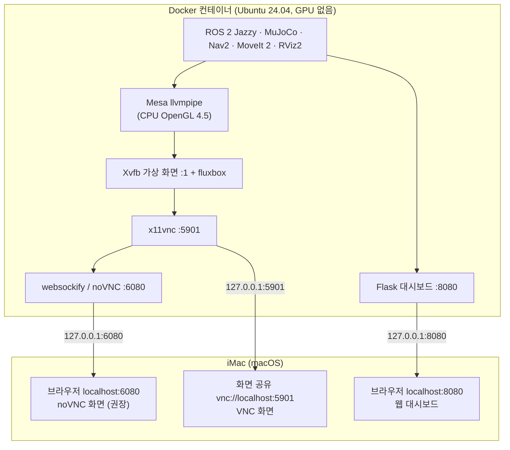

# iMac Docker로 OpenArm 실습 환경 만들기

> **기존 상세 참고 문서입니다.** clone부터 최초 실행까지의 기본 절차는 [Intel iMac Docker 환경 설정](setup/imac-docker.md)을 따르세요. 아래 압축파일·과거 성능·OS 지원 설명은 작성 당시 기록이며 현재 iMac 재검증 결과가 아닙니다. 교육은 [휠형 1일차](course/wheel-day1.md) · [2일차](course/wheel-day2.md)로 이동하세요.

Nov 4, 2026

> 이 저장소(openarms_llm_ex) 자체가 워크스페이스(`openarm_mobile_ws`)입니다. 문서의 `~/openarm_mobile_ws` 는 `git clone https://github.com/aha645/openarms_llm_ex.git ~/openarm_mobile_ws` 로 받은 폴더로 읽으세요.


**결론: 가능합니다. 그래픽 드라이버·CUDA 툴킷·PyTorch는 설치하지 않습니다.** macOS의 Docker 컨테이너는 Mac의 GPU(Radeon Pro 575X)를 쓸 수 없으므로, 컨테이너 안에서 CPU로 OpenGL을 그리는 Mesa llvmpipe(OpenGL 4.5)를 쓰고, 화면은 컨테이너 안 가상 데스크톱을 브라우저(noVNC)나 macOS 화면 공유(VNC)로 봅니다.

대상 Mac: iMac (Retina 5K, 27-inch, 2019) — Intel Core i5-8600 6코어 3.1GHz, Radeon Pro 575X 4GB, RAM 32GB. Intel(x86\_64)이라 ROS 공식 amd64 이미지를 에뮬레이션 없이 그대로 씁니다.

| 항목 | 필요 여부 | 이유 |
| --- | --- | --- |
| 그래픽 드라이버 (NVIDIA/AMD) | 불필요 | 컨테이너는 GPU에 접근 불가. Mesa 소프트웨어 렌더러(llvmpipe)가 이미지에 포함됨 |
| CUDA 툴킷 | 불가·불필요 | CUDA는 NVIDIA 전용(Radeon에서 동작 안 함). 교육과정도 CUDA를 쓰지 않음 |
| PyTorch | 불필요 | 교육과정에 없음. 꼭 필요하면 CPU 버전만: `pip install torch --index-url https://download.pytorch.org/whl/cpu` |
| Docker Desktop for Mac | 필요 | 설치에 관리자 권한 1회 필요(아래 준비 절) |
| XQuartz | 불필요(선택) | 기본 방식은 브라우저/VNC. XQuartz는 OpenGL 2.1까지라 RViz2가 자주 실패 |
| OpenAI API 키 | 선택 | DAY2 LLM 실습용. 없으면 오프라인 규칙 계획기 |

**대가:** GPU 가속이 없어 MuJoCo 뷰어·RViz·머리 카메라 렌더를 모두 CPU가 그립니다. 화면이 느리고 시뮬이 실시간보다 느려질 수 있지만, 모든 노드가 시뮬 시간을 쓰므로 동작 결과는 같습니다. 2코어·GPU 없는 환경에서 뷰어+RViz+카메라를 동시에 띄웠을 때 실시간의 약 0.4배, RViz 2fps였습니다. iMac은 코어가 3배라 더 나을 것으로 보지만 실측값은 아닙니다.

워크스페이스 압축파일 `openarm_mobile_ws.zip` 의 `docker/` 폴더에 Dockerfile, docker-compose.yml, 시작 스크립트를 넣었습니다.

## 화면을 보여주는 구조



컨테이너 안 프로그램은 가상 화면 `:1` 에 그리고, Mac은 포트 3개(6080·5901·8080)로 그 화면과 대시보드를 봅니다. X11 소켓 공유(`-v /tmp/.X11-unix`)는 리눅스 호스트에서만 되는 방식이라 쓰지 않습니다.

## 준비: Docker Desktop 설치와 리소스 설정

1. **macOS 버전 확인.** 이 iMac은 macOS 15 Sequoia가 마지막입니다. Docker Desktop은 현재 macOS와 직전 두 버전을 지원하므로 지금은 설치됩니다. macOS가 두 번 더 새로 나오면 Sequoia 지원이 끝날 수 있습니다.
2. **Docker Desktop 설치** — docs.docker.com 에서 "Docker Desktop for Mac with Intel chip" `.dmg` 를 받아 `Docker.app` 을 응용 프로그램으로 끌어다 놓습니다.
   - **관리자 권한**: 설치할 때 한 번은 필요합니다. 관리자 계정이 없다면 관리자에게 다음을 부탁합니다. 그 뒤에는 일반 계정으로 실행됩니다.
   - `sudo hdiutil attach Docker.dmg && sudo /Volumes/Docker/Docker.app/Contents/MacOS/install --user=<내계정이름>`
3. **리소스 설정** (Docker Desktop → Settings → Resources). macOS의 Docker는 Linux VM 안에서 컨테이너를 돌리므로, 여기서 주는 양이 컨테이너가 쓸 수 있는 전부입니다.

| 설정 | 권장값 | 이유 |
| --- | --- | --- |
| CPU limit | 6 | 소프트웨어 렌더·물리·Nav2·MoveIt이 모두 CPU를 씁니다 |
| Memory limit | 16 GB | 32GB 중 절반. 전체 모델(시각 메시) 로드 시 2GB, 시스템 전체 6\~8GB |
| Swap | 2 GB | 빌드 시 여유 |
| Virtual disk limit | 64 GB 이상 | ROS desktop + Nav2 + MoveIt 이미지 약 6\~8GB + 빌드 |
| General → Virtual Machine Manager | Apple Virtualization framework | Intel Mac 기본값 |
| General → File sharing | VirtioFS | Mac 폴더 공유가 가장 빠름 |

4. 워크스페이스를 Mac 홈 폴더에 해제합니다.

```bash
cd ~ && unzip openarm_mobile_ws.zip     # ~/openarm_mobile_ws/docker/ 에 Dockerfile 등이 있음
docker version                          # Client/Server(OS/Arch: linux/amd64) 가 보이면 준비 완료
```

## 이미지 빌드와 컨테이너 실행

가장 간단한 방법은 시작 스크립트 하나입니다. 빌드 → 실행 → (처음이면) 워크스페이스 준비 → 브라우저 열기를 차례로 합니다.

```bash
cd ~/openarm_mobile_ws/docker
bash mac_start.sh
```

### 단계별로 직접 하기 (docker compose)

```bash
cd ~/openarm_mobile_ws/docker
docker compose build            # 처음 1회, 네트워크에 따라 20~40분 (osrf/ros:jazzy-desktop + Nav2·MoveIt)
docker compose up -d            # 백그라운드 실행
docker compose exec openarm bash -lc "bash scripts/04_setup_workspace.sh"   # 처음 1회: 에셋·모델 생성·빌드
open "http://localhost:6080/vnc.html?autoconnect=1&resize=scale"            # 비밀번호 openarm
docker compose exec openarm bash   # 새 터미널 (여러 개 열어도 됨)
docker compose stop / start        # 일시 정지·재개
docker compose down               # 컨테이너 삭제 (소스·빌드 볼륨은 유지)
```

### 같은 일을 docker run 한 줄로

```bash
docker build -t openarm-mobile:jazzy ~/openarm_mobile_ws/docker
docker run -d --name openarm --platform linux/amd64 --shm-size=2g \
  -p 127.0.0.1:6080:6080 -p 127.0.0.1:5901:5901 -p 127.0.0.1:8080:8080 \
  -e RESOLUTION=1600x900x24 -e VNC_PASSWORD=openarm -e LP_NUM_THREADS=4 \
  -e OPENAI_API_KEY="$OPENAI_API_KEY" \
  -v ~/openarm_mobile_ws:/root/openarm_mobile_ws \
  -v ws_build:/root/openarm_mobile_ws/build -v ws_install:/root/openarm_mobile_ws/install \
  -v ws_log:/root/openarm_mobile_ws/log \
  -it openarm-mobile:jazzy
```

| 옵션 | 의미 | 왜 필요한가 |
| --- | --- | --- |
| `-d` / `--name openarm` | 백그라운드 실행 / 이름 지정 | `docker exec -it openarm bash` 로 터미널을 더 열 수 있음 |
| `--platform linux/amd64` | x86\_64 이미지 사용 | Intel iMac 과 같은 아키텍처 → 에뮬레이션 없음 |
| `--shm-size=2g` | 컨테이너의 /dev/shm 크기 | Docker 기본 64MB. ROS 2(Fast DDS) 공유메모리·RViz(Qt)가 부족하면 멈추거나 메시지가 유실됨 |
| `-p 127.0.0.1:6080:6080` | noVNC 웹 화면 포트 | 브라우저로 컨테이너 데스크톱 보기. `127.0.0.1:` 을 붙여 같은 네트워크의 다른 PC에서 접속 못 하게 함 |
| `-p 127.0.0.1:5901:5901` | VNC 포트 | macOS 화면 공유 앱(더 매끄럽고 클립보드 공유) |
| `-p 127.0.0.1:8080:8080` | 웹 대시보드 포트 | DAY2-06 대시보드를 Mac 사파리에서 바로 열기 |
| `-e RESOLUTION` | 가상 화면 크기·색 깊이 | 작을수록 CPU 렌더가 빨라짐. 느리면 `1280x720x24` |
| `-e VNC_PASSWORD` | VNC 비밀번호 | macOS 화면 공유는 비밀번호 없는 VNC 에 접속하지 않음 |
| `-e LP_NUM_THREADS` | llvmpipe 렌더 스레드 수 | Docker에 준 CPU(6)보다 1\~2 적게 — 물리 시뮬·Nav2 몫을 남김 |
| `-e OPENAI_API_KEY` | Mac 쉘의 키 전달 | DAY2-04/05 LLM 실습. 비워 두면 오프라인 계획기 사용 |
| `-v ~/openarm_mobile_ws:/root/...` | Mac 폴더를 컨테이너와 공유 | 코드를 Mac 에디터(VS Code 등)로 고치고 컨테이너에서 바로 실행. 컨테이너를 지워도 남음 |
| `-v ws_build:... ws_install:... ws_log:...` | colcon 산출물을 Docker 볼륨에 | 수천 개의 작은 파일을 Mac 폴더에 쓰면 매우 느림. 볼륨은 VM 안에 있어 빠름 |
| `-it` | 터미널 할당 | 로그 확인·입력용 |

쓰지 않는 옵션: `--gpus` (macOS에서 지원 안 함), `--privileged`, `--net=host` (Mac에서는 호스트 네트워크가 VM 네트워크라 의미 없음), `-v /tmp/.X11-unix` (리눅스 호스트 전용).

### Dockerfile 요점

| 줄 | 내용 |
| --- | --- |
| `FROM osrf/ros:jazzy-desktop` | Ubuntu 24.04 + ROS 2 Jazzy desktop(RViz2 포함) 공식 이미지 |
| `apt-get install ros-jazzy-navigation2 ... slam-toolbox ... moveit ...` | 교육과정 스택 (본 가이드 3단계와 같음) |
| `xvfb x11vnc novnc websockify fluxbox xterm` | 가상 데스크톱과 원격 화면 |
| `mesa-utils libgl1-mesa-dri libglx-mesa0 libegl-mesa0 libosmesa6 libglfw3` | 소프트웨어 OpenGL(화면용 GLX, 오프스크린용 EGL/OSMesa) |
| `pip3 install --break-system-packages --ignore-installed -c /etc/pip-constraints.txt mujoco==3.5.0 openai pydantic>=2.5` | apt 의 numpy 버전(1.26.4)을 고정한 채 MuJoCo 설치. `--ignore-installed` 로 debian 이 설치한 typing_extensions 등을 지우지 않음 |
| `ENV LIBGL_ALWAYS_SOFTWARE=1 GALLIUM_DRIVER=llvmpipe` | 항상 llvmpipe 사용 (GPU 탐색 시도 안 함) |
| `ENV XDG_RUNTIME_DIR=/tmp/runtime-root` | glfw/Qt 의 "XDG\_RUNTIME\_DIR is invalid" 경고 제거 |
| `ENV ROS_AUTOMATIC_DISCOVERY_RANGE=LOCALHOST` | ROS 통신을 컨테이너 안으로 한정 |
| `ENTRYPOINT start-desktop.sh` | Xvfb :1 → fluxbox → xterm → x11vnc(5901, 비밀번호) → noVNC(6080) 순서로 시작 |

## 컨테이너 화면 보기

| 방법 | 접속 | 장점 | 단점 |
| --- | --- | --- | --- |
| **A. noVNC (권장)** | 사파리·크롬에서 `http://localhost:6080/vnc.html?autoconnect=1&resize=scale` | 설치 불필요, 바로 됨 | 키 조합·클립보드가 일부 불편 |
| **B. macOS 화면 공유** | Finder → 이동 → 서버에 연결(⌘K) → `vnc://localhost:5901` | 기본 앱, 더 매끄러움 | 비밀번호 필수(`VNC_PASSWORD`) |
| C. XQuartz (비권장) | 컨테이너 창을 Mac 창으로 직접 띄움 | 창이 Mac 창처럼 보임 | XQuartz 설치에 관리자 권한 필요, OpenGL 2.1(간접 GLX)까지라 RViz2·MuJoCo 뷰어가 실패하거나 매우 느림 |

접속하면 검은 데스크톱에 xterm 터미널 하나가 떠 있습니다. 바탕화면을 우클릭하면 fluxbox 메뉴에서 터미널을 더 열 수 있고, Mac 터미널의 `docker compose exec openarm bash` 에서 실행한 프로그램도 같은 화면(`DISPLAY=:1`)에 뜨는 것을 확인합니다.

```bash
# 컨테이너 안에서: 소프트웨어 OpenGL 확인
glxinfo -B | grep -E "renderer|version"
#   OpenGL renderer string: llvmpipe (LLVM ..., 256 bits)
#   OpenGL core profile version string: 4.5 (Core Profile) Mesa ...
```

### C. XQuartz 방식이 꼭 필요할 때

```bash
# Mac: XQuartz 설치 후 → 환경설정 → 보안 → '네트워크 클라이언트에서의 연결 허용' 체크 → XQuartz 재시작
defaults write org.xquartz.X11 enable_iglx -bool true    # 간접 GLX 허용
xhost +localhost
# 컨테이너 안: 가상 데스크톱 대신 Mac 의 X 서버로
export DISPLAY=host.docker.internal:0
rviz2      # 실패하면 LIBGL_ALWAYS_INDIRECT=1 을 붙여 보고, 그래도 안 되면 A/B 방식으로
```

## 컨테이너 안에서 실습하기

> 챕터별 상세 실습은 [실습서 목록](labs/README.md)을 따라 하세요. 컨테이너에서는 새 터미널을 Mac에서 `docker compose exec openarm bash`로 엽니다. `world`를 지원하는 시뮬/주행 launch에 `world:=world_light.xml`을 사용하세요. `camera_hz:=5.0`은 sim launch에서만 사용하고, 현재 이 인자를 전달하지 않는 nav/full_system에 공통 적용하지 않습니다. 약어 풀이는 [용어집](labs/glossary.md).

설치 단계는 노트북 가이드와 다릅니다. `scripts/01`(NVIDIA 드라이버)·`02`(CUDA/PyTorch)·`03`(ROS 설치)은 **건너뜁니다**. 03은 이미 이미지에 들어 있고, 04만 처음 한 번 실행합니다. DAY1·DAY2 실습 명령은 노트북 가이드와 같고, 아래처럼 CPU 부하를 줄이는 인자를 붙이면 됩니다.

```bash
# Mac 터미널 → 컨테이너 안으로
docker compose exec openarm bash
bash scripts/04_setup_workspace.sh     # 처음 1회 (selftest 14개 통과 확인)
source install/setup.bash

# DAY1-02 시뮬 + 브리지 (저사양 월드, 카메라 5Hz)
ros2 launch mobile_openarm_sim sim.launch.py world:=world_light.xml camera_hz:=5.0
# DAY1-05 Nav2
ros2 launch mobile_openarm_sim nav.launch.py world:=world_light.xml
# DAY2 최종 통합 (뷰어 끄고 대시보드로 보기) → Mac 사파리에서 http://localhost:8080
ros2 launch mobile_openarm_apps full_system.launch.py world:=world_light.xml viewer:=false planner:=offline
```

### 성능 조절 (GPU 없이 그리므로 중요)

| 조절 | 방법 | 효과 |
| --- | --- | --- |
| 저사양 월드 | `world:=world_light.xml` | 시각 메시 160만 면 제거 → 뷰어 렌더 부하·메모리 크게 감소 |
| MuJoCo 뷰어 끄기 | `viewer:=false` | RViz 나 대시보드로만 보기 |
| RViz 하나만 | 필요할 때만 `rviz:=true` | 가장 무거운 렌더러 |
| 카메라 주기 | `camera_hz:=5.0` (기본 10) | 오프스크린 렌더 절반 |
| LiDAR 선 수 | `lidar_rays:=180` | Nav2·SLAM 에는 충분 |
| 가상 화면 크기 | `RESOLUTION=1280x720x24` | 작은 창 = 빠른 렌더 |
| 시뮬 속도 | `rate_factor:=0.5` | 느린 대신 매끄럽게 (모든 노드가 시뮬 시간 사용) |

```bash
ros2 topic hz /clock      # 100Hz 가까우면 실시간, 50Hz 면 0.5배
docker stats openarm      # Mac 터미널: 컨테이너 CPU·메모리 사용량
```

## 트러블슈팅과 검증 범위

| 증상 | 원인 | 조치 |
| --- | --- | --- |
| `Cannot connect to the Docker daemon` | Docker Desktop 이 꺼져 있음 | 응용 프로그램에서 Docker 실행, 메뉴 막대 고래 아이콘 확인 |
| 브라우저가 6080 에 접속 못 함 | 컨테이너 시작 스크립트 실패 | `docker compose logs openarm`, 컨테이너 안 `cat /tmp/novnc.log /tmp/x11vnc.log` |
| 창이 검게만 나옴 | 첫 프레임 렌더 전(CPU 렌더라 느림) | 10\~30초 기다림. 계속되면 `glxinfo -B` 가 llvmpipe 인지 확인 |
| RViz 가 멈추거나 토픽이 끊김 | /dev/shm 부족 | `--shm-size=2g` (compose 에 설정됨) |
| `colcon build` 가 매우 느림 | build/install 을 Mac 폴더에 씀 | compose 의 named volume 사용 여부 확인, File sharing = VirtioFS |
| `numpy.core.multiarray failed to import` | pip 가 numpy 2.x 설치 | `pip install --break-system-packages -c /etc/pip-constraints.txt "numpy<2"` |
| 화면 공유가 접속을 거부 | VNC 비밀번호 없음/틀림 | `VNC_PASSWORD` 확인 후 `docker compose up -d --force-recreate` |
| 컨테이너 재시작 후 화면이 안 뜨음 | 남은 X 잠금 파일 | 시작 스크립트가 `/tmp/.X1-lock` 을 지움. 안 되면 `docker compose down && up -d` |
| 한글이 □ 로 보임 | 글꼴 없음 | 이미지에 `fonts-noto-cjk` 포함됨(RViz·대시보드는 정상). xterm 은 기본 글꼴이 영문용 |

**빌드 중 `Cannot uninstall typing_extensions 4.10.0, RECORD file not found. Hint: The package was installed by debian.`** — pip가 apt로 설치된 패키지를 지우려다 실패한 것입니다. 고친 Dockerfile은 `--ignore-installed` 로 새 버전을 `/usr/local` 에 따로 설치하고, numpy는 apt와 같은 버전(`numpy==1.26.4`)으로 고정합니다. Ubuntu 24.04 Python 3.12에서 같은 오류를 재현한 뒤, 이 방식으로 apt OpenCV 4.6 + pip MuJoCo 3.5가 함께 동작하고 selftest 14개가 통과하는 것을 확인했습니다.

### 확인한 것과 못 한 것

- **확인함:** Ubuntu 24.04(GPU 없음, CPU 2코어)에서 같은 패키지로 화면 체인을 그대로 돌렸습니다. Xvfb → fluxbox → x11vnc(비밀번호) → noVNC 순서입니다. llvmpipe OpenGL 4.5 에서 MuJoCo 뷰어와 RViz2가 동시에 뜨고, 브라우저(noVNC)로 화면이 보이는 것까지 확인했습니다. 머리 카메라 오프스크린 렌더와 ArUco 도 동작했습니다. 이때 실시간 배속은 약 0.4, RViz는 2fps였습니다.
- **못 함:** 이 Dockerfile의 실제 `docker build`, Docker Desktop for Mac 위 실행, iMac 에서의 속도. 빌드나 실행 오류가 나면 로그를 보내 주세요.

## Sources

- [Docker Desktop for Mac 설치 (지원 macOS 버전)](https://docs.docker.com/desktop/setup/install/mac-install/)
- [Docker Desktop for Mac 권한 요구사항 (관리자 없이 쓰기)](https://docs.docker.com/desktop/setup/install/mac-permission-requirements.md)
- [Docker Desktop FAQ — 관리자 권한 없이 설치(--user)](https://docs.docker.com/desktop/troubleshoot-and-support/faqs/general/)
- [iMac Core i5 3.1 27" 2019 사양 (EveryMac)](https://everymac.com/systems/apple/imac/specs/imac-core-i5-3.1-27-inch-aluminum-retina-5k-early-2019-specs.html)
- [ROS Jazzy Docker 이미지 목록 (osrf/ros:jazzy-desktop)](https://discourse.openrobotics.org/t/ros-jazzy-docker-images/37879)
- [tiryoh/ros2-desktop-vnc:jazzy — 같은 noVNC 방식의 기성 이미지(대안)](https://hub.docker.com/r/tiryoh/ros2-desktop-vnc)
- [XQuartz GLX/OpenGL 관련 논의](https://github.com/orgs/XQuartz/discussions/482)
- [RViz2 in Docker 오류 사례 (ROS Answers)](https://answers.ros.org/question/411969/rviz2-in-docker-error-while-starting/)
