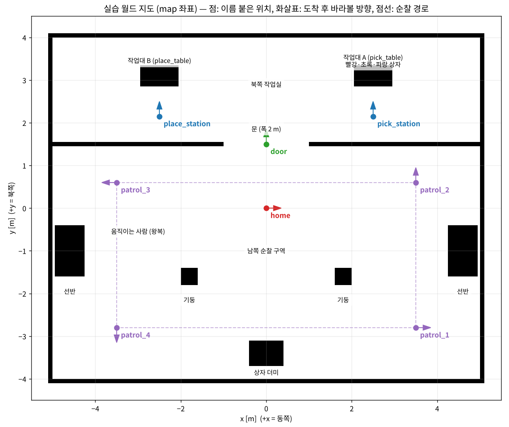

# 챕터별 실습서 (DAY 1 · DAY 2)

설치가 끝난 뒤 이 폴더의 문서를 **순서대로** 따라 하세요. 설치 방법은 다음 두 문서에 있습니다.

- Ubuntu 노트북: [../mujoco_ros2_mobile_openarm_guide.md](../mujoco_ros2_mobile_openarm_guide.md)
- iMac + Docker: [../imac_docker_openarm_guide.md](../imac_docker_openarm_guide.md)

모르는 약어(SLAM, TF, MJCF, AMCL …)는 [용어집 glossary.md](glossary.md)에서 원래 이름과 뜻을 찾으세요. 각 챕터 맨 앞에도 그 장의 용어 풀이가 있습니다.

| DAY | 챕터 | 이 장에서 하는 일 | 문서 |
|---|---|---|---|
| 1 | 01 | Gazebo와 MuJoCo의 차이를 알고, MuJoCo 뷰어로 로봇과 월드를 직접 만져 본다 | [day1-01-mujoco-basics.md](day1-01-mujoco-basics.md) |
| 1 | 02 | 브리지로 MuJoCo 시뮬레이션을 ROS 2 토픽·액션으로 연결하고 키보드로 운전한다 | [day1-02-bridge.md](day1-02-bridge.md) |
| 1 | 03 | 로봇 설명(URDF)과 좌표계(TF) 트리를 확인한다 | [day1-03-description-tf.md](day1-03-description-tf.md) |
| 1 | 04 | SLAM으로 지도를 만들고 저장한 뒤, 그 지도에서 AMCL로 위치를 추정한다 | [day1-04-slam-rviz.md](day1-04-slam-rviz.md) |
| 1 | 05 | Nav2로 목표 지점까지 자율주행하고 장애물을 피한다 | [day1-05-nav2.md](day1-05-nav2.md) |
| 1 | 06 | 여러 지점을 순서대로 도는 순찰 프로그램을 실행한다 | [day1-06-patrol.md](day1-06-patrol.md) |
| 2 | 01 | MoveIt 2로 양팔을 계획·실행한다 (RViz 조작 + Python) | [day2-01-moveit.md](day2-01-moveit.md) |
| 2 | 02 | ArUco 마커로 상자 위치를 알아내고 집어서 옮긴다 | [day2-02-aruco-pick-place.md](day2-02-aruco-pick-place.md) |
| 2 | 03 | 주행과 조작을 이어서, 작업대 A의 상자를 작업대 B로 운반한다 | [day2-03-nav-pick-place.md](day2-03-nav-pick-place.md) |
| 2 | 04 | LLM이 자연어 명령을 로봇 작업 계획(JSON)으로 바꾸게 한다 | [day2-04-llm-planner.md](day2-04-llm-planner.md) |
| 2 | 05 | LLM 계획을 실제 ROS 2 동작으로 실행하는 Task Manager를 돌린다 | [day2-05-task-manager.md](day2-05-task-manager.md) |
| 2 | 06 | 웹 대시보드에서 명령을 보내고 진행 상황을 본다 (최종 통합) | [day2-06-dashboard.md](day2-06-dashboard.md) |

## 모든 챕터에 공통으로 쓰는 규칙

### 1. 터미널 여러 개 쓰기

ROS 2는 **프로그램(노드)마다 터미널 하나**를 차지하는 경우가 많습니다. 문서에는 터미널을 **T1, T2, T3** 처럼 번호로 적었습니다.

- T1에서 `ros2 launch ...` 를 실행하면 그 터미널은 로그를 계속 출력하면서 **붙잡혀 있습니다**. 끝난 것이 아니라 *돌아가는 중*입니다. 다음 명령은 새 터미널(T2)을 열어서 입력하세요.
- 새 터미널 여는 법
  - Ubuntu 노트북: `Ctrl + Alt + T`, 또는 터미널 창에서 `Ctrl + Shift + T`(새 탭)
  - iMac Docker: Mac 터미널에서 `cd ~/openarm_mobile_ws/docker && docker compose exec openarm bash`, 또는 VNC 화면의 xterm에서 `xterm &`

### 2. 새 터미널마다 환경 불러오기

```bash
source /opt/ros/jazzy/setup.bash                 # ROS 2 명령(ros2 ...) 사용 가능하게
source ~/openarm_mobile_ws/install/setup.bash    # 우리 패키지(mobile_openarm_*) 찾을 수 있게
```

Docker 이미지와 `04_setup_workspace.sh` 를 실행한 노트북은 `~/.bashrc` 에 두 줄이 들어 있어 자동으로 실행됩니다. `Package 'mobile_openarm_sim' not found` 가 나오면 두 번째 줄을 다시 실행하세요.

### 3. 멈추기·다시 시작하기

- 실행 중인 프로그램 멈추기: 그 터미널에서 `Ctrl + C`
- 한 챕터가 끝나면 **모든 터미널에서 Ctrl + C** 로 다 끄고 다음 챕터를 시작하세요. 이전 챕터의 노드가 남아 있으면 같은 이름의 노드가 둘이 되어 TF가 뒤엉킵니다.
- 남은 프로세스 확인: `ros2 node list` (아무것도 없어야 정상)

### 4. 저사양 옵션

화면이 끊기거나 메모리가 8GB 이하이면 모든 `launch` 명령 끝에 다음을 붙입니다.

```
world:=world_light.xml        # 로봇의 시각용 메시를 빼서 메모리 1.9GB → 0.2GB
```

iMac Docker(GPU 없음)는 `camera_hz:=5.0` 도 함께 붙이면 좋습니다.

### 5. 월드 지도 (모든 챕터 공통 무대)



검은색은 벽·작업대·기둥·선반, 흰색은 다닐 수 있는 곳입니다. 이 그림은 패키지에 들어 있는 정답 지도(`src/mobile_openarm_sim/maps/world_map.pgm`)에 이름 붙은 위치를 표시한 것입니다.

- 방 전체는 가로 10 m × 세로 8 m입니다. 좌표는 m 단위이고 +x = 동쪽(오른쪽), +y = 북쪽(위쪽)입니다.
- 이름 붙은 위치(`home`, `pick_station`, `place_station`, `door`, `patrol_1~4`)는 `src/mobile_openarm_sim/config/locations.yaml` 에 적혀 있습니다.
