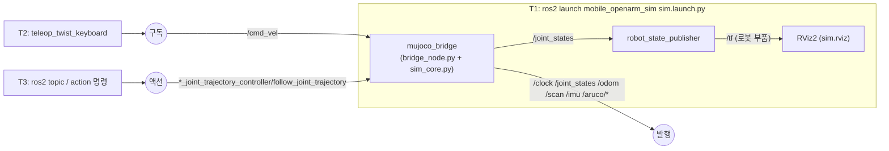

# DAY 1-02 MuJoCo–ROS 2 브리지 — 시뮬레이터를 ROS 2에 연결하기

## 이 장의 미션

> MuJoCo 시뮬레이션을 ROS 2 노드로 띄우고, **토픽으로 센서 값을 읽고, 토픽으로 로봇을 운전하고, 액션으로 팔을 움직인다.**
> 키보드로 로봇을 1 m 앞으로 보낸 뒤 `/odom` 값이 약 1.0이 되는지 확인한다.

## 이 장에 나오는 용어

- **ROS 2** (Robot Operating System 2) — 로봇 프로그램끼리 데이터를 주고받게 하는 플랫폼. 운영체제가 아니라 Ubuntu 위에서 도는 도구 모음
- **노드(node)** — ROS 2에서 실행되는 프로그램 하나
- **토픽(topic) / 서비스(service) / 액션(action)** — ROS 2 통신 3종류: 계속 흘려보내기 / 한 번 묻고 답 받기 / 오래 걸리는 일 맡기고 진행 상황·결과 받기
- **브리지(bridge)** — MuJoCo와 ROS 2 사이에서 데이터를 통역하는 프로그램 (`bridge_node.py`)
- **cmd_vel** (command velocity, 속도 명령) — 로봇에 주는 직진 속도(m/s)·회전 속도(rad/s) 토픽
- **odom** (odometry, 주행 거리계) — 바퀴 회전량으로 계산한 이동 추정. 오래 가면 오차가 쌓임
- **LiDAR** (Light Detection And Ranging, 레이저 거리 측정기) — 레이저를 360° 쏴서 주변까지 거리를 재는 센서. 토픽 `/scan`
- **IMU** (Inertial Measurement Unit, 관성 측정 장치) — 가속도·회전 속도 센서
- **sim time** (simulation time, 시뮬레이션 시간) — 시뮬레이터 안의 시계. `/clock` 토픽, 노드는 `use_sim_time:=true` 로 사용
- **teleop** (teleoperation, 원격 조종) — 사람이 키보드로 직접 운전

전체 목록은 [용어집](glossary.md)에 있습니다.

## 1. 개념

### 브리지란?

MuJoCo는 ROS 2를 모릅니다. **브리지(bridge)** 는 둘 사이의 통역사입니다.

- MuJoCo → ROS 2: 시뮬레이션의 센서 값(LiDAR 거리, 바퀴 회전, 관절 각도, 카메라 영상)을 ROS 2 **메시지**로 바꿔 **발행(publish)** 합니다.
- ROS 2 → MuJoCo: ROS 2에서 온 명령(속도, 팔 궤적)을 **구독(subscribe)** 해 MuJoCo 모터 값으로 바꿉니다.

### ROS 2 통신 3종류

| 종류 | 비유 | 이 장의 예 |
|---|---|---|
| **토픽(topic)** | 라디오 방송. 보내는 쪽은 계속 내보내고 듣고 싶은 쪽이 듣는다 | `/scan`, `/odom`, `/cmd_vel` |
| **서비스(service)** | 전화. 한 번 묻고 한 번 답을 받는다 | `/sim/reset` |
| **액션(action)** | 배달 주문. 목표를 주면 진행 상황(feedback)을 받다가 결과를 받는다. 중간 취소 가능 | 팔 궤적 `follow_joint_trajectory` |

### 시뮬레이션 시간 `/clock`

시뮬레이터는 PC 속도에 따라 실제 시간보다 느리게 돌 수 있습니다. 그래서 브리지는 **시뮬레이션 안의 시간**을 `/clock` 으로 발행하고, 모든 노드는 `use_sim_time:=true` 로 그 시간을 씁니다. 이 실습의 모든 launch에 이미 설정되어 있습니다.

## 2. 이 장의 전체 구조



## 3. 실제로 실행되는 소스

| 순서 | 파일 | 하는 일 |
|---|---|---|
| 1 | `src/mobile_openarm_sim/launch/sim.launch.py` | 노드 3개 실행. 옵션: `viewer`(MuJoCo 창), `world`, `camera`, `rate_factor`(1.0=실시간, 0.5=절반 속도), `lidar_rays`, `camera_hz`, `start_x/y/yaw`(시작 위치), `rviz` |
| 2 | `mobile_openarm_sim/bridge_node.py` → `main()` | 노드 `mujoco_bridge`. 별도 스레드 `physics_loop()` 에서 MuJoCo를 실시간으로 돌리고, 100 Hz마다 `on_tick()` 에서 메시지를 발행 |
| 2-1 | `mobile_openarm_sim/sim_core.py` (`MobileOpenArmSim`) | ROS와 무관한 순수 시뮬레이션: 차동구동 바퀴 속도 계산(`set_cmd_vel`), 바퀴 오도메트리(`_update_odom`), LiDAR 광선 쏘기(`maybe_scan`), 카메라 렌더·ArUco 검출(`maybe_camera`), 팔 궤적 보간 |
| 3 | `robot_state_publisher` | `urdf/mobile_openarm.urdf` 와 `/joint_states` 로 로봇 부품 TF 계산 |
| 4 | `rviz2 -d rviz/sim.rviz` | 고정 좌표계 `odom` 으로 로봇·스캔 표시 |

브리지가 주고받는 것(`bridge_node.py` 맨 위 주석에 전부 정리되어 있음):

| 방향 | 이름 | 형식 | 주기 |
|---|---|---|---|
| 발행 | `/clock` | rosgraph_msgs/Clock | 100 Hz |
| 발행 | `/joint_states` | sensor_msgs/JointState | 50 Hz |
| 발행 | `/odom` + TF `odom→base_footprint` | nav_msgs/Odometry | 50 Hz |
| 발행 | `/scan` | sensor_msgs/LaserScan (360개, 0.12~12 m) | 10 Hz |
| 발행 | `/imu` | sensor_msgs/Imu | 50 Hz |
| 발행 | `/aruco/detections`, `/aruco/poses`, `/aruco/markers` | 마커 검출 결과 | `camera_hz` (기본 10 Hz) |
| 발행 | `/head_camera/image_raw/compressed` | 압축 이미지 | `image_hz` (기본 5 Hz) |
| 발행 | `/ground_truth/pose`, `/sim/objects` | 정답 위치 (채점·디버그용) | 50 Hz |
| 구독 | `/cmd_vel` | geometry_msgs/Twist (`linear.x` m/s, `angular.z` rad/s) | — |
| 액션 | `/left_joint_trajectory_controller/follow_joint_trajectory` 외 3개 | control_msgs/FollowJointTrajectory | — |
| 액션 | `/left_gripper_controller/gripper_cmd`, `/right_...` | control_msgs/GripperCommand | — |
| 서비스 | `/sim/reset`, `/sim/set_grasp_assist`, `/sim/set_person_motion` | std_srvs | — |

액션 이름을 실제 OpenArm 패키지(`openarm_bringup`)의 컨트롤러 이름과 똑같이 맞춰 두었습니다. 그래서 DAY 2의 MoveIt 설정을 실로봇에서도 그대로 쓸 수 있습니다.

## 4. 따라하기

### 단계 1 — T1: 시뮬레이터 + 브리지 켜기

```bash
ros2 launch mobile_openarm_sim sim.launch.py
# 가볍게: ros2 launch mobile_openarm_sim sim.launch.py world:=world_light.xml
# MuJoCo 창 없이: ... viewer:=false
```

- **확인**: MuJoCo 창과 RViz2 창이 뜨고, T1 로그에 `MuJoCo bridge started (viewer=True, camera=True)` 가 나옵니다. RViz에는 로봇 모델과 주변 벽에 찍힌 LiDAR 점들이 보입니다.

### 단계 2 — T2: 토픽 둘러보기

```bash
ros2 node list                 # 실행 중인 노드: /mujoco_bridge /robot_state_publisher /rviz2 …
ros2 topic list                # 위 표의 토픽들이 보여야 함
ros2 topic hz /scan            # 약 10 Hz → Ctrl+C로 멈춤
ros2 topic hz /clock           # 약 100 Hz. 50 Hz 정도면 PC가 느려 시뮬이 절반 속도로 도는 것
ros2 topic echo /odom --once   # 오도메트리 한 번 출력: pose.pose.position.x/y 가 현재 위치
ros2 topic info /cmd_vel -v    # 누가 구독하는지 (mujoco_bridge)
ros2 interface show geometry_msgs/msg/Twist   # /cmd_vel 메시지 구조
```

| 명령 | 의미 |
|---|---|
| `ros2 node list` | 지금 돌고 있는 노드 이름 |
| `ros2 topic list` | 지금 있는 토픽 이름 |
| `ros2 topic hz <토픽>` | 초당 몇 번 발행되는지 |
| `ros2 topic echo <토픽> --once` | 메시지 하나를 받아 내용 출력 |
| `ros2 topic info <토픽> -v` | 발행자·구독자와 QoS |
| `ros2 interface show <형식>` | 메시지 필드 구조 |

### 단계 3 — T2: 명령어로 직접 운전하기

```bash
# 0.2 m/s로 앞으로 (10 Hz로 계속 보냄 — 멈추려면 Ctrl+C)
ros2 topic pub -r 10 /cmd_vel geometry_msgs/msg/Twist "{linear: {x: 0.2}, angular: {z: 0.0}}"
```

- `-r 10`: 초당 10번 보내기. 브리지는 **0.5초 동안 명령이 끊기면 멈추므로** 한 번만 보내면(`--once`) 잠깐 움찔하고 섭니다.
- Ctrl+C로 멈추면 로봇도 0.5초 뒤 섭니다.

### 단계 4 — T2: 키보드로 운전하고 오도메트리 확인 (미션)

```bash
ros2 run teleop_twist_keyboard teleop_twist_keyboard
```

T2 창을 클릭한 뒤 `z` 를 몇 번 눌러 속도를 낮추고, `i`(앞) `,`(뒤) `j`/`l`(제자리 회전) `k`(정지)로 운전합니다. 키 표는 [04장 단계 2](day1-04-slam-rviz.md#단계-2--t2-키보드-운전-프로그램-켜기)에 자세히 있습니다.

새 터미널 T3에서 위치를 지켜봅니다.

```bash
ros2 topic echo /odom --field pose.pose.position
```

**미션**: home(0, 0)에서 동쪽(앞)으로 똑바로 약 1 m 가서 멈추고, `x` 가 1.0 근처인지 확인합니다. 정답 위치 `ros2 topic echo /ground_truth/pose --once` 와 비교해 차이(오도메트리 오차)를 적어 보세요. 몇 cm 이내면 정상입니다.

### 단계 5 — T3: 액션으로 오른팔 움직이기

```bash
ros2 action list                     # *_joint_trajectory_controller/follow_joint_trajectory 4개, gripper_cmd 2개
ros2 action send_goal /right_joint_trajectory_controller/follow_joint_trajectory \
  control_msgs/action/FollowJointTrajectory \
  "{trajectory: {joint_names: [openarm_right_joint1, openarm_right_joint2, openarm_right_joint3, openarm_right_joint4, openarm_right_joint5, openarm_right_joint6, openarm_right_joint7], points: [{positions: [0.0, 0.0, 0.0, 1.57, 0.0, 0.0, 0.0], time_from_start: {sec: 3}}]}}" \
  --feedback
```

- `joint_names` 7개와 `positions` 7개(라디안)가 순서대로 짝입니다. `joint4 = 1.57` 이면 팔꿈치가 90° 굽습니다.
- `time_from_start: {sec: 3}` : 3초에 걸쳐 그 자세로 가라는 뜻.
- `--feedback` : 진행 중 피드백을 출력.
- **확인**: MuJoCo와 RViz에서 오른팔 팔꿈치가 3초 동안 굽고, 마지막에 `Goal finished with status: SUCCEEDED`.
- 되돌리기: `positions` 를 모두 0.0으로 바꿔 다시 보냅니다.

그리퍼 열고 닫기:

```bash
ros2 action send_goal /right_gripper_controller/gripper_cmd control_msgs/action/GripperCommand "{command: {position: 0.044}}"   # 열기 (손가락 1개 이동량 m)
ros2 action send_goal /right_gripper_controller/gripper_cmd control_msgs/action/GripperCommand "{command: {position: 0.0}}"     # 닫기
```

### 단계 6 — T3: 서비스 써 보기

```bash
ros2 service list | grep sim
ros2 service call /sim/reset std_srvs/srv/Trigger          # 로봇·상자를 처음 위치로
```

## 5. 미션 체크리스트

- [ ] `ros2 topic hz` 로 `/scan` 약 10 Hz, `/clock` 약 100 Hz를 확인했다
- [ ] `ros2 topic pub` 과 teleop 두 가지 방법으로 로봇을 움직였다
- [ ] 1 m 직진 후 `/odom` 과 `/ground_truth/pose` 를 비교했다
- [ ] 액션으로 오른팔 joint4를 굽혔다 폈고, 그리퍼를 열고 닫았다

## 6. 확인 질문

1. 로봇에 속도를 주는 토픽 이름과 메시지 형식은? → `/cmd_vel`, `geometry_msgs/Twist`
2. 팔을 움직이는 데 토픽이 아니라 액션을 쓰는 이유는? → 몇 초 걸리는 동작이라 진행 상황·성공 여부·취소가 필요하기 때문
3. `/odom` 과 `/ground_truth/pose` 가 다른 이유는? → `/odom` 은 바퀴 회전만으로 계산한 추정값이라 미끄러짐 오차가 쌓인다

## 7. 잘 안 될 때

| 증상 | 해결 |
|---|---|
| `ros2 topic list` 에 아무것도 안 나옴 | T2에서 `source ~/openarm_mobile_ws/install/setup.bash`. Docker는 `ROS_AUTOMATIC_DISCOVERY_RANGE=LOCALHOST` 가 모든 터미널에 같아야 함 |
| 액션이 `Goal was rejected` | 관절 이름 오타, 또는 7개 중 빠진 관절. 브리지가 `bridge_node.py` 의 `check_arm_goal()` 에서 검사한다 |
| 팔이 지정한 각도까지 안 감 | 관절 한계 밖 값은 한계에서 멈춘다. 한계는 `src/mobile_openarm_moveit_config/config/joint_limits.yaml` |
| `/clock` 이 50 Hz 이하 | `world:=world_light.xml`, `camera_hz:=5.0`, `lidar_rays:=180` |

## 8. 더 해보기

- `ros2 topic echo /aruco/detections --once` : 카메라에 보이는 마커가 있는지 (home에서는 아마 비어 있음)
- `rqt_graph` 를 실행해 노드·토픽 연결 그림 보기
- `bridge_node.py` 의 `on_cmd_vel()` 과 `sim_core.py` 의 `_apply_base()` 를 읽고, 선속도 `v` 와 각속도 `w` 가 좌·우 바퀴 속도로 바뀌는 식(`wl = (v - w·0.44/2) / 0.08`)을 확인하기
