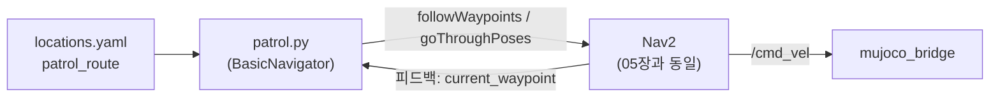

# DAY 1-06 통합 데모: 순찰 — 여러 지점을 순서대로 돌기

## 이 장의 미션

> Python 프로그램으로 Nav2에 **경유지(waypoint) 4곳**을 순서대로 보내 남쪽 구역을 2바퀴 순찰하고 home으로 돌아오게 한다.
> 그다음 순찰 경로를 직접 바꿔 본다.

## 이 장에 나오는 용어

- **waypoint** (경유지) — 순서대로 들르는 지점
- **Nav2** (Navigation 2) — ROS 2 자율주행 패키지 모음: 경로 계획, 장애물 회피, 위치 추정, 복구
- **YAML** (YAML Ain't Markup Language) — `이름: 값` 형식의 설정 파일

전체 목록은 [용어집](glossary.md)에 있습니다.

## 1. 개념

### 사람이 클릭하지 않고 프로그램이 Nav2를 부리기

05장에서는 RViz에서 목표를 하나씩 찍었습니다. 실제 서비스 로봇은 프로그램이 목표를 보냅니다. Nav2에는 Python에서 쉽게 쓰도록 만든 **nav2_simple_commander** 라이브러리가 있습니다.

| 함수 | 뜻 |
|---|---|
| `BasicNavigator()` | Nav2를 부리는 Python 객체 생성 |
| `waitUntilNav2Active()` | AMCL과 Nav2 노드가 모두 켜질 때까지 기다림 |
| `goToPose(pose)` | 목표 하나로 가기 (`/navigate_to_pose` 액션) |
| `followWaypoints([p1, p2, …])` | 경유지마다 **멈춰 도착 확인**하며 차례로 가기 (`/follow_waypoints` 액션) |
| `goThroughPoses([p1, p2, …])` | 경유지를 **멈추지 않고 이어서** 지나가기 (`/navigate_through_poses` 액션) |
| `isTaskComplete()` / `getFeedback()` / `getResult()` | 끝났는지, 진행 상황, 결과(성공·실패·취소) |

### 위치를 이름으로 관리하기

좌표를 코드에 직접 적지 않고 `config/locations.yaml` 에 이름으로 모아 둡니다. DAY 2의 LLM도 이 이름(`home`, `pick_station`…)만 쓰게 되어, LLM이 엉뚱한 좌표를 만들 수 없습니다.

```yaml
# src/mobile_openarm_sim/config/locations.yaml (일부)
locations:
  home: [0.0, 0.0, 0.0]          # [x(m), y(m), 바라볼 방향(도)]
  patrol_1: [3.5, -2.8, 0.0]
  patrol_2: [3.5, 0.6, 90.0]
  patrol_3: [-3.5, 0.6, 180.0]
  patrol_4: [-3.5, -2.8, -90.0]
patrol_route: [patrol_1, patrol_2, patrol_3, patrol_4]
```

순찰 경로는 남쪽 구역의 네 모서리(남동 → 북동 → 북서 → 남서)를 시계 반대 방향으로 도는 사각형입니다.

## 2. 이 장의 전체 구조



## 3. 실제로 실행되는 소스

| 파일 | 하는 일 |
|---|---|
| `src/mobile_openarm_sim/launch/nav.launch.py` | 05장과 같음 (시뮬 + Nav2) |
| `src/mobile_openarm_apps/mobile_openarm_apps/patrol.py` → `main()` | ① `locations.yaml` 읽기 ② `waitUntilNav2Active()` ③ `loops` 번 반복: `patrol_route` 의 4곳을 `make_pose()` 로 PoseStamped로 바꿔 `followWaypoints`(또는 `goThroughPoses`) ④ 3초마다 "waypoint n/4" 출력 ⑤ 실패하면 반복 중단 ⑥ 끝나면 `goToPose(home)` |
| `src/mobile_openarm_apps/setup.py` | `patrol = mobile_openarm_apps.patrol:main` — `ros2 run mobile_openarm_apps patrol` 이 이 함수를 부르도록 등록 |

`patrol.py` 파라미터:

| 파라미터 | 기본값 | 의미 |
|---|---|---|
| `loops` | 1 | 순찰 반복 횟수 |
| `mode` | `waypoints` | `waypoints`(지점마다 멈춤) 또는 `through`(멈추지 않고 이어서) |

## 4. 따라하기

### 단계 1 — T1: 시뮬레이터 + Nav2

```bash
ros2 launch mobile_openarm_sim nav.launch.py
```

`Managed nodes are active` 가 나올 때까지 기다립니다.

### 단계 2 — T2: 순찰 실행

```bash
ros2 run mobile_openarm_apps patrol --ros-args -p loops:=2 -p mode:=waypoints
```

| 부분 | 의미 |
|---|---|
| `ros2 run <패키지> <실행이름>` | 패키지에 등록된 프로그램 하나 실행 |
| `--ros-args -p 이름:=값` | 노드 파라미터 지정 |

**T2 출력 예**

```
[INFO] [basic_navigator]: Nav2 is ready for use!
[INFO] [basic_navigator]: 순찰 1/2: ['patrol_1', 'patrol_2', 'patrol_3', 'patrol_4']
[INFO] [basic_navigator]:   waypoint 1/4
...
[INFO] [basic_navigator]:   결과: 성공
[INFO] [basic_navigator]: 순찰 2/2: ...
[INFO] [basic_navigator]: 순찰 종료 → home 복귀
```

RViz에서는 경유지마다 경로가 새로 그려지고, 로봇이 네 모서리를 돕니다. 한 바퀴에 3~6분 걸립니다(PC 속도에 따라 다름). 중간에 멈추려면 T2에서 Ctrl+C (로봇은 마지막 목표까지 갈 수 있으니 RViz의 Nav2 패널에서 Cancel, 또는 T1을 끄기).

### 단계 3 — 두 모드 비교

```bash
ros2 run mobile_openarm_apps patrol --ros-args -p loops:=1 -p mode:=through
```

`through` 는 모서리에서 멈추지 않고 부드럽게 이어 돕니다. 걸린 시간과 움직임을 `waypoints` 와 비교해 보세요.

### 단계 4 — 미션: 순찰 경로 바꾸기

순찰에 **문 앞(`door`)** 을 넣어 봅니다.

1. 편집: `src/mobile_openarm_sim/config/locations.yaml` 의 마지막 부분을

   ```yaml
   patrol_route: [patrol_1, patrol_2, door, patrol_3, patrol_4]
   ```

   로 바꿉니다. (`door` 는 이미 `locations` 에 `[0.0, 1.5, 90.0]` 으로 있습니다.)
2. 다시 설치: `patrol.py` 는 **설치된 share 폴더**의 `locations.yaml` 을 읽으므로 빌드가 필요합니다.

   ```bash
   cd ~/openarm_mobile_ws
   colcon build --symlink-install --base-paths src --packages-select mobile_openarm_sim
   source install/setup.bash
   ```

   주의: `locations.yaml` 은 `tools/build_world.py` 가 만든 파일이라, `04_setup_workspace.sh` 를 다시 돌리면 원래대로 덮어써집니다. 계속 쓰려면 `build_world.py` 의 `LOCATIONS` 도 같이 고치세요.
3. T1을 재시작할 필요는 없습니다. T2에서 순찰을 다시 실행하고 `waypoint n/5` 로 바뀌었는지 확인합니다.

## 5. 미션 체크리스트

- [ ] 순찰 2바퀴 후 home으로 돌아왔다
- [ ] `waypoints` 와 `through` 모드 차이를 봤다
- [ ] 순찰 경로에 `door` 를 넣어 5곳을 돌게 했다

## 6. 확인 질문

1. `followWaypoints` 와 `goThroughPoses` 의 차이는? → 지점마다 멈추기 / 멈추지 않고 이어서
2. 좌표를 코드 대신 yaml에 이름으로 두는 이유는? → 위치를 한곳에서 관리하고, DAY 2 LLM이 정해진 이름만 쓰게 하려고
3. yaml을 고친 뒤 빌드가 필요한 이유는? → 프로그램이 `install/.../share/` 의 파일을 읽기 때문

## 7. 잘 안 될 때

| 증상 | 해결 |
|---|---|
| `Nav2 is ready` 가 안 나오고 멈춤 | T1의 Nav2가 아직 켜지는 중이거나 실패. T1 로그 확인 |
| 한 지점에서 실패 → 순찰 중단 | 그 지점이 장애물에 가려짐 (사람). `/sim/set_person_motion` 으로 사람 멈추고 다시 |
| yaml 고쳤는데 그대로 | `colcon build` 후 `source install/setup.bash` 를 했는지 |

## 8. 더 해보기

- `patrol.py` 를 고쳐 각 경유지에 도착할 때마다 `nav.get_logger().info("도착")` 대신 `/aruco/detections` 를 한 번 읽어 "보이는 마커"를 출력하게 하기 (보안 순찰 로봇 흉내)
