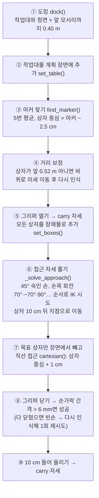

# DAY 2-02 ArUco 기반 Pick & Place — 보고, 집고, 놓기

## 이 장의 미션

> 작업대 A 앞에 선 로봇이 머리 카메라로 **ArUco 마커를 읽어 빨간 상자(id 0)의 위치를 알아내고**,
> 오른팔로 **집어서 같은 작업대의 다른 자리에 내려놓는다.** 그다음 초록·파란 상자로도 해 본다.

## 이 장에 나오는 용어

- **ArUco** (Augmented Reality University of Córdoba, 코르도바 대학 증강현실 마커) — ID와 위치·방향을 알 수 있는 흑백 사각 마커
- **PnP** (Perspective-n-Point) — 마커 모서리 4점의 영상 좌표로 3D 위치를 계산하는 방법
- **OpenCV** (Open Source Computer Vision Library) — 영상 처리 라이브러리
- **RGB-D** (Red Green Blue + Depth) — 컬러 영상과 픽셀별 거리를 함께 주는 카메라
- **TF** (Transform, 좌표 변환 / ROS 패키지 tf2) — 좌표계 사이 위치·방향 관계를 시간과 함께 알려 주는 ROS 시스템
- **JSON** (JavaScript Object Notation) — `{"이름": 값}` 형태의 데이터 텍스트
- **pick & place** (집어서 놓기), **grasp** (파지, 손으로 잡기), **docking** (도킹, 작업대 앞에 정확히 붙기)
- **planning scene** (계획 장면) — MoveIt이 아는 주변 물체(작업대·상자). 충돌 검사에 사용

전체 목록은 [용어집](glossary.md)에 있습니다.

## 1. 개념

### ArUco 마커

**ArUco**(Augmented Reality University of Córdoba, 스페인 코르도바 대학이 만든 증강현실 마커)는 흑백 정사각형 무늬입니다. 카메라 영상에서 찾으면 **번호(ID)** 와 **카메라 기준 3D 위치·방향**을 알 수 있습니다.

| 이 실습 설정 | 값 |
|---|---|
| 사전(dictionary) | `DICT_4X4_50` (안쪽 4×4 칸, ID 0~49) |
| 마커 크기 | 4 cm (검은 테두리 포함) |
| 상자 | 5 cm 정육면체, 80 g. 윗면에 마커 |
| 상자와 ID | 빨강 `box_0` = id 0, 초록 `box_1` = id 1, 파랑 `box_2` = id 2 |

### 위치 계산 과정

1. **검출**: OpenCV(Open Source Computer Vision Library)가 영상에서 마커 네 모서리의 픽셀 좌표와 ID를 찾습니다.
2. **자세 추정 PnP(Perspective-n-Point)**: 모서리 4점의 픽셀 좌표 + 실제 마커 크기(4 cm) + 카메라 렌즈 정보(`/head_camera/camera_info`)로 카메라 기준 3D 위치를 계산합니다.
3. **깊이 보정**: 4 cm 마커는 640×480 영상에서 약 23픽셀이라 PnP만으로는 거리 오차가 5~15%(4.5~11 cm) 납니다. 그래서 RGB-D(Red Green Blue + Depth, 컬러+깊이) 카메라처럼 **깊이 영상**으로 거리를 다시 잽니다. 오차 1~3 mm.
4. **좌표 변환(TF)**: `head_camera_optical_frame` 기준 → `base_footprint`(로봇 바닥 중심) 기준으로 바꿔 `/aruco/detections` 에 JSON으로 발행합니다.

시뮬레이션에서는 `mujoco_bridge` 가 카메라 렌더·검출을 직접 합니다. 실로봇에서는 `aruco_detector` 노드가 같은 형식으로 대신합니다.

### 집기(Pick) 순서 — `robot_skills.py` 의 `pick()`



왼쪽·오른쪽 팔은 상자가 로봇 중심선의 오른쪽(y < 0)이면 오른팔, 왼쪽이면 왼팔로 자동 선택합니다.

### 놓기(Place) 순서 — `place()`

도킹 → 작업대 앞 모서리에서 12 cm 안쪽, 손 쪽으로 12 cm 옆 지점 계산 → 그 위 5 cm로 접근 → 직선으로 내려 놓기 → 그리퍼 열기 → 뒤·위로 빼기 → `carry` → `home`.

### 파지 보조(grasp assist)

MuJoCo의 손가락 마찰만으로 5 cm 상자를 들면 가끔 미끄러집니다. 교육용으로 **"그리퍼가 닫혀 있고 상자가 손가락 사이에 닿아 있으면 상자를 손에 고정"** 하는 보조 기능을 켜 두었습니다(`sim_core.py` `_update_attached()`). 끄려면 `sim.launch.py grasp_assist:=false`. 실로봇에는 없는 기능입니다.

## 2. 실제로 실행되는 소스

| 순서 | 파일 | 하는 일 |
|---|---|---|
| 1 | `src/mobile_openarm_sim/launch/sim.launch.py start_x:=2.5 start_y:=2.45 start_yaw:=1.5708` | 로봇을 처음부터 작업대 A 앞(북쪽을 봄, 90° = 1.5708 rad)에 놓고 시작. Nav2는 안 씀 |
| 1-1 | `mobile_openarm_sim/sim_core.py` `maybe_camera()` + `aruco_utils.py` | 카메라 렌더 → ArUco 검출 → PnP → 깊이 보정 |
| 1-2 | `bridge_node.py` `publish_detections()` | `/aruco/detections`(JSON), `/aruco/poses`, `/aruco/markers`(RViz용) 발행 |
| 2 | `move_group.launch.py` | MoveIt (01장과 같음) |
| 3 | `src/mobile_openarm_apps/mobile_openarm_apps/pick_place.py` | ① Nav2가 없으므로 `map → odom` TF를 시작 위치로 직접 발행(`ensure_map_frame()`) ② `home_arms()` ③ 보이는 마커 출력 ④ `pick(object)` ⑤ `place(offset=(0.48, -0.04))` — 같은 작업대 로봇 정면 중앙에 놓기 |
| 3-1 | `robot_skills.py` | `dock()`, `find_marker()`, `pick()`, `place()`, `set_table()`, `set_boxes()` |
| 3-2 | `config/locations.yaml` | 작업대 크기·높이(0.70 m), 상자 ID, 스테이션 ↔ 작업대 연결 |

`/aruco/detections` 메시지 예:

```json
{"stamp": 12.3, "detections": [
  {"id": 0, "frame": "base_footprint", "position": [0.52, -0.12, 0.751],
   "quaternion_xyzw": [0, 0, 0.1, 0.99], "yaw": 0.2}
]}
```

`position` 은 로봇 바닥 중심 기준 마커 중심(m): 앞 0.52 m, 오른쪽 0.12 m, 높이 0.751 m(= 작업대 0.70 + 상자 0.05 + 마커 두께).

## 3. 따라하기

### 단계 1 — T1: 작업대 앞에서 시뮬 시작

```bash
ros2 launch mobile_openarm_sim sim.launch.py start_x:=2.5 start_y:=2.45 start_yaw:=1.5708
# iMac Docker: 끝에 camera_hz:=5.0 world:=world_light.xml
```

MuJoCo 창에서 로봇이 작업대 A를 바라보고, 앞에 상자 3개가 있어야 합니다.

### 단계 2 — T2: 마커가 보이는지 확인

```bash
ros2 topic echo /aruco/detections --once
ros2 topic hz /aruco/detections          # camera_hz (10 또는 5 Hz)
```

ID 0, 1, 2가 모두 나와야 합니다. RViz(T1이 띄운 것)에서 Add → By topic → `/aruco/markers` 를 추가하면 상자 위에 초록 판과 `id 0` 글자가 보입니다.

### 단계 3 — T2: MoveIt 켜기

```bash
ros2 launch mobile_openarm_moveit_config move_group.launch.py rviz:=false
```

`You can start planning now!` 를 기다립니다.

### 단계 4 — T3: Pick & Place 실행 (미션)

```bash
ros2 run mobile_openarm_apps pick_place --ros-args -p object:=box_0
```

| 파라미터 | 기본값 | 의미 |
|---|---|---|
| `object` | `box_0` | 집을 상자 (`box_0` 빨강, `box_1` 초록, `box_2` 파랑) |
| `station` | `pick_station` | 지금 서 있는 스테이션 (작업대 정보 찾기용) |
| `start_x`, `start_y`, `start_yaw` | 2.5, 2.45, 1.5708 | T1의 시작 위치와 **같게** (map 좌표 알려 주기용) |

T3 로그 예 (1~2분):

```
map 프레임 없음 → map→odom 정적 TF 발행 (시작 위치 2.5, 2.45, 90°)
보이는 마커: [0, 1, 2]
[arm] left_arm → 'home'
[arm] right_arm → 'home'
[pick] box_0(id 0) @ base [ 0.52 -0.12  0.725] → right 팔
[arm] right_arm → 'carry'
[ik] right 접근 자세 roll=70°
...
[pick] 완료: box_0
[place] box_0 → base [0.48 -0.04 0.735] (right)
[place] 완료: box_0
pick_place 완료
```

MuJoCo 창에서: 오른팔이 몸 쪽(carry)으로 올라옴 → 상자 뒤 위쪽으로 → 직선으로 내려가 손가락이 상자를 감쌈 → 닫고 들어 올림 → 앞쪽 가운데에 내려놓음 → 팔 내림.

### 단계 5 — 다른 상자로 반복

상자 위치를 처음으로 돌리려면:

```bash
ros2 service call /sim/reset std_srvs/srv/Trigger      # 주의: 로봇도 start 위치로 돌아감
ros2 run mobile_openarm_apps pick_place --ros-args -p object:=box_1     # 초록 (왼쪽에 있으면 왼팔)
ros2 run mobile_openarm_apps pick_place --ros-args -p object:=box_2     # 파랑
```

어느 팔을 썼는지, 왜 그 팔인지(상자 `position` 의 y 부호)를 로그에서 확인하세요. 시작 배치에서는 빨강 y ≈ −0.12(오른팔), 초록 y ≈ +0.08(왼팔), 파랑 y ≈ −0.30(오른팔)입니다. 파랑은 가장 바깥쪽이라 IK가 더 어렵습니다.

## 4. 미션 체크리스트

- [ ] `/aruco/detections` 에서 ID 0, 1, 2를 확인했다
- [ ] 빨간 상자를 집어 정면 중앙에 내려놓았다 (`pick_place 완료`)
- [ ] 초록·파란 상자도 집었고, 어느 팔을 썼는지 설명할 수 있다

## 5. 확인 질문

1. 마커 하나로 위치를 계산하는 방법 이름은? → PnP(Perspective-n-Point)
2. 깊이 보정을 추가한 이유는? → 작은 마커는 PnP 거리 오차가 5~15%라 집기에 부족
3. 집기 전에 모든 상자를 장애물로 넣었다가 목표 상자만 빼는 이유는? → 다른 상자를 치지 않으면서, 목표 상자에는 손이 닿아야 하므로

## 6. 잘 안 될 때

| 증상 | 해결 |
|---|---|
| `보이는 마커: []` | 카메라가 꺼짐(`camera:=false`)이거나 시작 위치가 다름. 단계 1 명령 그대로 |
| `[pick] 파지 실패 (2회)` | 손이 상자를 비켜 감. 로봇을 리셋하고 다시. `grasp_assist` 가 켜져 있는지(`ros2 param get /mujoco_bridge grasp_assist`) |
| `No IK solution` / `START_STATE_INVALID` | 상자가 너무 멀거나 가까움. 리셋 후 다시 |
| 아주 느림 (Docker) | `camera_hz:=5.0`, `world:=world_light.xml` |

## 7. 더 해보기

- `place(offset=(0.48, -0.04))` 의 숫자를 바꿔 내려놓는 자리 바꾸기 (`pick_place.py`)
- `grasp_assist:=false` 로 시뮬을 켜고 순수 마찰만으로 집어 보기 — 실로봇에 가까운 조건
- `ros2 topic echo /sim/objects --once` 의 정답 위치와 `/aruco/detections` 의 위치를 비교해 인식 오차 구하기 (`/sim/objects` 는 world 좌표라 로봇 위치 2.5, 2.45, 90°를 빼고 돌려야 함)
