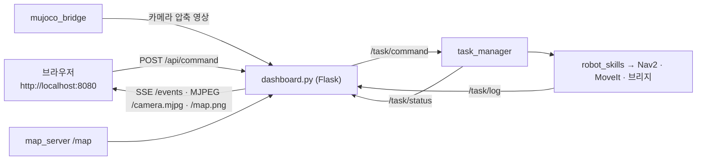

# DAY 2-06 웹 대시보드 & 최종 통합

## 이 장의 미션

> **명령 하나로 전체 시스템**(시뮬 + Nav2 + MoveIt + Task Manager + 웹 대시보드)을 켜고,
> **브라우저에서** "빨간 상자를 왼쪽 작업대로 옮기고 돌아와"를 보내 지도·카메라·미션 진행을 보며 끝까지 완료한다.

## 이 장에 나오는 용어

- **Flask** — Python 웹 서버 라이브러리
- **SSE** (Server-Sent Events, 서버 전송 이벤트) — 서버가 브라우저로 데이터를 계속 밀어 보내는 웹 기술
- **MJPEG** (Motion JPEG) — JPEG 그림을 연속으로 보내 영상처럼 보이게 하는 방식
- **HTTP** (HyperText Transfer Protocol) — 웹 통신 규약. **POST** 는 데이터 보내기 요청. **curl** 은 명령줄 HTTP 도구
- **JSON** (JavaScript Object Notation) — `{"이름": 값}` 형태의 데이터 텍스트

전체 목록은 [용어집](glossary.md)에 있습니다.

## 1. 개념

### 왜 웹 대시보드인가

현장 작업자는 터미널과 RViz를 쓰지 않습니다. **브라우저만 있으면** 휴대폰·태블릿에서도 로봇에 일을 시키고 상태를 볼 수 있어야 합니다. 대시보드는 ROS 2와 웹 사이의 또 다른 브리지입니다.

| 기술 | 전체 이름 | 대시보드에서 하는 일 |
|---|---|---|
| **Flask** | Python 웹 서버 라이브러리 | 웹 페이지와 아래 주소들을 제공 (포트 8080) |
| **SSE** | Server-Sent Events, 서버 전송 이벤트 | 서버가 브라우저로 **0.5초마다 상태 JSON을 밀어 보냄** (브라우저가 계속 물어볼 필요 없음) |
| **MJPEG** | Motion JPEG | 카메라 JPEG 그림을 연속으로 보내 **영상처럼** 보이게 함. `` 태그 하나로 재생 |
| HTTP POST | — | 브라우저 → 서버로 명령 보내기 |

### 대시보드 주소

| 주소 | 내용 | ROS 2 쪽 |
|---|---|---|
| `/` | 화면 (`web/index.html`) | — |
| `/events` | SSE 상태 스트림 | `/task/status`, `/task/log`, `/aruco/detections`, `/sim/attached`, TF `map→base_footprint` 를 모아 보냄 |
| `/camera.mjpg` | 머리 카메라 영상 | `/head_camera/image_raw/compressed` 를 그대로 중계 |
| `/map.png` | 지도 그림 | `/map` (OccupancyGrid → PNG) |
| `POST /api/command` `{"text": "..."}` | 명령 보내기 | `/task/command` 발행 |
| `POST /api/cancel` | 취소 | `/task/cancel` 서비스 호출 |

## 2. 이 장의 전체 구조



## 3. 실제로 실행되는 소스

`ros2 launch mobile_openarm_apps full_system.launch.py` 하나가 다음을 **시간차를 두고** 켭니다.

| 시점 | 실행되는 것 | 파일 |
|---|---|---|
| 0초 | 시뮬 + 브리지 + Nav2 (RViz는 기본 꺼짐) | `mobile_openarm_sim/launch/nav.launch.py` |
| 5초 | MoveIt move_group (RViz 꺼짐) | `mobile_openarm_moveit_config/launch/move_group.launch.py` |
| 12초 | Task Manager (`planner` 옵션 전달) | `mobile_openarm_apps/task_manager.py` |
| 12초 | 웹 대시보드 | `mobile_openarm_apps/dashboard.py` + `web/index.html` |

시간차를 두는 이유: 시뮬의 `/clock`·TF가 먼저 나와야 Nav2가, Nav2·MoveIt이 먼저 켜져야 Task Manager가 오류 없이 시작합니다.

`full_system.launch.py` 옵션:

| 옵션 | 기본값 | 의미 |
|---|---|---|
| `planner` | `offline` | `llm` 이면 OpenAI 사용 (`OPENAI_API_KEY` 필요) |
| `viewer` | `true` | MuJoCo 창 |
| `rviz` | `false` | RViz 창 |
| `world` | `world.xml` | 저사양 `world_light.xml` |

## 4. 따라하기

### 단계 1 — 모든 터미널 정리

이전 장의 프로그램이 남아 있으면 이름이 겹칩니다. 모든 터미널에서 Ctrl+C, `ros2 node list` 가 비어 있는지 확인.

### 단계 2 — T1: 전체 시스템 켜기

```bash
ros2 launch mobile_openarm_apps full_system.launch.py planner:=offline
# 저사양 / iMac Docker:
ros2 launch mobile_openarm_apps full_system.launch.py planner:=offline world:=world_light.xml viewer:=false
# LLM 사용:
export OPENAI_API_KEY='sk-...' && ros2 launch mobile_openarm_apps full_system.launch.py planner:=llm
```

T1 로그에 `task_manager 준비 완료` 와 `dashboard: http://localhost:8080` 이 나올 때까지 기다립니다(20~60초).

### 단계 3 — 브라우저 열기

- 노트북: 브라우저에서 `http://localhost:8080`
- iMac Docker: **Mac의** Safari/Chrome에서 `http://localhost:8080` (컨테이너 포트 8080이 Mac으로 연결되어 있음)
- 같은 Wi-Fi의 휴대폰: `http://<노트북 IP>:8080` (노트북 IP는 `hostname -I`). Docker는 보안상 `127.0.0.1` 에만 열려 있어 휴대폰 접속이 안 됩니다.

화면 구성:

| 영역 | 내용 |
|---|---|
| **지도 · 로봇 위치** | 지도 그림 위에 로봇 위치·방향, 작업장 표시 |
| **머리 카메라 (MJPEG)** | 로봇 머리 카메라 영상 + 검출된 마커 표시 |
| **자연어 명령** | 입력칸, `실행`·`취소` 버튼, 예시 버튼 4개 (빨간 상자 운반 / 파란 상자 운반 / 순찰 / 불가능한 명령) |
| **미션** | 상태(planning/running/done/rejected/failed), 단계 목록과 단계별 진행 표시 |
| **로그** | `[nav] …`, `[pick] …` 스킬 로그 |

### 단계 4 — 미션 실행

1. **빨간 상자 운반** 예시 버튼을 누르거나 입력칸에 `빨간 상자를 왼쪽 작업대로 옮기고 돌아와` 를 쓰고 **실행**.
2. 미션 영역에 5단계(navigate → pick → navigate → place → navigate)가 나타나고 하나씩 진행 표시가 바뀝니다.
3. 지도에서 로봇이 움직이고, 작업대 앞에서는 카메라에 상자와 마커가 보입니다.
4. 끝나면 `done` 과 걸린 시간.

### 단계 5 — 다른 명령

- **불가능한 명령** 버튼 (`커피 한 잔 타줘`) → `rejected`
- **순찰** 버튼 → 실행 중 **취소** 버튼
- 명령줄로도 보낼 수 있습니다 (T2):

```bash
curl -X POST http://localhost:8080/api/command -H 'Content-Type: application/json' -d '{"text": "파란 상자를 왼쪽 작업대로 옮겨줘"}'
curl -N http://localhost:8080/events            # SSE 스트림을 직접 보기 (Ctrl+C로 멈춤)
```

## 5. 미션 체크리스트 (최종)

- [ ] `full_system.launch.py` 한 번으로 모든 노드가 켜졌다
- [ ] 브라우저에서 지도·카메라·미션·로그 4개 영역이 모두 움직인다
- [ ] "빨간 상자를 왼쪽 작업대로 옮기고 돌아와" 가 `done` 으로 끝났다
- [ ] 불가능한 명령이 `rejected` 됐다
- [ ] `curl` 로 명령을 보내 봤다

## 6. 확인 질문

1. 상태를 브라우저로 보내는 데 SSE를 쓴 이유는? → 서버가 바뀐 상태를 바로 밀어 줄 수 있고, 브라우저 코드가 간단함
2. 대시보드가 명령을 받으면 어떤 ROS 2 토픽으로 넘기나? → `/task/command`
3. launch가 노드들을 시간차로 켜는 이유는? → 의존하는 노드(시계·TF → Nav2 → Task Manager)가 먼저 준비돼야 해서

## 7. 잘 안 될 때

| 증상 | 해결 |
|---|---|
| 브라우저 `연결할 수 없음` | T1이 12초 이상 지났는지, `ros2 node list` 에 `/dashboard` 가 있는지. Docker는 `docker compose ps` 에서 `127.0.0.1:8080->8080` 확인 |
| 카메라 영역이 검음 | `camera:=false` 거나 `publish_image` 꺼짐. `ros2 topic hz /head_camera/image_raw/compressed` |
| 지도가 안 나옴 | Nav2(map_server)가 아직 안 켜짐. 잠시 기다리기 |
| 미션이 `failed` | 로그 영역의 마지막 줄 확인 → 03·05장 문제 해결 |

## 8. 더 해보기

- `web/index.html` 의 예시 버튼에 내 명령(`초록 상자를 왼쪽 작업대로 옮기고 문 앞에서 기다려`)을 추가 (빌드 후 반영: `colcon build --symlink-install --base-paths src --packages-select mobile_openarm_apps`)
- 실로봇 전환: 설치 가이드의 "실로봇 제어로 넘어가기"를 읽고, 시뮬의 `mujoco_bridge` 자리에 무엇이 들어가야 하는지 정리
