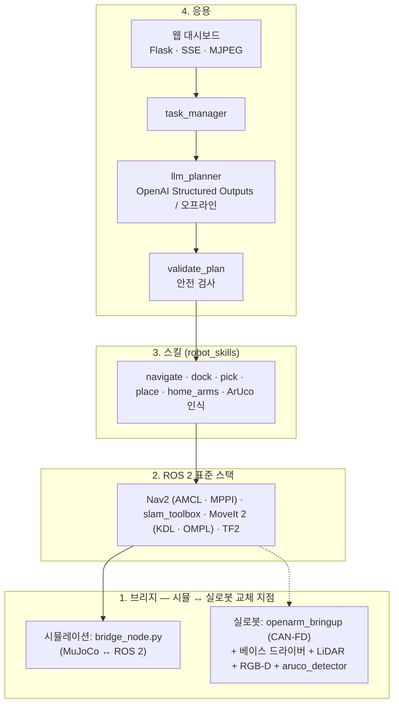

# MuJoCo + ROS 2 주행형 OpenArm 실습 가이드

> **기존 종합 참고 문서입니다.** 현재 기본 설치 절차는 [Ubuntu 24.04 노트북 환경 설정](setup/ubuntu24-native.md), 기본 교육은 [휠형 1일차](course/wheel-day1.md) · [2일차](course/wheel-day2.md)를 따르세요. 아래 드라이버/CUDA·실로봇 전환·과거 검증 기록은 선택적 참고이며 현재 장비에서 재검증된 결과가 아닙니다. `~/openarm_mobile_ws`는 자신의 clone 경로로 바꿔 읽으세요.

Nov 4, 2026

> 이 저장소(openarms_llm_ex) 자체가 워크스페이스(`openarm_mobile_ws`)입니다. 문서의 `~/openarm_mobile_ws` 는 `git clone https://github.com/aha645/openarms_llm_ex.git ~/openarm_mobile_ws` 로 받은 폴더로 읽으세요.


**결론: 교육과정 14개 모듈은 이 노트북에서 시뮬레이션으로 모두 실습할 수 있습니다. 단, GTX 1050은 드라이버 580·CUDA 12.x·PyTorch 2.14에 고정해야 하고, 실로봇 제어는 하드웨어가 없어 지금은 불가능합니다.** OpenArm v1 양팔 상반신 아래에 바퀴 베이스를 붙인 로봇, ROS 2 브리지, Nav2·MoveIt 2 설정, LLM 작업 계획, 웹 대시보드까지 새로 작성했고, 최종 미션 "빨간 상자를 왼쪽 작업대로 옮기고 돌아와"가 끝까지 성공하는 것을 확인했습니다.

| 구분 | 가능 여부 | 조건 / 이유 |
| --- | --- | --- |
| Ubuntu 24.04 + ROS 2 Jazzy + Nav2 + MoveIt 2 설치 | 가능 | apt 공식 저장소 그대로 |
| NVIDIA 드라이버 | 조건부 가능 | 580 브랜치 고정(590+는 GTX 10 시리즈 미지원) |
| CUDA / PyTorch | 조건부 가능 (과정에는 불필요) | CUDA 12.6, PyTorch 2.14 + cu126 가 마지막. 최신 버전은 동작 안 함 |
| DAY 1 자율주행 (브리지·TF·SLAM·AMCL·Nav2·순찰) | 가능 | 사람 장애물 포함. CPU가 바쁘면 실시간보다 느려짐 |
| DAY 2 양팔·Pick & Place·이동조작·LLM·대시보드 | 가능 | LLM은 OpenAI API 키(또는 다른 PC의 로컬 LLM) 필요, 키 없으면 오프라인 규칙 계획기 |
| 로컬 LLM을 이 노트북에서 실행 | 사실상 불가 | VRAM 2GB |
| 실로봇(OpenArm + 바퀴 베이스) 제어 | 불가(하드웨어 필요) | 로봇·CAN-FD 어댑터·베이스·센서 필요. 소프트웨어는 같은 인터페이스로 준비됨(미검증) |

만든 것: 워크스페이스 `openarm_mobile_ws.zip` (ROS 2 패키지 3개 + 설치 스크립트 5개). OpenArm 메시(48MB)는 설치 스크립트가 enactic/openarm\_mujoco에서 받습니다.

> 문서에 나오는 약어(SLAM, TF, MJCF, AMCL, CUDA …)의 원래 이름과 뜻은 [용어집](labs/glossary.md)에 정리되어 있습니다.

## 문제점과 제약 (먼저 읽기)

대상 노트북은 Samsung Notebook Odyssey NP800G5M(2017): i7-7700HQ 4코어/8스레드, GTX 1050(Pascal, 2GB 또는 4GB), RAM 8GB 또는 16GB, 128GB NVMe SSD + 1TB 5400rpm HDD입니다. 교육과정 권장 사양은 i5급, RAM 16GB, **GTX 1650 이상**이므로 GPU 한 등급이 모자랍니다.

| 항목 | 판정 | 무엇이 문제인가 | 대응 |
| --- | --- | --- | --- |
| NVIDIA 드라이버 | 조건부 가능 | 580 브랜치가 GTX 10 시리즈(Pascal)를 지원하는 마지막 드라이버. 590부터 Pascal 지원 중단 | `nvidia-driver-580` 설치 후 `apt-mark hold`. `-open` 드라이버와 `cuda-drivers` 패키지는 설치 금지(590+로 올라감) |
| CUDA Toolkit | 12.x까지 | CUDA 13.0부터 Maxwell·Pascal·Volta(5.x\~7.0) 컴파일 지원 제거 | 필요하면 `cuda-toolkit-12-6`. 이 교육과정 자체에는 CUDA 불필요 |
| PyTorch | 2.14 + cu126까지 | 2.8부터 cu128/cu129 휠에서 sm\_61 제거, 2.15부터 cu126 휠도 미배포 → 최신 PyTorch는 GTX 1050에서 "no kernel image" 오류 | `torch==2.14.0 torchvision==0.29.0 --index-url .../whl/cu126` 고정. 과정에는 불필요(선택) |
| VRAM 2GB | 주의 | MuJoCo 뷰어 + 오프스크린 카메라 + RViz2는 가능. 로컬 LLM·딥러닝 학습은 사실상 불가 | LLM은 OpenAI API 또는 다른 PC(예: RTX 3090)의 OpenAI 호환 서버 사용 |
| RAM 8GB 모델 | 위험 | 시뮬+Nav2+MoveIt+RViz 동시 실행 시 6\~8GB 사용 | 16GB로 증설 권장. 안 되면 swap 8GB + `viewer:=false` + RViz 하나만 |
| 128GB SSD | 빠듯함 | Ubuntu+ROS desktop+Nav2+MoveIt+워크스페이스 약 35\~45GB. HDD에 설치하면 빌드·실행이 매우 느림 | Ubuntu는 SSD에, 데이터(rosbag·지도)는 HDD에 |
| 하이브리드 그래픽(Optimus) | 주의 | 기본 내장 GPU로 렌더링되면 뷰어가 끊김 | `sudo prime-select nvidia`, 로그인 화면에서 **Ubuntu on Xorg** 선택(Wayland에서 RViz2 불안정) |
| Secure Boot | 주의 | 드라이버 모듈 로드 실패(nvidia-smi 오류) | 설치 중 MOK 비밀번호 설정 → 재부팅 시 Enroll MOK, 또는 BIOS에서 Secure Boot 끄기 |
| CPU 7700HQ | 가능 | 물리(2ms 스텝)+LiDAR 360선+카메라 10Hz+MPPI 제어가 겹치면 실시간보다 느려질 수 있음 | 전원 연결·성능 모드, `rate_factor:=0.5`, `lidar_rays:=180`, Nav2 MPPI batch 1000으로 축소(적용됨) |

### 교육과정과 다른 점 (이 문서가 해결한 것과 못 한 것)

- **교육과정 원본 코드는 공개되어 있지 않습니다.** PinkLAB 워크샵은 자사 주행형 양팔 로봇(PL-2 M) 기준이며 소스는 현장에서 배포됩니다. 이 문서의 코드는 공개 커리큘럼 14개 모듈을 같은 기술 스택(MuJoCo, ROS 2 Jazzy, Nav2, MoveIt 2, ArUco, OpenAI Structured Outputs, Flask·SSE·MJPEG)으로 새로 구현한 것입니다.
- **OpenArm에는 공식 바퀴 베이스가 없습니다.** OpenArm v1 상반신 MJCF(enactic/openarm\_mujoco)를 그대로 쓰고, 아래에 차동구동 베이스(바퀴 2 + 캐스터 2, LiDAR, IMU, 머리 RGB-D 카메라)를 직접 설계해 붙였습니다.
- **OpenArm 공식 ROS 2 패키지는 ROS 인덱스상 Humble 릴리스만 있습니다.** Jazzy에서는 소스 빌드가 필요하고, 공식 MoveIt 설정은 바뀐 URDF 경로를 참조하고 있어 그대로 쓰기 어렵습니다. 그래서 MJCF에서 URDF·SRDF를 자동 생성하는 방식으로 대체했습니다. 컨트롤러 이름은 공식 `openarm_bringup`과 같게 맞췄습니다.
- **시뮬레이션의 "파지 보조(grasp\_assist)"는 실제와 다릅니다.** 손가락 마찰만으로 집기는 MuJoCo에서 자주 미끄러지므로, 손가락이 상자에 닿은 채 닫히면 상자를 손에 고정합니다. `grasp_assist:=false`로 끄고 순수 마찰 파지를 실험할 수 있습니다.
- **카메라는 RGB-D로 흉내 냅니다.** 640×480에서 4cm 마커는 약 23픽셀이라 PnP 깊이 오차가 5\~15%(45\~113mm)였습니다. 깊이 영상으로 보정해 오차를 1\~3mm로 줄였습니다. 실로봇에서는 RGB-D 카메라(예: RealSense)나 더 큰 마커가 필요합니다.
- **실로봇 제어는 이 노트북만으로는 불가능합니다.** OpenArm 양팔(공식 가격 $6,500), 팔마다 CAN-FD USB 어댑터, 24V 전원, 바퀴 베이스와 그 드라이버, LiDAR, 카메라, 비상정지가 필요합니다. 소프트웨어 경로는 "실로봇 제어로 넘어가기" 절에 정리했습니다.

## 구성



위 세 층은 시뮬과 실로봇에서 그대로 쓰고, 강조한 브리지 층만 교체합니다.

| ROS 2 패키지 | 내용 | 교육과정 모듈 |
| --- | --- | --- |
| `mobile_openarm_sim` | MJCF 생성기(OpenArm v1 + 바퀴 베이스), 월드, MJCF→URDF 변환, 정답 지도, 브리지 노드, sim/slam/nav launch, Nav2·SLAM 파라미터, selftest | DAY1 01\~05 |
| `mobile_openarm_moveit_config` | SRDF(그룹·이름자세·자기충돌 자동 생성), KDL, OMPL(Jazzy 형식), 컨트롤러 설정, move\_group launch | DAY2 01 |
| `mobile_openarm_apps` | `robot_skills`(Nav2·MoveIt·그리퍼·ArUco 스킬), patrol, arm\_demo, pick\_place, nav\_pick\_place, llm\_planner, task\_manager, dashboard, aruco\_detector(실로봇용), full\_system launch | DAY1 06, DAY2 02\~06 |

## 설치: 드라이버부터 빌드까지

워크스페이스 압축파일(`openarm_mobile_ws.zip`)을 홈 폴더에 풀고 `scripts/` 의 스크립트를 순서대로 실행합니다. 각 단계 끝의 확인 명령이 통과해야 다음으로 넘어갑니다.

```bash
cd ~ && unzip openarm_mobile_ws.zip && cd ~/openarm_mobile_ws
bash scripts/00_check_system.sh        # 사양·Secure Boot·세션(Xorg/Wayland) 점검
```

### 1단계 — NVIDIA 드라이버 580 (Pascal 마지막 지원)

```bash
bash scripts/01_install_nvidia_driver.sh
#   내부: apt install nvidia-driver-580 → apt-mark hold → prime-select nvidia
sudo reboot
nvidia-smi                               # GeForce GTX 1050, Driver 580.xx
glxinfo -B | grep "OpenGL renderer"     # NVIDIA GeForce GTX 1050/PCIe/SSE2 이어야 함
```

- 로그인 화면 오른쪽 아래 톱니바퀴에서 **Ubuntu on Xorg** 를 선택합니다.
- renderer 가 `llvmpipe` 나 `Mesa Intel` 이면 dGPU가 안 쓰이는 것입니다. `sudo prime-select nvidia` 후 재부팅하거나, 실행 시 `__NV_PRIME_RENDER_OFFLOAD=1 __GLX_VENDOR_LIBRARY_NAME=nvidia` 를 앞에 붙입니다.

### 2단계 (선택) — CUDA / PyTorch

이 교육과정(물리 시뮬, Nav2, MoveIt, OpenAI API)은 CUDA를 쓰지 않습니다. GPU 딥러닝 실습을 따로 할 때만 설치합니다. ROS와 충돌하지 않도록 별도 venv에 설치합니다.

```bash
bash scripts/02_install_cuda_pytorch_optional.sh
#   pip install torch==2.14.0 torchvision==0.29.0 --index-url https://download.pytorch.org/whl/cu126
#   확인: cuda available True, capability (6, 1), arch_list 에 sm_61 포함
```

- PyTorch 휠에 CUDA 런타임이 들어 있어 CUDA Toolkit은 필요 없습니다. nvcc가 꼭 필요하면 `cuda-toolkit-12-6` 만 설치하고 `cuda-drivers` 는 설치하지 마세요.
- `pip install torch` (버전 미지정)는 최신 cu13x 휠을 받아 GTX 1050에서 `no kernel image is available` 오류가 납니다.

### 3단계 — ROS 2 Jazzy + Nav2 + SLAM Toolbox + MoveIt 2

```bash
bash scripts/03_install_ros2_jazzy.sh
#   ros2-apt-source 로 저장소 등록 → ros-jazzy-desktop, ros-dev-tools,
#   ros-jazzy-navigation2, nav2-bringup, slam-toolbox, moveit, moveit-configs-utils,
#   teleop-twist-keyboard, python3-opencv, python3-flask
source /opt/ros/jazzy/setup.bash
ros2 doctor --report | head -20
```

### 4단계 — 워크스페이스 (OpenArm 에셋 + 모델 생성 + 빌드)

```bash
bash scripts/04_setup_workspace.sh
#  1) git clone enactic/openarm_mujoco → v1 메시(48MB) 복사
#  2) pip --user: mujoco==3.5.0, openai, pydantic>=2  (numpy<2 제약으로 ROS 의 numpy 1.26 보호)
#  3) build_mjcf → build_world → mjcf_to_urdf → make_map → make_srdf
#  4) tools/selftest.py (ROS 없이 물리·센서·집기 14개 항목 점검)
#  5) rosdep install && colcon build --symlink-install
source ~/openarm_mobile_ws/install/setup.bash
```

- **numpy를 2.x로 올리면 안 됩니다.** ROS Jazzy apt 패키지(cv\_bridge 등)와 Ubuntu의 python3-opencv 4.6은 numpy 1.26에 맞춰 빌드되어 `numpy.core.multiarray failed to import` 가 납니다. 다른 pip 설치 시에도 `-c` 제약파일(`numpy<2`)을 함께 쓰세요.
- selftest 끝에 `총 14개 중 실패 0개` 가 나오면 시뮬레이션은 정상입니다. 카메라 항목만 실패하면 OpenGL(드라이버) 문제입니다.

## 챕터별 실습 (DAY 1 · DAY 2)

설치가 끝났으면 챕터별 실습서를 순서대로 따라 하세요. 각 문서는 같은 순서로 되어 있습니다: **미션 → 이 장에 나오는 용어(약어 풀이) → 개념 → 전체 구조 그림 → 실제로 실행되는 소스 → 단계별 따라하기(어느 터미널에서, 언제, 무슨 뜻, 화면에서 확인할 것) → 체크리스트 → 확인 질문 → 문제 해결.**

- 시작 전에 읽기: [실습서 안내 — 터미널 쓰는 법, 공통 규칙, 월드 지도](labs/README.md)
- 모르는 약어가 나오면: [용어집](labs/glossary.md)

| DAY | 챕터 | 미션 | 실습서 |
|---|---|---|---|
| 1 | 01 Gazebo vs MuJoCo | MuJoCo 뷰어로 로봇·월드를 만져 보고 selftest 통과 | [day1-01-mujoco-basics.md](labs/day1-01-mujoco-basics.md) |
| 1 | 02 MuJoCo–ROS 2 브리지 | 토픽으로 센서 읽기, 키보드 운전, 액션으로 팔 움직이기 | [day1-02-bridge.md](labs/day1-02-bridge.md) |
| 1 | 03 Launch · Description · 센서 · TF | URDF 만들기, TF 트리 PDF, 카메라·LiDAR 높이 구하기 | [day1-03-description-tf.md](labs/day1-03-description-tf.md) |
| 1 | 04 SLAM과 RViz2 | 키보드로 운전하며 지도 만들고 저장, AMCL로 위치 추정 | [day1-04-slam-rviz.md](labs/day1-04-slam-rviz.md) |
| 1 | 05 Nav2 자율주행 | RViz·명령어로 목표 보내기, 사람 장애물 회피 | [day1-05-nav2.md](labs/day1-05-nav2.md) |
| 1 | 06 통합 데모: 순찰 | 경유지 4곳 2바퀴 순찰, 순찰 경로 바꾸기 | [day1-06-patrol.md](labs/day1-06-patrol.md) |
| 2 | 01 MoveIt 2 양팔 제어 | RViz에서 Plan → Execute, arm_demo로 4가지 동작 방법 | [day2-01-moveit.md](labs/day2-01-moveit.md) |
| 2 | 02 ArUco 기반 Pick & Place | 마커로 상자 위치 인식 → 집어서 옮기기 | [day2-02-aruco-pick-place.md](labs/day2-02-aruco-pick-place.md) |
| 2 | 03 Nav + Pick & Place | 작업대 A → B 상자 운반 후 복귀 | [day2-03-nav-pick-place.md](labs/day2-03-nav-pick-place.md) |
| 2 | 04 LLM과 OpenAI API | 자연어 → 작업 계획(JSON), 불가능한 명령 거절 | [day2-04-llm-planner.md](labs/day2-04-llm-planner.md) |
| 2 | 05 LLM → ROS 2 작업 실행 | Task Manager로 명령 실행·상태 확인·취소 | [day2-05-task-manager.md](labs/day2-05-task-manager.md) |
| 2 | 06 웹 대시보드 & Final | 명령 하나로 전체 시스템, 브라우저에서 최종 미션 | [day2-06-dashboard.md](labs/day2-06-dashboard.md) |

## 실로봇 제어로 넘어가기

소프트웨어는 실로봇과 같은 토픽·액션 이름을 쓰도록 만들어, 시뮬 브리지 하나를 실제 드라이버 4개로 바꾸면 됩니다. 단, 실제 하드웨어에서는 검증하지 못했습니다.

| 시뮬에서 `mujoco_bridge` 가 하던 일 | 실로봇에서 대신할 것 | 필요한 하드웨어 |
| --- | --- | --- |
| 팔·그리퍼 FollowJointTrajectory, /joint\_states | `openarm_bringup` (ros2\_control + `openarm_hardware`, Damiao 모터 CAN-FD) | OpenArm 양팔(공식 가 $6,500), 팔당 CAN-FD USB 어댑터 1개(can0/can1), 24V 전원 |
| /cmd\_vel → 바퀴, /odom + TF odom→base\_footprint | 베이스 드라이버 (상용 베이스의 ROS 2 드라이버 또는 ros2\_control `diff_drive_controller`) | 차동구동 베이스(양팔 상반신 약 16kg + 배터리를 싣을 내하중) |
| /scan | LiDAR 드라이버 (frame 이름을 `lidar_link` 로) | 2D LiDAR |
| /aruco/detections | `ros2 run mobile_openarm_apps aruco_detector` (이번에 추가한 노드, 깊이 토픽 지원) | RGB-D 카메라(예: RealSense), 머리 거치대 |
| /clock | 필요 없음 — 모든 노드 `use_sim_time:=false` | 비상정지 스위치(모터 전원 차단) |

```bash
# OpenArm ROS 2 (Jazzy 는 소스 빌드). openarm_can 은 OpenArm 문서의 PPA 안내로 설치
cd ~/openarm_mobile_ws/src && git clone https://github.com/enactic/openarm_ros2
sudo apt install -y libopenarm-can-dev openarm-can-utils
cd .. && rosdep install --from-paths src --ignore-src -r -y && colcon build
# 1) 가짜 하드웨어로 먼저 확인
ros2 launch openarm_bringup openarm.bimanual.launch.py arm_type:=v1.0
# 2) CAN-FD 설정 (1Mbps nominal / 5Mbps data) → 실제 팔
openarm-can-configure-socketcan can0 -fd -b 1000000 -d 5000000
openarm-can-configure-socketcan can1 -fd -b 1000000 -d 5000000
ros2 launch openarm_bringup openarm.bimanual.launch.py arm_type:=v1.0 use_fake_hardware:=false \
    right_can_interface:=can0 left_can_interface:=can1
```

바뀌어야 할 것:

1. **robot\_description 통일.** 실로봇 런치는 openarm\_description의 URDF를, Nav2·MoveIt은 이 워크스페이스의 베이스 포함 URDF를 씁니다. 실제 베이스 치수·센서 위치로 `tools/build_mjcf.py` 상수를 고치고 URDF를 다시 만든 뒤, 한 쪽 robot\_state\_publisher만 띄웁니다.
2. **그리퍼 단위 확인.** 시뮬은 `openarm_*_finger_joint1` 0\~0.044m(손가락 1개 이동량)입니다. 실제 컨트롤러의 단위·범위를 `openarm_bringup` 설정에서 확인해 `robot_skills.py` 의 0.044 값을 맞춥니다.
3. **grasp\_assist 없음.** 실제로는 마찰로 잡으므로 닫는 힘(Damiao 전류 제한)과 접근 자세를 다시 튜닝합니다.
4. **안전.** MoveIt 속도 배율 0.1부터 시작, 작업 반경에 사람 금지, 비상정지를 손에 들고 시험합니다. 주행 중 팔 자세는 반드시 `home`/`carry`.
5. **노트북 역할.** 2017년 노트북을 로봇 위 컴퓨터로 올리면 USB 포트(CAN 2 + LiDAR + 카메라)가 부족하므로 전원 공급형 USB 3.0 허브가 필요합니다. CAN 레이턴시가 80ms를 넘으면 포트를 바꾸거나 백그라운드 부하를 줄입니다.

## 검증 결과와 트러블슈팅

노트북 실물이 아닌, 클라우드 Linux(CPU 2코어, RAM 8GB, GPU 없음·소프트웨어 렌더)에 ROS 2 Jazzy 패키지(RoboStack: Nav2 1.3.13, MoveIt 2.12.4)를 설치해 헤드리스로 검증했습니다. RViz와 MuJoCo 뷰어 창, 실제 Ubuntu apt 패키지, GTX 1050 드라이버는 직접 확인하지 못했습니다.

| 항목 | 결과 |
| --- | --- |
| selftest 14항목 (MuJoCo 3.5 + numpy 1.26 + OpenCV 4.6 / MuJoCo 3.17 + OpenCV 5.0) | 모두 통과: 1m 직진 오도메트리 오차 1.6cm, ArUco 위치 오차 1\~3mm, IK·집기·운반·놓기 |
| URDF ↔ MJCF 기구학 | 무작위 20자세 FK 최대 오차 7×10⁻⁶ m, 카메라 프레임 일치 |
| 브리지 토픽·액션 | /clock·/scan·/odom·/aruco/\* 발행, 팔·그리퍼 액션 6개 동작 |
| Nav2 (정답 지도 + AMCL + MPPI) | home → 문 → 작업대 A 주행 성공(사람 장애물 이동 중) |
| MoveIt + ArUco Pick & Place (DAY2-02) | 성공: 상자 인식 → 집기 → 같은 작업대에 놓기 → home |
| 자연어 최종 미션 (대시보드 → task\_manager → Nav2·MoveIt) | 5단계 전부 성공(590초): 작업대 A 주행 → 도킹 → 집기 → 작업대 B 주행 → 놓기(상자 최종 위치 −2.22, 3.00, 0.725) → home 복귀. 불가능한 명령("커피 한 잔 타줘")은 rejected. SLAM(/map 생성)과 arm\_demo(양팔 both\_arms 계획 포함)도 통과. patrol·OpenAI 온라인 호출·aruco\_detector(실로봇용)는 미실행 |
| 실시간 배속 | 전체 시스템 동시 실행 시 약 0.5배(소프트웨어 카메라 렌더가 CPU 1코어 사용). 모든 노드가 시뮬 시간을 쓰므로 느려질 뿐 동작은 같음 |

### 검증 중 발견해 고친 문제 (같은 증상이 보이면 참고)

| 증상 | 원인 | 조치 |
| --- | --- | --- |
| Nav2가 매초 "Detected jump back in time", TF extrapolation 오류 | 시뮬 시간 107.99999 같은 float를 sec/nanosec로 나눌 때 nanosec이 1e9로 반올림돼 1초 뒤로 감 | 전체 ns로 바꾼 뒤 나눔 (`bridge_node.py` `stamp()`) |
| controller\_server 활성화 실패 "Controller period more then model dt" | MPPI는 controller\_frequency ≥ 1/model\_dt(20Hz) 필요 | 20Hz 유지, 대신 batch·time\_steps 축소 |
| "Timed out while waiting for action server ... compute\_path\_to\_pose" | CPU가 바빠 BT가 플래너 응답을 20ms만 기다림 | `default_server_timeout: 500`, planner 5Hz |
| MoveIt "Start state out of bounds" (error -26) | 위치제어 오버슈트로 joint5가 한계를 0.001rad 초과 | /joint\_states 를 한계 안으로 clamp |
| 작업대 앞에서 "Failed to make progress" 반복 | 목표가 팽창 영역 안 | 스테이션을 0.70m 앞으로, 나머지는 도킹 |
| 처음 집기에서 자주 놓침 | home→접근점 경로가 상자를 침 + 손가락이 위아래로 닫히는 roll | carry에서 출발, 상자를 충돌 객체로 등록, roll ±70 우선, 파지 확인 후 재시도 |
| `numpy.core.multiarray failed to import` | pip가 numpy 2.x를 설치 | `pip install "numpy<2"` 로 되돌리고 항상 `-c` 제약파일 사용 |
| `colcon build --symlink-install` 에서 "option --editable not recognized" | setuptools 80 이상(특히 conda/venv) | `--symlink-install` 없이 빌드. Ubuntu apt setuptools 68에서는 정상 |
| MuJoCo 뷰어가 열리지 않거나 검은 화면 | Wayland 세션 또는 내장 GPU | Ubuntu on Xorg, `prime-select nvidia`, 안 되면 `viewer:=false` |
| 모델 로드에 RAM 1.9GB | 시각 메시 47개(약 160만 면) | `world:=world_light.xml` (0.2GB) |

### 노트북에서 직접 재보세요

```bash
ros2 launch mobile_openarm_sim sim.launch.py rviz:=false viewer:=false &
ros2 topic hz /clock     # 100Hz 가까우면 실시간. 크게 낮으면 lidar_rays:=180, camera_hz 낮추기, rate_factor:=0.5
nvidia-smi dmon -s u     # 뷰어·카메라가 GPU 를 쓰는지 확인
```

## Sources

- [PinkLAB — MuJoCo + ROS2 2일 워크샵 1차 (커리큘럼·준비물)](https://pinklab.art/academy/mujoco-ros2-workshop-1/)
- [enactic/openarm](https://github.com/enactic/OpenArm) · [openarm\_mujoco](https://github.com/enactic/openarm_mujoco) · [openarm\_ros2](https://github.com/enactic/openarm_ros2)
- [ROS Index — openarm\_bringup (Humble 릴리스, launch 인자)](https://index.ros.org/p/openarm_bringup/)
- [OpenArm ROS2 Control 문서 (bringup·MoveIt 명령)](https://tokirobot.github.io/OpenArm/api-reference/ros2/control)
- [OpenArm CAN 설정 (openarm-can-configure-socketcan)](https://github.com/enactic/openarm_can/wiki)
- [Samsung Odyssey NP800G5M 사양 (Notebookcheck)](https://www.notebookcheck.net/Samsung-Odyssey-NP800G5M-7700HQ-FHD-GTX-1050-Laptop-Review.213840.0.html)
- [NVIDIA 580이 Maxwell·Pascal·Volta 마지막 지원 드라이버 (Notebookcheck)](https://www.notebookcheck.net/Nvidia-confirms-upcoming-end-of-driver-support-for-GTX-700-900-and-10-series-GPUs.1048442.0.html)
- [PyTorch: CUDA 12.8/12.9 빌드에서 Maxwell·Pascal 제거](https://dev-discuss.pytorch.org/t/cuda-toolkit-version-and-architecture-support-update-maxwell-and-pascal-architecture-support-removed-in-cuda-12-8-and-12-9-builds/3128)
- [PyTorch: 2.15부터 CUDA 12.6 휠 중단 (Pascal 마지막 = 2.14)](https://dev-discuss.pytorch.org/t/notice-cuda-12-6-wheels-will-no-longer-be-published-from-pytorch-2-15-drops-maxwell-pascal-volta/3432)
- [GTX 1050 + PyTorch 2.8 cu128 "no kernel image" 사례](https://github.com/bnsreenu/digitalsreeni-image-annotator/issues/57)
- [mujoco\_ros2\_control (ros-controls, Jazzy 지원) — 이 워크스페이스의 브리지 대신 쓸 수 있는 대안](https://control.ros.org/jazzy/doc/mujoco_ros2_control/doc/index.html)
- [Nav2 Jazzy 기본 파라미터](https://raw.githubusercontent.com/ros-navigation/navigation2/jazzy/nav2_bringup/params/nav2_params.yaml)
