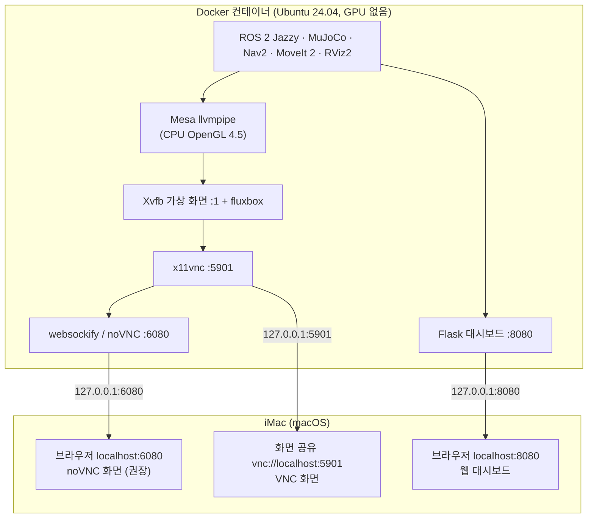

# 환경 설정 — Intel iMac / Docker의 Ubuntu 24.04

[README](../../README.md) · 다음: [휠형 교육](../wheel/README.md)

## 범위와 원리

이 문서는 **Docker 이미지(Ubuntu 24.04 + ROS 2 Jazzy) → 컨테이너 화면 → 가상환경·colcon 빌드**까지만 다룹니다. 실행은 교육 문서([휠형](../wheel/README.md) · [TRON1](../tron1/day1.md))에서 시작하며, 모든 ROS 명령은 컨테이너 안에서 실행합니다.

대상은 **Intel iMac (Retina 5K, 27-inch, 2019)** — Intel Core i5-8600 6코어, Radeon Pro 575X 4GB, RAM 32GB 입니다. Intel(x86_64)이라 ROS 공식 amd64 이미지를 에뮬레이션 없이 그대로 씁니다. Apple Silicon 은 이 문서의 검증 대상이 아닙니다.

macOS 에 Ubuntu 를 이중 부팅하거나 컨테이너 안에서 OS 설치 프로그램을 돌리지 않습니다. `osrf/ros:jazzy-desktop` 이미지가 **Ubuntu 24.04 + ROS 2 Jazzy** 를 제공하고, `docker/Dockerfile` 이 Nav2·MoveIt·가상 데스크톱·소프트웨어 OpenGL 을 추가합니다. macOS 의 Docker 컨테이너는 Mac 의 GPU 를 쓸 수 없으므로 컨테이너 안에서 CPU 로 OpenGL 을 그리는 Mesa llvmpipe(OpenGL 4.5)를 쓰고, 화면은 컨테이너 안 가상 데스크톱을 브라우저(noVNC)나 macOS 화면 공유(VNC)로 봅니다.

| 항목 | 필요 여부 | 이유 |
| --- | --- | --- |
| 그래픽 드라이버 (NVIDIA/AMD) | 불필요 | 컨테이너는 GPU 에 접근 불가. Mesa 소프트웨어 렌더러(llvmpipe)가 이미지에 포함됨 |
| CUDA 툴킷·PyTorch | 불가·불필요 | CUDA 는 NVIDIA 전용(Radeon 에서 동작 안 함). 교육과정도 쓰지 않음 |
| Docker Desktop for Mac | 필요 | 설치에 관리자 권한 1회 필요 (1절) |
| XQuartz | 불필요(선택) | 기본 방식은 브라우저/VNC. XQuartz 는 OpenGL 2.1 까지라 RViz2 가 자주 실패 |
| OpenAI API 키 | 선택 | 2일차 LLM 실습용. 없으면 오프라인 규칙 계획기 |

**대가:** GPU 가속이 없어 MuJoCo 뷰어·RViz·머리 카메라 렌더를 모두 CPU 가 그립니다. 화면이 느리고 시뮬이 실시간보다 느려질 수 있지만, 모든 노드가 시뮬 시간을 쓰므로 동작 결과는 같습니다. 2코어·GPU 없는 환경에서 뷰어+RViz+카메라를 동시에 띄웠을 때 실시간의 약 0.4배, RViz 2fps 였습니다. iMac 은 코어가 3배라 더 나을 것으로 보지만 실측값은 아닙니다.

### 화면을 보여주는 구조



컨테이너 안 프로그램은 가상 화면 `:1` 에 그리고, Mac 은 포트 3개(6080·5901·8080)로 그 화면과 대시보드를 봅니다. X11 소켓 공유(`-v /tmp/.X11-unix`)는 리눅스 호스트에서만 되는 방식이라 쓰지 않습니다.

## 1. Mac 준비

1. **macOS 버전 확인.** 이 iMac 은 macOS 15 Sequoia 가 마지막입니다. Docker Desktop 은 현재 macOS 와 직전 두 버전을 지원하므로 지금은 설치됩니다. 지원 범위는 [공식 설치 문서](https://docs.docker.com/desktop/setup/install/mac-install/)에서 확인하세요.
2. **Docker Desktop 설치** — **이미 설치되어 있으면 이 단계는 건너뜁니다** (아래 Mac 터미널 블록의 `docker version` 에 Server 가 나오면 설치·실행된 상태). 없으면 "Docker Desktop for Mac with Intel chip" `.dmg` 를 받아 `Docker.app` 을 응용 프로그램으로 끌어다 놓고 실행합니다.
   - **관리자 권한**은 설치할 때 한 번 필요합니다. 관리자 계정이 없다면 관리자에게 다음을 부탁합니다. 그 뒤에는 일반 계정으로 실행됩니다.
   - `sudo hdiutil attach Docker.dmg && sudo /Volumes/Docker/Docker.app/Contents/MacOS/install --user=<내계정이름>`
3. **리소스 설정** (Docker Desktop → Settings → Resources). macOS 의 Docker 는 Linux VM 안에서 컨테이너를 돌리므로, 여기서 주는 양이 컨테이너가 쓸 수 있는 전부입니다.

   | 설정 | 권장값 | 이유 |
   | --- | --- | --- |
   | CPU limit | 6 | 소프트웨어 렌더·물리·Nav2·MoveIt 이 모두 CPU 를 씀 |
   | Memory limit | 16 GB | 32GB 중 절반. 전체 모델(시각 메시) 로드 시 2GB, 시스템 전체 6~8GB |
   | Swap | 2 GB | 빌드 시 여유 |
   | Virtual disk limit | 64 GB 이상 | ROS desktop + Nav2 + MoveIt 이미지 약 6~8GB + 빌드 |
   | General → Virtual Machine Manager | Apple Virtualization framework | Intel Mac 기본값 |
   | General → File sharing | VirtioFS | Mac 폴더 공유가 가장 빠름 |

4. Git 이 없으면 macOS 명령줄 도구를 설치합니다(`xcode-select --install`).

Mac 터미널:

```bash
docker version
docker compose version
git --version
mkdir -p ~/Documents
cd ~/Documents
git clone https://github.com/aha645/openarms_llm_ex.git
cd openarms_llm_ex/docker
```

`docker version` 에 Client/Server(OS/Arch: linux/amd64)가 보이면 준비 완료입니다. 이미 받은 저장소가 있으면 clone 을 생략하고 그 폴더의 `docker/` 로 이동합니다.

## 2. Ubuntu + ROS 이미지 빌드·시작

이 문서에는 명령을 입력하는 곳이 세 군데 있습니다. 각 블록 앞의 표시를 보고 구분하세요.

| 어디에서 | 프롬프트 모양 | 여는 법 |
|---|---|---|
| **Mac 터미널** | `사용자@iMac docker %` | macOS 터미널 앱, `cd ~/Documents/openarms_llm_ex/docker` |
| **컨테이너 터미널** | `root@...:/#` | Mac 터미널에서 `docker compose exec openarm bash`, 또는 noVNC 화면의 xterm |
| **Mac 브라우저** | — | Safari/Chrome |

가장 간단한 방법은 시작 스크립트 하나입니다. 빌드 → 실행 → (처음이면) 워크스페이스 준비 → 브라우저 열기를 차례로 합니다.

Mac 터미널(`docker/`)에서:

```bash
bash mac_start.sh
```

`mac_start.sh` 는 워크스페이스가 아직 빌드되지 않았으면 컨테이너 안에서 `mobile_openarm/scripts/setup_workspace.sh` 까지 **자동으로 실행**합니다. 이 스크립트를 썼다면 3절은 **마지막 확인 명령만** 하면 됩니다.

단계별로 직접 하려면 Mac 터미널(`docker/`)에서:

```bash
docker compose build            # 처음 1회, 네트워크에 따라 20~40분
docker compose up -d            # 백그라운드 실행
docker compose ps
docker compose exec openarm bash
```

이제부터는 **컨테이너 안**입니다.

```bash
cd /root/openarm_mobile_ws
source /opt/ros/jazzy/setup.bash
grep PRETTY_NAME /etc/os-release
ros2 --help
command -v colcon
command -v rosdep
```

`Ubuntu 24.04` 가 나오고 `colcon`·`rosdep` 경로가 보이면 됩니다. 베이스 이미지 `osrf/ros:jazzy-desktop` 에 ROS 2 Jazzy·RViz2·colcon·rosdep(초기화 완료)이 들어 있고, Dockerfile 이 Nav2·SLAM Toolbox·MoveIt·가상 데스크톱(VNC)을 더합니다. 혹시 `colcon`·`rosdep` 이 없으면 `apt-get update && apt-get install -y ros-dev-tools` 로 설치합니다.

**컨테이너에서는 `doc/setup/install_nvidia_driver.sh`·`install_ros2_jazzy.sh` 를 실행하지 않습니다.** ROS 는 이미지에 이미 있습니다. 포트·볼륨·공유 메모리 같은 컨테이너 설정과 그 이유는 `docker/docker-compose.yml` 주석에 있습니다.


## 3. 가상환경·colcon 빌드

> `mac_start.sh` 를 썼다면 아래 블록 대신 컨테이너 터미널에서 `ros2 pkg prefix mobile_openarm_apps` 로 경로가 나오는지만 확인하고 4절로 넘어갑니다. `setup_workspace.sh` 를 다시 돌려도 망가지지는 않지만 시간이 오래 걸립니다.

컨테이너 터미널(2절에서 연 터미널을 그대로 사용):

```bash
cd /root/openarm_mobile_ws
apt-get update                             # 이미지는 apt 목록을 지워 두므로, rosdep 이 빠진 패키지를 설치할 수 있게
bash mobile_openarm/scripts/setup_workspace.sh
source mobile_openarm/scripts/env.sh       # ROS 2 + .venv-mobile + 휠형 패키지
ros2 pkg prefix mobile_openarm_apps
```

`setup_workspace.sh` 가 `mobile_openarm/.venv-mobile` 가상환경(`--system-site-packages`)을 만들고, 저장소에 들어 있는 모델을 확인하고 자체 점검(14개)을 한 뒤, `mobile_openarm/` 에서 venv Python 으로 `colcon build --symlink-install --base-paths src` 를 수행합니다. 이미지에 pip 로 넣어 둔 MuJoCo·OpenAI·Pydantic 은 venv 에서 그대로 재사용되므로 새로 내려받지 않습니다. 자체 점검·rosdep 실패는 빌드를 멈추지 않으므로 로그와 빌드 요약(`Failed` 없음)을 따로 확인합니다.

TRON1 도 쓸 때는 컨테이너 터미널에서 이어서 (TRON1 은 휠형과 코드·패키지·가상환경을 나눠 쓰지 않는 독립 시스템 — 휠형 빌드 없이도 됨):

```bash
cd /root/openarm_mobile_ws
bash tron1_openarm/scripts/setup_workspace.sh      # .venv-biped 생성 → 자체 점검 → 빌드
source tron1_openarm/scripts/env.sh        # ROS 2 + .venv-biped + TRON1 패키지
ros2 pkg prefix tron1_openarm_sim
```

저장소는 Mac 폴더와 공유되지만 컨테이너 내부 경로는 **`/root/openarm_mobile_ws`** 로 고정됩니다. `mobile_openarm/`·`tron1_openarm/` 의 `build/`, `install/`, `log/` 와 가상환경 `mobile_openarm/.venv-mobile`·`tron1_openarm/.venv-biped` 는 Compose named volume 입니다(Mac 폴더에 쓰면 매우 느림). **Mac 호스트에서 colcon 을 실행하거나 호스트의 install 경로를 source 하지 마세요.**

컨테이너 터미널을 열 때마다 `/root/openarm_mobile_ws` 에서 `source mobile_openarm/scripts/env.sh`(휠형) 또는 `source tron1_openarm/scripts/env.sh`(TRON1) 한 줄로 ROS 2·가상환경·패키지를 한 번에 불러옵니다. 이미지의 `~/.bashrc` 는 ROS 와 휠형 install 만 미리 불러옵니다.

## 4. 화면 보기

| 방법 | 접속 | 장점 | 단점 |
| --- | --- | --- | --- |
| **A. noVNC (권장)** | 사파리·크롬에서 `http://localhost:6080/vnc.html?autoconnect=1&resize=scale` | 설치 불필요, 바로 됨 | 키 조합·클립보드가 일부 불편 |
| **B. macOS 화면 공유** | Finder → 이동 → 서버에 연결(⌘K) → `vnc://localhost:5901` | 기본 앱, 더 매끄러움 | 비밀번호 필수(`VNC_PASSWORD`) |
| C. XQuartz (비권장) | 컨테이너 창을 Mac 창으로 직접 띄움 | 창이 Mac 창처럼 보임 | XQuartz 설치에 관리자 권한 필요, OpenGL 2.1(간접 GLX)까지라 RViz2·MuJoCo 뷰어가 실패하거나 매우 느림 |

기본 VNC 비밀번호는 `openarm` 입니다. 필요하면 `docker/docker-compose.yml` 에서 변경 후 컨테이너를 재생성합니다. 포트는 localhost 에만 바인딩되어 있습니다. 접속하면 검은 데스크톱에 xterm 터미널 하나가 떠 있습니다. 바탕화면을 우클릭하면 fluxbox 메뉴에서 터미널을 더 열 수 있고, Mac 터미널의 `docker compose exec openarm bash` 에서 실행한 프로그램도 같은 화면(`DISPLAY=:1`)에 뜹니다.

```bash
# 컨테이너 안에서: 소프트웨어 OpenGL 확인
glxinfo -B | grep -E "renderer|version"
#   OpenGL renderer string: llvmpipe (LLVM ..., 256 bits)
#   OpenGL core profile version string: 4.5 (Core Profile) Mesa ...
```

XQuartz 방식이 꼭 필요할 때:

```bash
# Mac: XQuartz 설치 후 → 환경설정 → 보안 → '네트워크 클라이언트에서의 연결 허용' 체크 → XQuartz 재시작
defaults write org.xquartz.X11 enable_iglx -bool true    # 간접 GLX 허용
xhost +localhost
# 컨테이너 안: 가상 데스크톱 대신 Mac 의 X 서버로
export DISPLAY=host.docker.internal:0
rviz2      # 실패하면 LIBGL_ALWAYS_INDIRECT=1 을 붙여 보고, 그래도 안 되면 A/B 방식으로
```

## 5. 종료·재개와 문제 해결

순서: ① **컨테이너 터미널**(T1)에서 launch 를 `Ctrl+C` → ② 다른 컨테이너 터미널은 `exit` → ③ **Mac 터미널**(`docker/` 폴더)에서 아래 명령.

```bash
docker compose stop         # 일시 정지
docker compose start        # 재개
# 컨테이너 삭제 (소스와 named volume은 유지)
docker compose down
```

`docker compose down -v` 는 빌드·설치 볼륨을 삭제하므로 평소에는 사용하지 않습니다. Dockerfile 이 바뀐 저장소를 받았다면(`git pull`) `docker compose build && docker compose up -d` 로 이미지와 컨테이너를 다시 만들어야 반영됩니다. 재개 후 Mac 터미널에서 `docker compose exec openarm bash` 로 컨테이너 터미널에 들어가 `source mobile_openarm/scripts/env.sh`(TRON1 은 `tron1_openarm/scripts/env.sh`) 뒤 launch 를 다시 실행합니다.

| 증상 | 원인 | 조치 |
| --- | --- | --- |
| `Cannot connect to the Docker daemon` | Docker Desktop 이 꺼져 있음 | 응용 프로그램에서 Docker 실행, 메뉴 막대 고래 아이콘 확인 |
| 브라우저가 6080 에 접속 못 함 | 컨테이너 시작 스크립트 실패, 포트 충돌 | `docker compose logs openarm`, 컨테이너 안 `cat /tmp/novnc.log /tmp/x11vnc.log` |
| 창이 검게만 나옴 | 첫 프레임 렌더 전(CPU 렌더라 느림) | 10~30초 기다림. 계속되면 `glxinfo -B` 가 llvmpipe 인지 확인 |
| 너무 느림 | CPU 렌더 | 실행 인자 `world:=world_light.xml camera_hz:=5.0 lidar_rays:=180 rate_factor:=0.5` ([휠형 공통 규칙](../wheel/README.md)), 가상 화면 `RESOLUTION=1280x720x24`, Docker CPU/RAM 설정 |
| RViz 가 멈추거나 토픽이 끊김 | /dev/shm 부족 | compose 의 `shm_size: "2gb"` 가 적용됐는지 (`docker compose up -d --force-recreate`) |
| `colcon build` 가 매우 느림 | build/install 을 Mac 폴더에 씀 | compose 의 named volume 사용 여부 확인, File sharing = VirtioFS |
| ROS 패키지 없음 | 빌드 실패 또는 source 누락 | 컨테이너에서 빌드 성공 여부와 `/root/openarm_mobile_ws/mobile_openarm/install/setup.bash` 확인 |
| `numpy.core.multiarray failed to import` | pip 가 numpy 2.x 설치 | `.venv-mobile` 이면 볼륨을 지우고(`docker volume rm <프로젝트>_mobile_venv`) `bash mobile_openarm/scripts/setup_workspace.sh` 재실행. 이미지 쪽이면 `pip install --break-system-packages -c /etc/pip-constraints.txt "numpy<2"` |
| 이미지 빌드 중 `Cannot uninstall typing_extensions ... RECORD file not found` | pip 가 apt(debian) 패키지를 지우려다 실패 | 저장소의 최신 `docker/Dockerfile`(`--ignore-installed`)로 `docker compose build` 다시 실행 |
| 화면 공유가 접속을 거부 | VNC 비밀번호 없음/틀림 | `VNC_PASSWORD` 확인 후 `docker compose up -d --force-recreate` |
| 컨테이너 재시작 후 화면이 안 뜸 | 남은 X 잠금 파일 | 시작 스크립트가 `/tmp/.X1-lock` 을 지움. 안 되면 `docker compose down && docker compose up -d` |
| 한글이 □ 로 보임 | 글꼴 없음 | 이미지에 `fonts-noto-cjk` 포함됨(RViz·대시보드는 정상). xterm 은 기본 글꼴이 영문용 |

**TRON1 보행 PPO 학습은 이 Docker 환경의 대상이 아닙니다.** 컨테이너에 GPU 가 없어 JAX 가 CPU 로만 돌고, 학습용 `.venv-biped-train` 볼륨도 없습니다. 정책 학습은 GPU PC([DGX Spark](dgx-spark.md#7-tron1-보행-ppo-학습용-가상환경-venv-biped-train--jax-gpu) · 우분투 24.04 + RTX 3090 등)에서 하고, 결과 `.npz` 만 저장소로 가져와 쓰세요. TRON1 시뮬·교육 자체는 Docker 에서 할 수 있습니다.

### 확인한 것과 못 한 것

- **확인함:** Ubuntu 24.04(GPU 없음, CPU 2코어)에서 같은 패키지로 화면 체인(Xvfb → fluxbox → x11vnc(비밀번호) → noVNC)을 그대로 돌렸습니다. llvmpipe OpenGL 4.5 에서 MuJoCo 뷰어와 RViz2 가 동시에 뜨고, 브라우저(noVNC)로 화면이 보이며, 머리 카메라 오프스크린 렌더와 ArUco 도 동작했습니다. 이때 실시간 배속은 약 0.4, RViz 는 2fps 였습니다.
- **못 함:** 이 Dockerfile 의 실제 `docker build`, Docker Desktop for Mac 위 실행, iMac 에서의 속도.

환경 설정 완료 후 **[휠형 교육](../wheel/README.md)** 으로 이동합니다.

## 참고 자료

- [Docker Desktop for Mac 설치 (지원 macOS 버전)](https://docs.docker.com/desktop/setup/install/mac-install/)
- [Docker Desktop for Mac 권한 요구사항 (관리자 없이 쓰기)](https://docs.docker.com/desktop/setup/install/mac-permission-requirements.md)
- [Docker Desktop FAQ — 관리자 권한 없이 설치(--user)](https://docs.docker.com/desktop/troubleshoot-and-support/faqs/general/)
- [ROS Jazzy Docker 이미지 목록 (osrf/ros:jazzy-desktop)](https://discourse.openrobotics.org/t/ros-jazzy-docker-images/37879)
- [tiryoh/ros2-desktop-vnc:jazzy — 같은 noVNC 방식의 기성 이미지(대안)](https://hub.docker.com/r/tiryoh/ros2-desktop-vnc)
- [XQuartz GLX/OpenGL 관련 논의](https://github.com/orgs/XQuartz/discussions/482)
- [RViz2 in Docker 오류 사례 (ROS Answers)](https://answers.ros.org/question/411969/rviz2-in-docker-error-while-starting/)
