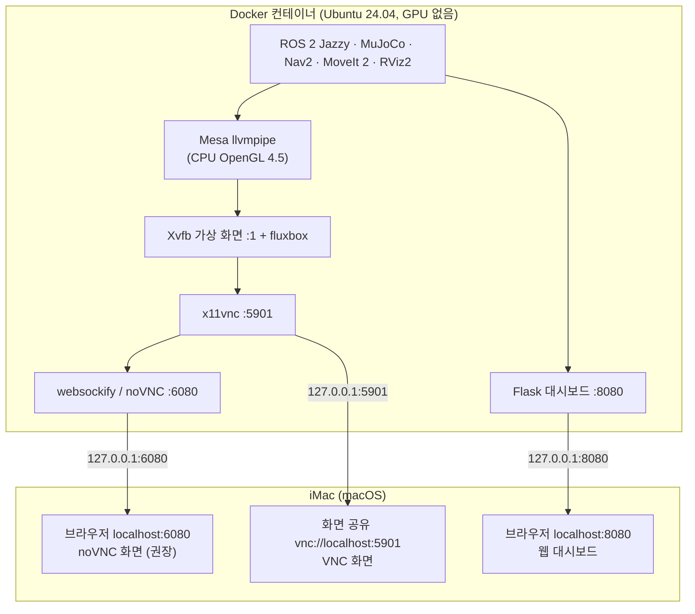

# 환경 설정 — Intel iMac / Docker의 Ubuntu 24.04

[README](../../README.md) · 다음: [휠형 교육](../wheel/README.md)

## 범위와 원리

대상은 **Intel iMac (Retina 5K, 27-inch, 2019)** — Intel Core i5-8600 6코어, Radeon Pro 575X 4GB, RAM 32GB 입니다. Intel(x86_64)이라 ROS 공식 amd64 이미지를 에뮬레이션 없이 그대로 씁니다. Apple Silicon 은 이 문서의 검증 대상이 아닙니다.

macOS 에 Ubuntu 를 이중 부팅하거나 컨테이너 안에서 OS 설치 프로그램을 돌리지 않습니다. `osrf/ros:jazzy-desktop` 이미지가 **Ubuntu 24.04 + ROS 2 Jazzy** 를 제공하고, `docker/Dockerfile` 이 Nav2·MoveIt·가상 데스크톱·소프트웨어 OpenGL 을 추가합니다. macOS 의 Docker 컨테이너는 Mac 의 GPU 를 쓸 수 없으므로 컨테이너 안에서 CPU 로 OpenGL 을 그리는 Mesa llvmpipe(OpenGL 4.5)를 쓰고, 화면은 컨테이너 안 가상 데스크톱을 브라우저(noVNC)나 macOS 화면 공유(VNC)로 봅니다.

| 항목 | 필요 여부 | 이유 |
| --- | --- | --- |
| 그래픽 드라이버 (NVIDIA/AMD) | 불필요 | 컨테이너는 GPU 에 접근 불가. Mesa 소프트웨어 렌더러(llvmpipe)가 이미지에 포함됨 |
| CUDA 툴킷·PyTorch | 불가·불필요 | CUDA 는 NVIDIA 전용(Radeon 에서 동작 안 함). 교육과정도 쓰지 않음 |
| Docker Desktop for Mac | 필요 | 설치에 관리자 권한 1회 필요 (1절) |
| XQuartz | 불필요(선택) | 기본 방식은 브라우저/VNC. XQuartz 는 OpenGL 2.1 까지라 RViz2 가 자주 실패 |
| OpenAI API 키 | 선택 | 2일차 LLM 실습용. 없으면 오프라인 규칙 계획기 |

**대가:** GPU 가속이 없어 MuJoCo 뷰어·RViz·머리 카메라 렌더를 모두 CPU 가 그립니다. 화면이 느리고 시뮬이 실시간보다 느려질 수 있지만, 모든 노드가 시뮬 시간을 쓰므로 동작 결과는 같습니다. 2코어·GPU 없는 환경에서 뷰어+RViz+카메라를 동시에 띄웠을 때 실시간의 약 0.4배, RViz 2fps 였습니다. iMac 은 코어가 3배라 더 나을 것으로 보지만 실측값은 아닙니다.

### 화면을 보여주는 구조



컨테이너 안 프로그램은 가상 화면 `:1` 에 그리고, Mac 은 포트 3개(6080·5901·8080)로 그 화면과 대시보드를 봅니다. X11 소켓 공유(`-v /tmp/.X11-unix`)는 리눅스 호스트에서만 되는 방식이라 쓰지 않습니다.

## 1. Mac 준비

1. **macOS 버전 확인.** 이 iMac 은 macOS 15 Sequoia 가 마지막입니다. Docker Desktop 은 현재 macOS 와 직전 두 버전을 지원하므로 지금은 설치됩니다. 지원 범위는 [공식 설치 문서](https://docs.docker.com/desktop/setup/install/mac-install/)에서 확인하세요.
2. **Docker Desktop 설치** — "Docker Desktop for Mac with Intel chip" `.dmg` 를 받아 `Docker.app` 을 응용 프로그램으로 끌어다 놓고 실행합니다.
   - **관리자 권한**은 설치할 때 한 번 필요합니다. 관리자 계정이 없다면 관리자에게 다음을 부탁합니다. 그 뒤에는 일반 계정으로 실행됩니다.
   - `sudo hdiutil attach Docker.dmg && sudo /Volumes/Docker/Docker.app/Contents/MacOS/install --user=<내계정이름>`
3. **리소스 설정** (Docker Desktop → Settings → Resources). macOS 의 Docker 는 Linux VM 안에서 컨테이너를 돌리므로, 여기서 주는 양이 컨테이너가 쓸 수 있는 전부입니다.

   | 설정 | 권장값 | 이유 |
   | --- | --- | --- |
   | CPU limit | 6 | 소프트웨어 렌더·물리·Nav2·MoveIt 이 모두 CPU 를 씀 |
   | Memory limit | 16 GB | 32GB 중 절반. 전체 모델(시각 메시) 로드 시 2GB, 시스템 전체 6~8GB |
   | Swap | 2 GB | 빌드 시 여유 |
   | Virtual disk limit | 64 GB 이상 | ROS desktop + Nav2 + MoveIt 이미지 약 6~8GB + 빌드 |
   | General → Virtual Machine Manager | Apple Virtualization framework | Intel Mac 기본값 |
   | General → File sharing | VirtioFS | Mac 폴더 공유가 가장 빠름 |

4. Git 이 없으면 macOS 명령줄 도구를 설치합니다(`xcode-select --install`).

Mac 터미널:

```bash
docker version
docker compose version
git --version
mkdir -p ~/Documents
cd ~/Documents
git clone https://github.com/aha645/openarms_llm_ex.git
cd openarms_llm_ex/docker
```

`docker version` 에 Client/Server(OS/Arch: linux/amd64)가 보이면 준비 완료입니다. 이미 받은 저장소가 있으면 clone 을 생략하고 그 폴더의 `docker/` 로 이동합니다.

## 2. Ubuntu + ROS 이미지 빌드·시작

가장 간단한 방법은 시작 스크립트 하나입니다. 빌드 → 실행 → (처음이면) 워크스페이스 준비 → 브라우저 열기를 차례로 합니다.

```bash
bash mac_start.sh
```

단계별로 직접 하려면 Mac 터미널(`docker/`)에서:

```bash
docker compose build            # 처음 1회, 네트워크에 따라 20~40분
docker compose up -d            # 백그라운드 실행
docker compose ps
docker compose exec openarm bash
```

이제부터는 **컨테이너 안**입니다.

```bash
cd /root/openarm_mobile_ws
source /opt/ros/jazzy/setup.bash
grep PRETTY_NAME /etc/os-release
ros2 --help
command -v colcon
command -v rosdep
```

OS 는 Ubuntu 24.04 계열이어야 합니다. `colcon` 또는 `rosdep` 이 없다면 컨테이너에서 설치합니다. 베이스 이미지 태그는 바뀔 수 있어 명시적으로 확인합니다.

```bash
apt-get update
apt-get install -y ros-dev-tools
```

**컨테이너에서는 `mobile_openarm/scripts/01`(NVIDIA 드라이버)·`03`(ROS 설치)을 실행하지 않습니다.** ROS 는 이미지에 이미 있고, 컨테이너는 root 라 sudo 를 전제하는 호스트용 설치 스크립트와도 다릅니다.

### 같은 일을 docker run 한 줄로

Compose 대신 직접 실행할 때의 대응 명령과 옵션 설명입니다.

```bash
docker build -t openarm-mobile:jazzy ~/Documents/openarms_llm_ex/docker
docker run -d --name openarm --platform linux/amd64 --shm-size=2g \
  -p 127.0.0.1:6080:6080 -p 127.0.0.1:5901:5901 -p 127.0.0.1:8080:8080 \
  -e RESOLUTION=1600x900x24 -e VNC_PASSWORD=openarm -e LP_NUM_THREADS=4 \
  -e OPENAI_API_KEY="$OPENAI_API_KEY" \
  -v ~/Documents/openarms_llm_ex:/root/openarm_mobile_ws \
  -v mobile_build:/root/openarm_mobile_ws/mobile_openarm/build \
  -v mobile_install:/root/openarm_mobile_ws/mobile_openarm/install \
  -v mobile_log:/root/openarm_mobile_ws/mobile_openarm/log \
  -v mobile_venv:/root/openarm_mobile_ws/mobile_openarm/.venv-mobile \
  -it openarm-mobile:jazzy
```

| 옵션 | 의미 | 왜 필요한가 |
| --- | --- | --- |
| `-d` / `--name openarm` | 백그라운드 실행 / 이름 지정 | `docker exec -it openarm bash` 로 터미널을 더 열 수 있음 |
| `--platform linux/amd64` | x86_64 이미지 사용 | Intel iMac 과 같은 아키텍처 → 에뮬레이션 없음 |
| `--shm-size=2g` | 컨테이너의 /dev/shm 크기 | Docker 기본 64MB. ROS 2(Fast DDS) 공유메모리·RViz(Qt)가 부족하면 멈추거나 메시지가 유실됨 |
| `-p 127.0.0.1:6080:6080` | noVNC 웹 화면 포트 | 브라우저로 컨테이너 데스크톱 보기. `127.0.0.1:` 을 붙여 같은 네트워크의 다른 PC 에서 접속 못 하게 함 |
| `-p 127.0.0.1:5901:5901` | VNC 포트 | macOS 화면 공유 앱(더 매끄럽고 클립보드 공유) |
| `-p 127.0.0.1:8080:8080` | 웹 대시보드 포트 | 2일차 대시보드를 Mac 사파리에서 바로 열기 |
| `-e RESOLUTION` | 가상 화면 크기·색 깊이 | 작을수록 CPU 렌더가 빨라짐. 느리면 `1280x720x24` |
| `-e VNC_PASSWORD` | VNC 비밀번호 | macOS 화면 공유는 비밀번호 없는 VNC 에 접속하지 않음 |
| `-e LP_NUM_THREADS` | llvmpipe 렌더 스레드 수 | Docker 에 준 CPU(6)보다 1~2 적게 — 물리 시뮬·Nav2 몫을 남김 |
| `-e OPENAI_API_KEY` | Mac 셸의 키 전달 | LLM 실습. 비워 두면 오프라인 계획기 사용 |
| `-v ~/Documents/openarms_llm_ex:/root/...` | Mac 폴더를 컨테이너와 공유 | 코드를 Mac 에디터로 고치고 컨테이너에서 바로 실행. 컨테이너를 지워도 남음 |
| `-v mobile_build:... mobile_install:... mobile_log:... mobile_venv:...` | colcon 산출물과 `.venv-mobile` 을 Docker 볼륨에 | 수천 개의 작은 파일을 Mac 폴더에 쓰면 매우 느림. 볼륨은 VM 안에 있어 빠름. TRON1 도 쓰면 `tron1_openarm/{build,install,log}` 볼륨을 같은 방식으로 추가(compose 에는 들어 있음) |
| `-it` | 터미널 할당 | 로그 확인·입력용 |

쓰지 않는 옵션: `--gpus` (macOS 에서 지원 안 함), `--privileged`, `--net=host` (Mac 에서는 호스트 네트워크가 VM 네트워크라 의미 없음), `-v /tmp/.X11-unix` (리눅스 호스트 전용).

### Dockerfile 요점

| 줄 | 내용 |
| --- | --- |
| `FROM osrf/ros:jazzy-desktop` | Ubuntu 24.04 + ROS 2 Jazzy desktop(RViz2 포함) 공식 이미지 |
| `apt-get install ros-jazzy-navigation2 ... slam-toolbox ... moveit ... python3-venv` | 교육과정 스택 + 가상환경 도구 |
| `xvfb x11vnc novnc websockify fluxbox xterm` | 가상 데스크톱과 원격 화면 |
| `mesa-utils libgl1-mesa-dri libglx-mesa0 libegl-mesa0 libosmesa6 libglfw3` | 소프트웨어 OpenGL(화면용 GLX, 오프스크린용 EGL/OSMesa) |
| `pip3 install --break-system-packages --ignore-installed -c /etc/pip-constraints.txt mujoco==3.5.0 openai pydantic>=2.5` | apt 의 numpy 버전(1.26.4)을 고정한 채 MuJoCo 를 이미지에 미리 설치. `--ignore-installed` 로 debian 이 설치한 typing_extensions 등을 지우지 않음. 3절의 `.venv-mobile`(`--system-site-packages`)이 이 패키지를 그대로 재사용 |
| `ENV LIBGL_ALWAYS_SOFTWARE=1 GALLIUM_DRIVER=llvmpipe` | 항상 llvmpipe 사용 (GPU 탐색 시도 안 함) |
| `ENV XDG_RUNTIME_DIR=/tmp/runtime-root` | glfw/Qt 의 "XDG_RUNTIME_DIR is invalid" 경고 제거 |
| `ENV ROS_AUTOMATIC_DISCOVERY_RANGE=LOCALHOST` | ROS 통신을 컨테이너 안으로 한정 |
| `ENTRYPOINT start-desktop.sh` | Xvfb :1 → fluxbox → xterm → x11vnc(5901, 비밀번호) → noVNC(6080) 순서로 시작 |

## 3. 에셋 준비·colcon 빌드

컨테이너 안:

```bash
cd /root/openarm_mobile_ws
# rosdep이 아직 초기화되지 않은 이미지에만 필요 (이미 초기화됐다는 메시지는 무시 가능)
rosdep init
rosdep update
bash mobile_openarm/scripts/04_setup_workspace.sh
source mobile_openarm/install/setup.bash
ros2 pkg prefix mobile_openarm_apps
```

`04` 가 `mobile_openarm/.venv-mobile` 가상환경(`--system-site-packages`)을 만들고, OpenArm 에셋·모델을 생성한 뒤 `mobile_openarm/` 에서 venv Python 으로 `colcon build --symlink-install --base-paths src` 를 수행합니다. 이미지에 pip 로 넣어 둔 MuJoCo·OpenAI·Pydantic 은 venv 에서 그대로 재사용되므로 새로 내려받지 않습니다. 이미지를 폴더 재구성 전에 빌드했다면 `python3-venv` 가 없으므로 `docker compose build` 를 다시 실행하세요. `rosdep init` 이 이미 초기화되었다고 실패하면 다음 명령으로 진행하세요. `04` 내부 자체 점검(selftest 14개)·rosdep 실패가 무시될 수 있으므로 로그와 빌드 요약을 별도로 확인합니다.

저장소는 Mac 폴더와 공유되지만 컨테이너 내부 경로는 **`/root/openarm_mobile_ws`** 로 고정됩니다. `mobile_openarm/`·`tron1_openarm/` 의 `build/`, `install/`, `log/` 와 `mobile_openarm/.venv-mobile` 은 Compose named volume 입니다. 폴더 재구성 전에 만든 볼륨(`ws_build` 등)은 더 이상 쓰지 않으므로 `docker volume ls` 로 확인 후 지워도 됩니다. **Mac 호스트에서 colcon 을 실행하거나 호스트의 install 경로를 source 하지 마세요.**

## 4. 화면 보기

| 방법 | 접속 | 장점 | 단점 |
| --- | --- | --- | --- |
| **A. noVNC (권장)** | 사파리·크롬에서 `http://localhost:6080/vnc.html?autoconnect=1&resize=scale` | 설치 불필요, 바로 됨 | 키 조합·클립보드가 일부 불편 |
| **B. macOS 화면 공유** | Finder → 이동 → 서버에 연결(⌘K) → `vnc://localhost:5901` | 기본 앱, 더 매끄러움 | 비밀번호 필수(`VNC_PASSWORD`) |
| C. XQuartz (비권장) | 컨테이너 창을 Mac 창으로 직접 띄움 | 창이 Mac 창처럼 보임 | XQuartz 설치에 관리자 권한 필요, OpenGL 2.1(간접 GLX)까지라 RViz2·MuJoCo 뷰어가 실패하거나 매우 느림 |

기본 VNC 비밀번호는 `openarm` 입니다. 필요하면 `docker/docker-compose.yml` 에서 변경 후 컨테이너를 재생성합니다. 포트는 localhost 에만 바인딩되어 있습니다. 접속하면 검은 데스크톱에 xterm 터미널 하나가 떠 있습니다. 바탕화면을 우클릭하면 fluxbox 메뉴에서 터미널을 더 열 수 있고, Mac 터미널의 `docker compose exec openarm bash` 에서 실행한 프로그램도 같은 화면(`DISPLAY=:1`)에 뜹니다.

```bash
# 컨테이너 안에서: 소프트웨어 OpenGL 확인
glxinfo -B | grep -E "renderer|version"
#   OpenGL renderer string: llvmpipe (LLVM ..., 256 bits)
#   OpenGL core profile version string: 4.5 (Core Profile) Mesa ...
```

XQuartz 방식이 꼭 필요할 때:

```bash
# Mac: XQuartz 설치 후 → 환경설정 → 보안 → '네트워크 클라이언트에서의 연결 허용' 체크 → XQuartz 재시작
defaults write org.xquartz.X11 enable_iglx -bool true    # 간접 GLX 허용
xhost +localhost
# 컨테이너 안: 가상 데스크톱 대신 Mac 의 X 서버로
export DISPLAY=host.docker.internal:0
rviz2      # 실패하면 LIBGL_ALWAYS_INDIRECT=1 을 붙여 보고, 그래도 안 되면 A/B 방식으로
```

## 5. 첫 통합 실행

컨테이너 안:

```bash
source /opt/ros/jazzy/setup.bash
source /root/openarm_mobile_ws/mobile_openarm/install/setup.bash
ros2 launch mobile_openarm_apps full_system.launch.py \
  planner:=offline world:=world_light.xml viewer:=false rviz:=false
```

Mac 브라우저: **http://localhost:8080**

`viewer:=false` 는 MuJoCo 별도 창만 끄며 대시보드 카메라는 유지됩니다. 시뮬/주행 → 5초 뒤 MoveIt → 12초 뒤 Task Manager·웹이 시작되며 실제 초기화는 더 걸릴 수 있습니다.

새 Mac 터미널에서 ROS 터미널을 추가하려면:

```bash
cd ~/Documents/openarms_llm_ex/docker
docker compose exec openarm bash
```

그 컨테이너 터미널에서:

```bash
source /opt/ros/jazzy/setup.bash
source /root/openarm_mobile_ws/mobile_openarm/install/setup.bash
ros2 topic echo /task/status --field data
```

`idle` 을 확인하고 다른 컨테이너 터미널에서 다음을 보냅니다.

```bash
ros2 topic pub --once /task/command std_msgs/msg/String \
  "{data: '순찰하고 복귀해'}"
```

이 단계에서는 웹 접속·상태 수신·명령에 대한 상태 전환까지 확인합니다. 실제 운반 검증은 [휠형 2일차](../wheel/README.md)에서 진행합니다. 교육의 T1/T2/T3 는 각각 별도 **컨테이너 터미널**입니다.

### 성능 조절 (GPU 없이 그리므로 중요)

| 조절 | 방법 | 효과 |
| --- | --- | --- |
| 저사양 월드 | `world:=world_light.xml` | 시각 메시 160만 면 제거 → 뷰어 렌더 부하·메모리 크게 감소 |
| MuJoCo 뷰어 끄기 | `viewer:=false` | RViz 나 대시보드로만 보기 |
| RViz 하나만 | 필요할 때만 `rviz:=true` | 가장 무거운 렌더러 |
| 카메라 주기 | `camera_hz:=5.0` (기본 10) | 오프스크린 렌더 절반 |
| LiDAR 선 수 | `lidar_rays:=180` | Nav2·SLAM 에는 충분 |
| 가상 화면 크기 | `RESOLUTION=1280x720x24` | 작은 창 = 빠른 렌더 |
| 시뮬 속도 | `rate_factor:=0.5` | 느린 대신 매끄럽게 (모든 노드가 시뮬 시간 사용) |

**옵션 주의:** `camera_hz`·`rate_factor`·`lidar_rays` 는 현재 `sim.launch.py` 인자입니다. `nav.launch.py` 와 `full_system.launch.py` 가 모두 전달하는 것은 아니므로 모든 launch 에 무작정 붙이지 않습니다. 먼저 `ros2 launch <패키지> <파일> --show-args` 와 launch 소스를 확인하세요.

```bash
ros2 topic hz /clock      # 100Hz 가까우면 실시간, 50Hz 면 0.5배
docker stats openarm      # Mac 터미널: 컨테이너 CPU·메모리 사용량
```

## 6. 종료·재개와 문제 해결

launch 터미널에서 `Ctrl+C` 후 Mac 의 `docker/` 에서 실행합니다.

```bash
docker compose stop         # 일시 정지
docker compose start        # 재개
# 컨테이너 삭제 (소스와 named volume은 유지)
docker compose down
```

`docker compose down -v` 는 빌드·설치 볼륨을 삭제하므로 평소에는 사용하지 않습니다. 재개 후 컨테이너 터미널에 들어가 환경을 source 하고 launch 를 다시 실행합니다.

| 증상 | 원인 | 조치 |
| --- | --- | --- |
| `Cannot connect to the Docker daemon` | Docker Desktop 이 꺼져 있음 | 응용 프로그램에서 Docker 실행, 메뉴 막대 고래 아이콘 확인 |
| 브라우저가 6080 에 접속 못 함 | 컨테이너 시작 스크립트 실패, 포트 충돌 | `docker compose logs openarm`, 컨테이너 안 `cat /tmp/novnc.log /tmp/x11vnc.log` |
| 창이 검게만 나옴 | 첫 프레임 렌더 전(CPU 렌더라 느림) | 10~30초 기다림. 계속되면 `glxinfo -B` 가 llvmpipe 인지 확인 |
| 너무 느림 | CPU 렌더 | 5절 성능 조절표, Docker CPU/RAM 설정 확인 |
| RViz 가 멈추거나 토픽이 끊김 | /dev/shm 부족 | `--shm-size=2g` (compose 에 설정됨) |
| `colcon build` 가 매우 느림 | build/install 을 Mac 폴더에 씀 | compose 의 named volume 사용 여부 확인, File sharing = VirtioFS |
| ROS 패키지 없음 | 빌드 실패 또는 source 누락 | 컨테이너에서 빌드 성공 여부와 `/root/openarm_mobile_ws/mobile_openarm/install/setup.bash` 확인 |
| `numpy.core.multiarray failed to import` | pip 가 numpy 2.x 설치 | `.venv-mobile` 이면 볼륨을 지우고(`docker volume rm <프로젝트>_mobile_venv`) `04` 재실행. 이미지 쪽이면 `pip install --break-system-packages -c /etc/pip-constraints.txt "numpy<2"` |
| 빌드 중 `Cannot uninstall typing_extensions 4.10.0, RECORD file not found` | pip 가 apt(debian) 패키지를 지우려다 실패 | Dockerfile 은 `--ignore-installed` 로 새 버전을 `/usr/local` 에 따로 설치하고 numpy 는 apt 와 같은 버전으로 고정함. 이 방식으로 apt OpenCV 4.6 + pip MuJoCo 3.5 가 함께 동작하고 selftest 14개가 통과하는 것을 Ubuntu 24.04 Python 3.12 에서 확인함 |
| 화면 공유가 접속을 거부 | VNC 비밀번호 없음/틀림 | `VNC_PASSWORD` 확인 후 `docker compose up -d --force-recreate` |
| 컨테이너 재시작 후 화면이 안 뜸 | 남은 X 잠금 파일 | 시작 스크립트가 `/tmp/.X1-lock` 을 지움. 안 되면 `docker compose down && docker compose up -d` |
| 한글이 □ 로 보임 | 글꼴 없음 | 이미지에 `fonts-noto-cjk` 포함됨(RViz·대시보드는 정상). xterm 은 기본 글꼴이 영문용 |

### 확인한 것과 못 한 것

- **확인함:** Ubuntu 24.04(GPU 없음, CPU 2코어)에서 같은 패키지로 화면 체인(Xvfb → fluxbox → x11vnc(비밀번호) → noVNC)을 그대로 돌렸습니다. llvmpipe OpenGL 4.5 에서 MuJoCo 뷰어와 RViz2 가 동시에 뜨고, 브라우저(noVNC)로 화면이 보이며, 머리 카메라 오프스크린 렌더와 ArUco 도 동작했습니다. 이때 실시간 배속은 약 0.4, RViz 는 2fps 였습니다.
- **못 함:** 이 Dockerfile 의 실제 `docker build`, Docker Desktop for Mac 위 실행, iMac 에서의 속도.

환경 설정 완료 후 **[휠형 교육](../wheel/README.md)** 으로 이동합니다.

## 참고 자료

- [Docker Desktop for Mac 설치 (지원 macOS 버전)](https://docs.docker.com/desktop/setup/install/mac-install/)
- [Docker Desktop for Mac 권한 요구사항 (관리자 없이 쓰기)](https://docs.docker.com/desktop/setup/install/mac-permission-requirements.md)
- [Docker Desktop FAQ — 관리자 권한 없이 설치(--user)](https://docs.docker.com/desktop/troubleshoot-and-support/faqs/general/)
- [ROS Jazzy Docker 이미지 목록 (osrf/ros:jazzy-desktop)](https://discourse.openrobotics.org/t/ros-jazzy-docker-images/37879)
- [tiryoh/ros2-desktop-vnc:jazzy — 같은 noVNC 방식의 기성 이미지(대안)](https://hub.docker.com/r/tiryoh/ros2-desktop-vnc)
- [XQuartz GLX/OpenGL 관련 논의](https://github.com/orgs/XQuartz/discussions/482)
- [RViz2 in Docker 오류 사례 (ROS Answers)](https://answers.ros.org/question/411969/rviz2-in-docker-error-while-starting/)
