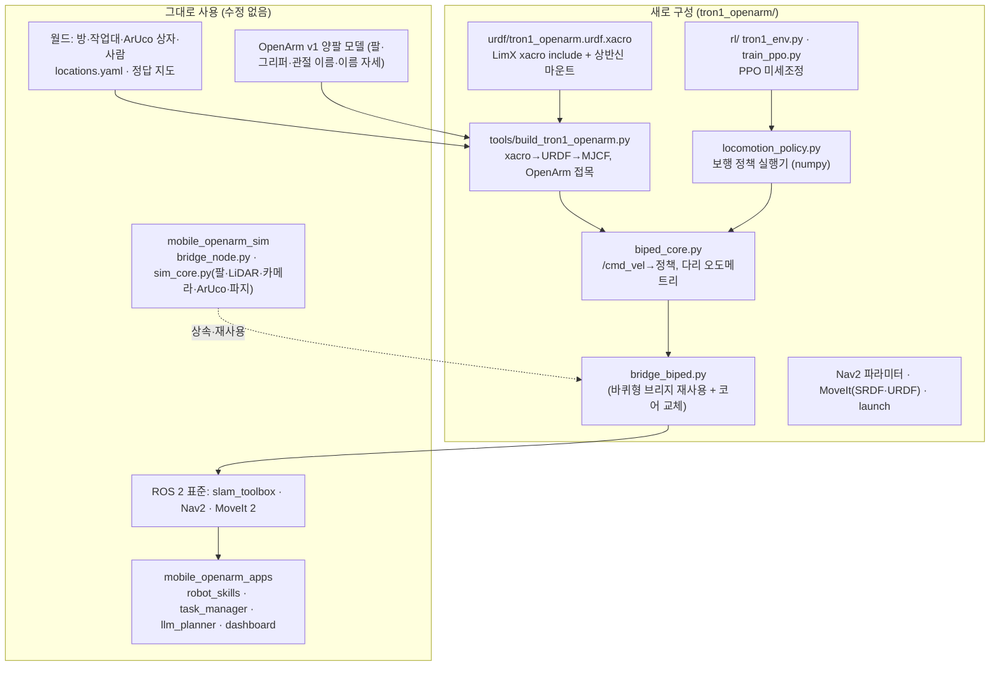

# 01. 무엇이 새로 구성되었고, 왜 그렇게 했나

바퀴형 실습 환경(저장소의 `src/`)은 **그대로 두고**, 하반신만 LimX TRON1 **Point-foot**(점 모양 발, 이족 보행)로 바꾼 두 번째 로봇을 `tron1_openarm/` 폴더에 따로 만들었습니다. 상반신은 기존에 구성한 OpenArm v1 양팔을 그대로 씁니다. SLAM·Nav2·MoveIt·ArUco·LLM 미션·웹 대시보드도 바퀴형과 같은 것을 씁니다.

## 이 문서에 나오는 용어

- **Point-foot** (점 발) — 발바닥이 없고 공 모양 발끝 하나로 땅을 딛는 다리. 발목 관절이 없어 다리 하나에 관절 3개(abad 옆으로 벌리기, hip 앞뒤, knee 무릎)
- **xacro** (XML Macros) — 변수·매크로·include 를 쓸 수 있는 URDF 작성 도구. 처리하면 URDF 가 나온다
- **URDF** (Unified Robot Description Format) / **MJCF** (MuJoCo Format) — ROS 용 / MuJoCo 용 로봇 설명 XML
- **RL** (Reinforcement Learning, 강화학습) — 시행착오와 보상으로 행동 규칙(정책)을 배우는 방법
- **PPO** (Proximal Policy Optimization, 근위 정책 최적화) — 보행 학습에 가장 많이 쓰는 RL 알고리즘. 정책을 한 번에 조금씩만 바꾸는 것이 특징
- **정책 (policy)** — 센서값을 넣으면 관절 목표각을 내놓는 신경망. 50 Hz로 계속 실행된다
- **사전학습 (pretrained)** — LimX 가 Isaac Gym(NVIDIA GPU 물리 시뮬레이터)에서 TRON1 단독으로 학습해 공개한 정책
- **미세조정 (fine-tuning)** — 사전학습 정책을 출발점으로, 바뀐 조건(상반신 14 kg)에 맞게 추가 학습
- **오도메트리 (odometry)** — 로봇 자신의 센서만으로 계산한 이동 추정

## 한눈에 보기

## 새로 구성한 부분과 이유

| 새로 만든 것 | 파일 | 하는 일 | 왜 필요한가 |
|---|---|---|---|
| ① 하반신 로봇 설명 가져오기 | `scripts/10_setup_tron1.sh` | `limxdynamics/tron1-robot-description` 을 `third_party/` 로 clone | LimX 가 공개한 TRON1 의 링크 길이·관절 한계·질량·관성(CAD 값)을 그대로 쓰기 위해. 직접 재면 틀린다 |
| ② 최상위 xacro | `urdf/tron1_openarm.urdf.xacro` | LimX `robot.xacro` 를 include + 상반신을 얹을 **마운트 판** 링크 추가 | LimX 파일은 수정하지 않고(업데이트 받기 쉽게) 우리 추가분만 따로 둔다. 마운트 위치(`mount_x`, `mount_z`)를 xacro 변수로 두어 바꿔 보기 쉽게 |
| ③ 모델 생성기 | `tools/build_tron1_openarm.py` | xacro → URDF → MuJoCo 컴파일 → MJCF, LimX MuJoCo 충돌형상 이식, PD 구동기, OpenArm 접목, 센서 배치 | 시뮬레이터(MJCF)와 ROS(URDF)가 같은 기구학을 쓰도록 한 번에 자동 생성. 자세한 근거는 [02-model.md](02-model.md) |
| ④ 상반신 기둥 교체·위치 | 같은 파일 (`SHOULDER_HEIGHT`, `MOUNT_X`) | OpenArm 의 75 cm 기둥을 약 43 cm 로 바꿔 **어깨 1.08 m, 몸통 중심보다 8 cm 앞** | 작업대(0.70 m) 상자가 팔 도달거리 안에 들어와 DAY 2 조작 코드를 고치지 않아도 되고, 내린 손이 TRON1 엉덩이 모터와 6 cm 떨어진다. 원본 기둥(어깨 1.40 m)보다 무게중심이 낮다 |
| ⑤ 보행 정책 | `policies/tron1_openarm_policy.npz`, `locomotion_policy.py` | /cmd_vel(속도 명령)을 다리 6관절 목표각으로 바꾸는 신경망 실행기 | 바퀴는 "바퀴 속도 = 공식"으로 끝나지만, 두 발은 **넘어지지 않게 발을 어디에 언제 디딜지** 매 순간 정해야 한다. 공식으로 풀기 어려워 RL 로 배운 정책을 쓴다 |
| ⑥ PPO 미세조정 | `rl/tron1_env.py`, `rl/train_ppo.py` | LimX 사전학습 정책을 출발점으로, 상반신 14.4 kg·팔 동작·잡음 조건에서 추가 학습 | 사전학습 정책은 TRON1 **단독**(18.5 kg)용이다. 상반신을 얹으면 옆으로 흐르고(0.1 m/s), 팔을 움직이면 넘어졌다 → [03-locomotion-rl.md](03-locomotion-rl.md) |
| ⑦ 이족 시뮬레이션 코어 | `biped_core.py` | 바퀴형 `MobileOpenArmSim` 을 상속해 하반신 부분만 교체: 명령→정책, 다리 오도메트리, 서 있는 자세 초기화 | 팔·LiDAR·카메라·ArUco·파지 보조 코드는 부모 것을 그대로 쓰고 다른 부분만 바꾸면 차이가 분명하고 버그가 적다 |
| ⑧ 다리 오도메트리 | 같은 파일 `_update_odom()` | "디딘 발은 미끄러지지 않는다"고 보고 관절각(기구학)+IMU 자세로 몸통 이동 계산. 공 모양 발이 **굴러가는 만큼** 보정, 속도는 보행 한 주기(0.5 s) 평균 | 바퀴가 없으니 바퀴 엔코더 오도메트리를 못 쓴다. 굴림 보정 전에는 거리가 10% 짧게 나왔다 (6 m 에 30~40 cm → 보정 후 2~5 cm) |
| ⑧-2 제자리 유지 · 속도 외곽 루프 | 같은 파일 `_apply_base()` | 명령 0: 멈춘 자리로 되돌아가는 작은 속도. 명령 있음: 측정 속도와의 차이를 PI 로 보정(느림·옆 흐름·회전 흐름) | 정책만으로는 제자리에서 60 s 에 3.1 m 흘렀고(→ 0.12 m), Nav2 MPPI 의 작은 시작 명령(0.04 m/s)을 못 따라가 **주행이 시작되지 않는 교착**이 있었다 (04장) |
| ⑨ 브리지 | `bridge_biped.py` | 바퀴형 브리지를 import 해 코어만 바꿔 끼움 + `/biped/status` | 토픽·액션·서비스 이름이 바퀴형과 100% 같으므로 SLAM·Nav2·MoveIt·앱이 그대로 동작 |
| ⑩ Nav2 파라미터 | `config/nav2_params_tron1.yaml` (`tools/make_nav2_params_tron1.py`) | 속도·가속 한계, 도착 허용오차, footprint, AMCL 잡음 변경 | 보행은 바퀴보다 느리고, 급가속을 못 하고, 제자리에서도 몸이 흔들린다 |
| ⑪ ROS 용 URDF·SRDF | `urdf/tron1_openarm.urdf`, `tron1_openarm_moveit_config/` | 다리 링크가 들어간 URDF, 다리–팔 충돌 쌍을 새로 계산한 SRDF | MoveIt 이 팔 경로를 짤 때 다리·TRON1 몸통과 부딪히는지 검사해야 한다. 팔 그룹·이름 자세·컨트롤러 이름은 바퀴형과 같다 |
| ⑫ launch | `launch/sim·slam·nav·full_system.launch.py` | 바퀴형 launch 와 같은 인자, 패키지 이름만 다름 + `policy:=` 인자 | 실습 명령이 `mobile_openarm_sim` → `tron1_openarm_sim` 으로만 바뀌도록 |

## 그대로 쓰는 부분과 이유

| 그대로 쓰는 것 | 왜 바꾸지 않아도 되나 |
|---|---|
| OpenArm 양팔·그리퍼 모델, 관절 이름, 팔 컨트롤러 이름 | 상반신은 같은 로봇. MoveIt 설정(kinematics·joint_limits·controllers·OMPL)도 복사해서 그대로 씀 |
| `mobile_openarm_apps` 전체 (robot_skills, pick/place, task_manager, llm_planner, dashboard) | 앱은 `/cmd_vel`, `/odom`, TF `map→base_footprint`, `/aruco/detections`(base_footprint 기준), MoveIt 액션만 쓴다. 이 인터페이스를 이족 브리지가 똑같이 제공한다. 어깨 높이를 맞췄으므로 작업대 접근 수치(`DOCK_GAP 0.40`, `IDEAL_REACH 0.52`)도 그대로 유효 |
| 월드 (방·작업대·상자·사람), `locations.yaml`, 정답 지도 | `build_world_tron1.py` 가 바퀴형 `build_world.py` 를 그대로 불러 같은 월드를 만들고 로봇만 바꿈 |
| slam_toolbox 설정 | LiDAR 토픽·프레임 이름이 같고, 2D 스캔 성질도 같음 |
| LLM 계획기·안전 검증 | 행동(navigate/pick/place…)과 위치 이름이 같으므로 |

## 바퀴형과 실제로 달라지는 체감 차이

| 항목 | 바퀴형 | TRON1 이족 |
|---|---|---|
| 명령 0 일 때 | 완전히 멈춤 | **제자리 걸음** (Point-foot 은 발바닥이 없어 가만히 서 있을 수 없음) |
| 최고 속도 (Nav2 설정) | 0.40 m/s, 회전 1.2 rad/s | 0.35 m/s, 회전 0.8 rad/s |
| 몸통 높이 | 고정 | 0.68 m ± 1~2 cm 출렁임, 기울기 1~3° |
| 오도메트리 | 바퀴 엔코더 (매우 정확) | 다리 기구학 (거리 오차 수 %, AMCL 이 보정) |
| 조작 중 | 바퀴 잠금 → 몸통 고정 | 제자리 걸음 중 팔 동작 → 몸통이 조금씩 움직임. 카메라로 다시 보고 보정 |
| 넘어짐 | 없음 | 가능. `/biped/status` 의 `fallen` 이 true → `/sim/reset` |

## 다음 문서

- [02-model.md](02-model.md) — 모델 파일 가져오기·xacro·MJCF 생성·상반신 고정 높이와 그 근거
- [03-locomotion-rl.md](03-locomotion-rl.md) — PPO 강화학습으로 두 발로 서고 걷게 하기, 결과
- [04-ros2-labs.md](04-ros2-labs.md) — 같은 SLAM·Nav2·MoveIt·LLM 실습을 TRON1 로 하기
- [05-limits-real-robot.md](05-limits-real-robot.md) — 검증 범위, 한계, 실로봇으로 갈 때
