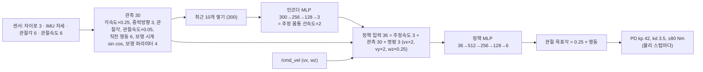

# 03. 두 발로 서고 걷기 — PPO 강화학습과 가상 로봇 적용

## 이 장의 미션

> LimX 가 공개한 TRON1 보행 정책을 우리 MuJoCo 모델(상반신 14.4 kg)에서 돌려 보고 문제를 확인한다.
> PPO 로 미세조정한 뒤, 학습에 쓰지 않은 배포 조건(실습 월드, 물리 2 ms)에서 사전학습 정책과 성능을 비교한다.
> 결과 정책을 시뮬레이터 브리지에 넣어 SLAM·Nav2 가 동작하게 한다 (04장).

## 이 장에 나오는 용어

- **RL** (Reinforcement Learning, 강화학습) — 행동 → 보상 → 더 좋은 행동을 반복해 정책을 배움
- **PPO** (Proximal Policy Optimization, 근위 정책 최적화) — 한 번 업데이트에서 정책이 너무 많이 바뀌지 않게 잘라내는(clip) 정책경사 알고리즘
- **액터 (actor) / 크리틱 (critic)** — 행동을 내는 신경망 / 지금 상태가 앞으로 얼마나 좋은지(가치) 예측하는 신경망
- **KL** (Kullback–Leibler divergence) — 업데이트 전후 정책이 얼마나 달라졌는지 재는 값. 너무 크면 정책이 망가진다
- **GAE** (Generalized Advantage Estimation) — "이 행동이 평균보다 얼마나 좋았나"(advantage)를 안정적으로 추정하는 방법
- **도메인 랜덤화 (domain randomization)** — 질량·마찰·지연·잡음을 일부러 바꿔 가며 학습해 실제 차이에 강하게 만드는 것
- **커리큘럼 (curriculum)** — 쉬운 조건부터 시작해 잘하면 조금씩 어렵게
- **sim-to-sim** — 한 시뮬레이터(Isaac Gym)에서 학습한 정책을 다른 시뮬레이터(MuJoCo)에서 검증
- **JAX** — 자동 미분이 되는 Python 수치 라이브러리 (CPU·GPU). PyTorch 대신 사용 (아래 설명)

## 1. 왜 강화학습이 필요한가

바퀴형은 `/cmd_vel` 을 좌우 바퀴 속도로 바꾸는 식 하나로 끝납니다. **Point-foot 이족은 그렇게 할 수 없습니다.**

- 발바닥이 점이라 **가만히 서 있을 수 없습니다** (지지 면적 = 0). 넘어지지 않으려면 계속 발을 옮겨 디뎌야 합니다 → 명령 0 에서도 제자리 걸음
- 다리 6관절 토크를 매 순간 정해야 하고, 상반신 14 kg 가 흔들리면 디딜 곳이 바뀝니다
- 이를 수식(역동역학 + 최적제어)으로 풀 수도 있지만 모델 오차에 약하고 구현이 깁니다. 지금 TRON1 같은 로봇의 표준은 **시뮬레이터에서 RL 로 정책을 배워** 실기에 옮기는 것입니다 (LimX 도 그렇게 배포)

## 2. LimX 사전학습 정책 — 관측·행동 규약

LimX 의 `tron1-rl-deploy-python/controllers/model/PF_TRON1A/policy/isaacgym/` 에 있는 `encoder.onnx`, `policy.onnx` 를 numpy 가중치로 옮겼습니다 (`policies/limx_pf_tron1a_pretrained.npz`, 검증 오차 1e-5).



- 정책 주기 50 Hz, 보행 주파수 2 Hz (발 하나가 0.25 s 씩 디딤), 발 높이 0.1 m
- 같은 규약을 `tron1_openarm_sim/locomotion_policy.py`(배포)와 `rl/tron1_env.py`(학습)가 똑같이 구현합니다

## 3. 사전학습 정책 그대로 써 보기 (문제 확인)

```bash
cd ~/openarm_mobile_ws/tron1_openarm/src/tron1_openarm_sim
python3 tools/selftest_tron1.py world_light.xml policies/limx_pf_tron1a_pretrained.npz
```

| 조건 | 결과 (이 저장소에서 측정) |
|---|---|
| TRON1 단독 (LimX robot.xml) | 잘 걷는다. 명령 0 에서 앞으로 0.17 m/s 흐름 — sim-to-sim 차이 |
| + 상반신 14.4 kg, 팔 고정 | 선다·걷는다. 대신 **옆으로 0.10 m/s 흐르고**, 직진 중 회전 0.11 rad/s (10 s 에 12.7° 틀어짐) |
| + 관측 잡음 (LimX 학습 수준) | 32 환경 × 10 s 에 57 번 넘어짐 |
| + 팔 자세 변경 (ready→carry→hands_up) | **넘어짐** |

LimX 의 학습 랜덤화는 몸통 질량 −0.5~+5 kg 였는데, 상반신은 그보다 3배 무겁고 위에 달려 있습니다. 그래서 **미세조정이 필요**합니다.

## 4. PPO 미세조정 설계 (`rl/`)

### 4-1. 왜 처음부터가 아니라 미세조정인가

| | 처음부터 학습 | 사전학습 + 미세조정 (이 저장소) |
|---|---|---|
| 필요한 경험량 | LimX: 환경 8192개 × 24 스텝 × 15,000 회 ≈ **30억 스텝** | 수백만~천만 스텝 |
| 필요한 장비 | Isaac Gym + NVIDIA GPU | CPU 2코어로도 1~2 시간 |
| 걸음새 | 보상 설계를 처음부터 맞춰야 함 | LimX 의 검증된 걸음새를 유지한 채 무게만 적응 |

이 실습 PC(노트북 i7-7700HQ, iMac Docker)와 이 저장소를 만든 클라우드(CPU 2코어, GPU 없음)에서는 처음부터 학습은 현실적으로 불가능합니다. 그래서 **같은 네트워크·같은 관측 규약을 유지한 전이학습**을 택했습니다. `--init scratch` 옵션으로 처음부터도 할 수 있게 해 두었습니다(GPU PC 권장).

### 4-2. 환경 (`rl/tron1_env.py`)

| 항목 | 값 | 이유 |
|---|---|---|
| 모델 | `mjcf/tron1_openarm_train.xml` — 상반신 충돌 끔, 바닥만 | 계산을 가볍게. 팔의 질량·관성은 그대로 |
| 병렬 | 128 환경, `mujoco.rollout.Rollout` (C 스레드) | 파이썬 반복문 없이 여러 MjData 를 한 번에 진행. 2코어에서 초당 약 3,500 정책 스텝 (학습 포함) |
| 물리 | 4 ms × 5 = 20 ms (50 Hz) | 학습 속도 2배. 배포는 2 ms 에서 다시 평가 |
| 명령 | vx −0.35~0.6, vy ±0.2(30%), wz ±0.9 / 25% 제자리 / 20% 직진만 / 15% 제자리 회전, 5 s 마다 바꿈 | Nav2(직진+회전), 도킹(느린 직진), yaw 보정(제자리 회전)에서 실제로 쓰는 명령 |
| 팔 | SRDF 이름 자세(home·ready·carry·hands_up)와 그 사이 무작위 자세, 1.5~3 s 에 걸쳐 이동 (평균 3 s 마다) | MoveIt 궤적이 몸에 주는 반동을 학습. **최소 60% 확률로 항상 켬** (조작에 꼭 필요) |
| 랜덤화 | 몸통 질량 −0.5~+2 kg, 무게중심 ±2 cm, 바닥 마찰 0.4~1.2, PD 게인 ±15%, 행동 지연 0~12 ms, 7 s 마다 몸통 밀기 ±0.5 m/s, 관측 잡음(LimX 와 같은 크기) | 실로봇·다른 시뮬레이터 차이에 강하게. **난이도(difficulty) 0→1 로 서서히** 키움 |
| 종료 | 몸통 0.45 m 아래 또는 기울기 45° 이상 | 넘어짐 |
| 에피소드 | 20 s | |

### 4-3. 보상 (LimX `pointfoot_flat` 과 같은 항목, 계수 일부 조정)

| 항목 | 계수 | 뜻 |
|---|---|---|
| keep_balance | +1.0 | 살아 있으면 매 스텝 보상 |
| tracking_lin_vel | +1.5 | exp(−‖명령 vxy − 실제 vxy‖² / 0.2) — **옆 흐름도 여기서 벌점** |
| tracking_ang_vel | +0.75 | exp(−(명령 wz − 실제 wz)² / 0.25) |
| base_height | −20 | (높이 − 0.68)² — 어깨 높이 유지 (LimX −2 보다 강하게) |
| orientation | −10 | 몸통 기울기² |
| lin_vel_z / ang_vel_xy | −0.5 / −0.05 | 위아래 출렁임, 앞뒤·좌우 흔들림 |
| torques / action_rate / action_smooth | −8e-5 / −0.01 / −0.01 | 에너지·떨림 줄이기 |
| dof_pos_limits | −2 | 관절 한계 근처 금지 |
| feet_distance | −100 | 두 발 간격 < 11.5 cm 금지 (다리 꼬임) |
| contact_force / contact_vel | −2 / −2 | 보행 시계에 맞춰 디딜 때 디디고, 들 때 들기 (LimX 의 걸음새 유지 항) |
| termination | −20 | 넘어짐 |

### 4-4. PPO 와 학습 중 겪은 문제

| 설정 | 값 |
|---|---|
| 액터 | 사전학습 인코더 + 정책 그대로 시작, 행동 표준편차 0.08 (작게: 사전학습 걸음새를 흔들지 않도록) |
| 크리틱 | 새로 (관측 30 + 실제 선속도 3 + 명령 3 + 추정속도 3 → 512-256-128 → 1). 처음 20 회는 크리틱만 학습 |
| PPO | 반복당 128 × 24 = 3,072 스텝, 5 에폭 × 4 미니배치, clip 0.2, γ 0.99, λ 0.95 |
| 학습률 | 1e-5~2e-5 에서 KL 로 자동 조절 (0.008~0.03 유지), **KL > 0.02 면 그 반복의 액터 업데이트 중단** |
| 인코더 | PPO 뒤 따로, 실제 선속도(×2)를 맞히도록 MSE 학습 (LimX 와 같음) |

실제로 겪은 문제 (같은 증상을 보면 참고):

1. **첫 액터 업데이트에서 정책 붕괴** (KL 0.30, 넘어짐 급증): 사전학습 신경망에 Adam(최적화기)의 초기 스텝이 너무 큼 → 학습률 1e-4 → 2e-5, KL 조기 중단
2. **인코더를 PPO 미니배치마다 같이 학습** → 정책 입력이 바뀌어 KL 폭증 → 인코더는 PPO 가 끝난 뒤 따로 학습
3. **관측 잡음을 처음부터 넣으면** 사전학습 정책이 버티지 못함(낙상 대부분의 원인) → 난이도 커리큘럼
4. **난이도에 팔 동작까지 묶었더니** 난이도가 0.2 근처에 머물러 팔 동작을 거의 못 배움 → 팔은 난이도와 별개로 최소 60%

### 4-5. 실행

```bash
bash tron1_openarm/scripts/11_train_policy.sh 90        # 가상환경 생성 → 90분 학습 → 평가
```

또는 직접:

```bash
python3 -m venv ~/tron1_rl_venv
env -u PYTHONPATH ~/tron1_rl_venv/bin/pip install "jax[cpu]" optax "mujoco==3.5.0" onnx onnxruntime scipy pyyaml
cd ~/openarm_mobile_ws/tron1_openarm/rl
env -u PYTHONPATH ~/tron1_rl_venv/bin/python train_ppo.py --minutes 90 --init-std 0.08 --lr 2e-5 --out ../runs/my_run
```

| 옵션 | 뜻 |
|---|---|
| `--envs 128` | 병렬 환경 수. 코어가 많으면 늘리기 (16코어: 512) |
| `--minutes` | 학습 시간 |
| `--init scratch` | 사전학습 없이 처음부터 (GPU PC, 수 시간~하루) |
| `--resume runs/x/last.pkl` | 이어서 학습 (크리틱·난이도 포함) |
| `--train-encoder 0` | 인코더 고정 |

**왜 별도 가상환경인가:** JAX 는 numpy 2.x 가 필요합니다. ROS Jazzy(apt)는 numpy 1.26 에 맞춰 빌드되어 있어 같은 환경에 설치하면 cv_bridge 등이 깨집니다. 학습은 ROS 가 필요 없으므로 분리합니다.

**왜 PyTorch 가 아니라 JAX 인가:** LimX 원본(rsl_rl)은 PyTorch 입니다. 이 저장소를 만든 환경에서는 PyTorch 내려받기 서버가 막혀 있었고, JAX 는 일반 PyPI 에서 CPU 판이 작게 설치됩니다. GPU 가 있으면 `pip install "jax[cuda12]"` 로 같은 코드가 GPU 에서 돕니다. 신경망 구조·가중치 형식(npz/ONNX)은 PyTorch 쪽과 같습니다.

로그 한 줄 읽기:

```json
{"it": 145, "steps": 445440, "fall_rate": 0.00046, "difficulty": 0.0, "ep_len": 716.8, "kl": 0.011, "lin_track": 0.79, "ang_track": 0.80}
```

`fall_rate` = 스텝당 넘어짐 비율 (0.0003 = 환경 하나가 평균 67초에 한 번), `difficulty` = 랜덤화 강도, `ep_len` = 평균 에피소드 길이(최대 1000), `lin_track/ang_track` = 속도 추종 보상(1 이 완벽).

## 5. 결과

> 학습 진행 중입니다. 학습이 끝나면 사전학습 정책과 미세조정 정책의 평가 결과(rl/eval_policy.py)를 이 절에 표로 정리합니다.

## 6. 가상 로봇에 적용

학습 결과 `best.npz` 를 `src/tron1_openarm_sim/policies/tron1_openarm_policy.npz` 로 복사하면 브리지가 그 정책을 씁니다. 다른 정책을 시험하려면 launch 인자로 바꿉니다.

```bash
ros2 launch tron1_openarm_sim sim.launch.py policy:=$HOME/openarm_mobile_ws/tron1_openarm/runs/my_run/best.npz
ros2 launch tron1_openarm_sim sim.launch.py policy:=$(ros2 pkg prefix --share tron1_openarm_sim)/policies/limx_pf_tron1a_pretrained.npz   # 비교
```

브리지 안에서의 흐름 (`biped_core.py`):

1. `/cmd_vel` → `set_cmd_vel(v, w)` (0.5 s 동안 새 명령이 없으면 0 = 제자리 걸음)
2. 물리 스텝 10번(20 ms)마다 `_apply_base()`: 명령을 학습 범위(vx −0.35~0.5, wz ±1.0)로 자르고, 가속 0.8 m/s²·2.0 rad/s² 로 부드럽게 바꿔 정책에 넣음 → 다리 목표각
3. 물리 스텝마다 MuJoCo 가 PD 토크 계산
4. `_update_odom()`: 디딤발 고정 가정으로 다리 오도메트리 → `/odom`, TF `odom→base_footprint`

LimX 배포 형식 ONNX 로도 내보낼 수 있습니다 (입출력 이름·크기 동일):

```bash
env -u PYTHONPATH ~/tron1_rl_venv/bin/python export_onnx.py ../policies/tron1_openarm_policy.npz ../policies/onnx
```

## 7. 더 좋은 정책을 원할 때 (GPU PC)

- **Isaac Gym / Isaac Lab 에서 처음부터 학습**: `limxdynamics/tron1-rl-isaacgym` 의 `resources/robots/PF_TRON1A/urdf/robot.urdf` 대신 이 저장소의 `mjcf/tron1_openarm.urdf.generated` 에 OpenArm 링크를 붙인 URDF 를 넣고, `terminate_after_contacts_on` 에 팔 링크를 추가, `added_mass_range` 를 상반신 기준으로 다시 잡아 학습합니다. 학습 후 `export_policy_as_onnx.py` 로 나온 ONNX 를 `onnx→npz` 변환(이 문서 2절과 같은 방법)해서 쓰면 됩니다.
- **팔 관절각을 관측에 넣기**: 지금 정책은 팔이 어디 있는지 모르고 몸통 반동으로만 알아챕니다. 관측에 팔 14관절을 넣으면 더 안정적이지만 네트워크 입력이 바뀌어 사전학습을 쓸 수 없습니다 (처음부터 학습 필요).

## 확인 질문

1. Point-foot 로봇이 명령 0 에서도 걷는 이유는? → 지지 면적이 0 이라 계속 디뎌야 균형 유지
2. 미세조정에서 행동 표준편차를 0.08 로 작게 시작한 이유는? → 사전학습 걸음새를 탐색 잡음으로 망가뜨리지 않으려고
3. 학습은 4 ms, 평가는 2 ms 로 한 이유는? → 학습 속도를 높이고, 배포 조건에서 따로 확인하려고 (sim-to-sim)
