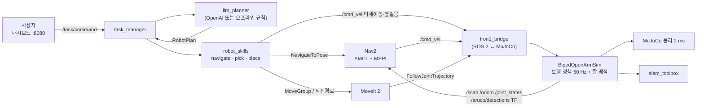
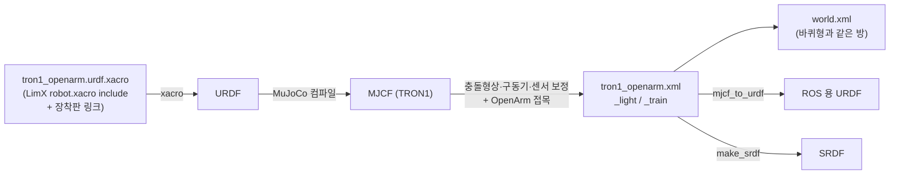
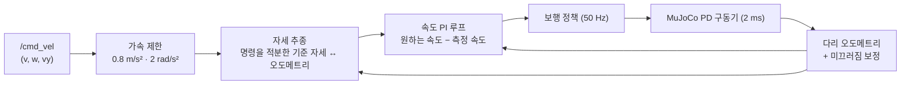
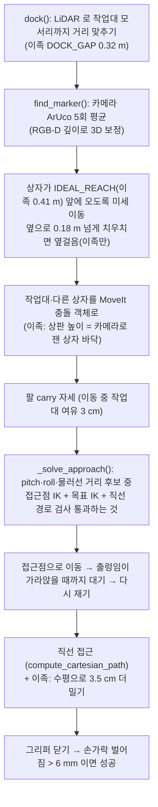
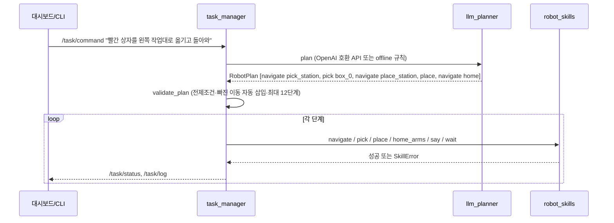

# 07. 구현 과정 전체 해설 — 실제로 무엇을, 어떤 자료로, 어떻게 했나

이 문서는 "바퀴형 하반신 → TRON1 이족 하반신" 작업을 **실제로 수행한 순서대로** 정리한 기록입니다.
개념 → 사용한 자료 → 수정한 파일과 내용 → 실행 명령 → 확인 방법과 결과 → 만족하지 못한 점 순서로 씁니다.

- 앞 장(01~06)이 "결과 설명"이라면, 이 장은 "과정 기록"입니다.
- 약어는 처음 나올 때 괄호 안에 풀어 씁니다.
- 수치는 모두 이 저장소의 시뮬레이터에서 직접 잰 값입니다.

---

## 0. 현재 상태 한눈에 보기 (2026-11-05 기준)

| 기능 | 상태 | 근거 |
|---|---|---|
| 하반신 모델 (xacro → URDF → MJCF) | ✅ Point-foot·Sole-foot 둘 다 생성 | 2장 |
| 보행 정책 (PPO 미세조정) | ✅ PF v8: 넘어짐 0/3 (6개 시험). SF: 넘어짐 0/3 (한 팔 carry 만 3/3) | 5장 |
| 제자리 서기 | PF: 원리상 불가(항상 제자리 걸음). SF: 명령 0 이면 실제로 섬 (30 s 흔들림 0.10 m) | 4장 |
| SLAM 지도 작성 | ✅ 점유 셀 97.6% 가 정답 지도 10 cm 안 | 7장 |
| Nav2 주행 | ✅ 목표 3/3 도착 (PF). 전체 미션에서 pick_station 도착 | 8장 |
| 도킹·ArUco 인식 | ✅ ArUco 위치 오차 최대 0.2 cm (정답 대비) | 9장 |
| LLM 명령 → 계획 | ✅ "빨간 상자를 왼쪽 작업대로 옮기고 돌아와" → 5단계 계획 | 10장 |
| **MoveIt 집기** | ❌ **아직 성공 못 함** — 손끝이 상자에서 3~6 cm 어긋남 | 9장 |
| 상반신을 하반신에 바짝 붙인 설계 | 🔄 모델·자세 적용 완료, 정책 재학습 중 | 3·11장 |

---

## 1. 전체 구조



바퀴형과 비교해 바뀐 것은 오른쪽 아래 `tron1_bridge` 와 `BipedOpenArmSim` 뿐입니다.
토픽 이름이 같으므로 SLAM·Nav2·MoveIt·LLM 앱은 바퀴형 것을 그대로 씁니다.
앱 쪽에는 이족용 선택 기능만 더했습니다(9장).

용어

- **MJCF** (MuJoCo XML Format) — MuJoCo 시뮬레이터의 로봇·월드 기술 파일
- **URDF** (Unified Robot Description Format) — ROS 의 로봇 기술 파일. **xacro** (XML Macros) 는 URDF 를 변수·매크로로 만드는 형식
- **SRDF** (Semantic Robot Description Format) — MoveIt 용 팔 그룹·이름 자세·충돌 무시 쌍
- **TF** (Transform) — ROS 의 좌표계 트리 (map → odom → base_footprint → base_link …)
- **PD 제어** (Proportional-Derivative) — 목표각과의 차이(P)와 속도(D)로 토크를 내는 관절 제어
- **PPO** (Proximal Policy Optimization) — 정책을 조금씩만 바꾸며 학습하는 강화학습 알고리즘
- **SLAM** (Simultaneous Localization and Mapping) — 움직이며 지도를 만들고 동시에 자기 위치를 추정
- **AMCL** (Adaptive Monte Carlo Localization) — 만들어 둔 지도 위에서 파티클로 위치를 추정
- **MPPI** (Model Predictive Path Integral) — Nav2 의 경로 추종 제어기. 무작위 속도 후보를 굴려 보고 고른다
- **IK** (Inverse Kinematics) — 손 위치·자세 → 관절각 계산
- **TCP** (Tool Center Point) — 그리퍼 손가락 사이의 기준점 (`openarm_*_hand_tcp`)
- **ONNX** (Open Neural Network Exchange) — 신경망 가중치 교환 형식
- **PF / SF** — TRON1 의 Point-foot(점 발, 발목 없음) / Sole-foot(평발, 발목 관절 있음)

---

## 2. 하반신 교체 — 어떤 자료를 써서 어떻게 만들었나

### 2-1. 사용한 자료

| 자료 | 무엇을 가져왔나 |
|---|---|
| `limxdynamics/tron1-robot-description` | `pointfoot/PF_TRON1A`, `SF_TRON1A` 의 xacro(링크 길이·관절 한계·질량·관성), 메시(STL), MuJoCo 용 `xml/robot.xml`(충돌 형상) |
| `limxdynamics/tron1-mujoco-sim` | LimX 의 MuJoCo 시뮬 구성 확인 (PD 를 토크로 거는 방식, 센서 이름) |
| `limxdynamics/tron1-rl-deploy-python` | `PointfootController.py`·`SolefootController.py`(관측·행동 규약), `params.yaml`(kp·kd·토크 한계·보행 주기), 사전학습 정책 ONNX |
| `limxdynamics/tron1-rl-isaacgym` | `pointfoot_flat`·`solefoot_flat` 학습 코드: 보상 항, 명령 구성(SF 의 base_height·stand_still), 관측 순서 |
| `enactic/openarm_mujoco` v1 | OpenArm 양팔 MJCF (`openarm_bimanual.xml`) |

### 2-2. 만드는 순서와 이유



1. **xacro**: `urdf/tron1_openarm.urdf.xacro` 는 LimX `robot.xacro` 를 고치지 않고 include 합니다. 그 위에 상반신을 얹을 `openarm_mount_link`(0.20×0.24×0.014 m 판, 0.6 kg)만 더합니다. LimX 원본이 바뀌어도 그대로 받을 수 있게 하려는 것입니다.
2. **xacro → URDF → MJCF**: `tools/build_tron1_openarm.py` 가 다음을 합니다.
   - xacro 를 처리합니다. `$(find robot_description)` 를 실제 경로로 바꾼 임시 사본을 씁니다.
   - MuJoCo 로 바로 컴파일한 뒤 `mj_saveLastXML` 로 저장합니다.
   - 질량 1e-6 kg·관성 0 인 `contact_*_Link` 는 MuJoCo 가 거부하므로 뺍니다.
3. **보정**: URDF 의 다리 충돌 형상은 구 2개뿐이라, LimX 가 MuJoCo 용으로 검증한 `robot.xml` 의 충돌 원통·상자를 옮겨 옵니다.
   - 관절 armature·damping 0.01 을 줍니다.
   - `base_Link` 를 `base_link` 로 바꿉니다 (ROS 관례).
   - 몸통에 `freejoint`(`base_free`)를 붙입니다.
   - 다리에 PD 위치 구동기를 붙입니다. PF 는 kp 42·kd 3.5·±80 Nm, SF 는 kp 45·kd 3(발목 1.5)·±80(발목 ±20) Nm 입니다.
   - 센서: IMU 자이로·가속도·자세, 몸통 속도(학습 정답용), 발 접촉력·위치·속도, 관절 토크.
4. **마찰 모델**: `cone="elliptic" impratio="10"`.
   - 기본값(피라미드 마찰뿔, impratio 1)에서는 공 모양 발이 디딘 채 천천히 미끄러졌습니다.
   - 그 결과 30 s 에 몸통이 0.19 m 흘렀는데, 다리 오도메트리는 0.06 m 밖에 잡지 못했습니다.
   - 바꾼 뒤에는 실제 0.06 m / 오도메트리 0.05 m 로 일치합니다.
5. **상반신 접목**: OpenArm 의 `openarm_body_link0`(기둥+어깨 브래킷)을 장착판 아래에 붙입니다.
   - 원본 75 cm 기둥 메시는 빼고 짧은 상자 기둥으로 바꿉니다. 질량은 길이에 비례해 줄입니다.
   - **결합은 관절 0개, 강체 고정**입니다 (6장 흔들림 분석에서 확인).
6. **저사양·학습용 파일**:
   - `_light` 는 시각 메시를 뺀 파일입니다.
   - `_train` 은 상반신 충돌을 끄고 바닥을 넣은 파일입니다. 물리 4 ms 라 학습이 2배 빠릅니다.

실행 (저장소 루트, `scripts/10_setup_tron1.sh` 에 모두 들어 있음)

```bash
cd tron1_openarm/src/tron1_openarm_sim
# Point-foot
python3 tools/build_tron1_openarm.py --tron1 ../../third_party/tron1-robot-description/pointfoot/PF_TRON1A \
        --openarm ../../../third_party/openarm_mujoco/v1/openarm_bimanual.xml --out mjcf
# Sole-foot (서 있는 높이 0.73 m)
python3 tools/build_tron1_openarm.py --foot sf --base-height 0.73 \
        --tron1 ../../third_party/tron1-robot-description/pointfoot/SF_TRON1A \
        --openarm ../../../third_party/openarm_mujoco/v1/openarm_bimanual.xml --out mjcf/sf
python3 tools/build_world_tron1.py --wheeled-tools ../../../src/mobile_openarm_sim/tools --out mjcf --config config
python3 tools/make_urdf_tron1.py --wheeled-tools ../../../src/mobile_openarm_sim/tools --mjcf mjcf/tron1_openarm.xml --out urdf/tron1_openarm.urdf
python3 ../../../src/mobile_openarm_moveit_config/tools/make_srdf.py --mjcf mjcf/tron1_openarm.xml \
        --out ../tron1_openarm_moveit_config/config/tron1_openarm.srdf --samples 2000
python3 tools/patch_srdf_home.py ../tron1_openarm_moveit_config/config/tron1_openarm.srdf   # 이족용 이름 자세
```

- `build_world_tron1.py` 는 바퀴형 `build_world.py` 를 그대로 불러 같은 방·작업대·상자를 만들고 로봇 include 만 바꿉니다. 그래서 지도·위치(`locations.yaml`)가 바퀴형과 1:1 로 같습니다.
- `make_urdf_tron1.py` 는 최종 MJCF 를 정본으로 ROS 용 URDF 를 다시 뽑습니다. 시뮬과 MoveIt 의 기구학이 같아야 하기 때문입니다. `base_footprint → base_link` 는 고정 높이(PF 0.68, SF 0.73)입니다.
- 확인: 아래 표처럼 MJCF 와 URDF 로 각각 FK(Forward Kinematics, 정기구학)를 계산해 비교했고 1 mm 단위까지 같았습니다.

| 링크 (base_footprint 기준 z) | MJCF | URDF |
|---|---|---|
| openarm_right_link1 | 1.080 | 1.080 |
| openarm_right_hand | 0.5439 | 0.5439 |

---

## 3. 몸체 설계 변경 이력 (왜 바꿨나)

| 단계 | 어깨 높이 | 앞뒤 위치(mount_x) | 바꾼 이유 (측정 근거) |
|---|---|---|---|
| ① 첫 설계 | 0.999 m (바퀴형과 같음) | 0.0 | DAY2 조작 수치(작업대 거리 등)를 그대로 쓰려고 |
| ② | 0.999 | **0.08** | 팔을 내린 home 에서 손가락이 엉덩이 모터(abad)에 닿음 → 앞으로 8 cm |
| ③ | **1.08** | 0.08 | 그래도 손끝이 모터 높이(0.47 m) → 어깨를 올려 손끝 0.45 m 로 위를 지나가게 |
| ④ home 자세 | 1.08 | 0.08 | 손이 TRON1 몸통 상자 옆면에 3.6 cm 파고들어 MoveIt 이 `START_STATE_IN_COLLISION` → 어깨 roll(joint2) ±0.2 rad 벌림 |
| ⑤ 카메라 | - | - | 어깨를 올리자 카메라도 높아져 4 cm 마커가 너무 작게 보여 검출 실패 → 640×480 → 960×720 |
| ⑥ Sole-foot 추가 | 1.08 (base 0.73) | 0.08 | PF 는 발목이 없어 제자리에 가만히 설 수 없음 → 발목 있는 SF 변형 (사용자 요청) |
| ⑦ **현재: 상반신을 하반신에 바짝** | **base+0.10** (PF 0.78, SF 0.83) | 0.08 | 높은 어깨는 팔을 움직일 때 무게중심을 크게 흔듦 (사용자 제안 + 6장 실험). 기둥 0.43 → 0.13 m |

⑦ 에서 함께 바꾼 것

- **팔 이름 자세** (`tron1_openarm_sim/arm_poses.py`):
  - 어깨가 낮아지자 바퀴형 ready/carry(위팔을 내린 채 팔꿈치만 굽힘)가 TRON1 몸통 상자를 관통했습니다.
  - 그래서 위팔을 앞으로 든 자세를 격자 탐색으로 찾았습니다. 몸통·다른 팔과 2 cm 이상 떨어지는 자세입니다.
  - carry 는 처음 후보에서 양손이 서로 닿아, 안쪽 0.10 m 에 오도록 다시 골랐습니다.
  - 이 파일 하나를 SRDF(`patch_srdf_home.py`)·시뮬 초기 자세·학습 환경·평가·자체 시험이 같이 씁니다.

| 자세 | 오른팔 관절각 (왼팔은 거울상) | 손끝 위치 (앞, 옆, 높이) |
|---|---|---|
| home | [0, 0.20, 0, 0, 0, 0, 0] | (0.08, −0.28, 0.17) |
| ready | [0.2, 0.20, 0, 2.0, 0, 0, 0] | (0.45, −0.16, 0.80) |
| carry | [0.3, 0.35, −0.1, 2.4, 0, 0, 0] | (0.32, −0.10, 0.92) |
| hands_up | [0, 0.30, 0, 2.3, 0, 0, 0] | (0.38, −0.14, 0.83) |

- **카메라**: 어깨를 낮춰도 카메라는 기둥 위 마스트에 두어 지면 1.243 m 를 유지합니다 (`CAMERA_HEIGHT`). 팔이 몸 앞에 있어도 위에서 작업대를 내려다보게 하려는 것입니다.
- 예전 설계로 되돌리기: `build_tron1_openarm.py --shoulder 1.08`.

---

## 4. 학습한 가중치로 MuJoCo 를 제어해 로봇을 세우는 방법

### 4-1. 정책 신경망의 입출력 (LimX 규약 그대로)

`tron1_openarm_sim/locomotion_policy.py` (numpy 만 사용, ROS·onnxruntime 불필요)

| | Point-foot | Sole-foot |
|---|---|---|
| 관측 obs | 30 = 각속도×0.25(3) + 중력 방향(3) + 관절각(6) + 관절속도×0.05(6) + 직전 행동(6) + 보행 시계 sin/cos(2) + 보행 파라미터(4) | 36 = 같은 구성, 관절 8개, 관절각은 '기본각과의 차이' |
| 인코더 | 최근 관측 10개(300) → 추정 몸통 선속도×2 (3) | 최근 5개(180) → 3 |
| 정책 입력 | 인코더 3 + obs 30 + 명령 3 (vx×2, vy×2, wz×0.25) = 36 | 3 + 36 + 명령 5 (… + 목표 몸통 높이 + **제자리 서기 0/1**) = 44 |
| 정책 출력 | 6 관절 목표각 오프셋 / 0.25 | 8 |
| 보행 주기 | 2 Hz | 1.3 Hz |

- 정책 파일(npz)의 첫 층 입력 크기(36 / 44)로 PF·SF 를 자동 판별합니다.
- 행동은 LimX 배포 코드와 같이 "토크 한계를 넘지 않는 범위"로 자릅니다.

```python
lo = (qd + (kd*dq - tau_max)/kp) / 0.25 ;  hi = (qd + (kd*dq + tau_max)/kp) / 0.25
target = clip(a, lo, hi) * 0.25 + default_q          # → MuJoCo position 구동기 ctrl
```

### 4-2. LimX 가중치를 가져오는 법 (ONNX → npz)

`rl/onnx_to_npz.py`: LimX ONNX 는 MatMul → Add → Elu 가 반복되는 단순 MLP(Multi-Layer Perceptron)입니다.
그래서 초기값(initializer)을 순서대로 꺼내 `encoder_W0, encoder_b0, …, policy_W3, policy_b3` 로 저장합니다.
PF 파일로 변환해 기존 가중치와 완전히 같은지 검증했습니다 (`allclose = True`).

```bash
env -u PYTHONPATH ~/rlvenv/bin/python rl/onnx_to_npz.py \
    tron1-rl-deploy-python/controllers/model/SF_TRON1A/policy/isaacgym policies/limx_sf_tron1a_pretrained.npz
```

### 4-3. 시뮬레이터 안의 제어 흐름 (`biped_core.py` `_apply_base`)

물리 2 ms 마다 호출되고, 정책은 10 스텝(20 ms, 50 Hz)마다 한 번 계산합니다.



각 층이 생긴 이유 (모두 실험에서 문제를 보고 넣었습니다)

| 층 | 없을 때 문제 (측정) | 넣은 뒤 |
|---|---|---|
| 자세 추종 (제자리 유지) | 명령 0 인데 60 s 에 3.1 m 흐름 | 0.12 m |
| 속도 PI 루프 (VEL_KP [0.3,0.5,0.3], VEL_KI [0.8,1.0,0.8]) | Nav2 MPPI 가 0.04 m/s 같은 작은 명령을 보냄 → 정책이 반응 안 함 → 측정 속도 0 → 명령도 안 커짐 = **주행 교착** | 목표 3/3 도착 |
| 옆 보정 한도 0.45 m/s | 오른팔만 carry 일 때 정책이 왼쪽으로 0.1 m/s 흘러감 (60 s 에 1.9 m) | 0.08 m |
| 다리 오도메트리 + 굴림 보정 | 바퀴가 없음. 디딘 발 고정 가정만 하면 거리 10% 짧음 | 6 m 에 2~5 cm |
| 정책 인코더로 앞뒤 미끄러짐 보정 | 팔 동작 25 s 동안 실제 0.098 m 흐름을 오도메트리가 못 봄 | 0.031 m |
| 서기 모드 (SF 만) | - | 명령이 완전히 0 이면 두 발 디딘 위상(0 또는 0.5)에서 보행 시계를 멈추고 `stand_still=1` |
| 서기 해제 안전장치 (SF) | 팔을 carry → home 으로 내릴 때 한 발에 무게가 몰려(330 N : 33 N) 발을 구르며 0.4 m 흔들림 | 한 발 < 12% 또는 기울기 속도 > 0.5 rad/s 이면 1.5 s 동안 걸어서 회복 |

"제자리에 서 있게 된" 원리

- **Point-foot**: 발이 점이라 발목 토크를 낼 수 없습니다. 정책은 항상 2 Hz 로 제자리 걸음을 하며 균형을 잡습니다. "서 있다"는 것은 위의 자세 추종 루프가 제자리 걸음의 흐름을 계속 되돌린다는 뜻입니다.
- **Sole-foot**: LimX 가 학습 때 넣어 둔 `stand_still` 명령을 씁니다. 시계를 멈추면 정책이 발을 떼지 않고 발목으로 버팁니다. 30 s 흔들림이 1.52 m(PF, 보정 루프 없이)에서 0.10 m 로 줄었습니다.

---

## 5. PPO 강화학습 — 환경·알고리즘·보상 함수를 어떻게 바꿨나

### 5-1. 왜 미세조정인가

- LimX 사전학습 정책은 TRON1 단독(18.6 kg)용입니다.
- 상반신 14.5 kg 을 얹으면 PF·SF 모두 1~2 s 안에 넘어집니다 (평가 넘어짐 3/3).
- 같은 신경망 구조·관측 규약을 유지한 채 PPO 로 이어서 학습했습니다 (전이학습).

### 5-2. 학습 환경 `rl/tron1_env.py`

- `mujoco.rollout.Rollout` 으로 128 개 환경을 C 스레드에서 한꺼번에 진행합니다. JAX 로 쓴 신경망은 CPU 에서 돕니다.
  - PyTorch 를 쓰지 않은 이유: 이 환경에서 PyTorch 내려받기 서버가 막혀 있었습니다.
- 도메인 랜덤화(domain randomization)는 시뮬과 현실의 차이에 견디도록 조건을 무작위로 바꾸는 것입니다.
  - 몸통 질량 −0.5~+2 kg, 무게중심 ±2 cm, 바닥 마찰 0.4~1.2
  - PD 게인 ±15%, 행동 지연 0~12 ms, 밀기, 관측 잡음
- **팔 자세 랜덤화**: 3~6 s 마다 새 자세로 1.5~3 s 에 걸쳐 이동합니다 (MoveIt 궤적 흉내). 이름 자세는 `arm_poses.py` 에서 가져옵니다.
  - v8 부터: **왼팔·오른팔을 따로** 고릅니다 (절반은 같게). v7 은 양팔이 항상 같은 자세로만 학습해, 앱이 한 팔만 carry 로 올리면 옆으로 흘러갔습니다.
- **SF 서기 학습**: 명령 0 인 경우의 80% 는 `want_still`. 시계가 두 발 디딘 위상에 오면 멈추고, 그동안 두 발 모두 "디딤 기대값 1" 로 둡니다(발 속도 벌점).

### 5-3. PPO 알고리즘 `rl/train_ppo.py` (LimX rsl_rl 변형과 같은 구성)

| 항목 | 값 |
|---|---|
| 반복당 데이터 | 128 환경 × 24 스텝 |
| GAE (Generalized Advantage Estimation) | γ 0.99, λ 0.95 |
| 클립 | 0.2 (정책 비율·가치 둘 다) |
| 갱신 | 5 epoch × 미니배치 4 |
| 엔트로피 | 0.0005 |
| 학습률 | 2e-5 시작, KL(Kullback-Leibler divergence)이 0.03 넘으면 ÷1.5, 0.008 미만이면 ×1.5 |
| KL 조기 종료 | 미니배치 KL > 0.02 이면 그 반복의 나머지는 크리틱만 학습 |
| 크리틱 워밍업 | 처음 20 반복은 크리틱만 (사전학습 액터를 망가뜨리지 않도록) |
| 인코더 | PPO 갱신 **뒤에** 따로 MSE 지도학습 (실제 선속도 맞히기) |

학습 중 겪은 문제와 해결

| 문제 | 해결 |
|---|---|
| 인코더를 미니배치마다 같이 갱신 → 첫 갱신 KL 0.30, 정책 붕괴 | 인코더 분리 + KL 조기 종료 |
| 잡음·랜덤화를 처음부터 최대로 → 계속 넘어짐 | 난이도 커리큘럼: 넘어짐(스텝당) < 0.0003 이면 +0.02, > 0.0015 이면 −0.02, 최대 0.5 |
| 커리큘럼 때문에 팔 동작을 거의 못 봄 | 팔 랜덤화 하한 60% |
| SF 는 상반신을 얹자 1 s 만에 넘어져 배울 거리가 없음 (상반신 질량 0 이면 잘 섬) | **상반신 무게 커리큘럼**: 질량 10% 에서 시작, 넘어짐 < 0.002 면 5% 씩 올림 (`--payload-start 0.1`) |

### 5-4. 보상 함수 (`REWARD_SCALES`, 정책 주기마다 합 × 0.02)

| 항 | 가중치 | 식 | LimX 대비 바꾼 점·이유 |
|---|---|---|---|
| keep_balance | +1.0 | 1 | - |
| tracking_lin_vel | **+3.0** | exp(−‖v_cmd − v‖²/**0.05**) | LimX σ 0.2 → 0.05, 가중치 ↑: v3 에서 앞으로 가는 능력을 잃고 옆으로 흘러서 |
| tracking_ang_vel | +1.5 (**SF 3.0**) | exp(−(w_cmd − w)²/0.1) | SF 1차가 0.6 rad/s 명령에 0.08 만 돌아서 2배 |
| base_height | −20 | (h − 목표)² | 목표 PF 0.68, SF 0.73 |
| orientation | **−60** | 중력 방향 xy² | v6 이 11° 앞으로 기울어 카메라·팔 좌표가 틀어져서 크게 |
| lin_vel_z / ang_vel_xy | −0.5 / −0.05 | 상하 속도², 롤·피치 각속도² | - |
| torques / action_rate / action_smooth | −8e-5 / −0.01 / −0.01 | 토크², 행동 변화², 2차 차분² | - |
| dof_pos_limits | −2 | 관절 한계 95% 넘은 양 | - |
| feet_distance | −100 | 두 발 사이 < 0.115 m 인 양 | - |
| contact_force / contact_vel | −2 / −2 | 떠야 할 때 접촉력, 디뎌야 할 때 발 속도 | SF 서기 중에는 두 발 모두 '디딤' |
| termination | −20 | 넘어짐 | - |

### 5-5. 실행 명령과 버전 이력

```bash
# 별도 가상환경 (JAX 는 numpy 2 필요, ROS Jazzy 는 numpy 1.26 → 같은 환경에 깔면 cv_bridge 등이 깨짐)
cd tron1_openarm/rl
env -u PYTHONPATH ~/rlvenv/bin/python train_ppo.py --foot pf \
    --init ../src/tron1_openarm_sim/policies/tron1_openarm_policy.npz \
    --minutes 60 --init-std 0.08 --lr 2e-5 --critic-warmup 20 --out ../runs/pf_low_v1
env -u PYTHONPATH ~/rlvenv/bin/python train_ppo.py --foot sf --xml ../src/tron1_openarm_sim/mjcf/sf/tron1_openarm_train.xml \
    --init ../policies/limx_sf_tron1a_pretrained.npz --payload-start 0.1 --minutes 80 --init-std 0.1 --lr 3e-5 --out ../runs/sf_v2
# 평가 (학습에 안 쓴 배포 조건: 실습 월드, 물리 2 ms, 시드 3개)
python3 eval_policy.py ../src/tron1_openarm_sim/policies/tron1_openarm_policy.npz ../runs/sf_v2/best.npz
```

| 버전 | 바꾼 것 | 결과 |
|---|---|---|
| v1~v3 | 인코더 분리, 난이도 커리큘럼, 팔 하한 | 안 넘어지지만 앞으로 가는 추종을 잃음 |
| v4 | 추종 σ 0.05·가중치 3, 최대 난이도 0.5 | 추종 회복 |
| v5 | 물리 2 ms 로 학습 | 오히려 나빠져 폐기 |
| v6 / v7 | 어깨 1.08 / 자세 벌점 −60 | 기울기 11° → 2° |
| **v8** (PF 배포) | 왼팔·오른팔 따로 랜덤화, 마찰 elliptic | 6개 시험 모두 넘어짐 0/3 |
| **sf_v2** (SF 배포) | SF + 무게 커리큘럼, 80분 | 서기 0.10 m, 한 팔 carry 넘어짐 3/3 (계단 입력), 직진·회전 추종 약함 |
| pf_low_v1 / sf_low_v1 | 어깨를 낮춘 설계 + 새 팔 자세 | **학습 중** (컨테이너 재시작으로 PF 는 40분에서 멈춤, best.npz 저장됨) |

평가 결과 (`eval_policy.py`, 시드 3개, 흔들림 = 시험 동안 몸통이 움직인 범위)

| 시험 | LimX 사전학습 | PF v8 | SF sf_v2 |
|---|---|---|---|
| 제자리 30 s | 넘어짐 3/3 | 0/3, 흔들림 1.52 m (보정 루프 없이) | 0/3, **0.10 m** |
| 직진 0.3 m/s | 3/3 | 0/3, 실제 0.16 m/s | 0/3, 0.09 m/s |
| 회전 0.6 rad/s | 3/3 | 0/3, 0.55 rad/s | 0/3, 0.08 rad/s |
| 팔 동작 중 서기 | 3/3 | 0/3, 0.48 m | 0/3, 0.23 m |
| 옆으로 밀기 10회 | 3/3 | 0/3 | 0/3 |
| 한 팔만 carry | - | 0/3 | **3/3** |

---

## 6. ROS 2 브리지와 실행

- `tron1_openarm_sim/bridge_biped.py` 는 바퀴형 `bridge_node.py` 를 import 하고 시뮬 코어만 `BipedOpenArmSim` 으로 바꿉니다.
  - `/cmd_vel` 은 linear.y(옆걸음)도 받습니다.
  - `BASE_LINK_Z` 는 발 형태에 따라 0.68/0.73 입니다 (ArUco 위치를 base_footprint 기준으로 바꿀 때 씀).
- 디버그 토픽 `/biped/status` (JSON): 발 형태, 서기 여부, 몸통 높이·기울기, 넘어짐, 정책 명령, 인코더 추정 속도, **손끝 정답 위치**, **팔과 외부 물체의 접촉 목록**.
- 모든 launch 에 `foot:=pf|sf` 인자가 있습니다. `policy:=` 를 비우면 발 형태별 기본 정책을 씁니다.

```bash
colcon build --base-paths src tron1_openarm/src && source install/setup.bash
ros2 launch tron1_openarm_sim sim.launch.py foot:=sf viewer:=true              # 화면에서 서 있는 로봇 보기
ros2 topic echo /biped/status                                                  # standing: true 확인
ros2 topic pub -r 10 /cmd_vel geometry_msgs/msg/Twist "{linear: {x: 0.2}}"   # 걷기
```

- 실행 환경 주의: GPU 없는 Docker 에서는 `MUJOCO_GL=osmesa` 입니다.
  - 머리 카메라 렌더에서 그림자를 켜면 프레임당 0.68 s 가 걸렸고, 끄자 0.16 s 가 됐습니다 (`_camera_scene_hook`).
  - launch 를 끌 때 자식 프로세스가 남아 시뮬 두 개가 동시에 돌면 실시간 배율이 0.1 까지 떨어졌습니다. 끌 때 `ps … | xargs kill -9` 로 남은 것까지 정리합니다.

---

## 7. SLAM 시험 — 어떻게 했나

방법

1. `slam.launch.py` 를 실행합니다 (시뮬 + slam_toolbox online async). LiDAR 는 몸통 앞 0.57 m 높이입니다. 상자 더미(0.6 m)를 보도록 정한 높이입니다.
2. 사람 손 조종 대신 `tools/validation/slam_auto_drive.py` 로 같은 경로를 반복 주행합니다.
   - 시뮬 정답 자세(`/ground_truth/pose`)를 보며 경유지 12개를 0.25 m/s 로 따라갑니다.
   - 지도 품질을 공정하게 비교하려고 매번 같은 경로를 썼습니다. 정답 자세는 경로 따라가기에만 쓰고, SLAM 자체는 정답을 쓰지 않습니다.
3. `map_saver_cli` 로 저장한 지도를 정답 지도(월드에서 만든 `world_map`)와 겹쳐 비교합니다.

```bash
ros2 launch tron1_openarm_sim slam.launch.py viewer:=false
python3 tron1_openarm/tools/validation/slam_auto_drive.py
ros2 run nav2_map_server map_saver_cli -f ~/maps/tron1_map --ros-args -p use_sim_time:=true
```

결과: SLAM 지도의 점유 셀 중 **97.6%** 가 정답 지도 장애물에서 10 cm 안이었습니다 (`doc/images/tron1_slam_map_vs_truth.png`).
이족이라 제자리 걸음으로 스캔이 흔들리므로 바퀴형보다 천천히, 회전은 더 천천히 몰았습니다.

---

## 8. Nav2 시험 — 어떻게 했나

설정 `config/nav2_params_tron1.yaml` (`tools/make_nav2_params_tron1.py` 가 바퀴형 파라미터에서 생성)

| 파라미터 | 바퀴형 | TRON1 | 이유 |
|---|---|---|---|
| 최대 vx / wz | 0.40 / 1.2 | 0.35 / 0.8 | 보행 정책의 학습 범위 |
| 가속 ax / az | 2.0 / 2.5 | 0.8 / 1.5 | 이족은 급가속에 약함 |
| 도착 허용 xy / yaw | 0.12 m / 0.15 rad | 0.15 m / 0.20 rad | 제자리 걸음 흔들림 |
| footprint | 0.55×0.52 | 0.46×0.64 | 내린 팔·손 포함 |
| AMCL alpha | 0.2 | 0.4 | 다리 오도메트리 잡음 |

방법

1. `nav.launch.py` 를 실행하고 `ros2 action send_goal /navigate_to_pose …` 로 목표를 보냅니다.
2. `tools/validation/nav_monitor.py` 로 정답·AMCL·오도메트리·`/cmd_vel` 을 3 s 마다 기록합니다.
3. 도착 여부와, 도착했을 때 정답 대비 위치 오차를 봅니다.

겪은 문제: **MPPI 교착**

- 로봇이 출발하지 않았습니다.
- 기록을 보니 MPPI 는 "측정 속도 + 가속 한계×0.05 s" 만큼씩만 명령을 키우는데, 정책이 0.04 m/s 같은 작은 명령에는 다리를 움직이지 않았습니다.
- 측정 속도가 계속 0 이니 명령도 0.04 에 머물렀습니다.
- 해결: 4-3 의 속도 PI 루프가 작은 명령도 실제 움직임으로 만듭니다.

결과: 목표 3/3 도착. 전체 미션에서도 pick_station 도착(약 384 s). 도착 오차는 AMCL 옆 오차 때문에 최대 0.15 m 정도였고, 이것은 9장의 옆걸음으로 보정합니다.

---

## 9. 카메라 정보를 받으며 MoveIt 으로 집기 — 어떻게 시험했고 왜 만족하지 못했나

### 9-1. 집기 동작 순서 (`src/mobile_openarm_apps/mobile_openarm_apps/robot_skills.py` `pick()`)



### 9-2. 평가 방법

- **성공 판정 (앱 자체)**: 그리퍼를 닫은 뒤 손가락 벌어짐이 6 mm 보다 크면 "상자를 쥐었다"고 봅니다. 실로봇에서도 같은 방법을 씁니다.
- **원인 분석용 정답 기록 (시뮬 전용)** `tools/validation/grasp_recorder.py`: 0.2 s 마다 다음을 기록합니다.
  - 손끝 정답 위치 (손 몸체 + 손 z축 0.09 m, URDF `hand_tcp` 정의와 같음)
  - 상자 정답 위치 (`/sim/objects`)
  - MoveIt 이 생각하는 손끝 (TF)
  - 카메라가 잰 상자
  - 몸통 높이·기울기, 팔과 외부 물체 접촉
- 판정 지표: 손끝–상자 최근접 거리와 방향, 상자가 들렸는지(z 상승), 팔이 작업대에 닿았는지, 최대 기울기.

```bash
bash tron1_openarm/tools/validation/pick_test.sh pf 1     # 또는 sf
```

### 9-3. 시험 기록 — 발견한 문제와 고친 것

| # | 증상 (로그·정답 기록) | 원인 | 고친 것 |
|---|---|---|---|
| 1 | 직선 경로 64% 만 가능 | 도킹 후 상자가 옆으로 0.27~0.31 m (AMCL 옆 오차) | 옆걸음 `strafe_base` (이족만, `/cmd_vel.linear.y`) |
| 2 | 재측정 값이 엉뚱함 (z 0.76) | carry 자세의 팔이 마커를 가려, 깊이 영상이 팔까지의 거리를 줌 | 6 cm 넘게 다른 재측정은 버림 |
| 3 | 몸통이 1.3~1.9 m 달아남 | 한 팔 carry 가 학습 범위 밖 | v8 재학습, 옆 보정 한도 0.45 |
| 4~8 | 모든 접근 후보가 42~67% | (a) 지도 상판 높이와 기울어진 몸통 기준 상자 높이가 3~6 cm 어긋나 상자 중심이 상판 '안' (b) 목표 상자를 장애물로 둔 채 직선 검사 (c) 접근점 IK 가 관절 한계에 붙은 다른 팔 모양 | (a) 상판 높이를 카메라로 잰 상자 바닥으로 (b) 검사 때 목표 상자 제외 (c) 접근점 IK 를 목표점 IK 에서 시작 |
| 9 | 접근 성공, 그러나 손가락이 끝까지 닫힘 | - | 정답 기록기를 만들어 분석 시작 |
| 11 | MoveIt 거부 (`START_STATE_IN_COLLISION`, box_37) | 팔 무늬를 마커 37 로 오검출 → 팔 위에 가짜 상자 | 알려진 마커 id 만 장애물로 |
| 12 | 손끝이 상자 중심 3.5 cm 앞에서 멈춤 | 팔 처짐 + 몸통 반동 | 수평 밀기 3.5 cm |
| 17 | 마지막 접근 중 몸통이 10 cm 앞뒤로 출렁 | 큰 팔 동작 뒤 균형 회복 중 | 출렁임이 가라앉을 때까지 대기(`wait_still`) |
| SF 1·2 | 기울기 18~20°, 몸통 높이 0.55 m | **손가락이 이동 중 작업대 상판을 스침** (접촉 기록으로 확인) | 이동 중 작업대 충돌 객체 3 cm 여유 |
| SF 3 | 직선 27% | 팔에 가려 안 보이는 목표 상자가 장애물로 남음 | 안 보여도 목표 상자 장애물 제거 |

### 9-4. 왜 아직 만족하지 못하나 (측정)

마지막 시험들에서 손끝은 상자에서 PF 2~4 cm, SF 4~6 cm 어긋났습니다.
상자는 5 cm 이고 손가락 사이 여유는 약 ±2 cm 라서 쥐지 못합니다.
6장 흔들림 분석의 분해 결과는 다음과 같습니다.

| 손끝 오차의 원인 | 크기 |
|---|---|
| 팔을 크게 움직일 때 몸통 반동·무게중심 이동 (팔 질량을 없애면 62% 줄어듦) | 몸통 몫 4~6 cm |
| 보행 정책이 팔 자세를 모름 (관측에 팔 관절 없음) | 위에 포함 |
| 팔 관절이 중력에 처짐 (몸통을 고정해도 남음) | 2~3 cm |
| 기둥 높이 (13 cm 줄이면 16~25% 감소) | 작음 |

정해진 위치로 손을 보내는 방식(열린 루프)으로는 이족에서 ±2 cm 를 안정적으로 맞추기 어렵다는 것이 지금까지의 결론입니다.
그래서 상반신을 하반신에 바짝 붙인 설계(3장 ⑦)로 바꾸고 정책을 다시 학습하는 중입니다.

---

## 10. LLM 명령 수신 → 로봇 행동 실행



- **안전 설계** (`llm_planner.py`):
  - 행동은 화이트리스트(navigate, pick, place, home_arms, say, wait)만 허용합니다.
  - 장소·물체는 Enum 으로 제한합니다. LLM 이 임의 좌표나 명령을 만들 수 없습니다.
  - 계획은 `validate_plan()` 이 상태를 시뮬레이션해 검사합니다.
- 오프라인 모드(`planner:=offline`)는 API 없이 규칙으로 같은 형식의 계획을 만듭니다. 로컬 LLM 은 `OPENAI_BASE_URL` 로 붙입니다.
- 이족에서 앱이 달라지는 부분은 환경변수로만 켭니다. 바퀴형은 변수가 없으므로 예전 동작 그대로입니다.
  - `OPENARM_SRDF` (이족용 이름 자세)
  - `OPENARM_BIPED=1`: 옆걸음, 작업대 더 가까이, 상판 높이 측정, 이동 중 여유, 출렁임 대기, 재측정, 수평 밀기

```bash
ros2 launch tron1_openarm_sim full_system.launch.py foot:=pf planner:=offline viewer:=false
python3 tron1_openarm/tools/validation/mission_cli.py "빨간 상자를 왼쪽 작업대로 옮기고 돌아와" 1500
```

전체 미션 결과 (PF): 계획 5단계 생성 → pick_station 도착 → 도킹·마커 인식 → **pick 단계에서 실패** (9장).

---

## 11. 흔들림 원인 분석과 설계 변경 (요약, 자세히는 06장)

- 질문: 상반신이 너무 길고 가늘어서 흔들리는가?
- 측정:
  - 시뮬에서 상반신은 관절 없이 강체로 고정되어 있어 휘지 않습니다.
  - 상반신 무게의 83% 가 팔(12.2 kg)입니다.
  - 상반신을 얹어 무게중심이 0.21 m 올라갔습니다.
- 실험 (PF, carry 동작 흔들림): 그대로 11.6 cm, 팔 질량 1% 4.4 cm, 팔 3배 느리게 7.2 cm, 기둥 13 cm 짧게 9.7 cm.
- 사용자 제안: 팔이 하반신 바로 위에 붙도록 → 어깨 = 서 있는 base + 0.10 m 로 변경 (3장 ⑦).
- 기존 정책 그대로 잰 예비 결과 (재학습 전):
  - SF 는 carry 흔들림 13.0 → 9.1 cm (−30%), ready 0.2 cm.
  - PF 는 어깨 높이로는 거의 같고(7.7 → 7.6 cm), 팔 자세를 바꾼 효과가 컸습니다 (11.6 → 7.7 cm).

---

## 12. 실행 명령 모음

```bash
# 0) 빌드
colcon build --base-paths src tron1_openarm/src && source install/setup.bash
# 1) 모델·월드·URDF·SRDF 다시 만들기
bash tron1_openarm/scripts/10_setup_tron1.sh
# 2) 시뮬 단독 자체 시험 (ROS 불필요, 10개 항목)
cd tron1_openarm/src/tron1_openarm_sim
python3 tools/selftest_tron1.py                                                  # PF
python3 tools/selftest_tron1.py sf/world_light.xml policies/tron1sf_openarm_policy.npz   # SF
python3 tools/sway_analysis.py mjcf/world_light.xml policies/tron1_openarm_policy.npz normal   # 흔들림 분해
# 3) 학습·평가 (5장)
# 4) SLAM / Nav2
ros2 launch tron1_openarm_sim slam.launch.py foot:=pf
ros2 launch tron1_openarm_sim nav.launch.py foot:=pf map:=$HOME/maps/tron1_map.yaml
# 5) 집기 시험 (정답 기록 포함)
bash tron1_openarm/tools/validation/pick_test.sh sf 1
# 6) 전체 시스템 + LLM 미션
ros2 launch tron1_openarm_sim full_system.launch.py foot:=sf planner:=offline     # http://localhost:8080
```

## 13. 남은 과제

1. 어깨를 낮춘 설계로 재학습 완료(PF·SF) → 흔들림 재측정 → 집기 → 전체 미션.
2. 그래도 부족하면 (6장 대책):
   - 팔 속도 낮추기
   - 팔 중력 보상
   - 보행 정책 관측에 팔 관절각 추가 재학습
   - 손목 마커로 손–상자 상대 오차를 보며 보정 (visual servoing)
3. SF 직진·회전 추종 개선 (Nav2 주행에 필요).
