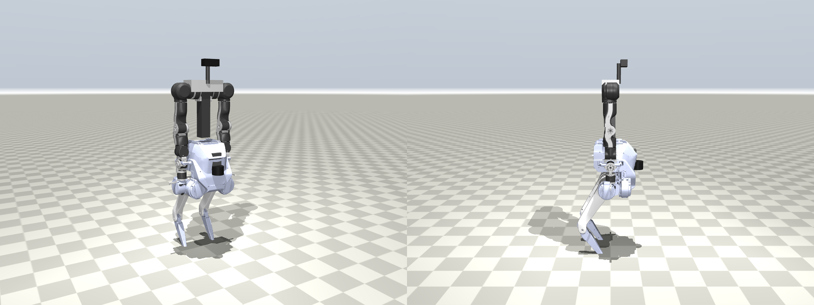

# TRON1 + OpenArm — 설계·학습·검증 상세 자료

> 기본 교육은 **[TRON1 1일차](../course/tron1-day1.md) · [2일차](../course/tron1-day2.md)**를 먼저 읽으세요. 새 교육은 SF 기준이며 아래 초기 문서와 기본 launch는 PF 중심입니다. 이 폴더는 개발 이력과 심화 참고로 보존합니다. [문서 검토·한계](../document-review.md)

바퀴형 실습 환경(`src/`)은 그대로 두고, `tron1_openarm/` 폴더에 **하반신만 LimX TRON1 Point-foot(이족)** 으로 바꾼 로봇을 따로 만들었습니다. 상반신 OpenArm 양팔, 실습 월드, SLAM·Nav2·MoveIt·ArUco·LLM 미션·웹 대시보드는 바퀴형과 같습니다.



## 문서 순서

| 순서 | 문서 | 내용 |
|---|---|---|
| 1 | [01-what-changed.md](01-what-changed.md) | **무엇이 새로 구성됐고 왜 그렇게 했나** (바퀴형과의 차이 전체) |
| 2 | [02-model.md](02-model.md) | LimX description 가져오기 → xacro → URDF → MJCF, 상반신 고정 높이·위치와 그 근거 |
| 3 | [03-locomotion-rl.md](03-locomotion-rl.md) | 두 발로 서고 걷기: LimX 사전학습 정책 + PPO 미세조정, 결과, 가상 로봇 적용 |
| 4 | [04-ros2-labs.md](04-ros2-labs.md) | 같은 DAY1·DAY2 실습을 TRON1 으로 (명령 대응표, 장별 차이, 통합 검증 결과) |
| 5 | [05-limits-real-robot.md](05-limits-real-robot.md) | 검증 범위·한계·실로봇으로 갈 때 |
| 6 | [06-sway-analysis.md](06-sway-analysis.md) | 몸통 흔들림 원인 분석 (팔 반동·정책·팔 처짐·기둥 길이 분해 실험) |
| 7 | [07-implementation-walkthrough.md](07-implementation-walkthrough.md) | **구현 과정 전체 해설** — 자료·수정 내용·보상 함수·추론 제어·SLAM/Nav2/MoveIt/LLM 시험 방법과 결과 |
| 8 | [08-visual-servo.md](08-visual-servo.md) | 손목 마커 시각 피드백 집기 — 구현, 시험 7~20 기록, 제자리 흐름 원인 분석, 남은 문제 |
| 9 | [09-sf-mission.md](09-sf-mission.md) | **Sole-foot 로 전체 미션 완주** — 정책 재학습·오도메트리·LiDAR·Nav2·카메라 도킹·집기 수정과 시험 기록 |

약어는 각 문서 맨 앞 "이 장에 나오는 용어"와 [용어집](../labs/glossary.md)에 풀어 두었습니다.

## 빠른 시작

```bash
cd ~/openarm_mobile_ws
bash scripts/04_setup_workspace.sh               # 바퀴형 (OpenArm 에셋·의존성)
bash tron1_openarm/scripts/10_setup_tron1.sh     # TRON1 description 받기 → 모델 생성 → 자체점검 → 빌드
source install/setup.bash
ros2 launch tron1_openarm_sim full_system.launch.py planner:=offline    # → http://localhost:8080
```

(선택) 보행 정책 직접 학습: `bash tron1_openarm/scripts/11_train_policy.sh 90`

## 폴더 구조

```
tron1_openarm/
├── scripts/10_setup_tron1.sh, 11_train_policy.sh
├── third_party/                    (스크립트가 clone, git 에 안 올라감) tron1-robot-description, tron1-mujoco-sim
├── src/
│   ├── tron1_openarm_sim/          ROS 2 패키지: 모델·월드·브리지·launch·Nav2 설정·보행 정책
│   │   ├── urdf/tron1_openarm.urdf.xacro   ← 새로 작성 (LimX xacro include + 상반신 마운트)
│   │   ├── tools/build_tron1_openarm.py    ← xacro→URDF→MJCF + OpenArm 접목
│   │   ├── tools/build_world_tron1.py, make_urdf_tron1.py, make_nav2_params_tron1.py, selftest_tron1.py
│   │   ├── tron1_openarm_sim/locomotion_policy.py, biped_core.py, bridge_biped.py
│   │   ├── policies/tron1_openarm_policy.npz (미세조정), limx_pf_tron1a_pretrained.npz (LimX 원본)
│   │   └── launch/sim, slam, nav, full_system
│   └── tron1_openarm_moveit_config/  MoveIt (다리 포함 URDF·SRDF, 팔 설정은 바퀴형과 동일)
├── rl/                             강화학습: tron1_env.py, train_ppo.py, eval_policy.py, export_onnx.py
├── policies/                       평가 결과(eval_results.json), ONNX
└── runs/                           학습 로그 (git 에는 요약만)
```

## 출처·라이선스

- TRON1 모델·사전학습 정책: [limxdynamics/tron1-robot-description](https://github.com/limxdynamics/tron1-robot-description), [tron1-mujoco-sim](https://github.com/limxdynamics/tron1-mujoco-sim), [tron1-rl-deploy-python](https://github.com/limxdynamics/tron1-rl-deploy-python), [tron1-rl-isaacgym](https://github.com/limxdynamics/tron1-rl-isaacgym) (Apache-2.0)
- OpenArm: [enactic/openarm_mujoco](https://github.com/enactic/openarm_mujoco) (Apache-2.0)
