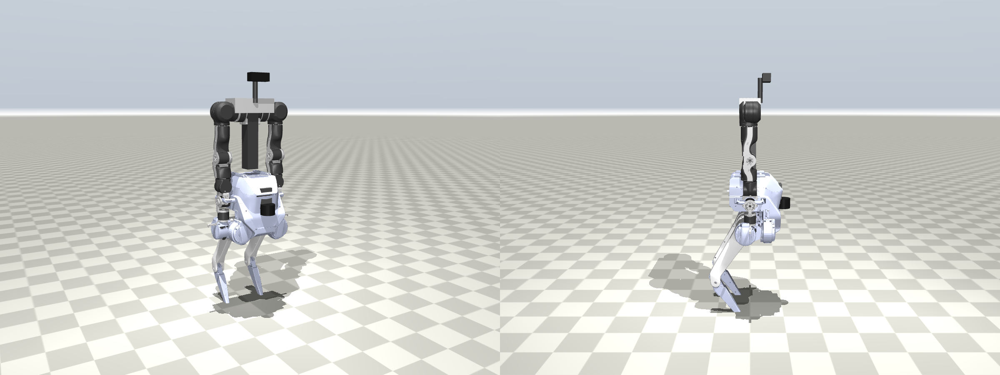

# TRON1 + OpenArm 교육·설계·검증

[README](../../README.md) · [휠형 교육](../wheel/README.md) · [용어집](../glossary.md)

바퀴형 실습 환경(`mobile_openarm/`)은 그대로 두고, `tron1_openarm/` 폴더에 **하반신만 LimX TRON1(이족)** 으로 바꾼 로봇을 따로 만들었습니다. 상반신 OpenArm 양팔, 실습 월드, SLAM·Nav2·MoveIt·ArUco·LLM 미션·웹 대시보드는 바퀴형과 같습니다. 교육은 전체 미션 완주 기록이 있는 **Sole-foot(SF)** 기준이며, launch 기본값도 SF(`foot:=sf`)입니다. Point-foot 은 `foot:=pf` 로 비교합니다.



## 문서

| 문서 | 내용 |
|---|---|
| [day1.md](day1.md) | **교육 1일차** — 사전 준비(TRON1 워크스페이스 설치), 보행 브리지·TF·SLAM·Nav2·순찰, 휠형 명령 대응표와 다른 점 |
| [day2.md](day2.md) | **교육 2일차** — 이족 MoveIt·카메라 집기·운반·LLM·Task Manager·통합 미션 |
| [design.md](design.md) | 무엇을 새로 구성했고 왜 그랬나, LimX description → xacro → URDF → MJCF, 상반신 장착 높이·위치와 설계 변경 이력 |
| [locomotion-rl.md](locomotion-rl.md) | 두 발로 서고 걷기: LimX 사전학습 정책 + PPO 미세조정(팔을 움직이는 상태), 보상·버전 이력, 브리지 제어 흐름 |
| [run-guide.md](run-guide.md) | **실행 안내** — 다른 컴퓨터에서 받아 설치, 전체 미션·집기 시험 실행과 판정, 다른 정책 시험, (선택) 원본에서 모델 다시 만들기 |
| [validation-log.md](validation-log.md) | 시험·검증 기록(날짜순): SLAM·Nav2·집기 시험, 흔들림 원인 분석, 손목 마커 시각 피드백, SF 전체 미션 완주 |
| [../real-robot.md](../real-robot.md) | 검증 범위·한계, 실로봇으로 갈 때의 순서 (휠형과 공통) |

가상환경은 두 개입니다: 시뮬·미션용 `tron1_openarm/.venv-biped`(CPU), 정책 학습용 `tron1_openarm/.venv-biped-train`(JAX GPU) — [Python 가상환경](../setup/python-venv.md).

## 빠른 시작

`~/openarm_mobile_ws` 는 저장소를 clone 한 폴더(저장소 루트)로 바꿔 읽으세요(Docker 는 `/root/openarm_mobile_ws`). 아래는 **한 터미널에서 위에서부터 순서대로** 실행합니다. 마지막 launch 는 🟢 터미널을 붙잡으며 `Ctrl+C` 로 끕니다.

```bash
cd ~/openarm_mobile_ws
bash tron1_openarm/scripts/setup_workspace.sh    # .venv-biped 생성 → 자체 점검 → 빌드 (휠형 설치 불필요)
source tron1_openarm/install/setup.bash
ros2 launch tron1_openarm_sim full_system.launch.py foot:=sf planner:=offline world:=world_light.xml rviz:=false    # → http://localhost:8080
```

이미 설치한 PC 라면 첫 줄은 건너뜁니다. 교육 절차는 [1일차](day1.md)부터입니다.

(선택) 보행 정책 직접 학습 (GPU PC): `bash tron1_openarm/scripts/12_train_mjx.sh 30 sf` — ROS 와 분리된 `tron1_openarm/.venv-biped-train`(JAX GPU)을 없으면 자동으로 만들어 씁니다 (`setup_venv_biped_train_ppo.sh`). [Python 가상환경](../setup/python-venv.md)

## 폴더 구조

```
tron1_openarm/
├── scripts/setup_venv_biped.sh(시뮬 venv), setup_workspace.sh(설치·빌드), setup_venv_biped_train_ppo.sh(학습 venv),
│            11_train_policy.sh, 12_train_mjx.sh, 13_regen_tron1_models.sh(선택)
├── third_party/                    (13 재생성 때만 clone, git 에 안 올라감) tron1-robot-description — 메시·모델은 src/ 에 포함
├── .venv-biped/                    (setup_venv_biped.sh 가 생성, git 제외) 시뮬·미션용 (ROS·MuJoCo, CPU)
├── .venv-biped-train/              (setup_venv_biped_train_ppo.sh 가 생성, git 제외) PPO 학습용 (JAX·MJX, GPU)
├── build/ install/ log/            (colcon 산출물 — 휠형과 독립)
├── src/
│   ├── tron1_openarm_sim/          ROS 2 패키지: 모델·월드·브리지·launch·Nav2 설정·보행 정책
│   │   ├── urdf/tron1_openarm.urdf.xacro   ← 새로 작성 (LimX xacro include + 상반신 마운트)
│   │   ├── tools/build_tron1_openarm.py    ← xacro→URDF→MJCF + OpenArm 접목
│   │   ├── tools/build_world_tron1.py, make_urdf_tron1.py, make_nav2_params_tron1.py, selftest_tron1.py
│   │   ├── tron1_openarm_sim/locomotion_policy.py, biped_core.py, bridge_biped.py
│   │   ├── mjcf/ (모델·메시, MESHES_NOTICE.md 에 출처), urdf/
│   │   ├── deployed_policies/tron1sf_openarm_policy.npz (SF v3, 교육 기준), tron1_openarm_policy.npz (PF), limx_pf_tron1a_pretrained.npz (LimX 원본)
│   │   └── launch/sim, slam, nav, full_system
│   └── tron1_openarm_moveit_config/  MoveIt (다리 포함 URDF·SRDF, 팔 설정은 바퀴형과 동일)
├── rl/                             강화학습: train_mjx.py, eval_policy.py, watch_training.py, export_onnx.py …
│   ├── pretrained_limx/            학습 시작점 — LimX 공개 정책 원본 (PF·SF)
│   └── eval_records/               평가 기록 (eval_results.json, eval_gait_history.json, gait_pick_tests.json)
└── runs/                           학습 로그 (생성물, git 제외)
```

## 출처·라이선스

- TRON1 모델·사전학습 정책: [limxdynamics/tron1-robot-description](https://github.com/limxdynamics/tron1-robot-description), [tron1-mujoco-sim](https://github.com/limxdynamics/tron1-mujoco-sim), [tron1-rl-deploy-python](https://github.com/limxdynamics/tron1-rl-deploy-python), [tron1-rl-isaacgym](https://github.com/limxdynamics/tron1-rl-isaacgym) (Apache-2.0)
- OpenArm: [enactic/openarm_mujoco](https://github.com/enactic/openarm_mujoco) (Apache-2.0)
