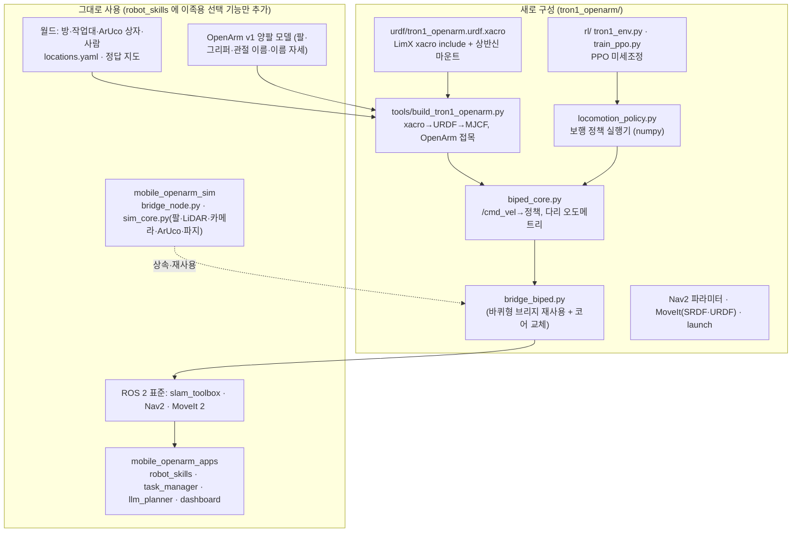

# TRON1 + OpenArm 설계 — 무엇을 바꿨고, 모델을 어떻게 만들었나

[TRON1 목차](README.md) · [보행 학습](locomotion-rl.md) · [검증 기록](validation-log.md) · [용어집](../glossary.md)

바퀴형 실습 환경(저장소의 `mobile_openarm/`)은 **그대로 두고**, 하반신만 LimX TRON1(이족 보행)로 바꾼 두 번째 로봇을 `tron1_openarm/` 폴더에 따로 만들었습니다. 상반신은 OpenArm v1 양팔을 그대로 쓰고, SLAM·Nav2·MoveIt·ArUco·LLM 미션·웹 대시보드도 바퀴형과 같은 것을 씁니다.

> **현재 상반신 장착 설계는 [몸체 설계 변경 이력](#몸체-설계-변경-이력-왜-바꿨나)의 ⑦(어깨 = 서 있는 base + 0.10 m, 기둥 0.13 m)입니다.** 아래 '모델 만들기'의 어깨 1.08 m·기둥 0.43 m 수치는 그 직전(③~⑥) 설계 기준 설명이며, 바꾼 이유를 이해하는 데 필요해 남겨 두었습니다. 예전 설계 재현: `build_tron1_openarm.py --shoulder 1.08`.

## 이 문서에 나오는 용어

- **Point-foot** (점 발) — 발바닥이 없고 공 모양 발끝 하나로 땅을 딛는 다리. 발목 관절이 없어 다리 하나에 관절 3개(abad 옆으로 벌리기, hip 앞뒤, knee 무릎)
- **xacro** (XML Macros) — 변수·매크로·include 를 쓸 수 있는 URDF 작성 도구. 처리하면 URDF 가 나온다
- **URDF** (Unified Robot Description Format) / **MJCF** (MuJoCo Format) — ROS 용 / MuJoCo 용 로봇 설명 XML
- **RL** (Reinforcement Learning, 강화학습) — 시행착오와 보상으로 행동 규칙(정책)을 배우는 방법
- **PPO** (Proximal Policy Optimization, 근위 정책 최적화) — 보행 학습에 가장 많이 쓰는 RL 알고리즘. 정책을 한 번에 조금씩만 바꾸는 것이 특징
- **정책 (policy)** — 센서값을 넣으면 관절 목표각을 내놓는 신경망. 50 Hz로 계속 실행된다
- **사전학습 (pretrained)** — LimX 가 Isaac Gym(NVIDIA GPU 물리 시뮬레이터)에서 TRON1 단독으로 학습해 공개한 정책
- **미세조정 (fine-tuning)** — 사전학습 정책을 출발점으로, 바뀐 조건(상반신 14 kg)에 맞게 추가 학습
- **오도메트리 (odometry)** — 로봇 자신의 센서만으로 계산한 이동 추정
- **MJCF** (MuJoCo Format) — MuJoCo 의 모델 XML. body(몸체)·joint·geom(충돌/표시 형상)·actuator(구동기)
- **관성 (inertia)** — 회전시키기 어려운 정도. 질량과 함께 넘어짐·보행에 직접 영향
- **무게중심 (COM, Center Of Mass)** — 전체 질량이 모였다고 볼 수 있는 점. 두 발 위에 있어야 넘어지지 않는다
- **PD 제어** (Proportional–Derivative) — 토크 = kp×(목표각−현재각) − kd×각속도. 관절을 목표각으로 끌어당기는 스프링+댐퍼
- **REP-105** (ROS Enhancement Proposal 105) — ROS 좌표계 이름 규칙 (`base_link`, `odom`, `map`)

## 한눈에 보기



## 새로 구성한 부분과 이유

| 새로 만든 것 | 파일 | 하는 일 | 왜 필요한가 |
|---|---|---|---|
| ① 하반신 로봇 설명 가져오기 | `tron1_openarm/scripts/10_setup_tron1.sh` | `limxdynamics/tron1-robot-description` 을 `tron1_openarm/third_party/` 로 clone | LimX 가 공개한 TRON1 의 링크 길이·관절 한계·질량·관성(CAD 값)을 그대로 쓰기 위해. 직접 재면 틀린다 |
| ② 최상위 xacro | `urdf/tron1_openarm.urdf.xacro` | LimX `robot.xacro` 를 include + 상반신을 얹을 **마운트 판** 링크 추가 | LimX 파일은 수정하지 않고(업데이트 받기 쉽게) 우리 추가분만 따로 둔다. 마운트 위치(`mount_x`, `mount_z`)를 xacro 변수로 두어 바꿔 보기 쉽게 |
| ③ 모델 생성기 | `tools/build_tron1_openarm.py` | xacro → URDF → MuJoCo 컴파일 → MJCF, LimX MuJoCo 충돌형상 이식, PD 구동기, OpenArm 접목, 센서 배치 | 시뮬레이터(MJCF)와 ROS(URDF)가 같은 기구학을 쓰도록 한 번에 자동 생성. 자세한 근거는 아래 [모델 만들기](#모델-만들기--로봇-설명-가져오기--xacro--mjcf-생성--상반신-고정) |
| ④ 상반신 기둥 교체·위치 | 같은 파일 (`SHOULDER_HEIGHT`, `MOUNT_X`) | OpenArm 의 75 cm 기둥을 약 43 cm 로 바꿔 **어깨 1.08 m, 몸통 중심보다 8 cm 앞** | 작업대(0.70 m) 상자가 팔 도달거리 안에 들어와 DAY 2 조작 코드를 고치지 않아도 되고, 내린 손이 TRON1 엉덩이 모터와 6 cm 떨어진다. 원본 기둥(어깨 1.40 m)보다 무게중심이 낮다 |
| ⑤ 보행 정책 | `policies/tron1_openarm_policy.npz`, `locomotion_policy.py` | /cmd_vel(속도 명령)을 다리 6관절 목표각으로 바꾸는 신경망 실행기 | 바퀴는 "바퀴 속도 = 공식"으로 끝나지만, 두 발은 **넘어지지 않게 발을 어디에 언제 디딜지** 매 순간 정해야 한다. 공식으로 풀기 어려워 RL 로 배운 정책을 쓴다 |
| ⑥ PPO 미세조정 | `rl/tron1_env.py`, `rl/train_ppo.py` | LimX 사전학습 정책을 출발점으로, 상반신 14.4 kg·팔 동작·잡음 조건에서 추가 학습 | 사전학습 정책은 TRON1 **단독**(18.5 kg)용이다. 상반신을 얹으면 옆으로 흐르고(0.1 m/s), 팔을 움직이면 넘어졌다 → [보행 학습](locomotion-rl.md) |
| ⑦ 이족 시뮬레이션 코어 | `biped_core.py` | 바퀴형 `MobileOpenArmSim` 을 상속해 하반신 부분만 교체: 명령→정책, 다리 오도메트리, 서 있는 자세 초기화 | 팔·LiDAR·카메라·ArUco·파지 보조 코드는 부모 것을 그대로 쓰고 다른 부분만 바꾸면 차이가 분명하고 버그가 적다 |
| ⑧ 다리 오도메트리 | 같은 파일 `_update_odom()` | "디딘 발은 미끄러지지 않는다"고 보고 관절각(기구학)+IMU 자세로 몸통 이동 계산. 공 모양 발이 **굴러가는 만큼** 보정, 속도는 보행 한 주기(0.5 s) 평균 | 바퀴가 없으니 바퀴 엔코더 오도메트리를 못 쓴다. 굴림 보정 전에는 거리가 10% 짧게 나왔다 (6 m 에 30~40 cm → 보정 후 2~5 cm) |
| ⑧-2 제자리 유지 · 속도 외곽 루프 | 같은 파일 `_apply_base()` | 명령 0: 멈춘 자리로 되돌아가는 작은 속도. 명령 있음: 측정 속도와의 차이를 PI 로 보정(느림·옆 흐름·회전 흐름) | 정책만으로는 제자리에서 60 s 에 3.1 m 흘렀고(→ 0.12 m), Nav2 MPPI 의 작은 시작 명령(0.04 m/s)을 못 따라가 **주행이 시작되지 않는 교착**이 있었다 ([검증 기록 2-3](validation-log.md#2-3-nav2-시험--어떻게-했나)) |
| ⑨ 브리지 | `bridge_biped.py` | 바퀴형 브리지를 import 해 코어만 바꿔 끼움 + `/biped/status` | 토픽·액션·서비스 이름이 바퀴형과 100% 같으므로 SLAM·Nav2·MoveIt·앱이 그대로 동작 |
| ⑩ Nav2 파라미터 | `config/nav2_params_tron1.yaml` (`tools/make_nav2_params_tron1.py`) | 속도·가속 한계, 도착 허용오차, footprint, AMCL 잡음 변경 | 보행은 바퀴보다 느리고, 급가속을 못 하고, 제자리에서도 몸이 흔들린다 |
| ⑪ ROS 용 URDF·SRDF | `urdf/tron1_openarm.urdf`, `tron1_openarm_moveit_config/` | 다리 링크가 들어간 URDF, 다리–팔 충돌 쌍을 새로 계산한 SRDF | MoveIt 이 팔 경로를 짤 때 다리·TRON1 몸통과 부딪히는지 검사해야 한다. 팔 그룹·이름 자세·컨트롤러 이름은 바퀴형과 같다 |
| ⑫ launch | `launch/sim·slam·nav·full_system.launch.py` | 바퀴형 launch 와 같은 인자, 패키지 이름만 다름 + `policy:=` 인자 | 실습 명령이 `mobile_openarm_sim` → `tron1_openarm_sim` 으로만 바뀌도록 |
| ⑬ 이족용 팔 `home` 자세 | `tools/patch_srdf_home.py`, `biped_core.py` `HOME_ARM` | 팔을 내린 `home` 에서 joint2 를 왼쪽 −0.2, 오른쪽 +0.2 rad 벌림 (손이 몸통 바깥으로 4.5 cm) | TRON1 몸통 상자(base_link)가 바퀴형 기둥보다 넓어, 팔을 그냥 내리면 손이 몸통과 겹쳐 MoveIt 이 `START_STATE_IN_COLLISION` 으로 계획을 거부했다 |
| ⑭ 앱의 SRDF 경로 (기존 코드 수정 ①) | `mobile_openarm/src/mobile_openarm_apps/.../robot_skills.py` | 이름 자세를 읽을 SRDF 를 환경변수 `OPENARM_SRDF` 로 바꿀 수 있게 함. 없으면 예전과 같은 바퀴형 SRDF | 이족 `home` 자세가 바퀴형과 달라졌기 때문. TRON1 `full_system.launch.py` 가 이 변수를 자동으로 넣는다. 바퀴형 동작은 그대로 |
| ⑮ 머리 카메라 해상도 | `launch/sim.launch.py` | 640×480 → **960×720** | 어깨를 1.08 m 로 올리며 카메라도 높아져 작업대 상자의 ArUco 마커가 작게 보였고, 검출이 실패했다 |
| ⑯ 옆걸음 (기존 코드 수정 ②, 이족만) | `biped_core.py` `set_cmd_vel(v, w, vy)`, `bridge_biped.py`, `robot_skills.strafe_base()` | `/cmd_vel` 의 `linear.y` 를 정책의 옆 속도 명령으로 전달. 집기 직전 상자가 옆으로 0.18 m 넘게 치우쳐 있으면 옆걸음으로 0.12 m 에 맞춤 (`OPENARM_BIPED=1` 일 때만) | 이족은 AMCL 위치 오차와 제자리 걸음 흐름 때문에 작업대 앞에서 옆으로 0.15 m 가까이 어긋나 서는 일이 있었고, 그러면 오른팔 직선 접근이 64% 에서 막혀 미션이 실패했다. 바퀴형(차동 구동)은 옆으로 못 가므로 이 단계를 건너뛴다 |

## 그대로 쓰는 부분과 이유

| 그대로 쓰는 것 | 왜 바꾸지 않아도 되나 |
|---|---|
| OpenArm 양팔·그리퍼 모델, 관절 이름, 팔 컨트롤러 이름 | 상반신은 같은 로봇. MoveIt 설정(kinematics·joint_limits·controllers·OMPL)도 복사해서 그대로 씀 |
| `mobile_openarm_apps` 전체 (robot_skills, pick/place, task_manager, llm_planner, dashboard) — ⑭·⑯ 의 환경변수로 켜는 이족용 기능 제외. 변수가 없으면 바퀴형 동작 그대로 | 앱은 `/cmd_vel`, `/odom`, TF `map→base_footprint`, `/aruco/detections`(base_footprint 기준), MoveIt 액션만 쓴다. 이 인터페이스를 이족 브리지가 똑같이 제공한다. 어깨 높이를 맞췄으므로 작업대 접근 수치(`DOCK_GAP 0.40`, `IDEAL_REACH 0.52`)도 그대로 유효 |
| 월드 (방·작업대·상자·사람), `locations.yaml`, 정답 지도 | `build_world_tron1.py` 가 바퀴형 `build_world.py` 를 그대로 불러 같은 월드를 만들고 로봇만 바꿈 |
| slam_toolbox 설정 | LiDAR 토픽·프레임 이름이 같고, 2D 스캔 성질도 같음 |
| LLM 계획기·안전 검증 | 행동(navigate/pick/place…)과 위치 이름이 같으므로 |

## 바퀴형과 실제로 달라지는 체감 차이

| 항목 | 바퀴형 | TRON1 이족 |
|---|---|---|
| 명령 0 일 때 | 완전히 멈춤 | **제자리 걸음** (Point-foot 은 발바닥이 없어 가만히 서 있을 수 없음) |
| 최고 속도 (Nav2 설정) | 0.40 m/s, 회전 1.2 rad/s | 0.35 m/s, 회전 0.8 rad/s |
| 몸통 높이 | 고정 | 0.68 m ± 1~2 cm 출렁임, 기울기 1~3° |
| 오도메트리 | 바퀴 엔코더 (매우 정확) | 다리 기구학 (거리 오차 수 %, AMCL 이 보정) |
| 조작 중 | 바퀴 잠금 → 몸통 고정 | 제자리 걸음 중 팔 동작 → 몸통이 조금씩 움직임. 카메라로 다시 보고 보정 |
| 넘어짐 | 없음 | 가능. `/biped/status` 의 `fallen` 이 true → `/sim/reset` |

## 모델 만들기 — 로봇 설명 가져오기 · xacro · MJCF 생성 · 상반신 고정

> LimX TRON1 Point-foot 의 xacro 를 가져와 **xacro → URDF → MJCF** 로 바꾸고, 그 위에 OpenArm 양팔을 **바퀴형과 같은 어깨 높이(1.0 m)** 로 고정한 MuJoCo 모델을 만든다. 왜 그 높이·위치인지 숫자로 확인한다.

### 1. 로봇 설명 파일 가져오기

```bash
cd ~/openarm_mobile_ws
bash tron1_openarm/scripts/10_setup_tron1.sh      # 아래 과정을 모두 자동으로
```

스크립트가 하는 첫 일은 LimX 공개 저장소를 받는 것입니다.

```bash
git clone --depth 1 https://github.com/limxdynamics/tron1-robot-description.git tron1_openarm/third_party/tron1-robot-description
```

이 실습에서 쓰는 것은 `pointfoot/PF_TRON1A/` 입니다.

| 폴더 | 내용 | 이 실습에서 |
|---|---|---|
| `xacro/robot.xacro` | 최상위: base_Link, IMU, 다리 매크로 2번 호출 | **include 해서 그대로 사용** |
| `xacro/const.xacro` | 치수·관절 한계(도)·질량·관성 (총 18.5 kg) | 정본 (수정 안 함) |
| `xacro/leg.xacro` | 다리 매크로: abad → hip → knee → foot (+contact) | 그대로 |
| `meshes/*.STL` | 외형 메시 9개 | `mjcf/meshes/tron1/` 로 복사 |
| `xml/robot.xml` | LimX 가 MuJoCo 용으로 손본 MJCF | **충돌 형상·관절 armature 값만** 가져옴 |
| `urdf/robot.urdf` | xacro 처리 결과 | 참고용 |

`tron1-mujoco-sim`(LimX 시뮬레이터)은 비교·참고용으로만 함께 받습니다. 그 시뮬레이터는 limxsdk 통신 규약으로 동작하고, 우리 실습은 ROS 2 브리지를 쓰기 때문입니다.

**함께 참고한 LimX·OpenArm 자료** (구현 기록에서)


| 자료 | 무엇을 가져왔나 |
|---|---|
| `limxdynamics/tron1-robot-description` | `pointfoot/PF_TRON1A`, `SF_TRON1A` 의 xacro(링크 길이·관절 한계·질량·관성), 메시(STL), MuJoCo 용 `xml/robot.xml`(충돌 형상) |
| `limxdynamics/tron1-mujoco-sim` | LimX 의 MuJoCo 시뮬 구성 확인 (PD 를 토크로 거는 방식, 센서 이름) |
| `limxdynamics/tron1-rl-deploy-python` | `PointfootController.py`·`SolefootController.py`(관측·행동 규약), `params.yaml`(kp·kd·토크 한계·보행 주기), 사전학습 정책 ONNX |
| `limxdynamics/tron1-rl-isaacgym` | `pointfoot_flat`·`solefoot_flat` 학습 코드: 보상 항, 명령 구성(SF 의 base_height·stand_still), 관측 순서 |
| `enactic/openarm_mujoco` v1 | OpenArm 양팔 MJCF (`openarm_bimanual.xml`) |

### 2. 최상위 xacro (새로 만든 파일)

`tron1_openarm/src/tron1_openarm_sim/urdf/tron1_openarm.urdf.xacro`

```xml
<robot name="tron1_openarm" xmlns:xacro="http://www.ros.org/wiki/xacro">
  <xacro:arg name="tron1_dir" default=""/>
  <xacro:include filename="$(arg tron1_dir)/xacro/robot.xacro"/>     <!-- LimX 원본 그대로 -->
  <xacro:arg name="mount_x" default="0.08"/>                            <!-- 상반신 앞뒤 위치 (인자로 바꿀 수 있음) -->
  <xacro:property name="mount_z" value="0.030"/>                        <!-- TRON1 몸통 윗면 -->
  <joint name="base_Link_to_openarm_mount_link" type="fixed"> ... </joint>
  <link name="openarm_mount_link"> 0.20×0.24×0.014 m 알루미늄 판, 0.6 kg </link>
</robot>
```

**왜 LimX 파일을 고치지 않고 include 하나?** LimX 가 치수·질량을 고쳐 배포하면 `git pull` 만으로 반영되게 하기 위해서입니다. 우리가 추가한 것(마운트 판)은 이 파일 하나에만 있습니다.

**`$(find robot_description)` 처리:** LimX xacro 는 ROS 패키지 `robot_description` 경로를 찾습니다. 빌더는 임시 폴더에 xacro 를 복사해 이 부분을 실제 경로로 바꾼 뒤 처리합니다. 그래서 LimX 저장소를 ROS 패키지로 빌드하지 않아도 됩니다. ROS 워크스페이스에 넣어 빌드해도 동작합니다(LimX 저장소에 `package.xml` 이 있음).

직접 처리해 보기:

```bash
cd ~/openarm_mobile_ws/tron1_openarm/src/tron1_openarm_sim
cat mjcf/tron1_openarm.urdf.generated | head -40      # 빌더가 저장한 xacro 처리 결과
check_urdf mjcf/tron1_openarm.urdf.generated            # base_Link → abad/hip/knee/foot ×2 + openarm_mount_link
```

### 3. xacro → URDF → MJCF (`tools/build_tron1_openarm.py`)

```bash
python3 tools/build_tron1_openarm.py \
    --tron1 ../../third_party/tron1-robot-description/pointfoot/PF_TRON1A \
    --openarm ../../../mobile_openarm/third_party/openarm_mujoco/v1/openarm_bimanual.xml --out mjcf
```

출력 예:

```
[1-2] xacro → URDF → MJCF: TRON1 질량 19.184 kg, 몸체 11개, 관절 6개
[5] 상반신 접목: 기둥 0.347 m (원본 0.75 m), 기둥+브래킷 2.21 kg (원본 3.74 kg)
    전체 질량 33.58 kg = TRON1 18.58 + 어댑터 판 0.6 + 상반신 14.39
    어깨 높이 1.029 m (목표 0.999), 머리 카메라 1.192 m, LiDAR 0.580 m (base 높이 0.710 m 기준)
```

(출력의 높이는 내려놓기 전 시작 높이 0.71 m 기준입니다. 서 있는 높이 0.68 m에서는 어깨 0.999 m, 카메라 1.162 m, LiDAR 0.55 m 입니다.)

단계별로 하는 일과 근거:

| 단계 | 하는 일 | 근거 / 이유 |
|---|---|---|
| 1. xacro | 위 최상위 xacro → URDF 문자열 | 기구학·관성 정본 = LimX `const.xacro` |
| 2. URDF 정리 | `contact_L/R_Link` 제거 | 발끝 표시용 링크(질량 1e-6 kg, 관성 0). MuJoCo 가 "관성 고유값이 양수가 아님" 오류로 거부함. 실제 접촉은 `foot_*_Link` 의 반지름 3.2 cm 구가 담당 |
| 3. URDF → MJCF | `mujoco.MjModel.from_xml_path(urdf)` → `mj_saveLastXML` | MuJoCo 는 URDF 를 직접 읽는다. `<mujoco><compiler fusestatic="false" discardvisual="false" balanceinertia="true"/>` 를 넣어 링크를 합치지 않고, 외형 메시도 남기게 함 |
| 4. 충돌 형상 이식 | URDF 의 무릎 구 → LimX `robot.xml` 의 원통·상자 (`base_collision`, `abad/hip/knee_*_collision`) | URDF 에는 다리 충돌이 구 2개뿐이라 정강이·허벅지가 벽·작업대를 뚫는다. LimX 가 MuJoCo 에서 검증한 형상을 같은 몸체 이름으로 옮김 |
| 5. 관절 동특성 | 다리 관절 `armature=0.01`, `damping=0.01` | LimX `robot.xml` 기본값 (모터 회전자 관성). URDF 에는 0 |
| 6. 이름 | `base_Link` → `base_link`, 관절은 xacro 이름(`abad_L_joint`) | `base_link` 는 ROS REP-105 표준이고, 바퀴형 브리지·LiDAR·카메라 코드가 이 이름을 씀. 관절 이름은 xacro(=URDF) 쪽을 따름 (LimX MJCF 는 `abad_L_Joint`) |
| 7. 떠 있는 몸통 | `base_link` 에 `<freejoint name="base_free"/>` | URDF 루트는 땅에 고정됨 → 걸어 다니려면 6자유도 자유 관절 필요 |
| 8. 구동기 | 다리 6관절 `<position kp="42" kv="3.5" forcerange="-80 80"/>` | LimX 배포 설정 `params.yaml` (stiffness 42, damping 3.5, user_torque_limit 80). 정책이 이 PD 값으로 학습됨 |
| 9. 물리 간격 | 배포 2 ms, 학습 4 ms | 정책 50 Hz = 10 / 5 스텝. 학습은 속도를 위해 4 ms, 배포 2 ms 에서 다시 평가 ([보행 학습](locomotion-rl.md)) |

**보충 (구현 기록에서)**

- **Sole-foot 구동기:** kp 45·kd 3(발목 1.5)·±80(발목 ±20) Nm. Point-foot 은 위 표처럼 kp 42·kd 3.5·±80 Nm.
- **센서:** IMU 자이로·가속도·자세, 몸통 속도(학습 정답용), 발 접촉력·위치·속도, 관절 토크.
- **마찰 모델 `cone="elliptic" impratio="10"`:** 기본값(피라미드 마찰뿔, impratio 1)에서는 공 모양 발이 디딘 채 천천히 미끄러져 30 s 에 몸통이 0.19 m 흘렀는데 다리 오도메트리는 0.06 m 밖에 잡지 못했습니다. 바꾼 뒤에는 실제 0.06 m / 오도메트리 0.05 m 로 일치합니다.
- **상반신 결합은 관절 0개, 강체 고정**입니다 ([흔들림 분석](validation-log.md#4-몸통-흔들림-원인-분석)에서 확인).

### 4. 상반신 고정 — 어디에, 얼마나 높이

#### 4-1. 높이: 어깨 1.08 m (바퀴형 1.0 m 보다 8 cm 높게)

| 값 | 바퀴형 | TRON1 | 계산 |
|---|---|---|---|
| 몸통(base_link) 높이 | 0.08 m (바퀴축) | **0.68 m** (서 있을 때) | LimX 학습 목표 `base_height_target 0.68` |
| OpenArm 원점(body_link0) 높이 | 0.302 m | 0.383 m | = 어깨 − 0.697 (OpenArm 모델의 `arm_origin` site 높이) |
| 어깨(openarm_*_link0) 높이 | 0.999 m | **1.08 m** | `SHOULDER_HEIGHT` |
| 어깨 앞뒤 위치 (base_footprint 기준) | +0.12 m | **+0.08 m** | `MOUNT_X` (4-3) |
| 머리 카메라 | 1.162 m, 50° 숙임 | 1.243 m, 50° 숙임 | body_link0 + 0.86 |

**처음 설계(어깨 0.999 m, 바퀴형과 똑같이)와 바꾼 이유**

처음에는 DAY 2 조작 코드의 수치(작업대 0.70 m, 상자 앞 거리 `IDEAL_REACH 0.52 m`, 도킹 거리 `DOCK_GAP 0.40 m`, `carry` 자세)를 그대로 쓰려고 어깨를 바퀴형과 같은 0.999 m 에 맞췄습니다. 통합 시험에서 팔을 내린 `home` 자세의 손가락이 TRON1 **엉덩이 모터(abad 링크, 윗면 약 0.47 m)** 에 닿는 것이 드러났습니다 (4-3). 손끝 높이는 어깨 − 0.63 m 이므로, 어깨를 1.08 m 로 올려 손끝(0.45 m)이 모터 위로 지나가게 했습니다. 앞으로 8 cm 옮긴 것과 합쳐 손–다리 최소 거리는 **6.0 cm** 입니다 (걷는 동안 측정).

8 cm 높아져도 앱 코드는 그대로입니다. 작업대 상자까지 어깨에서의 거리는 √(0.44² + 0.355²) ≈ 0.57 m 로, OpenArm 팔 길이(약 0.63 m) 안입니다. 바퀴형은 0.48 m 였습니다. 무게중심이 높아지는 만큼 보행은 어려워지므로 이 모델로 정책을 다시 미세조정했습니다 ([보행 학습](locomotion-rl.md)).

OpenArm 원본(75 cm 기둥)을 TRON1 위에 그대로 세우면 어깨가 1.40 m 가 됩니다. 그러면 작업대 상자까지 거리가 팔 길이를 넘고, 무게중심도 더 높아집니다. 그래서 기둥은 짧게 바꿉니다 (4-2).

#### 4-2. 기둥 교체

OpenArm 원점(body_link0)은 기둥 밑동에 있습니다. 어깨를 1.08 m 에 두면 원점은 TRON1 몸통 안쪽(0.383 m)에 오게 됩니다. 그래서 기둥 메시(75 cm, 충돌 메시 포함)를 빼고 **TRON1 윗면 판(0.717 m)부터 어깨 브래킷 윗면(1.145 m)까지 약 0.43 m 짜리 상자 기둥**으로 바꿨습니다. 팔·그리퍼·어깨 관절은 원본 그대로입니다.

| 질량 가정 | 값 | 근거 |
|---|---|---|
| 원본 body_link0 | 3.74 kg | openarm_bimanual.xml |
| 그중 어깨 브래킷·배선 몫 (남김) | 0.9 kg | 가정 (`BRACKET_MASS`) |
| 기둥 몫 | 2.84 kg × 0.347/0.75 = 1.31 kg | 길이에 비례한다고 가정 |
| 새 body_link0 | **2.21 kg** | 1.31 + 0.9 |
| 상반신 전체 (기둥+양팔+그리퍼) | **14.39 kg** | 팔 하나 6.09 kg × 2 |

실제 기구를 만들 때는 기둥을 실측해 이 두 숫자(`BRACKET_MASS`, `ORIG_COLUMN_LEN`)를 고치면 됩니다.

#### 4-3. 앞뒤 위치: 무게중심 vs 내린 손의 틈 (`mount_x = 0.08 m`)

처음에는 무게중심만 보고 정했습니다. TRON1 만 세워 두고 측정한 값입니다 (LimX 사전학습 정책, 명령 0):

```
두 발 평균 위치 (base_link 기준) x = -0.017 m,  TRON1 무게중심 x = -0.003 m
```

상반신 무게중심은 기둥 축에서 x = −0.005 m 이므로, `mount_x = 0.0` 이면 전체 무게중심이 두 발 사이에 옵니다. **그런데 통합 시험에서 문제가 드러났습니다.** 팔을 내린 `home` 자세에서 **손가락이 TRON1 엉덩이 모터(abad 링크)에 닿았습니다.**

- MoveIt 이 시작 자세를 충돌로 판정해 모든 팔 계획을 거부했습니다 (`START_STATE_IN_COLLISION: abad_L_Link - openarm_left_left_finger`).
- 시뮬레이터에서도 손이 엉덩이를 눌러 몸통이 8° 기울었습니다.
- 학습 모델은 상반신 충돌을 꺼 두었기 때문에 학습 중에는 드러나지 않았습니다.

그래서 걷는 동안 팔–다리 최소 거리를 재며 `mount_x` 를 바꿔 봤습니다 (`--mount-x` 인자):

| mount_x | 손–엉덩이 최소 거리 | 몸통 기울기 | 판단 |
|---|---|---|---|
| 0.00 m | 0 (닿음) | 8.1° | ✗ |
| 0.05 m | 0 (닿음) | 6.6° | ✗ |
| 0.08 m | 2.1 cm | 4.6° → 재학습 후 몸을 젖혀 11° 기울며 다시 닿음 | ✗ |
| **0.08 m + 어깨 1.08 m** | **6.0 cm** | (재학습 정책, [보행 학습](locomotion-rl.md)) | **채택** |
| 0.10 m | 0 (기울어진 채 다시 닿음) | 3.3° | ✗ |

최종 위치(0.08 m)에서는 전체 무게중심이 발보다 약 3.4 cm 앞에 옵니다 (14.4 kg × 0.08 / 33.6 kg). 정책은 몸을 약간 뒤로 기울여 균형을 잡고, 이 모델로 다시 미세조정했습니다 ([보행 학습](locomotion-rl.md)). 바퀴형도 팔 도달거리를 위해 몸통을 12 cm 앞에 두었으므로(`TORSO_X 0.12`), 팔과 작업대의 관계는 오히려 바퀴형에 가까워집니다.

**교훈:** 장착 위치는 무게중심만이 아니라 **팔의 기본 자세가 다리와 부딪히지 않는지**도 함께 봐야 합니다. 학습용 모델에서 충돌을 끄더라도 배포 모델로 반드시 다시 확인하세요.

#### 4-4. 센서 위치

| 센서 | 위치 | 이유 |
|---|---|---|
| IMU | base_link 원점 | TRON1 실제 IMU 위치 (LimX `imu_Link`) |
| LiDAR | base_link 기준 (0.17, 0, −0.13) → 지면 0.55 m | 월드의 가장 낮은 장애물인 **상자 더미가 0.6 m** 라 그보다 낮아야 보인다. 0.13 m 아래·몸통 앞쪽이라 내린 팔(어깨 아래 0.6 m 까지)·다리를 대부분 피한다 |
| 머리 카메라 | body_link0 기준 (0.10, 0, 0.86), 50° 숙임 | 바퀴형과 같은 높이·각도 → ArUco 거리·각도 조건이 같음 |

시뮬레이터의 LiDAR 는 로봇 자기 몸을 무시합니다(월드 geom 그룹만 감지). 실제 로봇에서는 뒤쪽 다리가 스캔 일부(뒤쪽 약 ±40°)를 가리므로 각도 마스크를 넣어야 합니다 → [실로봇으로 넘어가기](../real-robot.md)

#### 4-5. 충돌 제외

기둥·마운트 판·어깨 첫 링크는 TRON1 몸통 상자와 겹치게 붙어 있어 `<contact><exclude>` 로 서로 충돌하지 않게 했습니다. 팔 ↔ 다리 충돌은 **켜져 있습니다** (팔을 내린 채 걸으면 실제로 부딪힐 수 있으므로).

### 5. 생성되는 파일

| 파일 | 용도 |
|---|---|
| `mjcf/tron1_openarm.xml` | 로봇 (시각 메시 포함) |
| `mjcf/tron1_openarm_light.xml` | 저사양 (시각 메시 제거, 충돌 형상 표시) |
| `mjcf/tron1_openarm_train.xml` | 강화학습용: 저사양 + 상반신 충돌 끔 + 바닥 + 4 ms |
| `mjcf/world.xml`, `world_light.xml` | 실습 월드 (`tools/build_world_tron1.py`: 바퀴형 build_world 재사용, include 만 교체) |
| `urdf/tron1_openarm.urdf` | ROS 용 (`tools/make_urdf_tron1.py`: 최종 MJCF → URDF, base_footprint→base_link 0.68 m) |
| `../tron1_openarm_moveit_config/config/tron1_openarm.srdf` | MoveIt (바퀴형 make_srdf.py 재사용, 다리 포함 자기충돌 샘플링) |

#### ROS 용 URDF 를 xacro 결과로 바로 쓰지 않는 이유

ROS 쪽 URDF 에는 TRON1 다리뿐 아니라 OpenArm 팔·그리퍼, 카메라·LiDAR 프레임까지 들어가야 하고, 시뮬레이터와 **기구학이 1:1 로 같아야** 합니다. 그래서 바퀴형과 같은 원칙으로 **최종 MJCF 를 정본**으로 두고 URDF 를 다시 뽑습니다. xacro 는 "하반신 정본 → MJCF" 단계에서 쓰입니다.

**월드·URDF 생성 확인 (구현 기록에서)**

- `build_world_tron1.py` 는 바퀴형 `build_world.py` 를 그대로 불러 같은 방·작업대·상자를 만들고 로봇 include 만 바꿉니다. 그래서 지도·위치(`locations.yaml`)가 바퀴형과 1:1 로 같습니다.
- `make_urdf_tron1.py` 는 최종 MJCF 를 정본으로 ROS 용 URDF 를 다시 뽑습니다. 시뮬과 MoveIt 의 기구학이 같아야 하기 때문입니다. `base_footprint → base_link` 는 고정 높이(PF 0.68, SF 0.73)입니다.
- 확인: 아래 표처럼 MJCF 와 URDF 로 각각 FK(Forward Kinematics, 정기구학)를 계산해 비교했고 1 mm 단위까지 같았습니다.

| 링크 (base_footprint 기준 z) | MJCF | URDF |
|---|---|---|
| openarm_right_link1 | 1.080 | 1.080 |
| openarm_right_hand | 0.5439 | 0.5439 |

### 6. 확인하기

```bash
source ~/openarm_mobile_ws/mobile_openarm/.venv-mobile/bin/activate   # mujoco 가 든 ROS 실행용 venv
cd ~/openarm_mobile_ws/tron1_openarm/src/tron1_openarm_sim
python3 -m mujoco.viewer --mjcf=mjcf/world.xml          # 로봇 확인 (정책이 없어 다리 힘이 0 → 곧 주저앉음, 정상)
check_urdf urdf/tron1_openarm.urdf | head -20          # base_footprint → base_link → 다리 / openarm_mount_link → 팔
python3 tools/selftest_tron1.py                         # 정책으로 서기·걷기·회전·LiDAR·ArUco·팔 동작 점검
```

뷰어에서 다리에 힘이 없는 것이 정상입니다. 다리는 보행 정책이 매 20 ms 마다 목표각을 줘야 서기 때문입니다 ([보행 학습](locomotion-rl.md)).


## 몸체 설계 변경 이력 (왜 바꿨나)

| 단계 | 어깨 높이 | 앞뒤 위치(mount_x) | 바꾼 이유 (측정 근거) |
|---|---|---|---|
| ① 첫 설계 | 0.999 m (바퀴형과 같음) | 0.0 | DAY2 조작 수치(작업대 거리 등)를 그대로 쓰려고 |
| ② | 0.999 | **0.08** | 팔을 내린 home 에서 손가락이 엉덩이 모터(abad)에 닿음 → 앞으로 8 cm |
| ③ | **1.08** | 0.08 | 그래도 손끝이 모터 높이(0.47 m) → 어깨를 올려 손끝 0.45 m 로 위를 지나가게 |
| ④ home 자세 | 1.08 | 0.08 | 손이 TRON1 몸통 상자 옆면에 3.6 cm 파고들어 MoveIt 이 `START_STATE_IN_COLLISION` → 어깨 roll(joint2) ±0.2 rad 벌림 |
| ⑤ 카메라 | - | - | 어깨를 올리자 카메라도 높아져 4 cm 마커가 너무 작게 보여 검출 실패 → 640×480 → 960×720 |
| ⑥ Sole-foot 추가 | 1.08 (base 0.73) | 0.08 | PF 는 발목이 없어 제자리에 가만히 설 수 없음 → 발목 있는 SF 변형 (사용자 요청) |
| ⑦ **현재: 상반신을 하반신에 바짝** | **base+0.10** (PF 0.78, SF 0.83) | 0.08 | 높은 어깨는 팔을 움직일 때 무게중심을 크게 흔듦 (사용자 제안 + [흔들림 분석](validation-log.md#4-몸통-흔들림-원인-분석) 실험). 기둥 0.43 → 0.13 m |

⑦ 에서 함께 바꾼 것

- **팔 이름 자세** (`tron1_openarm_sim/arm_poses.py`):
  - 어깨가 낮아지자 바퀴형 ready/carry(위팔을 내린 채 팔꿈치만 굽힘)가 TRON1 몸통 상자를 관통했습니다.
  - 그래서 위팔을 앞으로 든 자세를 격자 탐색으로 찾았습니다. 몸통·다른 팔과 2 cm 이상 떨어지는 자세입니다.
  - carry 는 처음 후보에서 양손이 서로 닿아, 안쪽 0.10 m 에 오도록 다시 골랐습니다.
  - 이 파일 하나를 SRDF(`patch_srdf_home.py`)·시뮬 초기 자세·학습 환경·평가·자체 시험이 같이 씁니다.

| 자세 | 오른팔 관절각 (왼팔은 거울상) | 손끝 위치 (앞, 옆, 높이) |
|---|---|---|
| home | [0, 0.20, 0, 0, 0, 0, 0] | (0.08, −0.28, 0.17) |
| ready | [0.2, 0.20, 0, 2.0, 0, 0, 0] | (0.45, −0.16, 0.80) |
| carry | [0.3, 0.35, −0.1, 2.4, 0, 0, 0] | (0.32, −0.10, 0.92) |
| hands_up | [0, 0.30, 0, 2.3, 0, 0, 0] | (0.38, −0.14, 0.83) |

- **카메라**: 어깨를 낮춰도 카메라는 기둥 위 마스트에 두어 지면 1.243 m 를 유지합니다 (`CAMERA_HEIGHT`). 팔이 몸 앞에 있어도 위에서 작업대를 내려다보게 하려는 것입니다.
- 예전 설계로 되돌리기: `build_tron1_openarm.py --shoulder 1.08`.

## 확인 질문


1. LimX xacro 를 수정하지 않고 include 한 이유는? → 원본 업데이트를 그대로 받고, 우리 추가분을 분리하기 위해
2. 어깨 높이를 처음 1.0 m 에서 1.08 m 로 올린 이유는? → 팔을 내린 home 자세의 손가락이 엉덩이 모터(abad)에 닿았기 때문. 1.08 m 에서도 상자까지 거리(0.57 m)가 팔 길이 안이라 DAY2 조작 수치를 그대로 쓸 수 있다
3. LiDAR 를 0.55 m 에 둔 이유는? → 0.6 m 높이 상자 더미를 보기 위해
4. URDF → MJCF 변환 후 충돌 형상을 LimX robot.xml 에서 가져온 이유는? → URDF 의 충돌이 구 2개뿐이라서
