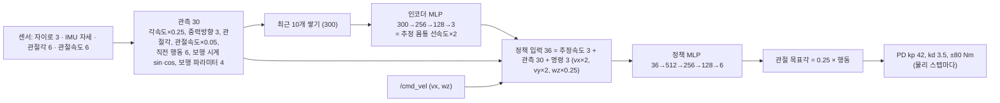
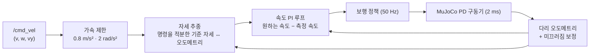

# TRON1 + OpenArm 보행 정책 — PPO 강화학습과 가상 로봇 적용

[TRON1 목차](README.md) · [설계](design.md) · [검증 기록](validation-log.md) · [Python 가상환경](../setup/python-venv.md)

## 이 장의 미션

> LimX 가 공개한 TRON1 보행 정책을 우리 MuJoCo 모델(상반신 14.4 kg)에서 돌려 보고 문제를 확인한다.
> PPO 로 미세조정한 뒤, 학습에 쓰지 않은 배포 조건(실습 월드, 물리 2 ms)에서 사전학습 정책과 성능을 비교한다.
> 결과 정책을 시뮬레이터 브리지에 넣어 SLAM·Nav2 가 동작하게 한다 ([TRON1 1일차](day1.md)).

## 이 장에 나오는 용어

- **RL** (Reinforcement Learning, 강화학습) — 행동 → 보상 → 더 좋은 행동을 반복해 정책을 배움
- **PPO** (Proximal Policy Optimization, 근위 정책 최적화) — 한 번 업데이트에서 정책이 너무 많이 바뀌지 않게 잘라내는(clip) 정책경사 알고리즘
- **액터 (actor) / 크리틱 (critic)** — 행동을 내는 신경망 / 지금 상태가 앞으로 얼마나 좋은지(가치) 예측하는 신경망
- **KL** (Kullback–Leibler divergence) — 업데이트 전후 정책이 얼마나 달라졌는지 재는 값. 너무 크면 정책이 망가진다
- **GAE** (Generalized Advantage Estimation) — "이 행동이 평균보다 얼마나 좋았나"(advantage)를 안정적으로 추정하는 방법
- **도메인 랜덤화 (domain randomization)** — 질량·마찰·지연·잡음을 일부러 바꿔 가며 학습해 실제 차이에 강하게 만드는 것
- **커리큘럼 (curriculum)** — 쉬운 조건부터 시작해 잘하면 조금씩 어렵게
- **sim-to-sim** — 한 시뮬레이터(Isaac Gym)에서 학습한 정책을 다른 시뮬레이터(MuJoCo)에서 검증
- **JAX** — 자동 미분이 되는 Python 수치 라이브러리 (CPU·GPU). PyTorch 대신 사용 (아래 설명)

## 1. 왜 강화학습이 필요한가

바퀴형은 `/cmd_vel` 을 좌우 바퀴 속도로 바꾸는 식 하나로 끝납니다. **Point-foot 이족은 그렇게 할 수 없습니다.**

- 발바닥이 점이라 **가만히 서 있을 수 없습니다** (지지 면적 = 0). 넘어지지 않으려면 계속 발을 옮겨 디뎌야 합니다 → 명령 0 에서도 제자리 걸음
- 다리 6관절 토크를 매 순간 정해야 하고, 상반신 14 kg 가 흔들리면 디딜 곳이 바뀝니다
- 이를 수식(역동역학 + 최적제어)으로 풀 수도 있지만 모델 오차에 약하고 구현이 깁니다. 지금 TRON1 같은 로봇의 표준은 **시뮬레이터에서 RL 로 정책을 배워** 실기에 옮기는 것입니다 (LimX 도 그렇게 배포)

## 2. LimX 사전학습 정책 — 관측·행동 규약

LimX 의 `tron1-rl-deploy-python/controllers/model/PF_TRON1A/policy/isaacgym/` 에 있는 `encoder.onnx`, `policy.onnx` 를 numpy 가중치로 옮겼습니다 (`policies/limx_pf_tron1a_pretrained.npz`, 검증 오차 1e-5).



- 정책 주기 50 Hz, 보행 주파수 2 Hz (발 하나가 0.25 s 씩 디딤), 발 높이 0.1 m
- 같은 규약을 `tron1_openarm_sim/locomotion_policy.py`(배포)와 `rl/tron1_env.py`(학습)가 똑같이 구현합니다

## 3. 사전학습 정책 그대로 써 보기 (문제 확인)

```bash
source ~/openarm_mobile_ws/mobile_openarm/.venv-mobile/bin/activate   # mujoco 가 든 ROS 실행용 venv
cd ~/openarm_mobile_ws/tron1_openarm/src/tron1_openarm_sim
python3 tools/selftest_tron1.py world_light.xml policies/limx_pf_tron1a_pretrained.npz
```

| 조건 | 결과 (이 저장소에서 측정) |
|---|---|
| TRON1 단독 (LimX robot.xml) | 잘 걷는다. 명령 0 에서 앞으로 0.17 m/s 흐름 — sim-to-sim 차이 |
| + 상반신 14.4 kg, 팔 고정 | 선다·걷는다. 대신 **옆으로 0.10 m/s 흐르고**, 직진 중 회전 0.11 rad/s (10 s 에 12.7° 틀어짐) |
| + 관측 잡음 (LimX 학습 수준) | 32 환경 × 10 s 에 57 번 넘어짐 |
| + 팔 자세 변경 (ready→carry→hands_up) | **넘어짐** |

LimX 의 학습 랜덤화는 몸통 질량 −0.5~+5 kg 였는데, 상반신은 그보다 3배 무겁고 위에 달려 있습니다. 그래서 **미세조정이 필요**합니다.

## 4. PPO 미세조정 설계 (`rl/`)

### 4-1. 왜 처음부터가 아니라 미세조정인가

| | 처음부터 학습 | 사전학습 + 미세조정 (이 저장소) |
|---|---|---|
| 필요한 경험량 | LimX: 환경 8192개 × 24 스텝 × 15,000 회 ≈ **30억 스텝** | 수백만~천만 스텝 |
| 필요한 장비 | Isaac Gym + NVIDIA GPU | CPU 2코어로도 1~2 시간 |
| 걸음새 | 보상 설계를 처음부터 맞춰야 함 | LimX 의 검증된 걸음새를 유지한 채 무게만 적응 |

이 실습 PC(노트북 i7-7700HQ, iMac Docker)와 이 저장소를 만든 클라우드(CPU 2코어, GPU 없음)에서는 처음부터 학습은 현실적으로 불가능합니다. 그래서 **같은 네트워크·같은 관측 규약을 유지한 전이학습**을 택했습니다. `--init scratch` 옵션으로 처음부터도 할 수 있게 해 두었습니다(GPU PC 권장).

### 4-2. 환경 (`rl/tron1_env.py`)

| 항목 | 값 | 이유 |
|---|---|---|
| 모델 | `mjcf/tron1_openarm_train.xml` — 상반신 충돌 끔, 바닥만 | 계산을 가볍게. 팔의 질량·관성은 그대로 |
| 병렬 | 128 환경, `mujoco.rollout.Rollout` (C 스레드) | 파이썬 반복문 없이 여러 MjData 를 한 번에 진행. 2코어에서 초당 약 3,500 정책 스텝 (학습 포함) |
| 물리 | 4 ms × 5 = 20 ms (50 Hz) | 학습 속도 2배. 배포는 2 ms 에서 다시 평가 |
| 명령 | vx −0.35~0.6, vy ±0.2(30%), wz ±0.9 / 25% 제자리 / 20% 직진만 / 15% 제자리 회전, 5 s 마다 바꿈 | Nav2(직진+회전), 도킹(느린 직진), yaw 보정(제자리 회전)에서 실제로 쓰는 명령 |
| 팔 | SRDF 이름 자세(home·ready·carry·hands_up)와 그 사이 무작위 자세, 1.5~3 s 에 걸쳐 이동 (평균 3 s 마다) | MoveIt 궤적이 몸에 주는 반동을 학습. **최소 60% 확률로 항상 켬** (조작에 꼭 필요) |
| 랜덤화 | 몸통 질량 −0.5~+2 kg, 무게중심 ±2 cm, 바닥 마찰 0.4~1.2, PD 게인 ±15%, 행동 지연 0~12 ms, 7 s 마다 몸통 밀기 ±0.5 m/s, 관측 잡음(LimX 와 같은 크기) | 실로봇·다른 시뮬레이터 차이에 강하게. **난이도(difficulty) 0→1 로 서서히** 키움 |
| 종료 | 몸통 0.45 m 아래 또는 기울기 45° 이상 | 넘어짐 |
| 에피소드 | 20 s | |

### 4-3. 보상 (LimX `pointfoot_flat` 과 같은 항목, 계수 일부 조정)

| 항목 | 계수 | 뜻 |
|---|---|---|
| keep_balance | +1.0 | 살아 있으면 매 스텝 보상 |
| tracking_lin_vel | +1.5 | exp(−‖명령 vxy − 실제 vxy‖² / 0.2) — **옆 흐름도 여기서 벌점** |
| tracking_ang_vel | +0.75 | exp(−(명령 wz − 실제 wz)² / 0.25) |
| base_height | −20 | (높이 − 0.68)² — 어깨 높이 유지 (LimX −2 보다 강하게) |
| orientation | −10 | 몸통 기울기² |
| lin_vel_z / ang_vel_xy | −0.5 / −0.05 | 위아래 출렁임, 앞뒤·좌우 흔들림 |
| torques / action_rate / action_smooth | −8e-5 / −0.01 / −0.01 | 에너지·떨림 줄이기 |
| dof_pos_limits | −2 | 관절 한계 근처 금지 |
| feet_distance | −100 | 두 발 간격 < 11.5 cm 금지 (다리 꼬임) |
| contact_force / contact_vel | −2 / −2 | 보행 시계에 맞춰 디딜 때 디디고, 들 때 들기 (LimX 의 걸음새 유지 항) |
| termination | −20 | 넘어짐 |

### 4-4. PPO 와 학습 중 겪은 문제

| 설정 | 값 |
|---|---|
| 액터 | 사전학습 인코더 + 정책 그대로 시작, 행동 표준편차 0.08 (작게: 사전학습 걸음새를 흔들지 않도록) |
| 크리틱 | 새로 (관측 30 + 실제 선속도 3 + 명령 3 + 추정속도 3 → 512-256-128 → 1). 처음 20 회는 크리틱만 학습 |
| PPO | 반복당 128 × 24 = 3,072 스텝, 5 에폭 × 4 미니배치, clip 0.2, γ 0.99, λ 0.95 |
| 학습률 | 1e-5~2e-5 에서 KL 로 자동 조절 (0.008~0.03 유지), **KL > 0.02 면 그 반복의 액터 업데이트 중단** |
| 인코더 | PPO 뒤 따로, 실제 선속도(×2)를 맞히도록 MSE 학습 (LimX 와 같음) |

실제로 겪은 문제 (같은 증상을 보면 참고):

1. **첫 액터 업데이트에서 정책 붕괴** (KL 0.30, 넘어짐 급증): 사전학습 신경망에 Adam(최적화기)의 초기 스텝이 너무 큼 → 학습률 1e-4 → 2e-5, KL 조기 중단
2. **인코더를 PPO 미니배치마다 같이 학습** → 정책 입력이 바뀌어 KL 폭증 → 인코더는 PPO 가 끝난 뒤 따로 학습
3. **관측 잡음을 처음부터 넣으면** 사전학습 정책이 버티지 못함(낙상 대부분의 원인) → 난이도 커리큘럼
4. **난이도에 팔 동작까지 묶었더니** 난이도가 0.2 근처에 머물러 팔 동작을 거의 못 배움 → 팔은 난이도와 별개로 최소 60%

### 4-5. 실행

```bash
bash tron1_openarm/scripts/11_train_policy.sh 90        # (없으면) .venv-biped 생성 → 90분 학습 → 평가
```

학습용 가상환경은 `tron1_openarm/.venv-biped` 입니다. `11` 이 없으면 `tron1_openarm/scripts/setup_venv_biped.sh` 를 불러 만듭니다. 이 스크립트는 GPU 를 보고 `jax[cuda13]`(compute capability ≥ 7.5, DGX Spark GB10 등)·`jax[cuda12]`(GTX 1050 등)·`jax[cpu]` 중 하나를 설치하고 `jax.devices()` 로 GPU 사용을 확인합니다. 자세한 내용: [Python 가상환경](../setup/python-venv.md).

또는 직접 (ROS 를 source 하지 않은 새 터미널):

```bash
cd ~/openarm_mobile_ws
bash tron1_openarm/scripts/setup_venv_biped.sh          # JAX_SPEC='jax[cuda12]' 처럼 직접 지정 가능
cd tron1_openarm/rl
env -u PYTHONPATH PYTHONNOUSERSITE=1 XLA_PYTHON_CLIENT_PREALLOCATE=false \
  ../.venv-biped/bin/python train_ppo.py --minutes 90 --init-std 0.08 --lr 2e-5 --out ../runs/my_run
```

| 옵션 | 뜻 |
|---|---|
| `--envs 128` | 병렬 환경 수. 코어가 많으면 늘리기 (16코어: 512) |
| `--minutes` | 학습 시간 |
| `--init scratch` | 사전학습 없이 처음부터 (GPU PC, 수 시간~하루) |
| `--resume runs/x/last.pkl` | 이어서 학습 (크리틱·난이도 포함) |
| `--train-encoder 0` | 인코더 고정 |

**왜 별도 가상환경인가:** JAX 는 numpy 2.x 가 필요합니다. ROS Jazzy(apt)는 numpy 1.26 에 맞춰 빌드되어 있어 같은 환경(`mobile_openarm/.venv-mobile`)에 설치하면 cv_bridge 등이 깨집니다. 학습은 ROS 가 필요 없으므로 시스템 패키지를 보지 않는 `tron1_openarm/.venv-biped` 로 분리합니다. 학습 결과(npz)는 NumPy 배열 파일이라 ROS 쪽에서 그대로 읽습니다.

**왜 PyTorch 가 아니라 JAX 인가:** LimX 원본(rsl_rl)은 PyTorch 입니다. 이 저장소를 만든 환경에서는 PyTorch 내려받기 서버가 막혀 있었고, JAX 는 일반 PyPI 에서 CPU 판이 작게 설치됩니다. GPU 가 있으면 `setup_venv_biped.sh` 가 `jax[cuda13]`/`jax[cuda12]` 를 설치해 같은 코드의 신경망 부분이 GPU 에서 돕니다(MuJoCo 물리 rollout 은 CPU 스레드). 신경망 구조·가중치 형식(npz/ONNX)은 PyTorch 쪽과 같습니다.

로그 한 줄 읽기:

```json
{"it": 145, "steps": 445440, "fall_rate": 0.00046, "difficulty": 0.0, "ep_len": 716.8, "kl": 0.011, "lin_track": 0.79, "ang_track": 0.80}
```

`fall_rate` = 스텝당 넘어짐 비율 (0.0003 = 환경 하나가 평균 67초에 한 번), `difficulty` = 랜덤화 강도, `ep_len` = 평균 에피소드 길이(최대 1000), `lin_track/ang_track` = 속도 추종 보상(1 이 완벽).

## 5. 결과

`rl/eval_policy.py` 로 **학습에 쓰지 않은 배포 조건**(실습 월드, 물리 2 ms, 상반신 충돌 켜짐, 시드 3개)에서 정책만 단독으로 시험한 결과입니다. 바깥 보정 루프(6절)는 끄고 정책 출력 그대로입니다. 원본 수치는 `policies/eval_results.json` (`final.npz` = 최종 v7 정책).

| 시험 | LimX 사전학습 정책 | 미세조정 정책 (v7) |
|---|---|---|
| 제자리 30 s | **넘어짐 3/3** | 넘어짐 0/3 · 흐름 0.10 m/s · 기울기 2.2° |
| 직진 0.3 m/s 20 s | 넘어짐 3/3 | 넘어짐 0/3 · 몸통 높이 0.70 m (아래 설명) |
| 제자리 회전 0.6 rad/s | 넘어짐 3/3 | 넘어짐 0/3 · 실제 0.58 rad/s |
| 팔 동작 중 제자리 | 넘어짐 3/3 | 넘어짐 0/3 · 기울기 1.3° |
| 2 s 마다 옆으로 밀기 10회 | 넘어짐 3/3 | 넘어짐 0/3 |

읽는 법

- **사전학습 정책은 상반신(14.7 kg)을 얹으면 곧바로 넘어집니다.** 18.6 kg 몸에 맞춰 학습되었기 때문입니다. 미세조정이 꼭 필요한 이유가 이 표 한 줄입니다.
- 미세조정 정책은 모든 항목에서 넘어지지 않지만 **속도 추종은 거칩니다.** 직진 명령 0.3 m/s 에서 정책 단독으로는 천천히 휘어 돌고(0.12 rad/s), 명령 0 에서도 0.1 m/s 정도 흐릅니다. Point-foot 로봇은 발목이 없어 '가만히 서기'가 불가능하고 항상 제자리 걸음을 하기 때문입니다.
- 그래서 Nav2·도킹에 쓰려면 정책 바깥에 **속도·자세 보정 루프**가 필요합니다 (6절 3단계). 보정 루프를 켠 상태의 시험(`tools/selftest_tron1.py`)에서는 6 m 직진 오도메트리 오차 2~5 cm, 20 s 제자리 유지 흐름 0.12 m, 제자리 30° 회전 시 미끄러짐 6 cm 였습니다.

학습 이력 요약 (무엇이 안 됐고 어떻게 고쳤나)

| 버전 | 바꾼 것 | 결과 |
|---|---|---|
| 초기 시도 | 인코더를 미니배치마다 같이 갱신 | 첫 갱신에서 KL 0.30 → 정책 붕괴. 인코더는 PPO 갱신 뒤 따로 학습 + KL 0.02 넘으면 조기 종료 |
| 초기 시도 | 관측 잡음·질량 랜덤화를 처음부터 최대로 | 계속 넘어짐 → 난이도 커리큘럼(넘어짐이 적을 때만 난이도↑) |
| 초기 시도 | 커리큘럼만 | 난이도가 낮게 머물며 팔 동작을 거의 못 봄 → 팔 랜덤화 하한 0.6 |
| v3 | 위 수정 반영 | 넘어지진 않지만 앞으로 가는 추종을 잃음 |
| v4 | 추종 보상 sigma 0.05·가중치 3, 최대 난이도 0.5 | 앞으로 가는 능력 회복 |
| v5 | 물리 2 ms 로 학습 | 오히려 나빠져 폐기 (4 ms 유지) |
| v6 | 어깨 높이·장착 위치 변경 | 11° 앞으로 기욺 → 카메라·팔 좌표 틀어짐 |
| v7 | 어깨 1.08 m + 자세 벌점 −60 | 기울기 약 2°, 최종 채택 |

## 6. 가상 로봇에 적용

학습 결과 `best.npz` 를 `src/tron1_openarm_sim/policies/tron1_openarm_policy.npz` 로 복사하면 브리지가 그 정책을 씁니다. 다른 정책을 시험하려면 launch 인자로 바꿉니다.

```bash
ros2 launch tron1_openarm_sim sim.launch.py policy:=$HOME/openarm_mobile_ws/tron1_openarm/runs/my_run/best.npz
ros2 launch tron1_openarm_sim sim.launch.py policy:=$(ros2 pkg prefix --share tron1_openarm_sim)/policies/limx_pf_tron1a_pretrained.npz   # 비교
```

브리지 안에서의 흐름 (`biped_core.py`):

1. `/cmd_vel` → `set_cmd_vel(v, w)` (0.5 s 동안 새 명령이 없으면 0 = 제자리 걸음)
2. 물리 스텝 10번(20 ms)마다 `_apply_base()`: 명령을 가속 0.8 m/s²·2.0 rad/s² 로 부드럽게 바꾼 뒤
   - **자세 추종:** 명령 속도를 적분한 '기준 자세'를 만들고 다리 오도메트리 자세가 그것을 따라가게 함 (명령 0 이면 기준이 멈춤 = 제자리 유지, 느린 도킹 이동에서 옆 미끄러짐 방지)
   - **속도 PI 루프:** 원하는 속도 − 측정 속도(0.5 s 평균)의 오차를 비례·적분해 정책 명령에 더함 (보정 상한 0.2 m/s·0.4 rad/s)
   - 결과를 정책 입력 범위로 잘라 정책에 넣음 → 다리 목표각
   - 왜 필요했나: Nav2 MPPI 는 명령을 '측정 속도 + 가속 한계×0.05 s' 만큼씩만 키웁니다. 정책이 0.04 m/s 같은 작은 명령에 반응하지 않으면 측정 속도 0 → 명령도 계속 작음 → **교착**이 실제로 생겼습니다. PI 루프가 작은 명령도 실제 움직임으로 만들어 이를 풀었습니다
3. 물리 스텝마다 MuJoCo 가 PD 토크 계산
4. `_update_odom()`: 디딤발 고정 가정으로 다리 오도메트리 → `/odom`, TF `odom→base_footprint`

LimX 배포 형식 ONNX 로도 내보낼 수 있습니다 (입출력 이름·크기 동일):

```bash
env -u PYTHONPATH ../.venv-biped/bin/python export_onnx.py ../policies/tron1_openarm_policy.npz ../policies/onnx   # tron1_openarm/rl 에서
```

## 7. 더 좋은 정책을 원할 때 (GPU PC)

- **Isaac Gym / Isaac Lab 에서 처음부터 학습**: `limxdynamics/tron1-rl-isaacgym` 의 `resources/robots/PF_TRON1A/urdf/robot.urdf` 대신 이 저장소의 `mjcf/tron1_openarm.urdf.generated` 에 OpenArm 링크를 붙인 URDF 를 넣고, `terminate_after_contacts_on` 에 팔 링크를 추가, `added_mass_range` 를 상반신 기준으로 다시 잡아 학습합니다. 학습 후 `export_policy_as_onnx.py` 로 나온 ONNX 를 `onnx→npz` 변환(이 문서 2절과 같은 방법)해서 쓰면 됩니다.
- **팔 관절각을 관측에 넣기**: 지금 정책은 팔이 어디 있는지 모르고 몸통 반동으로만 알아챕니다. 관측에 팔 14관절을 넣으면 더 안정적이지만 네트워크 입력이 바뀌어 사전학습을 쓸 수 없습니다 (처음부터 학습 필요).

## 8. 이후 변경 — v8·Sole-foot·현재 설정 (구현 기록)

> 1~7절은 Point-foot v7 시점의 설명입니다. 아래는 그 뒤 실제로 바꾼 내용이며, **보상 계수 표(8-7)가 현재 코드(`rl/tron1_env.py` `REWARD_SCALES`)의 값**입니다.

### 8-1. 정책 신경망의 입출력 (LimX 규약 그대로)

`tron1_openarm_sim/locomotion_policy.py` (numpy 만 사용, ROS·onnxruntime 불필요)

| | Point-foot | Sole-foot |
|---|---|---|
| 관측 obs | 30 = 각속도×0.25(3) + 중력 방향(3) + 관절각(6) + 관절속도×0.05(6) + 직전 행동(6) + 보행 시계 sin/cos(2) + 보행 파라미터(4) | 36 = 같은 구성, 관절 8개, 관절각은 '기본각과의 차이' |
| 인코더 | 최근 관측 10개(300) → 추정 몸통 선속도×2 (3) | 최근 5개(180) → 3 |
| 정책 입력 | 인코더 3 + obs 30 + 명령 3 (vx×2, vy×2, wz×0.25) = 36 | 3 + 36 + 명령 5 (… + 목표 몸통 높이 + **제자리 서기 0/1**) = 44 |
| 정책 출력 | 6 관절 목표각 오프셋 / 0.25 | 8 |
| 보행 주기 | 2 Hz | 1.3 Hz |

- 정책 파일(npz)의 첫 층 입력 크기(36 / 44)로 PF·SF 를 자동 판별합니다.
- 행동은 LimX 배포 코드와 같이 "토크 한계를 넘지 않는 범위"로 자릅니다.

```python
lo = (qd + (kd*dq - tau_max)/kp) / 0.25 ;  hi = (qd + (kd*dq + tau_max)/kp) / 0.25
target = clip(a, lo, hi) * 0.25 + default_q          # → MuJoCo position 구동기 ctrl
```

### 8-2. LimX 가중치를 가져오는 법 (ONNX → npz)

`rl/onnx_to_npz.py`: LimX ONNX 는 MatMul → Add → Elu 가 반복되는 단순 MLP(Multi-Layer Perceptron)입니다.
그래서 초기값(initializer)을 순서대로 꺼내 `encoder_W0, encoder_b0, …, policy_W3, policy_b3` 로 저장합니다.
PF 파일로 변환해 기존 가중치와 완전히 같은지 검증했습니다 (`allclose = True`).

```bash
# tron1_openarm/ 에서, 학습용 venv(.venv-biped: onnx 포함)
env -u PYTHONPATH .venv-biped/bin/python rl/onnx_to_npz.py \
    tron1-rl-deploy-python/controllers/model/SF_TRON1A/policy/isaacgym policies/limx_sf_tron1a_pretrained.npz
```

### 8-3. 시뮬레이터 안의 제어 흐름 (`biped_core.py` `_apply_base`)

물리 2 ms 마다 호출되고, 정책은 10 스텝(20 ms, 50 Hz)마다 한 번 계산합니다.



각 층이 생긴 이유 (모두 실험에서 문제를 보고 넣었습니다)

| 층 | 없을 때 문제 (측정) | 넣은 뒤 |
|---|---|---|
| 자세 추종 (제자리 유지) | 명령 0 인데 60 s 에 3.1 m 흐름 | 0.12 m |
| 속도 PI 루프 (VEL_KP [0.3,0.5,0.3], VEL_KI [0.8,1.0,0.8]) | Nav2 MPPI 가 0.04 m/s 같은 작은 명령을 보냄 → 정책이 반응 안 함 → 측정 속도 0 → 명령도 안 커짐 = **주행 교착** | 목표 3/3 도착 |
| 옆 보정 한도 0.45 m/s | 오른팔만 carry 일 때 정책이 왼쪽으로 0.1 m/s 흘러감 (60 s 에 1.9 m) | 0.08 m |
| 다리 오도메트리 + 굴림 보정 | 바퀴가 없음. 디딘 발 고정 가정만 하면 거리 10% 짧음 | 6 m 에 2~5 cm |
| 정책 인코더로 앞뒤 미끄러짐 보정 | 팔 동작 25 s 동안 실제 0.098 m 흐름을 오도메트리가 못 봄 | 0.031 m |
| 서기 모드 (SF 만) | - | 명령이 완전히 0 이면 두 발 디딘 위상(0 또는 0.5)에서 보행 시계를 멈추고 `stand_still=1` |
| 서기 해제 안전장치 (SF) | 팔을 carry → home 으로 내릴 때 한 발에 무게가 몰려(330 N : 33 N) 발을 구르며 0.4 m 흔들림 | 한 발 < 12% 또는 기울기 속도 > 0.5 rad/s 이면 1.5 s 동안 걸어서 회복 |

"제자리에 서 있게 된" 원리

- **Point-foot**: 발이 점이라 발목 토크를 낼 수 없습니다. 정책은 항상 2 Hz 로 제자리 걸음을 하며 균형을 잡습니다. "서 있다"는 것은 위의 자세 추종 루프가 제자리 걸음의 흐름을 계속 되돌린다는 뜻입니다.
- **Sole-foot**: LimX 가 학습 때 넣어 둔 `stand_still` 명령을 씁니다. 시계를 멈추면 정책이 발을 떼지 않고 발목으로 버팁니다. 30 s 흔들림이 1.52 m(PF, 보정 루프 없이)에서 0.10 m 로 줄었습니다.

### 8-4. 왜 미세조정인가

- LimX 사전학습 정책은 TRON1 단독(18.6 kg)용입니다.
- 상반신 14.5 kg 을 얹으면 PF·SF 모두 1~2 s 안에 넘어집니다 (평가 넘어짐 3/3).
- 같은 신경망 구조·관측 규약을 유지한 채 PPO 로 이어서 학습했습니다 (전이학습).

### 8-5. 학습 환경 `rl/tron1_env.py`

- `mujoco.rollout.Rollout` 으로 128 개 환경을 C 스레드에서 한꺼번에 진행합니다. JAX 로 쓴 신경망은 CPU 에서 돕니다.
  - PyTorch 를 쓰지 않은 이유: 이 환경에서 PyTorch 내려받기 서버가 막혀 있었습니다.
- 도메인 랜덤화(domain randomization)는 시뮬과 현실의 차이에 견디도록 조건을 무작위로 바꾸는 것입니다.
  - 몸통 질량 −0.5~+2 kg, 무게중심 ±2 cm, 바닥 마찰 0.4~1.2
  - PD 게인 ±15%, 행동 지연 0~12 ms, 밀기, 관측 잡음
- **팔 자세 랜덤화**: 3~6 s 마다 새 자세로 1.5~3 s 에 걸쳐 이동합니다 (MoveIt 궤적 흉내). 이름 자세는 `arm_poses.py` 에서 가져옵니다.
  - v8 부터: **왼팔·오른팔을 따로** 고릅니다 (절반은 같게). v7 은 양팔이 항상 같은 자세로만 학습해, 앱이 한 팔만 carry 로 올리면 옆으로 흘러갔습니다.
- **SF 서기 학습**: 명령 0 인 경우의 80% 는 `want_still`. 시계가 두 발 디딘 위상에 오면 멈추고, 그동안 두 발 모두 "디딤 기대값 1" 로 둡니다(발 속도 벌점).

### 8-6. PPO 알고리즘 `rl/train_ppo.py` (LimX rsl_rl 변형과 같은 구성)

| 항목 | 값 |
|---|---|
| 반복당 데이터 | 128 환경 × 24 스텝 |
| GAE (Generalized Advantage Estimation) | γ 0.99, λ 0.95 |
| 클립 | 0.2 (정책 비율·가치 둘 다) |
| 갱신 | 5 epoch × 미니배치 4 |
| 엔트로피 | 0.0005 |
| 학습률 | 2e-5 시작, KL(Kullback-Leibler divergence)이 0.03 넘으면 ÷1.5, 0.008 미만이면 ×1.5 |
| KL 조기 종료 | 미니배치 KL > 0.02 이면 그 반복의 나머지는 크리틱만 학습 |
| 크리틱 워밍업 | 처음 20 반복은 크리틱만 (사전학습 액터를 망가뜨리지 않도록) |
| 인코더 | PPO 갱신 **뒤에** 따로 MSE 지도학습 (실제 선속도 맞히기) |

학습 중 겪은 문제와 해결

| 문제 | 해결 |
|---|---|
| 인코더를 미니배치마다 같이 갱신 → 첫 갱신 KL 0.30, 정책 붕괴 | 인코더 분리 + KL 조기 종료 |
| 잡음·랜덤화를 처음부터 최대로 → 계속 넘어짐 | 난이도 커리큘럼: 넘어짐(스텝당) < 0.0003 이면 +0.02, > 0.0015 이면 −0.02, 최대 0.5 |
| 커리큘럼 때문에 팔 동작을 거의 못 봄 | 팔 랜덤화 하한 60% |
| SF 는 상반신을 얹자 1 s 만에 넘어져 배울 거리가 없음 (상반신 질량 0 이면 잘 섬) | **상반신 무게 커리큘럼**: 질량 10% 에서 시작, 넘어짐 < 0.002 면 5% 씩 올림 (`--payload-start 0.1`) |

### 8-7. 보상 함수 (`REWARD_SCALES`, 정책 주기마다 합 × 0.02)

| 항 | 가중치 | 식 | LimX 대비 바꾼 점·이유 |
|---|---|---|---|
| keep_balance | +1.0 | 1 | - |
| tracking_lin_vel | **+3.0** | exp(−‖v_cmd − v‖²/**0.05**) | LimX σ 0.2 → 0.05, 가중치 ↑: v3 에서 앞으로 가는 능력을 잃고 옆으로 흘러서 |
| tracking_ang_vel | +1.5 (**SF 3.0**) | exp(−(w_cmd − w)²/0.1) | SF 1차가 0.6 rad/s 명령에 0.08 만 돌아서 2배 |
| base_height | −20 | (h − 목표)² | 목표 PF 0.68, SF 0.73 |
| orientation | **−60** | 중력 방향 xy² | v6 이 11° 앞으로 기울어 카메라·팔 좌표가 틀어져서 크게 |
| lin_vel_z / ang_vel_xy | −0.5 / −0.05 | 상하 속도², 롤·피치 각속도² | - |
| torques / action_rate / action_smooth | −8e-5 / −0.01 / −0.01 | 토크², 행동 변화², 2차 차분² | - |
| dof_pos_limits | −2 | 관절 한계 95% 넘은 양 | - |
| feet_distance | −100 | 두 발 사이 < 0.115 m 인 양 | - |
| contact_force / contact_vel | −2 / −2 | 떠야 할 때 접촉력, 디뎌야 할 때 발 속도 | SF 서기 중에는 두 발 모두 '디딤' |
| termination | −20 | 넘어짐 | - |

### 8-8. 실행 명령과 버전 이력

```bash
# 별도 가상환경 tron1_openarm/.venv-biped (JAX 는 numpy 2 필요, ROS Jazzy 는 numpy 1.26 → 같은 환경에 깔면 cv_bridge 등이 깨짐)
bash tron1_openarm/scripts/setup_venv_biped.sh      # 처음 1회 (JAX GPU 자동 선택)
cd tron1_openarm/rl
env -u PYTHONPATH ../.venv-biped/bin/python train_ppo.py --foot pf \
    --init ../src/tron1_openarm_sim/policies/tron1_openarm_policy.npz \
    --minutes 60 --init-std 0.08 --lr 2e-5 --critic-warmup 20 --out ../runs/pf_low_v1
env -u PYTHONPATH ../.venv-biped/bin/python train_ppo.py --foot sf --xml ../src/tron1_openarm_sim/mjcf/sf/tron1_openarm_train.xml \
    --init ../policies/limx_sf_tron1a_pretrained.npz --payload-start 0.1 --minutes 80 --init-std 0.1 --lr 3e-5 --out ../runs/sf_v2
# 평가 (학습에 안 쓴 배포 조건: 실습 월드, 물리 2 ms, 시드 3개)
env -u PYTHONPATH ../.venv-biped/bin/python eval_policy.py ../src/tron1_openarm_sim/policies/tron1_openarm_policy.npz ../runs/sf_v2/best.npz
```

| 버전 | 바꾼 것 | 결과 |
|---|---|---|
| v1~v3 | 인코더 분리, 난이도 커리큘럼, 팔 하한 | 안 넘어지지만 앞으로 가는 추종을 잃음 |
| v4 | 추종 σ 0.05·가중치 3, 최대 난이도 0.5 | 추종 회복 |
| v5 | 물리 2 ms 로 학습 | 오히려 나빠져 폐기 |
| v6 / v7 | 어깨 1.08 / 자세 벌점 −60 | 기울기 11° → 2° |
| **v8** (PF 배포) | 왼팔·오른팔 따로 랜덤화, 마찰 elliptic | 6개 시험 모두 넘어짐 0/3 |
| **sf_v2** (SF 배포) | SF + 무게 커리큘럼, 80분 | 서기 0.10 m, 한 팔 carry 넘어짐 3/3 (계단 입력), 직진·회전 추종 약함 |
| pf_low_v1 / sf_low_v1 | 어깨를 낮춘 설계 + 새 팔 자세 | **학습 중** (컨테이너 재시작으로 PF 는 40분에서 멈춤, best.npz 저장됨) |

평가 결과 (`eval_policy.py`, 시드 3개, 흔들림 = 시험 동안 몸통이 움직인 범위)

| 시험 | LimX 사전학습 | PF v8 | SF sf_v2 |
|---|---|---|---|
| 제자리 30 s | 넘어짐 3/3 | 0/3, 흔들림 1.52 m (보정 루프 없이) | 0/3, **0.10 m** |
| 직진 0.3 m/s | 3/3 | 0/3, 실제 0.16 m/s | 0/3, 0.09 m/s |
| 회전 0.6 rad/s | 3/3 | 0/3, 0.55 rad/s | 0/3, 0.08 rad/s |
| 팔 동작 중 서기 | 3/3 | 0/3, 0.48 m | 0/3, 0.23 m |
| 옆으로 밀기 10회 | 3/3 | 0/3 | 0/3 |
| 한 팔만 carry | - | 0/3 | **3/3** |

## 확인 질문


1. Point-foot 로봇이 명령 0 에서도 걷는 이유는? → 지지 면적이 0 이라 계속 디뎌야 균형 유지
2. 미세조정에서 행동 표준편차를 0.08 로 작게 시작한 이유는? → 사전학습 걸음새를 탐색 잡음으로 망가뜨리지 않으려고
3. 학습은 4 ms, 평가는 2 ms 로 한 이유는? → 학습 속도를 높이고, 배포 조건에서 따로 확인하려고 (sim-to-sim)
