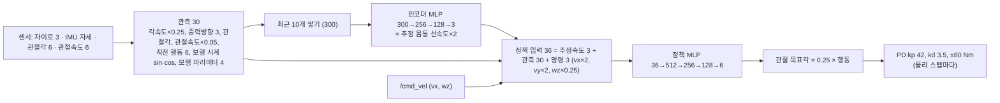
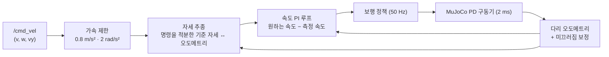

# TRON1 + OpenArm 보행 정책 — PPO 강화학습과 가상 로봇 적용

[TRON1 목차](README.md) · [설계](design.md) · [검증 기록](validation-log.md) · [Python 가상환경](../setup/python-venv.md)

## 이 장의 미션

> LimX 가 공개한 TRON1 보행 정책을 우리 MuJoCo 모델(상반신 14.4 kg)에서 돌려 보고 문제를 확인한다.
> PPO 로 미세조정한 뒤, 학습에 쓰지 않은 배포 조건(실습 월드, 물리 2 ms)에서 사전학습 정책과 성능을 비교한다.
> 결과 정책을 시뮬레이터 브리지에 넣어 SLAM·Nav2 가 동작하게 한다 ([TRON1 1일차](day1.md)).

## 이 장에 나오는 용어

- **RL** (Reinforcement Learning, 강화학습) — 행동 → 보상 → 더 좋은 행동을 반복해 정책을 배움
- **PPO** (Proximal Policy Optimization, 근위 정책 최적화) — 한 번 업데이트에서 정책이 너무 많이 바뀌지 않게 잘라내는(clip) 정책경사 알고리즘
- **액터 (actor) / 크리틱 (critic)** — 행동을 내는 신경망 / 지금 상태가 앞으로 얼마나 좋은지(가치) 예측하는 신경망
- **KL** (Kullback–Leibler divergence) — 업데이트 전후 정책이 얼마나 달라졌는지 재는 값. 너무 크면 정책이 망가진다
- **GAE** (Generalized Advantage Estimation) — "이 행동이 평균보다 얼마나 좋았나"(advantage)를 안정적으로 추정하는 방법
- **도메인 랜덤화 (domain randomization)** — 질량·마찰·지연·잡음을 일부러 바꿔 가며 학습해 실제 차이에 강하게 만드는 것
- **커리큘럼 (curriculum)** — 쉬운 조건부터 시작해 잘하면 조금씩 어렵게
- **sim-to-sim** — 한 시뮬레이터(Isaac Gym)에서 학습한 정책을 다른 시뮬레이터(MuJoCo)에서 검증
- **JAX** — 자동 미분이 되는 Python 수치 라이브러리 (CPU·GPU). PyTorch 대신 사용 (아래 설명)

## 1. 왜 강화학습이 필요한가

바퀴형은 `/cmd_vel` 을 좌우 바퀴 속도로 바꾸는 식 하나로 끝납니다. **Point-foot 이족은 그렇게 할 수 없습니다.**

- 발바닥이 점이라 **가만히 서 있을 수 없습니다** (지지 면적 = 0). 넘어지지 않으려면 계속 발을 옮겨 디뎌야 합니다 → 명령 0 에서도 제자리 걸음
- 다리 6관절 토크를 매 순간 정해야 하고, 상반신 14 kg 가 흔들리면 디딜 곳이 바뀝니다
- 이를 수식(역동역학 + 최적제어)으로 풀 수도 있지만 모델 오차에 약하고 구현이 깁니다. 지금 TRON1 같은 로봇의 표준은 **시뮬레이터에서 RL 로 정책을 배워** 실기에 옮기는 것입니다 (LimX 도 그렇게 배포)

## 2. LimX 사전학습 정책 — 관측·행동 규약

LimX 의 `tron1-rl-deploy-python/controllers/model/PF_TRON1A/policy/isaacgym/` 에 있는 `encoder.onnx`, `policy.onnx` 를 numpy 가중치로 옮겼습니다 (`rl/pretrained_limx/limx_pf_tron1a_pretrained.npz`, 검증 오차 1e-5).



- 정책 주기 50 Hz, 보행 주파수 2 Hz (발 하나가 0.25 s 씩 디딤), 발 높이 0.1 m
- 같은 규약을 `tron1_openarm_sim/locomotion_policy.py`(배포)와 `rl/tron1_env.py`(학습)가 똑같이 구현합니다

## 3. 사전학습 정책 그대로 써 보기 (문제 확인)

```bash
source ~/openarm_mobile_ws/tron1_openarm/.venv-biped/bin/activate     # mujoco 가 든 TRON1 시뮬용 venv
cd ~/openarm_mobile_ws/tron1_openarm/src/tron1_openarm_sim
python3 tools/selftest_tron1.py world_light.xml deployed_policies/limx_pf_tron1a_pretrained.npz
```

| 조건 | 결과 (이 저장소에서 측정) |
|---|---|
| TRON1 단독 (LimX robot.xml) | 잘 걷는다. 명령 0 에서 앞으로 0.17 m/s 흐름 — sim-to-sim 차이 |
| + 상반신 14.4 kg, 팔 고정 | 선다·걷는다. 대신 **옆으로 0.10 m/s 흐르고**, 직진 중 회전 0.11 rad/s (10 s 에 12.7° 틀어짐) |
| + 관측 잡음 (LimX 학습 수준) | 32 환경 × 10 s 에 57 번 넘어짐 |
| + 팔 자세 변경 (ready→carry→hands_up) | **넘어짐** |

LimX 의 학습 랜덤화는 몸통 질량 −0.5~+5 kg 였는데, 상반신은 그보다 3배 무겁고 위에 달려 있습니다. 그래서 **미세조정이 필요**합니다.

## 4. PPO 미세조정 설계 (`rl/`)

### 4-1. 왜 처음부터가 아니라 미세조정인가

| | 처음부터 학습 | 사전학습 + 미세조정 (이 저장소) |
|---|---|---|
| 필요한 경험량 | LimX: 환경 8192개 × 24 스텝 × 15,000 회 ≈ **30억 스텝** | 수백만~천만 스텝 |
| 필요한 장비 | Isaac Gym + NVIDIA GPU | CPU 2코어로도 1~2 시간 |
| 걸음새 | 보상 설계를 처음부터 맞춰야 함 | LimX 의 검증된 걸음새를 유지한 채 무게만 적응 |

이 실습 PC(노트북 i7-7700HQ, iMac Docker)와 이 저장소를 만든 클라우드(CPU 2코어, GPU 없음)에서는 처음부터 학습은 현실적으로 불가능합니다. 그래서 **같은 네트워크·같은 관측 규약을 유지한 전이학습**을 택했습니다. `--init scratch` 옵션으로 처음부터도 할 수 있게 해 두었습니다(GPU PC 권장).

### 4-2. 환경 (`rl/tron1_env.py`)

| 항목 | 값 | 이유 |
|---|---|---|
| 모델 | `mjcf/tron1_openarm_train.xml` — 상반신 충돌 끔, 바닥만 | 계산을 가볍게. 팔의 질량·관성은 그대로 |
| 병렬 | 128 환경, `mujoco.rollout.Rollout` (C 스레드) | 파이썬 반복문 없이 여러 MjData 를 한 번에 진행. 2코어에서 초당 약 3,500 정책 스텝 (학습 포함) |
| 물리 | 4 ms × 5 = 20 ms (50 Hz) | 학습 속도 2배. 배포는 2 ms 에서 다시 평가 |
| 명령 | vx −0.35~0.6, vy ±0.2(30%), wz ±0.9 / 25% 제자리 / 20% 직진만 / 15% 제자리 회전, 5 s 마다 바꿈 | Nav2(직진+회전), 도킹(느린 직진), yaw 보정(제자리 회전)에서 실제로 쓰는 명령 |
| 팔 | SRDF 이름 자세(home·ready·carry·hands_up)와 그 사이 무작위 자세, 1.5~3 s 에 걸쳐 이동 (평균 3 s 마다) | MoveIt 궤적이 몸에 주는 반동을 학습. **최소 60% 확률로 항상 켬** (조작에 꼭 필요) |
| 랜덤화 | 몸통 질량 −0.5~+2 kg, 무게중심 ±2 cm, 바닥 마찰 0.4~1.2, PD 게인 ±15%, 행동 지연 0~12 ms, 7 s 마다 몸통 밀기 ±0.5 m/s, 관측 잡음(LimX 와 같은 크기) | 실로봇·다른 시뮬레이터 차이에 강하게. **난이도(difficulty) 0→1 로 서서히** 키움 |
| 종료 | 몸통 0.45 m 아래 또는 기울기 45° 이상 | 넘어짐 |
| 에피소드 | 20 s | |

### 4-3. 보상 (LimX `pointfoot_flat` 과 같은 항목, 계수 일부 조정)

| 항목 | 계수 | 뜻 |
|---|---|---|
| keep_balance | +1.0 | 살아 있으면 매 스텝 보상 |
| tracking_lin_vel | +1.5 | exp(−‖명령 vxy − 실제 vxy‖² / 0.2) — **옆 흐름도 여기서 벌점** |
| tracking_ang_vel | +0.75 | exp(−(명령 wz − 실제 wz)² / 0.25) |
| base_height | −20 | (높이 − 0.68)² — 어깨 높이 유지 (LimX −2 보다 강하게) |
| orientation | −10 | 몸통 기울기² |
| lin_vel_z / ang_vel_xy | −0.5 / −0.05 | 위아래 출렁임, 앞뒤·좌우 흔들림 |
| torques / action_rate / action_smooth | −8e-5 / −0.01 / −0.01 | 에너지·떨림 줄이기 |
| dof_pos_limits | −2 | 관절 한계 근처 금지 |
| feet_distance | −100 | 두 발 간격 < 11.5 cm 금지 (다리 꼬임) |
| contact_force / contact_vel | −2 / −2 | 보행 시계에 맞춰 디딜 때 디디고, 들 때 들기 (LimX 의 걸음새 유지 항) |
| termination | −20 | 넘어짐 |

### 4-4. PPO 와 학습 중 겪은 문제

| 설정 | 값 |
|---|---|
| 액터 | 사전학습 인코더 + 정책 그대로 시작, 행동 표준편차 0.08 (작게: 사전학습 걸음새를 흔들지 않도록) |
| 크리틱 | 새로 (관측 30 + 실제 선속도 3 + 명령 3 + 추정속도 3 → 512-256-128 → 1). 처음 20 회는 크리틱만 학습 |
| PPO | 반복당 128 × 24 = 3,072 스텝, 5 에폭 × 4 미니배치, clip 0.2, γ 0.99, λ 0.95 |
| 학습률 | 1e-5~2e-5 에서 KL 로 자동 조절 (0.008~0.03 유지), **KL > 0.02 면 그 반복의 액터 업데이트 중단** |
| 인코더 | PPO 뒤 따로, 실제 선속도(×2)를 맞히도록 MSE 학습 (LimX 와 같음) |

실제로 겪은 문제 (같은 증상을 보면 참고):

1. **첫 액터 업데이트에서 정책 붕괴** (KL 0.30, 넘어짐 급증): 사전학습 신경망에 Adam(최적화기)의 초기 스텝이 너무 큼 → 학습률 1e-4 → 2e-5, KL 조기 중단
2. **인코더를 PPO 미니배치마다 같이 학습** → 정책 입력이 바뀌어 KL 폭증 → 인코더는 PPO 가 끝난 뒤 따로 학습
3. **관측 잡음을 처음부터 넣으면** 사전학습 정책이 버티지 못함(낙상 대부분의 원인) → 난이도 커리큘럼
4. **난이도에 팔 동작까지 묶었더니** 난이도가 0.2 근처에 머물러 팔 동작을 거의 못 배움 → 팔은 난이도와 별개로 최소 60%

### 4-5. 실행

```bash
bash tron1_openarm/scripts/11_train_policy.sh 90        # (없으면) .venv-biped-train 생성 → 90분 학습 → 평가
```

학습용 가상환경은 `tron1_openarm/.venv-biped-train` 입니다 (시뮬·미션용 `.venv-biped` 와 별개). `11`·`12` 가 없으면 `tron1_openarm/scripts/setup_venv_biped_train_ppo.sh` 를 불러 만듭니다. 이 스크립트는 GPU 를 보고 `jax[cuda13]`(compute capability ≥ 7.5, DGX Spark GB10 등)·`jax[cuda12]`(GTX 1050 등)·`jax[cpu]` 중 하나를 설치하고 `jax.devices()` 로 GPU 사용을 확인합니다. 자세한 내용: [Python 가상환경](../setup/python-venv.md).

또는 직접 (🆕 새 터미널). `~/.bashrc` 가 ROS 를 자동으로 불러오는 PC 라도 아래처럼 `env -u PYTHONPATH` 를 붙이면 ROS 의 Python 경로(NumPy 1.26)가 섞이지 않습니다. 이 접두어를 빼지 마세요.

```bash
cd ~/openarm_mobile_ws
bash tron1_openarm/scripts/setup_venv_biped_train_ppo.sh   # JAX_SPEC='jax[cuda12]' 처럼 직접 지정 가능
cd tron1_openarm/rl
env -u PYTHONPATH PYTHONNOUSERSITE=1 XLA_PYTHON_CLIENT_PREALLOCATE=false \
  ../.venv-biped-train/bin/python train_ppo.py --minutes 90 --init-std 0.08 --lr 2e-5 --out ../runs/my_run
```

| 옵션 | 뜻 |
|---|---|
| `--envs 128` | 병렬 환경 수. 코어가 많으면 늘리기 (16코어: 512) |
| `--minutes` | 학습 시간 |
| `--init scratch` | 사전학습 없이 처음부터 (GPU PC, 수 시간~하루) |
| `--resume runs/x/last.pkl` | 이어서 학습 (크리틱·난이도 포함) |
| `--train-encoder 0` | 인코더 고정 |

**왜 별도 가상환경인가:** JAX 는 numpy 2.x 가 필요합니다. ROS Jazzy(apt)는 numpy 1.26 에 맞춰 빌드되어 있어 같은 환경(시뮬용 `.venv-biped`)에 설치하면 cv_bridge 등이 깨집니다. 학습은 ROS 가 필요 없으므로 시스템 패키지를 보지 않는 `tron1_openarm/.venv-biped` 로 분리합니다. 학습 결과(npz)는 NumPy 배열 파일이라 ROS 쪽에서 그대로 읽습니다.

**왜 PyTorch 가 아니라 JAX 인가:** LimX 원본(rsl_rl)은 PyTorch 입니다. 이 저장소를 만든 환경에서는 PyTorch 내려받기 서버가 막혀 있었고, JAX 는 일반 PyPI 에서 CPU 판이 작게 설치됩니다. GPU 가 있으면 `setup_venv_biped_train_ppo.sh` 가 `jax[cuda13]`/`jax[cuda12]` 를 설치해 같은 코드의 신경망 부분이 GPU 에서 돕니다(MuJoCo 물리 rollout 은 CPU 스레드). 신경망 구조·가중치 형식(npz/ONNX)은 PyTorch 쪽과 같습니다.

로그 한 줄 읽기:

```json
{"it": 145, "steps": 445440, "fall_rate": 0.00046, "difficulty": 0.0, "ep_len": 716.8, "kl": 0.011, "lin_track": 0.79, "ang_track": 0.80}
```

`fall_rate` = 스텝당 넘어짐 비율 (0.0003 = 환경 하나가 평균 67초에 한 번), `difficulty` = 랜덤화 강도, `ep_len` = 평균 에피소드 길이(최대 1000), `lin_track/ang_track` = 속도 추종 보상(1 이 완벽).

## 5. 결과

`rl/eval_policy.py` 로 **학습에 쓰지 않은 배포 조건**(실습 월드, 물리 2 ms, 상반신 충돌 켜짐, 시드 3개)에서 정책만 단독으로 시험한 결과입니다. 바깥 보정 루프(6절)는 끄고 정책 출력 그대로입니다. 원본 수치는 `rl/eval_records/eval_results.json` (`final.npz` = 최종 v7 정책).

| 시험 | LimX 사전학습 정책 | 미세조정 정책 (v7) |
|---|---|---|
| 제자리 30 s | **넘어짐 3/3** | 넘어짐 0/3 · 흐름 0.10 m/s · 기울기 2.2° |
| 직진 0.3 m/s 20 s | 넘어짐 3/3 | 넘어짐 0/3 · 몸통 높이 0.70 m (아래 설명) |
| 제자리 회전 0.6 rad/s | 넘어짐 3/3 | 넘어짐 0/3 · 실제 0.58 rad/s |
| 팔 동작 중 제자리 | 넘어짐 3/3 | 넘어짐 0/3 · 기울기 1.3° |
| 2 s 마다 옆으로 밀기 10회 | 넘어짐 3/3 | 넘어짐 0/3 |

읽는 법

- **사전학습 정책은 상반신(14.7 kg)을 얹으면 곧바로 넘어집니다.** 18.6 kg 몸에 맞춰 학습되었기 때문입니다. 미세조정이 꼭 필요한 이유가 이 표 한 줄입니다.
- 미세조정 정책은 모든 항목에서 넘어지지 않지만 **속도 추종은 거칩니다.** 직진 명령 0.3 m/s 에서 정책 단독으로는 천천히 휘어 돌고(0.12 rad/s), 명령 0 에서도 0.1 m/s 정도 흐릅니다. Point-foot 로봇은 발목이 없어 '가만히 서기'가 불가능하고 항상 제자리 걸음을 하기 때문입니다.
- 그래서 Nav2·도킹에 쓰려면 정책 바깥에 **속도·자세 보정 루프**가 필요합니다 (6절 3단계). 보정 루프를 켠 상태의 시험(`tools/selftest_tron1.py`)에서는 6 m 직진 오도메트리 오차 2~5 cm, 20 s 제자리 유지 흐름 0.12 m, 제자리 30° 회전 시 미끄러짐 6 cm 였습니다.

학습 이력 요약 (무엇이 안 됐고 어떻게 고쳤나)

| 버전 | 바꾼 것 | 결과 |
|---|---|---|
| 초기 시도 | 인코더를 미니배치마다 같이 갱신 | 첫 갱신에서 KL 0.30 → 정책 붕괴. 인코더는 PPO 갱신 뒤 따로 학습 + KL 0.02 넘으면 조기 종료 |
| 초기 시도 | 관측 잡음·질량 랜덤화를 처음부터 최대로 | 계속 넘어짐 → 난이도 커리큘럼(넘어짐이 적을 때만 난이도↑) |
| 초기 시도 | 커리큘럼만 | 난이도가 낮게 머물며 팔 동작을 거의 못 봄 → 팔 랜덤화 하한 0.6 |
| v3 | 위 수정 반영 | 넘어지진 않지만 앞으로 가는 추종을 잃음 |
| v4 | 추종 보상 sigma 0.05·가중치 3, 최대 난이도 0.5 | 앞으로 가는 능력 회복 |
| v5 | 물리 2 ms 로 학습 | 오히려 나빠져 폐기 (4 ms 유지) |
| v6 | 어깨 높이·장착 위치 변경 | 11° 앞으로 기욺 → 카메라·팔 좌표 틀어짐 |
| v7 | 어깨 1.08 m + 자세 벌점 −60 | 기울기 약 2°, 최종 채택 |

## 6. 가상 로봇에 적용

학습 결과 `best.npz` 를 `src/tron1_openarm_sim/deployed_policies/tron1_openarm_policy.npz` 로 복사하면 브리지가 그 정책을 씁니다. **주의:** `tron1_openarm_policy.npz` 는 **Point-foot(PF)** 기본 정책입니다. 교육 기준인 Sole-foot(`foot:=sf`)은 `tron1sf_openarm_policy.npz` 를 쓰므로 이 복사는 SF 교육에 영향을 주지 않습니다. 덮어쓰기 전에 원본을 백업하세요.

다른 정책을 시험하려면 launch 인자로 바꿉니다. 아래 두 줄은 **둘 중 하나**를 T1에서 실행하는 예입니다(동시에 띄우지 않음, 바꿀 때는 `Ctrl+C` 후 다른 줄). 둘 다 PF 정책이므로 `foot:=pf` 를 붙입니다(launch 기본값은 SF라 빼면 발 형태가 달라 오류로 멈춤).

```bash
# (A) 내가 학습한 정책
ros2 launch tron1_openarm_sim sim.launch.py foot:=pf policy:=$HOME/openarm_mobile_ws/tron1_openarm/runs/my_run/best.npz
```

```bash
# (B) 비교: LimX 원본 사전학습 정책
ros2 launch tron1_openarm_sim sim.launch.py foot:=pf policy:=$(ros2 pkg prefix --share tron1_openarm_sim)/deployed_policies/limx_pf_tron1a_pretrained.npz
```

브리지 안에서의 흐름 (`biped_core.py`):

1. `/cmd_vel` → `set_cmd_vel(v, w)` (0.5 s 동안 새 명령이 없으면 0 = 제자리 걸음)
2. 물리 스텝 10번(20 ms)마다 `_apply_base()`: 명령을 가속 0.8 m/s²·2.0 rad/s² 로 부드럽게 바꾼 뒤
   - **자세 추종:** 명령 속도를 적분한 '기준 자세'를 만들고 다리 오도메트리 자세가 그것을 따라가게 함 (명령 0 이면 기준이 멈춤 = 제자리 유지, 느린 도킹 이동에서 옆 미끄러짐 방지)
   - **속도 PI 루프:** 원하는 속도 − 측정 속도(0.5 s 평균)의 오차를 비례·적분해 정책 명령에 더함 (보정 상한 0.2 m/s·0.4 rad/s)
   - 결과를 정책 입력 범위로 잘라 정책에 넣음 → 다리 목표각
   - 왜 필요했나: Nav2 MPPI 는 명령을 '측정 속도 + 가속 한계×0.05 s' 만큼씩만 키웁니다. 정책이 0.04 m/s 같은 작은 명령에 반응하지 않으면 측정 속도 0 → 명령도 계속 작음 → **교착**이 실제로 생겼습니다. PI 루프가 작은 명령도 실제 움직임으로 만들어 이를 풀었습니다
3. 물리 스텝마다 MuJoCo 가 PD 토크 계산
4. `_update_odom()`: 디딤발 고정 가정으로 다리 오도메트리 → `/odom`, TF `odom→base_footprint`

LimX 배포 형식 ONNX 로도 내보낼 수 있습니다 (입출력 이름·크기 동일):

```bash
env -u PYTHONPATH ../.venv-biped-train/bin/python export_onnx.py ../src/tron1_openarm_sim/deployed_policies/tron1_openarm_policy.npz onnx   # tron1_openarm/rl 에서
```

## 7. 더 좋은 정책을 원할 때 (GPU PC)

- **Isaac Gym / Isaac Lab 에서 처음부터 학습**: `limxdynamics/tron1-rl-isaacgym` 의 `resources/robots/PF_TRON1A/urdf/robot.urdf` 대신 이 저장소의 `mjcf/tron1_openarm.urdf.generated` 에 OpenArm 링크를 붙인 URDF 를 넣고, `terminate_after_contacts_on` 에 팔 링크를 추가, `added_mass_range` 를 상반신 기준으로 다시 잡아 학습합니다. 학습 후 `export_policy_as_onnx.py` 로 나온 ONNX 를 `onnx→npz` 변환(이 문서 2절과 같은 방법)해서 쓰면 됩니다.
- **팔 관절각을 관측에 넣기**: 지금 정책은 팔이 어디 있는지 모르고 몸통 반동으로만 알아챕니다. 관측에 팔 14관절을 넣으면 더 안정적이지만 네트워크 입력이 바뀌어 사전학습을 쓸 수 없습니다 (처음부터 학습 필요 → [9절 GPU 학습](#9-gpu-물리-학습-mjx--mujoco-warp)).

## 8. 이후 변경 — v8·Sole-foot·현재 설정 (구현 기록)

> 1~7절은 Point-foot v7 시점의 설명입니다. 아래는 그 뒤 실제로 바꾼 내용이며, **보상 계수 표(8-7)가 현재 코드(`rl/tron1_env.py` `REWARD_SCALES`)의 값**입니다.

### 8-1. 정책 신경망의 입출력 (LimX 규약 그대로)

`tron1_openarm_sim/locomotion_policy.py` (numpy 만 사용, ROS·onnxruntime 불필요)

| | Point-foot | Sole-foot |
|---|---|---|
| 관측 obs | 30 = 각속도×0.25(3) + 중력 방향(3) + 관절각(6) + 관절속도×0.05(6) + 직전 행동(6) + 보행 시계 sin/cos(2) + 보행 파라미터(4) | 36 = 같은 구성, 관절 8개, 관절각은 '기본각과의 차이' |
| 인코더 | 최근 관측 10개(300) → 추정 몸통 선속도×2 (3) | 최근 5개(180) → 3 |
| 정책 입력 | 인코더 3 + obs 30 + 명령 3 (vx×2, vy×2, wz×0.25) = 36 | 3 + 36 + 명령 5 (… + 목표 몸통 높이 + **제자리 서기 0/1**) = 44 |
| 정책 출력 | 6 관절 목표각 오프셋 / 0.25 | 8 |
| 보행 주기 | 2 Hz | 1.3 Hz |

- 정책 파일(npz)의 첫 층 입력 크기(36 / 44)로 PF·SF 를 자동 판별합니다.
- 행동은 LimX 배포 코드와 같이 "토크 한계를 넘지 않는 범위"로 자릅니다.

```python
lo = (qd + (kd*dq - tau_max)/kp) / 0.25 ;  hi = (qd + (kd*dq + tau_max)/kp) / 0.25
target = clip(a, lo, hi) * 0.25 + default_q          # → MuJoCo position 구동기 ctrl
```

### 8-2. LimX 가중치를 가져오는 법 (ONNX → npz)

`rl/onnx_to_npz.py`: LimX ONNX 는 MatMul → Add → Elu 가 반복되는 단순 MLP(Multi-Layer Perceptron)입니다.
그래서 초기값(initializer)을 순서대로 꺼내 `encoder_W0, encoder_b0, …, policy_W3, policy_b3` 로 저장합니다.
PF 파일로 변환해 기존 가중치와 완전히 같은지 검증했습니다 (`allclose = True`).

> 기록용 명령입니다. 결과물 `tron1_openarm/rl/pretrained_limx/limx_sf_tron1a_pretrained.npz` 는 이미 저장소에 들어 있어 다시 실행할 필요가 없습니다. 다시 만들려면 `tron1-rl-deploy-python` 저장소가 `tron1_openarm/` 아래에 있어야 하는데, 이 폴더를 받는 스크립트는 없으므로 먼저 직접 받습니다: `git clone --depth 1 https://github.com/limxdynamics/tron1-rl-deploy-python.git tron1_openarm/tron1-rl-deploy-python`

```bash
# tron1_openarm/ 에서, 학습용 venv(.venv-biped-train: onnx 포함)
env -u PYTHONPATH .venv-biped-train/bin/python rl/onnx_to_npz.py \
    tron1-rl-deploy-python/controllers/model/SF_TRON1A/policy/isaacgym rl/pretrained_limx/limx_sf_tron1a_pretrained.npz
```

### 8-3. 시뮬레이터 안의 제어 흐름 (`biped_core.py` `_apply_base`)

물리 2 ms 마다 호출되고, 정책은 10 스텝(20 ms, 50 Hz)마다 한 번 계산합니다.



각 층이 생긴 이유 (모두 실험에서 문제를 보고 넣었습니다)

| 층 | 없을 때 문제 (측정) | 넣은 뒤 |
|---|---|---|
| 자세 추종 (제자리 유지) | 명령 0 인데 60 s 에 3.1 m 흐름 | 0.12 m |
| 속도 PI 루프 (VEL_KP [0.3,0.5,0.3], VEL_KI [0.8,1.0,0.8]) | Nav2 MPPI 가 0.04 m/s 같은 작은 명령을 보냄 → 정책이 반응 안 함 → 측정 속도 0 → 명령도 안 커짐 = **주행 교착** | 목표 3/3 도착 |
| 옆 보정 한도 0.45 m/s | 오른팔만 carry 일 때 정책이 왼쪽으로 0.1 m/s 흘러감 (60 s 에 1.9 m) | 0.08 m |
| 다리 오도메트리 + 굴림 보정 | 바퀴가 없음. 디딘 발 고정 가정만 하면 거리 10% 짧음 | 6 m 에 2~5 cm |
| 정책 인코더로 앞뒤 미끄러짐 보정 | 팔 동작 25 s 동안 실제 0.098 m 흐름을 오도메트리가 못 봄 | 0.031 m |
| 서기 모드 (SF 만) | - | 명령이 완전히 0 이면 두 발 디딘 위상(0 또는 0.5)에서 보행 시계를 멈추고 `stand_still=1` |
| 서기 해제 안전장치 (SF) | 팔을 carry → home 으로 내릴 때 한 발에 무게가 몰려(330 N : 33 N) 발을 구르며 0.4 m 흔들림 | 한 발 < 12% 또는 기울기 속도 > 0.5 rad/s 이면 1.5 s 동안 걸어서 회복 |

"제자리에 서 있게 된" 원리

- **Point-foot**: 발이 점이라 발목 토크를 낼 수 없습니다. 정책은 항상 2 Hz 로 제자리 걸음을 하며 균형을 잡습니다. "서 있다"는 것은 위의 자세 추종 루프가 제자리 걸음의 흐름을 계속 되돌린다는 뜻입니다.
- **Sole-foot**: LimX 가 학습 때 넣어 둔 `stand_still` 명령을 씁니다. 시계를 멈추면 정책이 발을 떼지 않고 발목으로 버팁니다. 30 s 흔들림이 1.52 m(PF, 보정 루프 없이)에서 0.10 m 로 줄었습니다.

### 8-4. 왜 미세조정인가

- LimX 사전학습 정책은 TRON1 단독(18.6 kg)용입니다.
- 상반신 14.5 kg 을 얹으면 PF·SF 모두 1~2 s 안에 넘어집니다 (평가 넘어짐 3/3).
- 같은 신경망 구조·관측 규약을 유지한 채 PPO 로 이어서 학습했습니다 (전이학습).

### 8-5. 학습 환경 `rl/tron1_env.py`

- `mujoco.rollout.Rollout` 으로 128 개 환경을 C 스레드에서 한꺼번에 진행합니다. JAX 로 쓴 신경망은 CPU 에서 돕니다.
  - PyTorch 를 쓰지 않은 이유: 이 환경에서 PyTorch 내려받기 서버가 막혀 있었습니다.
- 도메인 랜덤화(domain randomization)는 시뮬과 현실의 차이에 견디도록 조건을 무작위로 바꾸는 것입니다.
  - 몸통 질량 −0.5~+2 kg, 무게중심 ±2 cm, 바닥 마찰 0.4~1.2
  - PD 게인 ±15%, 행동 지연 0~12 ms, 밀기, 관측 잡음
- **팔 자세 랜덤화**: 3~6 s 마다 새 자세로 1.5~3 s 에 걸쳐 이동합니다 (MoveIt 궤적 흉내). 이름 자세는 `arm_poses.py` 에서 가져옵니다.
  - v8 부터: **왼팔·오른팔을 따로** 고릅니다 (절반은 같게). v7 은 양팔이 항상 같은 자세로만 학습해, 앱이 한 팔만 carry 로 올리면 옆으로 흘러갔습니다.
- **SF 서기 학습**: 명령 0 인 경우의 80% 는 `want_still`. 시계가 두 발 디딘 위상에 오면 멈추고, 그동안 두 발 모두 "디딤 기대값 1" 로 둡니다(발 속도 벌점).

### 8-6. PPO 알고리즘 `rl/train_ppo.py` (LimX rsl_rl 변형과 같은 구성)

| 항목 | 값 |
|---|---|
| 반복당 데이터 | 128 환경 × 24 스텝 |
| GAE (Generalized Advantage Estimation) | γ 0.99, λ 0.95 |
| 클립 | 0.2 (정책 비율·가치 둘 다) |
| 갱신 | 5 epoch × 미니배치 4 |
| 엔트로피 | 0.0005 |
| 학습률 | 2e-5 시작, KL(Kullback-Leibler divergence)이 0.03 넘으면 ÷1.5, 0.008 미만이면 ×1.5 |
| KL 조기 종료 | 미니배치 KL > 0.02 이면 그 반복의 나머지는 크리틱만 학습 |
| 크리틱 워밍업 | 처음 20 반복은 크리틱만 (사전학습 액터를 망가뜨리지 않도록) |
| 인코더 | PPO 갱신 **뒤에** 따로 MSE 지도학습 (실제 선속도 맞히기) |

학습 중 겪은 문제와 해결

| 문제 | 해결 |
|---|---|
| 인코더를 미니배치마다 같이 갱신 → 첫 갱신 KL 0.30, 정책 붕괴 | 인코더 분리 + KL 조기 종료 |
| 잡음·랜덤화를 처음부터 최대로 → 계속 넘어짐 | 난이도 커리큘럼: 넘어짐(스텝당) < 0.0003 이면 +0.02, > 0.0015 이면 −0.02, 최대 0.5 |
| 커리큘럼 때문에 팔 동작을 거의 못 봄 | 팔 랜덤화 하한 60% |
| SF 는 상반신을 얹자 1 s 만에 넘어져 배울 거리가 없음 (상반신 질량 0 이면 잘 섬) | **상반신 무게 커리큘럼**: 질량 10% 에서 시작, 넘어짐 < 0.002 면 5% 씩 올림 (`--payload-start 0.1`) |

### 8-7. 보상 함수 (`REWARD_SCALES`, 정책 주기마다 합 × 0.02)

| 항 | 가중치 | 식 | LimX 대비 바꾼 점·이유 |
|---|---|---|---|
| keep_balance | +1.0 | 1 | - |
| tracking_lin_vel | **+3.0** | exp(−‖v_cmd − v‖²/**0.05**) | LimX σ 0.2 → 0.05, 가중치 ↑: v3 에서 앞으로 가는 능력을 잃고 옆으로 흘러서 |
| tracking_ang_vel | +1.5 (**SF 3.0**) | exp(−(w_cmd − w)²/0.1) | SF 1차가 0.6 rad/s 명령에 0.08 만 돌아서 2배 |
| base_height | −20 | (h − 목표)² | 목표 PF 0.68, SF 0.73 |
| orientation | **−60** | 중력 방향 xy² | v6 이 11° 앞으로 기울어 카메라·팔 좌표가 틀어져서 크게 |
| lin_vel_z / ang_vel_xy | −0.5 / −0.05 | 상하 속도², 롤·피치 각속도² | - |
| torques / action_rate / action_smooth | −8e-5 / −0.01 / −0.01 | 토크², 행동 변화², 2차 차분² | - |
| dof_pos_limits | −2 | 관절 한계 95% 넘은 양 | - |
| feet_distance | −100 | 두 발 사이 < 0.115 m 인 양 | - |
| contact_force / contact_vel | −2 / −2 | 떠야 할 때 접촉력, 디뎌야 할 때 발 속도 | SF 서기 중에는 두 발 모두 '디딤' |
| termination | −20 | 넘어짐 | - |

### 8-8. 실행 명령과 버전 이력

```bash
# 별도 가상환경 tron1_openarm/.venv-biped-train (JAX 는 numpy 2 필요, ROS Jazzy 는 numpy 1.26 → 같은 환경에 깔면 cv_bridge 등이 깨짐)
bash tron1_openarm/scripts/setup_venv_biped_train_ppo.sh      # 처음 1회 (JAX GPU 자동 선택)
cd tron1_openarm/rl
env -u PYTHONPATH ../.venv-biped-train/bin/python train_ppo.py --foot pf \
    --init ../src/tron1_openarm_sim/deployed_policies/tron1_openarm_policy.npz \
    --minutes 60 --init-std 0.08 --lr 2e-5 --critic-warmup 20 --out ../runs/pf_low_v1
env -u PYTHONPATH ../.venv-biped-train/bin/python train_ppo.py --foot sf --xml ../src/tron1_openarm_sim/mjcf/sf/tron1_openarm_train.xml \
    --init pretrained_limx/limx_sf_tron1a_pretrained.npz --payload-start 0.1 --minutes 80 --init-std 0.1 --lr 3e-5 --out ../runs/sf_v2
# 평가 (학습에 안 쓴 배포 조건: 실습 월드, 물리 2 ms, 시드 3개)
# 주의: 실행하면 저장소에 커밋된 기록 eval_records/eval_results.json 을 덮어씁니다
env -u PYTHONPATH ../.venv-biped/bin/python eval_policy.py ../src/tron1_openarm_sim/deployed_policies/tron1_openarm_policy.npz ../runs/sf_v2/best.npz
```

| 버전 | 바꾼 것 | 결과 |
|---|---|---|
| v1~v3 | 인코더 분리, 난이도 커리큘럼, 팔 하한 | 안 넘어지지만 앞으로 가는 추종을 잃음 |
| v4 | 추종 σ 0.05·가중치 3, 최대 난이도 0.5 | 추종 회복 |
| v5 | 물리 2 ms 로 학습 | 오히려 나빠져 폐기 |
| v6 / v7 | 어깨 1.08 / 자세 벌점 −60 | 기울기 11° → 2° |
| **v8** (PF 배포) | 왼팔·오른팔 따로 랜덤화, 마찰 elliptic | 6개 시험 모두 넘어짐 0/3 |
| **sf_v2** (SF 배포) | SF + 무게 커리큘럼, 80분 | 서기 0.10 m, 한 팔 carry 넘어짐 3/3 (계단 입력), 직진·회전 추종 약함 |
| pf_low_v1 / sf_low_v1 | 어깨를 낮춘 설계 + 새 팔 자세 | **학습 중** (컨테이너 재시작으로 PF 는 40분에서 멈춤, best.npz 저장됨) |

평가 결과 (`eval_policy.py`, 시드 3개, 흔들림 = 시험 동안 몸통이 움직인 범위)

| 시험 | LimX 사전학습 | PF v8 | SF sf_v2 |
|---|---|---|---|
| 제자리 30 s | 넘어짐 3/3 | 0/3, 흔들림 1.52 m (보정 루프 없이) | 0/3, **0.10 m** |
| 직진 0.3 m/s | 3/3 | 0/3, 실제 0.16 m/s | 0/3, 0.09 m/s |
| 회전 0.6 rad/s | 3/3 | 0/3, 0.55 rad/s | 0/3, 0.08 rad/s |
| 팔 동작 중 서기 | 3/3 | 0/3, 0.48 m | 0/3, 0.23 m |
| 옆으로 밀기 10회 | 3/3 | 0/3 | 0/3 |
| 한 팔만 carry | - | 0/3 | **3/3** |

## 9. GPU 물리 학습 (MJX + MuJoCo Warp)

> 1~8절의 학습은 물리를 CPU 스레드(`mujoco.rollout`)에서 돌린다. 이 절은 **물리까지 GPU 에서** 돌리는 판이다.
> 관측·행동·보상·명령·팔 동작·랜덤화·PPO·정책 파일 형식(npz)은 같다. 그래서 결과 정책을 그대로 배포 시뮬에 넣을 수 있다.

### 9-1. 파일

| 파일 | 하는 일 |
|---|---|
| `rl/mjx_model.py` | 학습 모델(`*_train.xml`) → GPU 용 단순화 모델: SF 발 메시 → 발바닥 상자, 바닥과는 발만 닿게, 솔버 반복 지정 |
| `rl/tron1_mjx_env.py` | `tron1_env.py` 와 같은 규약의 순수 JAX 환경. 환경 수천 개를 `vmap` 으로 한꺼번에 진행 |
| `rl/train_mjx.py` | 수집·GAE·PPO·인코더 갱신을 모두 `jit` 안에서 (CPU↔GPU 복사는 기록용 숫자뿐) |
| `rl/mjx_parity.py` | 같은 정책을 CPU 환경과 MJX 환경에 넣어 결과가 같은지 비교 |
| `scripts/12_train_mjx.sh` | GPU 고정 → 학습 → 배포 조건 평가(`eval_policy.py --out=run 폴더`) |
| `scripts/_gpu_select.sh` | GPU·드라이버를 보고 JAX 변형·GPU 를 고름 |

### 9-2. 측정 (RTX 3090, 드라이버 550, SF, 정책 스텝/s)

| 방식 | 속도 |
|---|---|
| CPU 물리 (`train_ppo.py`), 환경 128 / 1024 개, 32 스레드 | 7,600 / **20,800** |
| MJX 순수 JAX 백엔드, 환경 4096 개 (학습 전체) | 14,700 — 물리가 병목 (서 있는 상태 물리만 16,000) |
| **MJX + MuJoCo Warp 백엔드**, 환경 4096 / 8192 개 (학습 전체) | **80,000 / 92,000** |

### 9-3. 만들며 확인한 것

| 문제 | 확인 | 결정 |
|---|---|---|
| SF 발 충돌 메시(꼭짓점 8,259 개)는 GPU 에서 매우 느림 | 메시 바닥면은 18.2 × 4.6 cm 평면 (가운데 3.3 cm 평평, 가장자리 둥금) | 발바닥 상자 0.182 × 0.046 m (최저점 2 mm 안 꼭짓점 범위). 처음 1 cm 띠로 잡은 7.8 cm 폭은 너무 넓어 고침 |
| 솔버 반복 4 회 (MJX 권장값) | CPU 에서도 이 모델이 발산(NaN), 8 회 3~8 % 낙상, **16 회부터 기본값(100)과 같음** | 반복 16 / 선 탐색 16 |
| 상자 발 vs 메시 발 (CPU, 기본 솔버) | 서기·걷기 같음, **제자리 회전 0.17 vs 0.53 rad/s** | MuJoCo 메시–평면 충돌이 접촉점을 1 개만 만드는 경우가 많아(회전 마찰 0) 메시 발이 잘 돈다. 실제 고무 발바닥은 상자 쪽에 가깝다고 보고 상자로 학습 |
| CPU(상자 발) vs MJX-Warp | 서기·걷기·회전·옆걸음·느린 걸음 5 개 시험, 환경 256 개: 낙상 0, 속도·높이·기울기 차이 1 cm/s·1 mm·0.1° 수준 | 물리 동등 |
| 도메인 랜덤화가 Warp 에도 적용되는가 | 게인 ×0.6, 몸통 +6 kg, 마찰 0.05 에서 JAX·Warp 가 같은 방향·크기로 반응 | 적용됨 |
| 학습 중 NaN (환경 4096·16384 개) | 환경당 제약 버퍼 `njmax` 64 가 부족 | `njmax` 128, 발산 환경은 넘어짐 처리 + 그 스텝 값 0 (기록 `diverged`) |
| Warp 최신판은 CUDA 13 드라이버(≥ 580) 필요 | 드라이버 550 에서 GPU 를 못 찾음 | 드라이버 < 580 이면 `warp-lang==1.12.1`(CUDA 12.9 빌드) |

### 9-4. 배포 조건에서의 결과 (5 분 미세조정, 환경 4096 개)

배포 SF 정책에서 시작해 MJX-Warp 로 5 분(약 2,400 만 스텝) 학습한 `final.npz` 를 **CPU·메시 발·물리 2 ms**(`eval_policy.py`)로 평가:

| 시험 | 배포 정책 | MJX 5 분 |
|---|---|---|
| 넘어짐 (6 개 시험 × 시드 3) | 0 | 0 |
| 직진 0.3 m/s → 실제 | 0.19 | **0.22** |
| 회전 0.6 rad/s → 실제 | 0.42 | **0.57** |
| 기울기 서기 / 팔 동작 / 밀기 [°] | 4.2 / 4.0 / 3.3 | **2.8 / 1.6 / 1.8** |
| 제자리 흔들림 30 s [m] | 0.063 | 0.117 (나빠짐) |

GPU 에서 상자 발로 학습한 정책이 메시 발 배포 시뮬로 옮겨도 넘어지지 않고 동작한다.

**주의 — 짧은 학습은 결과가 흔들린다.** `12_train_mjx.sh 3 sf` 로 3 분 다시 학습한 정책은 회전이 오히려 나빠졌다
(best 0.27 / final 0.23 rad/s, final 은 직진도 0.10 m/s). 위 5 분 결과(회전 0.57)는 한 번의 실행이며,
상자 발은 메시 발보다 회전 마찰이 커서(9-3) 회전 성능이 학습마다 달라질 수 있다.
배포 정책은 바꾸지 않았다 — 더 긴 학습(30 분 이상)·여러 시드·제자리 흔들림·집기 시험으로 확인한 뒤 교체한다.
→ 이후 배포 모델의 발도 상자로 바꾸고 30 분 × 시드 3 으로 다시 학습해 교체했다 ([10절](#10-sf-발바닥-상자로-통일)).

### 9-5. 실행

```bash
bash tron1_openarm/scripts/setup_venv_biped_train_ppo.sh  # 처음 1 회 (MuJoCo Warp 포함)
bash tron1_openarm/scripts/12_train_mjx.sh 30 sf           # 30 분, SF, 환경 4096 개
bash tron1_openarm/scripts/12_train_mjx.sh 60 sf --envs 8192 --init scratch    # 처음부터 (관측 규약을 바꿀 때)
# 물리 동등성 확인 (CPU 상자 발 vs MJX)
cd tron1_openarm/rl && env -u PYTHONPATH ../.venv-biped-train/bin/python mjx_parity.py --foot sf --impl warp --only cpu,mjx_elliptic
```

- 첫 반복은 컴파일 때문에 약 1 분 걸린다 (`Module ... load on device` 줄은 Warp 커널 컴파일).
- 환경 수를 바꾸면 Warp 접촉 버퍼(`환경 수 × 16`)도 같이 바뀐다. (12 일 때 가끔 넘쳐 `narrowphase overflow` 경고 → 16)
- `--impl jax` 로 순수 JAX 백엔드도 쓸 수 있다 (느림, Warp 가 안 될 때 확인용).

## 10. SF 발바닥 상자로 통일

### 10-1. 왜 바꿨나

9-3 에서 본 것처럼 LimX 발목 메시를 그대로 충돌 형상으로 쓰면 메시–평면 충돌이 접촉점을 1 개만 만드는 경우가 많다
(서 있는 발 기준 1 개 222 회 / 3 개 109 회). 접촉점이 1 개면 회전 마찰이 0 이라 제자리에서 비현실적으로 잘 돈다.
배포는 메시 발, GPU 학습은 상자 발이면 학습한 회전 성능이 배포에서 그대로 나오지 않는다.
실제 고무 발바닥은 면으로 닿으므로 **배포 모델도 상자 발**로 바꾸고 정책을 다시 학습했다.

| 파일 | 하는 일 |
|---|---|
| `tron1_openarm_sim/sole.py` | `sole_box()` — 메시 최저점 2 mm 안 꼭짓점 범위로 상자 계산 (배포·MJX 공용) |
| `tools/sf_sole_box.py` | SF MJCF 3 개(`tron1_openarm`·`_light`·`_train`)의 `ankle_[LR]_collision` 메시 → 상자. 마찰 등 다른 속성은 그대로, 이미 바뀐 파일은 건드리지 않음 |
| `tools/build_tron1_openarm.py` | `--foot sf` 로 모델을 새로 만들 때 자동 적용 |
| `rl/mjx_model.py` | 같은 `sole_box()` 사용 (상자 크기가 배포와 항상 같음) |

결과 상자: 0.182 × 0.046 × 0.01 m, 발목 body 기준 중심 (0.0067, −0.0001, −0.0549). 시각 메시는 그대로.
상자 발이 바닥에 1.4 mm 파고들어 `biped_core.SOLE_SINK["sf"]` 1.5 mm 는 그대로 맞다 (몸통 높이 TF 오차 −0.07 mm).

### 10-2. 기존 정책을 상자 발 배포 모델에 넣으면

| 시험 (`eval_policy.py`) | 메시 발 | 상자 발 |
|---|---|---|
| 회전 0.6 rad/s → 실제 | 0.42 | **0.06** |
| 제자리 흔들림 [m] | 0.063 | 0.118 |

회전이 거의 안 된다 — 기존 정책은 메시 발의 '잘 미끄러지는 회전' 에 맞춰져 있었다.

### 10-3. 다시 학습 (MJX-Warp, 30 분 × 시드 3)

```bash
cd tron1_openarm/rl
for s in 1 2 3; do env -u PYTHONPATH ../.venv-biped-train/bin/python train_mjx.py --foot sf --impl warp --envs 4096 --minutes 30 --seed $s --out ../runs/box/seed$s; done
```

배포 정책(sf_v4)에서 시작, 시드마다 약 1,400 반복·1.35 억 스텝. 학습 중 낙상률 0, 발산 0.

배포 조건(CPU·**상자 발**·물리 2 ms·시드 3) 평가. 명령: 걷기 0.3 m/s, 회전 0.6 rad/s. 흔들림 [m], 넘어짐은 시드 3 개 중:

| 정책 | 서기 흔들림 | 걷기 | 회전 | 팔 동작 흔들림 | 밀기 흔들림 | 한 팔 들기 |
|---|---|---|---|---|---|---|
| 기존 (sf_v4) | 0.118 | 0.207 | 0.061 | 0.165 | 0.143 | 0/3 |
| seed1 best / final | 0.054 / 0.015 | 0.198 / 0.197 | 0.49 / 0.50 | 0.078 / 0.068 | 0.185 / 0.153 | **3/3 / 3/3 넘어짐** |
| seed2 best / final | 0.080 / 0.023 | 0.159 / 0.245 | 0.50 / 0.53 | 0.111 / 0.070 | 0.074 / 0.101 | 0/3 |
| **seed3 best (채택)** | **0.043** | 0.199 | **0.48** | **0.056** | 0.123 | 0/3 |
| seed3 final | 0.086 | 0.244 | 0.48 | 0.117 | 0.231 | **3/3 넘어짐** |

- 회전은 모든 시드에서 0.06 → 약 0.5 rad/s 로 회복 (메시 발 기존 정책 0.42 보다도 높음).
- **'한 팔 들기'(물건 든 자세로 20 s 서기)에서 넘어지는 정책이 있다** — 학습 보상·낙상률만 보면 구별되지 않는다. 집기 로봇이므로 이 시험을 통과하지 못하면 탈락.

집기 흔들림 분해 (`tools/sway_analysis.py ... normal`, 오른팔 carry → pre → grasp). 몸통 이탈 = 팔 움직이기 직전 몸통 기준:

| 정책 | pre 흔들림 [cm] | grasp 손끝 오차 [cm] | grasp 몸통 이동 (x, y) [cm] | grasp 몸통 회전 |
|---|---|---|---|---|
| 기존 (sf_v4) | 4.4 | 4.7 | 2.3, 1.9 | −6.1° |
| seed2 final | 2.3 | 8.5 | 1.2, 1.9 | +7.6° |
| **seed3 best** | 2.4 | 6.8 | 1.9, 2.4 | **+4.6°** |

(위 표는 옛 carry 자세로 잰 값. carry 를 `arm_poses.py` 값으로 고친 뒤 다시 재면 grasp 손끝 오차 기존 3.9 cm / seed3 best 7.0 cm, 둘 다 팔 몫 0 — [검증 기록 9-3](validation-log.md#9-3-같이-고친-것).)

- 팔을 뻗는 동안 출렁임(흔들림·기울기)은 줄었다 (pre 4.4 → 2.4 cm, 기울기 1.4~4.1° → 0.2~1.1°).
- 손끝 오차는 대부분 **팔을 앞으로 뻗을 때 몸통이 천천히 도는 것**(약 0.3°/s) 때문이다. 기존 정책도 같은 크기로 반대 방향으로 돈다.
  seed2 final 은 걷기·회전 수치가 가장 좋지만 이 회전이 가장 커서, 이 회전이 가장 작은 seed3 best 를 골랐다.
- ~~남은 과제: 명령 0 일 때 방향 유지(제자리 yaw 고정) 보상 또는 바깥 루프 보정~~ → 바깥 루프는 [검증 기록 10절](validation-log.md#10-sf-서기-중-방향-유지와-작업대-위치-보정), 보상(stand_yaw) 재학습은 [12절](#12-sf-서기-방향-유지-재학습)에서 처리. 작성 당시에는 집기 직전 마커를 다시 보고 손 목표를 고치는 것(시각 피드백, [검증 기록 5절](validation-log.md#5-시각-피드백-집기-손목-마커-visual-servoing))이 이 오차를 줄인다.
- 실제 집기 절차(`pick_test.sh sf`, 5 회)에서도 서 있는 동안 회전 흐름이 0.50 °/s 로 기존 정책(0.14 °/s)보다 컸다. 집기 성공률은 1/5 vs 0/5 로 둘 다 낮다 ([검증 기록 9절](validation-log.md#9-sf-집기-성공률-기준선-2026-11-18)).

`tools/selftest_tron1.py` SF·PF 10/10. 제자리 회전 0.5 rad/s × 8 s: 111° → 약 226°. 배포: `deployed_policies/tron1sf_openarm_policy.npz` = `runs/box/seed3/best.npz`.

**학습 중 경고 `narrowphase overflow ... naconmax`:** 환경당 접촉 버퍼 12 개가 순간적으로 13~14 개 필요해 일부 스텝에서 접촉이 빠졌다
(시드마다 240~430 회 / 약 1,400 반복). 낙상률·평가에 영향은 보이지 않았지만, 더 긴 학습에서는 `Tron1MjxEnv(contacts_per_env=16)` 로 올리는 것을 권한다.

## 11. SF 서기 모드 방향 흐름

서기 모드(보행 시계 정지, 두 발 디딤)에서 정책이 발을 디딘 채 몸통을 0.2~0.6 °/s 로 돌린다. 두 발이 함께 비틀리고, 서기 모드의 정책은
wz·v 명령에 반응하지 않으므로 바깥 루프의 명령으로는 되돌릴 수 없다 ([검증 기록 10절](validation-log.md#10-sf-서기-중-방향-유지와-작업대-위치-보정)).

### 11-1. 학습으로 고치기 — 시도했지만 채택 안 함

기존 보상으로는 이렇게 느린 흐름이 벌점이 되지 않는다: 회전 추종 보상의 허용 폭 0.25 rad/s, 발 속도 벌점의 폭 0.5 m/s 에 비해 0.007 rad/s 는 0 과 같다.
그래서 서 있는 동안만 몸통 회전·수평 속도를 좁은 폭(0.02 rad/s, 0.02 m/s)으로 보는 벌점 `stand_drift` 를 넣었다 (`tron1_env.py`, `tron1_mjx_env.py`):

```python
stand_drift = standing * (1 - exp(-(wz / 0.02)**2 - |v_xy|**2 / 0.02**2))     # 크기 −4 (TRON1_STAND_DRIFT)
```

배포 정책에서 이어 30 분 × 시드 2 (MJX Warp, 4096 환경):

| 정책 | 서기 회전 (팔 내림 / 팔 동작) | 한 팔 들기 |
|---|---|---|
| 배포 (box seed3 best) | 0.44 / 0.38 °/s | 0/3 넘어짐 |
| seed1 best / final | 0.21 / 0.25, 0.61 / 0.64 °/s | **3/3 넘어짐** (best) |
| seed2 best / final | 0.35 / 0.37, 0.68 / 1.06 °/s | **3/3 넘어짐** (best) |

- 학습 중 `stand_drift` 항은 0.6~0.95 에서 거의 줄지 않았다. 서기에 들어가는 순간(감속)·밀기 등 큰 움직임에 포화되어, 남은 느린 흐름에는 기울기가 거의 없다.
- 흐름이 조금 줄어든 best 도 한 팔 들기에서 넘어져 탈락 → 벌점은 **기본 꺼 둠**(`TRON1_STAND_DRIFT=0`), 실험할 때만 켠다.
- 학습 로그에 `stand_drift`(서 있는 스텝 평균)와 `standing`(서 있는 비율)을 남기도록 했다.

### 11-2. 채택 — 서기 중 방향 바로잡기 (바깥 루프)

`biped_core.py`: 서 있는 동안 기준 자세를 유지하다가 5° / 5 cm 넘게 벗어나면 서기 모드를 잠깐 풀어 걸어서 되돌리고, 0.7° / 2 cm 안이면 다시 선다.
허용 폭 3° 와 5° 를 비교해(서 있는 비율 67% vs 76%, 위치 흐름 0.29 vs 0.25 cm/s) 5° 로 정했다. 결과는 검증 기록 10절.

### 11-3. 같이 바꾼 것

- MJX 환경당 접촉 버퍼 기본값 12 → 16 (`narrowphase overflow` 경고, 10절 끝).

## 12. SF 서기 방향 유지 재학습

11절의 벌점(`stand_drift`)은 실패했다. 다시 설계한 보상으로 재학습해 배포했다 (`runs/yaw2/seed1/best.npz`,
[검증 기록 11절](validation-log.md#11-다리-오도메트리브리지-지연ekfnav2-omni-서기-정책-재학습)).

### 12-1. 진단

학습 환경(CPU `tron1_env`, 랜덤화·밀기 끔)에서 배포 정책을 명령 0 '제자리 서기' 로 30 s:
32 개 환경 모두 같은 방향으로 평균 **0.22 °/s** 회전 (팔 자세 무관) → 학습 물리에서도 재현되므로 보상으로 고칠 수 있다.
그런데 학습 때 명령이 **5 s 마다** 바뀌어, 한 번 서 있는 동안 1.1° 밖에 돌지 않는다 → 보상에 거의 안 드러났다.
다리에 수직축 관절이 없어 몸통이 돌면 두 발바닥이 바닥에서 비틀린다 → 몸통 방향을 벌점으로 보면 곧 발바닥 비틀림을 막는 것.

### 12-2. 보상 (`tron1_env.py`, `tron1_mjx_env.py`)

1. **긴 서기**: 제자리 서기 명령의 50 %(`STAND_LONG_P`)는 10~20 s 유지 (`cmd_until`).
2. **`stand_yaw`**: 서기 시작 1 s 뒤부터 기준 방향에서 돌아간 각도에 선형 벌점 (3° 에서 1, 상한 2), 크기 −3 (`TRON1_STAND_YAW`).
3. **기준 방향이 천천히 따라감** (v2, `STAND_YAW_TAU` = 5 s).
   v1(기준 고정)은 학습 후반에 밀기·팔 반동이 커지면서, 서 있는 동안 발을 못 떼 되돌릴 수 없는 회전이 계속 벌점으로 남아
   벌점 상한 근처(1.75/2)로 포화됐고, 끝 정책은 오히려 더 돌았다. 기준이 따라가면 정책 자신의 느린 회전 r 은 r·τ 만큼 꾸준히
   벌점으로 남고(0.22 °/s → 1.1°), 밀려서 돈 몫은 수 초 뒤 사라진다.

학습 로그에 `stand_yaw`(서 있는 스텝 평균) 추가. 배포 정책에서 이어 45 분 (MJX Warp, 4096 환경, 약 95k steps/s).

### 12-3. 결과 (배포 조건, 서기 흐름은 바로잡기 끈 상태 45 s)

| 정책 | 서기 회전 팔 내림 / 팔 동작 [°/s] | 서기 흔들림 | 걷기 | 회전 | 팔 동작 | 밀기 | 한 팔 들기 |
|---|---|---|---|---|---|---|---|
| 이전 배포 (box seed3 best) | 0.456 / 0.38 | 0.043 | 0.199 | 0.479 | 0.056 | 0.123 | 0/3 |
| v1 8 분 시점 | 0.088 / −0.004 | 0.108 | 0.198 | 0.419 | 0.105 | 0.132 | 0/3 |
| v1 seed1 best | −0.004 / 0.035 | 0.044 | 0.198 | 0.474 | 0.062 | 0.133 | **3/3 넘어짐** |
| v1 seed1 final | 0.79 / 0.69 | — | — | — | — | — | — |
| **v2 seed1 best (채택)** | **0.053 / −0.006** | **0.029** | 0.196 | 0.426 | 0.061 | **0.101** | 0/3 |
| v2 seed1 final | −0.075 / −0.114 | 0.015 | 0.194 | 0.409 | 0.058 | 0.100 | 0/3 |
| v2 seed2 best / final | 0.23 / 0.40, 0.20 / 0.36 | 0.105 | 걷기 3/3 넘어짐 / 0.197 | 0.375 / 0.371 | — | 0.299 / 0.154 | 0/3 |

- v1 seed1 best 는 거의 안 돌지만 '한 팔 들기'(서기 모드로 시작하자마자 오른팔을 carry 로 순간 이동)에서 0.5 s 만에 한 발에
  하중이 다 실리며 넘어졌다 — 뻣뻣하게 서는 쪽으로 배워 급한 무게 이동을 못 버틴다. 이 시험을 통과 기준으로 유지했다.
- v2 seed2 는 같은 설정인데 회전이 덜 줄었다 (학습 중 집기 시험의 뷰어·RViz 가 같은 GPU 를 써 31k steps/s 로 느려 학습량이
  seed1 의 약 1/3). 시드 편차도 크므로 여러 시드를 돌려 배포 조건으로 고른다.
- 대가: 제자리 회전 0.479 → 0.426 rad/s, 서기 기울기 2.7 → 3.7°.

## 13. SF 손 외력 버티기 재학습 (팔을 움직이며 서 있을 때 발을 구르지 않기)

집기 시험에서 상자를 쥔 채 로봇이 발을 디디며 작업대에서 벗어났다 (무작위 배치 s1c·s1e, [검증 기록 13절](validation-log.md#13-집기-견고성-기구-정리-오래-서-있기-속도)).
손이 상자·작업대에 막혀 팔 제어기가 계속 밀면 손에 25~30 N 이 걸리고, 그때 브리지가 서기 모드를 풀어(한 발 하중 6 % 미만 또는 기울며 도는 각속도 0.8 rad/s) 걸음을 시작했다.

### 13-1. 오프라인 시험 (`tools/stand_stress.py`)

집기 동작을 서 있는 채 재현한다: 서기 6 s(측정 안 함) → carry → 접근점 → 파지 위치 → 손 반력 0.4 s →
손 누름(아래·앞·옆 중 하나, `PRESS_N`, 2 s) → 상자 무게로 들어 올림 → 10 s 에 걸쳐 carry 로 접기 → home.
양팔 × 상자 옆 거리 2 가지 × seed 3 = 12 회. 서기 모드가 풀린 횟수를 이유(방향 바로잡기 / 불안정)·구간별로 센다.

### 13-2. 학습에 넣은 것 (`tron1_mjx_env.py`, 환경 변수로 켬)

| 변수 | 내용 |
|---|---|
| `TRON1_HAND_F` | 서 있고 서기 0.5 s 뒤부터 손에 외력 (켜짐 0.3~3 s / 쉼 0.5~3 s, 크기 U(0, 최대)·난이도, 앞·아래 쪽 치우침, 왼손·오른손·양손) |
| `TRON1_REACH_P` | 이 확률로 한 팔은 집기 자세(IK 로 푼 17 개 + 잡음), 다른 팔은 home·carry |
| `TRON1_STAND_FEET` | 서기 1 s 뒤 발 수평 속도 벌점 (σ 0.05 m/s) |
| `TRON1_STAND_LOAD` | 한 발 하중 비율이 25 % 미만이면 벌점 |
| `TRON1_STAND_TWIST` | 발바닥 수직축 회전 속도 벌점 (`cvel` z, σ 0.05 rad/s) — v2 에서 추가 |

v1: HAND_F 25, REACH_P 0.35, FEET 5, LOAD 3. v2: v1 + TWIST 5. 배포 정책에서 이어 시드 2 개 × 35 분.
`train_mjx.py` 는 새 항을 기록하고 10 분마다 체크포인트(`ckNNNmin.npz`)를 저장한다.

### 13-3. 결과 (손 누름 25 N, 12 회)

| 정책 | 서기 풀림 (이유) | 발 이동 평균 / 최대 [cm] | 서기 기울기 | 걷기 / 회전 | 넘어짐 |
|---|---|---|---|---|---|
| 이전 배포 (yaw2 seed1) | 10 (누름 중 불안정 9) | 19.8 / 51.2 | 3.8° | 0.196 / 0.426 | 0 |
| v1 seed1 20 분 | 2 | 3.9 / 18.0 | 5.3° | 0.194 / 0.456 | 0 |
| v1 seed1 final | 10 (접기·home 중 방향 바로잡기 8) | 4.5 / 14.9 | 6.3° | 0.197 / 0.538 | 0 |
| v2 seed1 final | 34 | 12.0 / 22.1 | — | **5 개 시험 3/3 넘어짐** | 15 |
| **v2 seed2 best (채택)** | **1** (누름 중 불안정 1) | **2.8 / 16.3** | 8.5° | 0.199 / 0.507 | 0 |

- v1 은 학습이 길어질수록 손 외력을 **발바닥을 비틀어** 받아냈다 → 몸통 방향이 천천히 돌아 5° 를 넘으면 브리지가
  방향 바로잡기 걸음을 걸었다. 발 미끄러짐 벌점은 제자리 비틀림을 보지 않았다 → v2 의 `stand_twist`.
- 학습 끝(final) 정책은 v1·v2 모두 나빠졌다 (v2 seed1 final 은 배포 조건에서 넘어짐). 체크포인트·best 를 배포 조건으로 골라야 한다.
- 대가: 서 있을 때 기울기가 3.8 → 8.5° (앞으로 숙여 손 외력에 대비). 집기에는 문제가 없었지만 다음 학습에서 줄일 과제.

### 13-4. 오래 서 있기 (학습이 아니라 시뮬레이터 문제였던 것)

집기 한 번에 작업대 앞에서 3~5 분 서 있는데 학습 에피소드는 20 s 다. `tools/stand_long.py`(상자를 쥔 carry 로 3 분):
발이 걸음 없이 **분당 2~3 cm 씩 미끄러졌고**, 오른팔은 몸통이 0.07 °/s 로 돌아 75 s 에 5° → 걸음. `noslip_iterations` 를 켜면
3 분 발 0.0~0.4 cm, 걸음 0 → 정책이 아니라 MuJoCo 연성 접촉의 creep 이었다. 배포 모델(SF)에만 켰고(물리 실시간 배율 7.6 → 4.0),
MJX 학습 모델은 noslip 을 지원하지 않아 그대로다. 걷기·회전 평가 값은 그대로였다.

```bash
cd tron1_openarm/src/tron1_openarm_sim
PRESS_N=25 python3 tools/stand_stress.py mjcf/sf/world_light.xml deployed_policies/tron1sf_openarm_policy.npz 3
python3 tools/stand_long.py mjcf/sf/world_light.xml deployed_policies/tron1sf_openarm_policy.npz 180
# 학습 (v2 설정)
cd ../../rl
TRON1_HAND_F=25 TRON1_REACH_P=0.35 TRON1_STAND_FEET=5 TRON1_STAND_LOAD=3 TRON1_STAND_TWIST=5 \
  ../.venv-biped-train/bin/python train_mjx.py --foot sf --impl warp --envs 4096 --minutes 35 --seed 2 --out ../runs/feet2/seed2
```

### 13-5. 서 있을 때 기울기 줄이기 (v3: 처음엔 배포 안 함 → 파지 보조 수정 뒤 채택)

v2 는 서 있을 때 몸통이 7~8° 앞으로 숙는다. 기울기 벌점과 긴 에피소드를 넣어 다시 학습했다 (`tron1_mjx_env.py`, 모두 기본 꺼짐):

| 환경 변수 | 뜻 |
|---|---|
| `TRON1_STAND_TILT` | 서기 안정 구간에서 기울기 3° 넘는 만큼 벌점 (5° 더 기울면 1, 최대 2) |
| `TRON1_EP_S` | 에피소드 길이 [s] (기본 20) |
| `TRON1_STAND_LONG_MAX_S` | 긴 서기 구간 최대 길이 [s] |

v2 설정 + `TILT 4, EP_S 60, LONG_MAX_S 50`, 시드 2 개 × 35 분. 오프라인 평가 (seed1 final):

| 항목 | v2 | v3 seed1 final | v3 seed1 best |
|---|---|---|---|
| 서기 / 팔 뻗음 / 손 누름 기울기 | 8.2 / 7.6 / 8.1° | **3.0 / 2.7 / 2.9°** | 4.6 / 4.1 / 4.2° |
| 손 누름 25 N 걸음 (12 회) | 2 | 2 | 1 |
| 3 분 서기 걸음 | 0 | 0 | 0 |
| 걷기 / 회전 | 0.208 / 0.507 | 0.242 / 0.535 | 0.243 / 0.553 |

seed2 는 3 분 서기에서 11 걸음·39 cm 밀려 탈락. 오프라인 지표는 모두 좋았지만 **집기 시리즈(r1~r8)에서 떨어졌다**:
final 6/8, best 7/8 (v2 8/8). 실패는 모두 같은 모양 — 그리퍼가 닫히며 손가락 한쪽이 먼저 상자에 닿는 순간
손이 몸통 기준 옆으로 5~9 cm, 몸통이 0.4 s 에 3~7 cm 흘러 서기가 풀리고, 상자를 쥔 채 바로잡기 걸음 → 작업대 이탈.
같은 순간 v2 는 몸통 최대 2.4 cm·손 2.9 cm. 덜 숙인 자세는 손에 짧게 걸리는 옆 힘에 덜 버틴다
(손 누름 시험은 천천히 커지는 힘이라 이 차이를 못 잡았다). → **v2 유지**. 다음에 하려면 파지처럼 짧고 날카로운
손 옆 힘(0.2~0.5 s)을 학습·시험에 넣어야 한다.

**다시 평가 → v3 채택** ([검증 기록 16·17절](validation-log.md#16-쥐고-놓을-때마다-하체가-떨리고-발을-디딤--파지-보조-구현-문제)):
쥐는 순간의 옆 힘은 정책이 아니라 시뮬레이터 파지 보조(손가락 하나만 닿아도 상자 위치를 덮어써 고정)가 만든 것이었다.
weld 파지 보조로 고친 뒤 같은 r1~r8: v3 seed1 final **8/8**, 평균 99 s, 쥐는 순간 몸통 0.1 cm, 서 있을 때 기울기 평균 2.3°
(v2: 8/8, 105 s, 0.1 cm, 6~7°). → 배포 정책 = `runs/upright/seed1/final.npz`.

```bash
TRON1_HAND_F=25 TRON1_REACH_P=0.35 TRON1_STAND_FEET=5 TRON1_STAND_LOAD=3 TRON1_STAND_TWIST=5 \
TRON1_STAND_TILT=4 TRON1_EP_S=60 TRON1_STAND_LONG_MAX_S=50 \
  ../.venv-biped-train/bin/python train_mjx.py --foot sf --impl warp --envs 4096 --minutes 35 --seed 1 --out ../runs/upright/seed1
```

## 14. 빠른 걸음·옆걸음·서서 작업하기 재학습 (v4~v10)

사용자 요청: "다리를 더 들고 보폭을 길게, 앞·뒤·옆으로 빠르면서도 치우치지 않고 넘어지지 않게", 이어서
"일자로 걷기, 팔을 움직이며 일자로, 서 있을 때 발바닥을 붙이고 발을 구르지 않기". 모두 v3(배포 정책)에서 이어 학습한 미세조정이고,
결과마다 문제를 찾아 다음 판의 보상·명령 분포를 바꿨다. 학습: `train_mjx.py --impl warp --envs 4096`, RTX 3090, 시드당 45~60 분 (판별 실행 스크립트 `tron1_openarm/tools/gait_runs/train_vN.sh`, 절차와 명령은 14-7, **처음부터 끝까지 한 바퀴 흐름은 14-11**).
평가: `rl/eval_policy.py`(배포 조건 SF 월드·2 ms), 집기 시험: `tools/validation/series_run.sh` r1~r8 (`POLICY=` 로 후보 지정).
학습 과정 보기: `rl/watch_training.py plot|play <runs/폴더>` (그래프·중간 정책 보행 화면).

### 14-1. 평가 도구 고침 (재학습 판단이 이것 때문에 한 번 틀렸다)

- 빠른 걸음 시험(0.6 m/s × 15 s = 9 m)이 실습 월드 벽(x 4.8 m)에 막혀 멈춘 시간까지 평균에 들어가 **v3 가 0.31 m/s 만 내는 것으로 잘못 나왔다**.
  학습 환경(MJX·CPU)에서는 0.59 m/s. 원인을 학습 모델과 배포 모델 차이(noslip·2 ms·바닥 마찰)로 의심해 하나씩 바꿔 봤지만 차이는 0.015 m/s 이내였고,
  위치 기록에서 벽 충돌을 찾았다 → 평가에서 벽·기둥·작업대 충돌을 끔. 고친 평가에서 **v3 는 전진 0.6 m/s 를 96 % 따라감**.
- 미션이 느렸던 진짜 이유는 정책이 아니라 Nav2 속도 상한(전진 0.35 m/s)이었다 → `nav2_params_tron1.yaml` 전진 0.5·후진 −0.3 m/s:
  미션 "빨간 상자를 왼쪽 작업대로 옮기고 돌아와" **586 → 365 s** (기울기 3.1°, 정책 v3 그대로).
- 평가 항목 추가: 전진 0.6 / 후진 0.4 / 옆 ±0.3, 팔 움직이며 직진(walk_arms), 느린 미세 이동(0.05 m/s), 발 들기(관절 각도 정기구학 + IMU),
  발 뗀 비율(접촉력 5 N 미만), 방향 변화[°], 추종률(track)·옆 치우침(drift).

### 14-2. 판별로 바꾼 것과 결과

| 판 | 시작 정책 | 바꾼 것 (환경 변수) | 결과 | 발견한 문제 → 다음 판 |
|---|---|---|---|---|
| v4 | v3 | 발 들기 보상 `CLEAR=200`(드는 발이 디딘 발보다 0.12 m 위, **발 위치 센서가 아니라 관절 각도 정기구학 + IMU** — 실로봇에서도 얻는 값), 속도 범위 `VX=-0.5,0.8 VY=0.35`, 옆 성분 비율 `VY_P=0.5` | 옆걸음 34~38 → 43~49 %, 발 들기 2~4 → 6~8 cm. 그러나 직진 옆 치우침 19 → **58 %** | 전진 속도는 이미 충분(평가 버그였음). 치우침 악화 → **v4 버림** |
| v5 | v3 | 옆 방향 추종 보상 `TRACK_VY=3`(옆 속도 오차만 따로, 폭 0.02 — 합친 추종 보상은 빠를 때 옆 오차가 묻힘), `CLEAR=100`, `VY_P=0.5` | 치우침 19 → 6 %, 전진 0.6 추종 100 %, 옆걸음 43/68 %, 집기 r1~r8 **8/8**. 미션 411 s(v3 365 s), 기울기 +1° | 팔을 움직이며 직진하면 13.5° 돎, 옆걸음은 여전히 약함 |
| v6 | v5 | 직진 방향 유지 `WALK_HEADING=2`(회전 명령 0 일 때 틀어진 각도, 3° 에서 1, 상한 2), 서 있을 때 발 떼면 벌점 `STAND_LIFT=2`·붙이면 보상 `STAND_PLANTED=1`, 옆걸음 때 발 사이 거리 벌점 30 % `FD_SIDE=0.3`, `VY_P=0.6` | 팔+직진 방향 13.5° → −1.8°, 직진 치우침 3 %. 그러나 후진 −33°·옆걸음 −35° 돎, 서기 기울기 3.6° | **옆걸음 명령이 전체의 약 6 % 뿐**이었다(`VY_P` 는 일반 명령 10 % 안에서만 적용). 학습 그래프도 쉬운 경우까지 평균해 진척이 가려짐 |
| v7 | v6 | 명령 분포 `CMD_MIX=v7`(서기 20·직진 15·**옆걸음 15·대각선 10**·느린 10·회전 15·일반 15 %), 발 들기 목표를 속도에 맞춤 `CLEAR_ADAPT=1`(0.06 + 0.07·|v|), 탐색 0.15, 60 분. 학습 지표를 명령 종류별로 나눔 | best: 옆걸음 **98/87 %**, 발 들기 7~8 cm. final: 직진 20 s 에 **−66°** 돎 | 회전 추종 허용 폭 0.25 에서 3 °/s 회전은 보상이 1.3 % 만 줄고, 방향 벌점은 6° 에서 상한 → 한번 돌면 되돌릴 이유가 없음 |
| v8 | v7 best | 직진 중 회전 속도 벌점 `WALK_YAWRATE=2`(제곱, 상한 4), 방향 벌점 상한 30° `WALK_HEADING_CAP=10`, 서기 기울기 `STAND_TILT=8` | 30 분: 제자리 회전 0.6 rad/s 명령에 0.17, **왼쪽 옆걸음 3/3 넘어짐**, 걷기 69 % | 회전 벌점이 너무 세서 회전 자체를 꺼림 → **중단·버림** |
| (v7 best 시험) | — | — | 집기 r1~r3 성공, 그러나 r3 에서 **방향 바로잡기 걸음 31 s**(걸음 모드 47 s, v5 1.2 s) | 팔로 작업하는 동안 몸통이 돌고 밀림(팔 동작 흐름 15.8 cm, v3 8.4 cm) → 브리지 서기 방향 바로잡기(5°/15° 넘으면 0.7° 까지)가 계속 걸음 |
| v9 | v7 best | 상자를 수평으로 든 팔 자세 학습 `HOLD=1`(손끝 1.00 m·앞 0.28 m, 집기 자세에서 1 cm 씩 이어 푼 역기구학 6 개), 서 있을 때 몸통 밀림 벌점 `STAND_SWAY=1`(3 cm 에서 1), 서기 방향 벌점 3 → 6 `STAND_YAW=6`, `CMD_MIX=v9`(서기 30 %) | best: 팔 동작 흐름 **8.0 cm**(v3 수준)·방향 0°, 옆걸음 98/87 %, 집기 r1~r8 **8/8**, r3~r7 걸음 0 s. final: 서기 기울기 8.6° | 느린 미세 이동이 부정확(전진 0.05 m/s 에 **17 %**, 후진 187 %) → 작업대 앞 위치 맞추기·제자리 복귀에 45~80 s 걸음. 느린 명령 비율을 8 % 까지 줄인 탓 |
| v10 | v9 best | 느린 명령 비율 오차 추종 `TRACK_SLOW=3`(0 < |명령| < 0.15 에서 0.5 s 평균 속도로 `exp(−(오차/|명령|)²/0.25)`), `CMD_MIX=v10`(느린 15·서기 25 %) | 30 분: 느린 전진 0.05 17 → **114 %**, 그러나 느린 옆 0.04 148 → 10 %, 후진 0.4 89 → 65 %, 서기 기울기 4.4 → 6.7°, 팔 동작 흐름 8.0 → 18.3 cm | 서기 비율을 30 → 25 % 로 줄인 만큼 서서 작업하기를 잊음 → **중단·버림**. 결론은 14-9 (v3 유지) |

모든 판 공통(v3 설정 유지): `HAND_F=25 REACH_P=0.35 STAND_FEET=5 STAND_LOAD=3 STAND_TWIST=5 STAND_TILT=4 EP_S=60 STAND_LONG_MAX_S=50`.
넘어짐은 v8 을 빼고 모든 판·모든 평가에서 0.

### 14-3. 주요 수치 (평가: 시드 3 개 평균)

판별 전체 평가 결과: `tron1_openarm/rl/eval_records/eval_gait_history.json`.

| 항목 | v3 | v5 final | v6 final | v7 best | v9 best |
|---|---|---|---|---|---|
| 걷기 0.3 추종 / 치우침 | 96 % / 19 % | 101 % / 6 % | 88 % / 3 % | 88 % / 19 % | 81 % / 13 % |
| 직진 20 s 방향 변화 | 15.7° | 5.8° | 3.4° | 11.8° | 11.6° |
| 팔 움직이며 직진 방향 변화 | 6.4° | 13.5° | −1.8° | 13.6° | 10.7° |
| 전진 0.6 / 후진 0.4 추종 | 96 / 87 % | 100 / 75 % | 94 / 82 % | 93 / 84 % | 89 / 89 % |
| 옆걸음 0.3 추종 (왼 / 오) | 33 / 38 % | 43 / 68 % | 51 / 60 % | 98 / 87 % | 98 / 87 % |
| 옆걸음 발 들기 | 2 / 4 cm | 3 / 6 cm | 5 / 5 cm | 7 / 8 cm | 7 / 8 cm |
| 서기 / 팔 동작 기울기 | 3.0 / 2.7° | 2.7 / 2.9° | 3.6 / 4.0° | 4.2 / 4.6° | 4.4 / 4.7° |
| 팔 동작 몸통 흐름 | 8.4 cm | 19.8 cm | 20.7 cm | 15.8 cm | 8.0 cm |
| 느린 전진 / 후진 0.05 m/s | 103 / 75 % | 122 / 77 % | — | 60 / 151 % | 17 / 187 % |

### 14-4. 소스 코드 변경 (파일·함수별, 커밋)

**`tron1_openarm/rl/tron1_mjx_env.py`** (MJX 학습 환경 — 새 항목은 모두 환경 변수로 켜고 기본은 꺼짐, v3 까지의 학습을 그대로 재현)

| 판 | 위치 | 어떻게 바꿨나 (식) | 왜 (그 전 판에서 본 문제) | 커밋 |
|---|---|---|---|---|
| v4 | 모듈 상수 | `_rng()`·`CMD_RANGES` 를 `TRON1_VX`·`TRON1_VY` 로, `VY_P`(`TRON1_VY_P`), `CLEAR_SCALE`(`TRON1_CLEAR`) | 학습 속도 범위가 앞 0.6·뒤 0.35·옆 0.2 m/s 로 묶여 있었음 (사용자: 더 빠르게) | 127be28 |
| v4 | `_reward()` + 새 함수 `quat_to_mat()` | `feet_clearance = Σ(1−des)·max(0, h* − (fz − min fz))²`, `h*` = 걸음 설정 4번째 값(0.12 m). `fz` = 몸통 기준 발 위치(`(xpos_발 − xpos_몸통)·R_몸통`, 관절 각도 정기구학)를 IMU 자세로 돌린 높이 | 보상에 발 높이 항이 없어 발을 끌듯이 걸음(옆걸음 발 들기 2~4 cm). 발 위치 센서는 시뮬 정답이라 쓰지 않음 (사용자: 관절 각도로 유추) | 127be28 |
| v4 | `_sample_cmd()` | 일반 명령의 옆 성분 비율 0.3 → `VY_P` | 옆걸음 연습을 늘리려고 | 127be28 |
| v5 | 상수·`_reward()`·`__init__` | `tracking_vy = exp(−(cmd_y − v_y)²/0.02)`, `TRON1_TRACK_VY` | `tracking_lin_vel` 은 앞뒤·옆 오차를 합쳐 보므로 빠를 때 옆 오차가 묻힘 → v3 직진 치우침 19 %, v4 58 % | 46a67ee |
| v6 | 상수 | `WALK_HEADING_SCALE/REF`, `STAND_LIFT_SCALE`, `STAND_PLANTED_SCALE`, `STAND_LIFT_F`(5 N), `FD_SIDE_SCALE` | 아래 세 항목용 | 151e0f8 |
| v6 | `EnvState`·`reset()`·`_advance_clock()` | `walk_yaw` 필드: 회전 명령 0 으로 걸을 때 `walk_yaw += (dt/5 s)·(yaw − walk_yaw)`, 회전 명령·서기 중엔 `yaw` | 직진 방향 기준이 필요. 기준이 천천히 따라가야 밀려서 돈 몫은 잊고 정책 자신의 회전만 남음 | 151e0f8 |
| v6 | `_reward()` | `walk_heading = 직진중·min(|yaw − walk_yaw|/0.05, 2)`, `stand_liftoff = 서기안정·[min F < 5 N]`, `stand_planted = 서기안정·[min F ≥ 5 N]·평균 exp(−(발 수평속도/0.05)²)`, `feet_distance` 에 옆걸음일 때 `FD_SIDE` 배 | v5 는 팔을 움직이며 직진하면 13.5° 돎 (사용자: 일자로, 팔 움직여도 일자로, 서 있을 때 발바닥 붙이기). 옆걸음은 발을 모았다 벌려야 하는데 발 사이 거리 벌점(−100)이 막음 | 151e0f8 |
| v7 | 상수 | `CMD_MIX`(`TRON1_CMD_MIX`), `CLEAR_ADAPT` | 아래 두 항목용 | e53c2a1 |
| v7 | `_sample_cmd()` | 난수 키 14 → 20, `CMD_MIX == "v7"` 이면 `jnp.select` 로 서기 20·직진 15·옆걸음 15(`side`: vy 0.1~0.35)·대각선 10(`diag`)·느린 10·회전 15·일반 15 % | 예전 분포는 일반 명령 10 % 안에서만 옆 성분이 붙어 0.3 m/s 급 옆걸음이 전체의 약 6 % — v6 에서 드문 후진·옆걸음이 −33~−35° 돎 | e53c2a1 |
| v7 | `_reward()` | 목표 발 높이 `h* = clip(0.06 + 0.07·|명령|, 0.06, 0.12)` | 고정 0.12 m 는 느린 걸음에서 닿을 수 없어 늘 벌점이 남아 줄일 기울기가 없었음 (실측 0.3 m/s 7~8 cm) | e53c2a1 |
| v8 | 상수·`_reward()` | `walk_heading` 상한 `WALK_HEADING_CAP`(2 → 10), `walk_yawrate = 직진중·min((ω_z/0.05)², 4)` | v7 final 이 직진 20 s 에 −66° 돎: 회전 추종 허용 폭 0.25 에서 3 °/s 회전은 보상이 1.3 % 만 줄고, 방향 벌점은 6° 에서 상한이라 되돌릴 이유가 없음. **결과: 회전 자체를 꺼려 옆걸음에서 넘어져 버림, 코드는 기본 꺼짐으로 남김** | 50639af |
| v9 | 상수 | `HOLD_R`(6 개, `TRON1_HOLD=1` 이면 `REACH_R` 에 두 번 덧붙임) | 실제 작업은 상자를 수평으로 들어(손끝 1.00 m·앞 0.28 m) 서 있는데 학습 팔 자세에 없었음 | 592d965 |
| v9 | `EnvState`·`reset()`·`_advance_clock()` | `stand_xy` 필드: 서기 안정 전엔 현재 위치, 뒤엔 `+= (dt/5 s)·(xy − stand_xy)` | 몸통 밀림 기준 | 592d965 |
| v9 | `_reward()`·`_sample_cmd()` | `stand_sway = 서기안정·min(|xy − stand_xy|/0.03, 2)`, `TRON1_STAND_YAW` 3 → 6, `CMD_MIX == "v9"`(서기 30 %) | v7 best 가 집기 r3 에서 방향 바로잡기 걸음 31 s — 팔 동작 중 몸통이 돌고 밀림(흐름 15.8 cm, v3 8.4 cm) | 592d965 |
| v10 | 상수 | `TRACK_SLOW_SCALE`, `SLOW_TAU`(0.5 s) | 아래 항목용 | 4408667 |
| v10 | `EnvState`·`reset()`·`_advance_clock()` | `v_avg` 필드: `v_avg += (dt/0.5 s)·(v_xy − v_avg)` | 걸음마다 몸통 속도가 출렁여 느린 명령은 순간 속도로 비교할 수 없음 | 4408667 |
| v10 | `_reward()`·`_sample_cmd()` | `tracking_slow = [0.005 < |cmd| < 0.15]·exp(−(|cmd − v_avg| / max(|cmd|, 0.03))²/0.25)`, `CMD_MIX == "v10"`(느린 15·서기 25 %) | v9 best 는 0.05 m/s 전진 17 %·후진 187 % → 작업대 앞 위치 맞추기에 45~80 s. 절대 오차 보상(폭 0.05)은 못 따라가도 보상이 95 % 남음. **결과: 서기 안정성을 잃어 30 분에 중단** | 4408667 |

**`tron1_openarm/rl/train_mjx.py`** (PPO 학습)
- `--ck-min`: 중간 정책 저장 간격(기본 10 분, 학습 보기용으로 5 분) — 127be28
- 학습 로그 항목 추가: `clear`(127be28), `vy_track`(46a67ee), `heading`·`liftoff`(151e0f8), `sway`(592d965), `slow`(4408667)
- `split_stats()` 새 함수: 명령 종류별 평균 `side_vy`(옆걸음 명령일 때 옆 추종)·`head_straight`(직진할 때 방향 오차)·`clear_walk`(걷는 중 발 들기)·`slow_track`(느린 명령 추종) — e53c2a1, 4408667

**`tron1_openarm/rl/eval_policy.py`** (배포 조건 평가)
- `Runner.__init__`: 발 링크 id, **벽·기둥·작업대 충돌 끔**(바닥만, 4f48691)
- `Runner.run()`: 발 들기(정기구학 + IMU), 두 발 중 작은 접촉력 기록
- `stats()`: `lift`·`liftoff`·`yaw_deg`·`track`·`drift`
- `evaluate()`: 시험 `fast`·`back`·`side_l`·`side_r`(127be28), `walk_arms`(151e0f8), `slow_f`·`slow_b`·`slow_s`(4408667)

**`tron1_openarm/rl/mjx_parity.py`**: 학습 환경 비교 시나리오 `fast_0.6`·`strafe_0.3` (4f48691)

**`tron1_openarm/rl/watch_training.py`** (새 파일, 127be28 → 3ce54ae → 974e172)
- `plot`: 학습 지표 그래프(10 s 마다 `log.json` 다시 그림), `current_run()` 이 지금 학습 중인 시드 폴더를 따라감
- `play`: 최신 중간 정책으로 전진·후진·옆걸음 반복. 처음엔 MuJoCo 뷰어(`launch_passive`)였으나 학습이 GPU 를 다 쓸 때 멈춰서
  화면 밖 렌더러(`mujoco.Renderer`) + OpenCV 창으로 바꿈 (10 Hz, 가벼운 모델, `--full` 로 전체 메시)

**학습 밖에서 같이 고친 것**
- `tron1_openarm_sim/config/nav2_params_tron1.yaml`, `tools/make_nav2_params_tron1.py`: 전진 0.35 → 0.5, 후진 −0.2 → −0.3 m/s, `vx_std` 0.2 (46a67ee)
- `mobile_openarm_sim/bridge_node.py`: `_before_physics()` 훅(물리 스레드 시작 전 상태 변경), 뷰어 생성을 시뮬 잠금 안에서 /
  `tron1_openarm_sim/bridge_biped.py`: 상자 위치(`box_poses`) 설정을 `_before_physics()` 로 — 상자 위치를 준 집기 시험에서 두 번에 한 번꼴 세그멘테이션 오류 (a589995). 지금은 TRON1 전용 `tron1_openarm_sim/bridge_node.py` 하나로 합쳐짐
- `tools/validation/pick_test.sh`·`mission_test.sh`: `POLICY=` 로 후보 보행 정책 시험 (a589995)

### 14-5. 판별 학습 명령

공통 (v3 설정): `TRON1_HAND_F=25 TRON1_REACH_P=0.35 TRON1_STAND_FEET=5 TRON1_STAND_LOAD=3 TRON1_STAND_TWIST=5 TRON1_STAND_TILT=4 TRON1_EP_S=60 TRON1_STAND_LONG_MAX_S=50`.
`rl/` 에서 `../.venv-biped-train/bin/python train_mjx.py --foot sf --impl warp --envs 4096 --seed <1|2> --ck-min 5 --out ../runs/gait_vN/seed<1|2>` 에 아래를 더한다.

| 판 | 추가 환경 변수 | `--init` | 기타 |
|---|---|---|---|
| v4 | `TRON1_VX=-0.5,0.8 TRON1_VY=0.35 TRON1_VY_P=0.5 TRON1_CLEAR=200` | (배포 v3) | `--minutes 45` |
| v5 | `TRON1_VY=0.3 TRON1_VY_P=0.5 TRON1_CLEAR=100 TRON1_TRACK_VY=3` | (배포 v3) | `--minutes 45` |
| v6 | v5 + `TRON1_VY_P=0.6 TRON1_WALK_HEADING=2 TRON1_STAND_LIFT=2 TRON1_STAND_PLANTED=1 TRON1_FD_SIDE=0.3` | v5 seed1 final | `--minutes 45` |
| v7 | v6 + `TRON1_VY=0.35 TRON1_CLEAR_ADAPT=1 TRON1_CMD_MIX=v7` | v6 seed1 final | `--minutes 60 --init-std 0.15` |
| v8 | v7 + `TRON1_WALK_HEADING_CAP=10 TRON1_WALK_YAWRATE=2`, `TRON1_STAND_TILT=8` | v7 seed1 best | `--minutes 60 --init-std 0.12` (버림) |
| v9 | v7 + `TRON1_CMD_MIX=v9 TRON1_HOLD=1 TRON1_STAND_SWAY=1 TRON1_STAND_YAW=6` | v7 seed1 best | `--minutes 60 --init-std 0.1` |
| v10 | v9 + `TRON1_CMD_MIX=v10 TRON1_TRACK_SLOW=3` | v9 seed1 best | `--minutes 60 --init-std 0.1` |

### 14-6. 배운 것

- **평가가 틀리면 학습 방향이 틀린다.** 벽에 막힌 속도를 정책 한계로 읽고 v4 를 '빠르게' 학습했다. 이상한 결과는 학습 환경(MJX)과 배포 조건을 같은 명령으로 비교하고(`mjx_parity.py`), 위치 기록을 본다.
- **보상 가중치보다 명령 분포가 먼저.** 옆걸음 보상을 아무리 올려도 연습 비율이 6 % 면 늘지 않았다(v5·v6). 명령 종류를 따로 두니 한 판에 34 → 98 % (v7).
- **강한 벌점은 다른 능력을 무너뜨린다.** 회전 벌점(v8)은 회전 자체를 막아 옆걸음에서 넘어졌다. 새 벌점은 약하게 시작해 10~30 분마다 평가하고, 나빠지면 멈춘다.
- **벌점의 상한·기준 따라가기를 조심.** 상한(6°)에서 기울기가 0 이 되면 많이 틀어진 상태를 되돌리지 않고(v7), 기준이 현재 값을 따라가면(시간상수 5 s) 천천히 밀리는 것은 벌점이 안 된다(v9 20 분: 흐름 26 cm).
- **연습을 줄인 능력은 잊는다.** 옆걸음·서기를 늘리느라 느린 미세 이동을 8 % 로 줄였더니 0.05 m/s 를 못 따라갔다(v9). 실제 작업에 쓰는 명령은 모두 분포에 남긴다.
- **오프라인 지표가 좋아도 집기 시험으로 확인.** v7 best 는 평가에서 서기 방향 변화 −0.2° 였지만 실제 집기에서 31 s 바로잡기 걸음을 했다 — 들고 있는 자세(학습에 없던 자세)·브리지 바로잡기와 같이 돌아야 드러난다.
- 학습 그래프는 명령 종류별(옆걸음 명령일 때 옆 추종, 직진할 때 방향 오차, 느린 명령 추종)로 봐야 진척이 보인다. 전체 평균은 서기·직진 같은 쉬운 경우가 대부분이다.

### 14-7. 실제로 쓴 학습·시험 절차와 명령

판마다 아래 순서로 했다. 경로는 저장소 루트 기준, GPU PC(RTX 3090)에서 `setup_workspace.sh`(시뮬용 `.venv-biped`)·`setup_venv_biped_train_ppo.sh`(학습용 `.venv-biped-train`)를 한 뒤.

**① 학습 실행** — 판별 스크립트 `tron1_openarm/tools/gait_runs/train_vN.sh` (14-5 표의 환경 변수·시작 정책이 들어 있음)
```bash
DISPLAY=:1 gnome-terminal --title "보행 학습 v9" -- bash -c "bash tron1_openarm/tools/gait_runs/train_v9.sh; exec bash"
```
- 스크립트가 하는 일: `scripts/_gpu_select.sh` 의 `pin_gpu`(가장 빈 GPU 고정) → 공통·판별 `TRON1_*` 환경 변수 →
  `train_mjx.py --foot sf --init <시작 정책> --init-std <탐색> --impl warp --envs 4096 --minutes <45|60> --seed 1|2 --ck-min 5 --out runs/gait_vN/seed1|2`
  를 시드 1·2 차례로 → 끝나면 `eval_policy.py` 로 배포 정책·이전 후보·새 best/final 을 함께 평가(`runs/gait_vN/eval.json`·`eval.log`) → `runs/gait_vN/DONE`.
- 결과물: `runs/gait_vN/seedS/{best.npz, final.npz, ckNNNmin.npz, log.json}`, 학습 출력 `runs/gait_vN/seedS.log` (`runs/` 는 git 에 넣지 않음).

**② 학습 중 보기** (선택, 학습과 같은 PC)
```bash
python3 tron1_openarm/rl/watch_training.py plot tron1_openarm/runs/gait_v9   # 그래프: 속도 추종·옆걸음 옆 추종·서기 밀림·넘어짐·직진 방향 오차·느린 추종
tron1_openarm/.venv-biped/bin/python tron1_openarm/rl/watch_training.py play tron1_openarm/runs/gait_v9   # 최신 중간 정책 보행 (q 로 끝)
```

**③ 중간 평가와 중단 판단** (오프라인 평가 방법은 14-10) — 새 벌점은 다른 능력을 무너뜨릴 수 있어(v8) 20·30 분째 중간 정책을 따로 평가했다. GPU 는 학습이 쓰므로 CPU 로.
```bash
cd tron1_openarm/rl
CUDA_VISIBLE_DEVICES= ../.venv-biped/bin/python eval_policy.py \
  ../runs/gait_v9/seed1/best.npz ../runs/gait_v10/seed1/ck030min.npz --out=/tmp/eval_v10ck30.json
```
- 시험 항목(정책마다 시드 3 개, 약 25 분): 제자리·직진·회전·팔 동작·밀기·한 팔·빠른 걸음(전진 0.6·후진 0.4·옆 ±0.3)·팔 움직이며 직진·느린 미세 이동 —
  `eval_policy.py` 머리말. 배포 조건(SF 월드, 물리 2 ms, 상반신 충돌), 바닥 말고는 충돌 끔.
- 판단: 이전 best 보다 나빠진 항목(옆걸음·서기 기울기·팔 동작 흐름·느린 추종)이 있으면 학습을 멈춤(v8 30 분, v10 30 분).

**④ 학습 환경 ↔ 배포 물리 비교** (결과가 이상할 때만) — 같은 정책·같은 명령을 MJX 학습 환경과 CPU 환경에서 돌려 비교
```bash
cd tron1_openarm/rl && ../.venv-biped-train/bin/python mjx_parity.py --foot sf --policy ../src/tron1_openarm_sim/deployed_policies/tron1sf_openarm_policy.npz
```
(v3 가 0.31 m/s 만 내는 것처럼 보였을 때 `fast_0.6`·`strafe_0.3` 시나리오로 학습 쪽 0.59 m/s 를 확인 → 평가의 벽 충돌을 찾음, 14-1)

**⑤ 집기 시험 (후보 정책으로)** — 오프라인 평가가 좋아도 실제 앱(MoveIt·브리지 서기 방향 유지·들고 있는 자세)과 같이 돌려야 드러나는 문제가 있다(v7 best).
```bash
DISPLAY=:1 gnome-terminal --title "v9 best 집기 r1~r8" -- bash -c \
  "POLICY=$PWD/tron1_openarm/runs/gait_v9/seed1/best.npz bash tron1_openarm/tools/validation/series_run.sh v9bA_ r1 r2 r3 r4 r5 r6 r7 r8; exec bash"
```
- `POLICY=` → `pick_test.sh` 가 `sim.launch.py policy:=<파일>` 로 보행 정책을 바꿈. 배치 r1~r8 은 `series_layouts.txt` (상자 위치·작업대 쪽).
- 결과: `/tmp/tron1_logs/series_v9bA_.txt` 의 `RESULT 이름 놓기완료수 최종상자위치`, 시험마다 집기 앱 로그 `sfpk_v9bA_rN.log`, 정답 기록 `rec_sf_v9bA_rN.jsonl`.

**⑥ 서 있어야 할 때 걸은 시간** — 발 구르기(방향 바로잡기 걸음)를 숫자로
```bash
python3 tron1_openarm/tools/validation/step_time.py /tmp/tron1_logs/rec_sf_v9bA_r*.jsonl
#  rec_sf_v9bA_r1.jsonl: 전체 125.8 s, 걸음 모드 48.8 s, 방향 바로잡기 6.8 s, 최대 기울기 5.9°
#  rec_sf_v9bA_r3.jsonl: 전체 108.4 s, 걸음 모드   0.0 s, 방향 바로잡기 0.0 s, 최대 기울기 5.4°
```
(걸음 모드 = 정책 서기 모드가 꺼진 시간 — 작업대 앞 위치 맞추기 이동 포함. 방향 바로잡기 = 그중 회전 명령만 있는 시간.
v7 best r3 31 s, v9 best r3~r7 0 s, r1·r2·r8 은 느린 미세 이동 45~80 s → v10)

**⑦ 미션 시험 (후보 정책으로)** — Nav2·LLM 플래너·작업 관리자까지 전체
```bash
DISPLAY=:1 gnome-terminal --title "v5 미션" -- bash -c \
  "VIEW=1 POLICY=$PWD/tron1_openarm/runs/gait_v5/seed1/final.npz bash tron1_openarm/tools/validation/mission_test.sh sf _v5m; exec bash"
```
- 기본 명령 "빨간 상자를 왼쪽 작업대로 옮기고 돌아와". 결과: 미션 시간, 최종 상자 위치(정답), 최대 기울기, 팔 접촉. 기록 `/tmp/tron1_logs/mrec_sf_v5m.jsonl`.
- Nav2 속도 상향(14-1)도 같은 명령으로 정책 v3 그대로 586 → 365 s 를 확인.

**⑧ 배포** (아직 안 함, 배포 정책은 v3) — 후보를 `tron1_openarm/src/tron1_openarm_sim/deployed_policies/tron1sf_openarm_policy.npz` 로 바꾸고,
`eval_policy.py` 결과를 `tron1_openarm/rl/eval_records/eval_results.json` 에, 문서 갱신 뒤 PR.

### 14-8. 판단 근거 데이터 — 어느 결과를 보고 다음 판을 정했나

결과 파일 (저장소):
- **오프라인 평가** `tron1_openarm/rl/eval_records/eval_gait_history.json` — 키 `<판>/<정책 파일>` → 시험 이름(`walk`, `side_l`, `arms`, `slow_f` …) → 지표.
  지표: `track`(명령 방향 실제 속도 / 명령), `drift`(옆 흐름 / 명령), `yaw_deg`(방향 변화 °), `lift`(발 들기 m), `tilt`(°), `sway`(몸통 흐름 m), `falls`.
- **집기·미션 시험 요약** `tron1_openarm/rl/eval_records/gait_pick_tests.json` — 키 `pick_<접두어>` → `runs.rN` → `placed`(놓기 완료), `walk_mode_s`(서기 모드가 꺼진 시간),
  `yaw_fix_s`(그중 방향 바로잡기), `max_tilt`; `mission_<이름>` → `total_s` 등. 원본 기록은 `/tmp/tron1_logs` (재부팅하면 지워짐 — 이 요약만 남음).
- 학습 곡선 `tron1_openarm/runs/gait_vN/seedS/log.json`, 정책 파일 `runs/gait_vN/seedS/*.npz` (git 밖, 학습 PC 에만).

| 판 | 본 데이터 (파일 → 키 → 값) | 해결 안 된 문제 | 그래서 다음 판에서 |
|---|---|---|---|
| v3 (출발점) | `eval_gait_history.json` → `v3` → `side_l.track` 0.33·`side_r.track` 0.38, `side_l.lift` 0.02 m, `walk.drift` 0.19 | 옆걸음이 명령의 1/3, 발을 거의 안 듦, 직진도 옆으로 흐름 | v4: 발 들기 보상·속도 범위 |
| v4 | → `v4/seed1/final.npz` → `walk.drift` 0.58, `side_l.track` 0.43 | 발은 들지만(6~8 cm) 직진 치우침 3 배 | v5: 옆 속도 오차를 따로 보는 `tracking_vy` (v3 에서 다시) |
| v5 | → `v5/seed1/final.npz` → `walk.drift` 0.06, `side_r.track` 0.68; `…(다시 잼)` → `walk_arms.yaw_deg` 13.5; `gait_pick_tests.json` → `pick_v5s1` 8/8, `mission_v5m1.total_s` 399 (v3 `mission_fast1` 364) | 팔을 움직이며 직진하면 13.5° 돎, 옆걸음 왼쪽 43 % | v6: 직진 방향 유지, 서 있을 때 발바닥 |
| v6 | → `v6/seed1/final.npz` → `walk_arms.yaw_deg` −1.8, 그러나 `back.yaw_deg` −33·`side_l.yaw_deg` −35, `stand.tilt` 3.6 | 드문 명령(후진·옆걸음)에서 크게 돎 — 명령 분포 계산: 옆걸음 0.3 m/s 급이 전체의 약 6 % | v7: 옆걸음·대각선 명령 따로 |
| v7 | → `v7/seed1/best.npz` → `side_l.track` 0.98·`side_r` 0.87; `v7/seed1/final.npz` → `walk.yaw_deg` −66 | final 이 직진에서 돎 (best 는 괜찮음) | v8: 회전 속도 벌점 — best 에서 이어서 |
| v8 | → `v8/ck030min.npz` → `side_l.falls` 3/3, `turn` 실제 0.17 rad/s (명령 0.6) | 회전 자체를 못 함, 옆걸음 넘어짐 | 버림. v7 best 를 집기 시험으로 |
| v7 best 집기 | `gait_pick_tests.json` → `pick_v7b.runs.r3` → `walk_mode_s` 47.4·`yaw_fix_s` 31.0 (v5 `pick_v5s1.runs.r3` 1.2·0.2); `eval…` → `v7/seed1/best.npz` → `arms.sway` 0.158 (v3 0.084) | 팔로 작업할 때 몸통이 돌고 밀려 브리지가 방향 바로잡기 걸음 — 사용자가 본 "서 있는데 발 구르기" | v9: 들기 자세 학습, 서기 밀림 벌점, 서기 30 % |
| v9 20 분 | → `v9/ck020min.npz` → `arms.sway` 0.26; `pick_v9c20.runs.r3` → `walk_mode_s` 40.4 | 밀림 기준이 따라가서 천천히 밀리는 것은 벌점이 안 됨 (계속 학습) | 학습 계속 → best 에서 확인 |
| v9 best | → `v9/seed1/best.npz` → `arms.sway` 0.080·`arms.yaw_deg` 0, `side_l.track` 0.98; `pick_v9bA` r3~r7 `walk_mode_s` 0, 그러나 r1 48.8·r2 80.6·r8 45.6; 그 뒤 느린 시험 추가: `slow_f.track` 0.17·`slow_b.track` 1.87 | 서서 작업하기는 해결. 작업대 앞 위치 맞추기(0.02~0.06 m/s 명령)를 못 따라가 오래 걸음 | v10: 느린 명령 비율 오차 추종, 느린 15 % |
| v10 30 분 | → `v10/ck030min.npz` → `slow_f.track` 1.14 이지만 `slow_s.track` 0.10, `back.track` 0.65, `stand.tilt` 6.7, `arms.sway` 0.183 | 느린 전진만 고치고 서기 안정성을 잃음 | 버림. 결론은 14-9 (v3 유지) |

### 14-9. 결론 — 배포 정책은 v3 유지 (최종 비교 2026-11-20)

v3 와 v9 best(재학습 판 중 가장 나음)를 **같은 날·같은 코드**로 다시 시험했다: 집기 r1~r8 각 8 번, 미션 각 1 번, 오프라인 평가.
결과 파일: `rl/eval_records/gait_pick_tests.json` 의 `pick_Fv3`·`pick_Fv9`·`mission_Fv3m`·`mission_Fv9m`, `rl/eval_records/eval_gait_history.json` 의 `최종비교 2026-11-20 / …`.

**결론: v3 를 그대로 쓴다.** v9 best 는 빠른 옆걸음과 미션 한 번의 시간만 앞서고, 서 있을 때 기울기(3° → 5~6°)와 느린 미세 이동이 나빠
집기 3 번 중 1 번꼴로 작업대 앞에서 35~49 s 를 걸었다.

**① 집기 r1~r8** (시험 방법 14-7 ⑤⑥)

| | v3 | v9 best |
|---|---|---|
| 놓기 성공 | 8/8 | 8/8 |
| 서 있어야 할 때 걸음 모드 | **1.2~6.4 s (평균 4.0)** | r3·r5·r6·r7 0 s, **r2 47.8·r4 35.2·r8 49.0 s** (평균 17.3) |
| 최대 기울기 | **3.1~3.4°** | 5.2~6.0° |
| 시험 1 번 시간 (평균) | 116.8 s | 119.8 s |

**② 미션 "빨간 상자를 왼쪽 작업대로 옮기고 돌아와"** (14-7 ⑦, Nav2 상한 0.5 m/s)

| | v3 | v9 best |
|---|---|---|
| 결과 | 성공, 상자 왼쪽 작업대 위 | 성공, 상자 왼쪽 작업대 위 |
| 미션 시간 | 436 s (전날 같은 시험 364 s) | **372 s** |
| 걸음 중 방향 바로잡기 | 47.6 s | **7.4 s** |
| 최대 기울기 | **3.1°** | 6.0° |

미션 시간은 실행마다 Nav2 경로·도착 위치 맞추기에 따라 70 s 안팎 달라져(v3: 364 / 436 s) 한 번씩으로는 우열을 가릴 수 없다.
v9 best 가 방향 바로잡기를 덜 한 것은 직진 방향 유지(`walk_heading`)를 학습한 효과로 보인다.

**③ 오프라인 평가** (14-10, 시드 3 개 — 전날 값과 같음)

| 시험 | v3 | v9 best | 실제 작업에서 쓰는 곳 |
|---|---|---|---|
| 서기 / 팔 동작 / 밀기 기울기 | **3.0 / 2.7 / 2.9°** | 4.4 / 4.7 / 4.8° | 집기·놓기 내내 (머리 카메라·팔 좌표) |
| 밀기 몸통 흐름 | **10.4 cm** | 18.2 cm | 상자 쥘 때 |
| 팔 동작 흐름 / 방향 변화 | 8.4 cm / 4.1° | **8.0 cm / 0.0°** | 팔 동작 중 |
| 느린 전진 / 후진 / 옆 (0.05·0.05·0.04 m/s) | **102 / 79 / 50 %** | 17 / 189 / 148 % | 작업대 앞 위치 맞추기 |
| 걷기 0.3 추종 / 치우침 / 방향 변화 | **96 %** / 19 % / 15.7° | 81 % / **13 % / 11.6°** | Nav2 이동 |
| 전진 0.6 / 후진 0.4 | **96** / 87 % | 89 / **89** % | Nav2 이동 |
| 옆걸음 0.3 (왼 / 오) | 33 / 38 % | **98 / 87 %** | (지금 미션은 거의 안 씀) |
| 넘어짐 | 0 | 0 | |

근거 정리:
1. **집기에서 v9 best 가 오래 걷는 원인 = 느린 미세 이동.** 작업대 앞 위치 맞추기 명령(0.02~0.06 m/s)을 v9 best 는 전진 17 %·후진 189 % 로 따라가
   (③) 목표를 넘거나 못 미쳐 되풀이한다 → r2·r4·r8 에서 35~49 s (①). v3 는 102 / 79 % 라 6 s 이내.
2. **기울기는 모든 시험에서 v3 가 1.5~3° 작다** (①②③). 기울면 머리 카메라로 잰 상자·작업대 위치와 팔 좌표가 틀어진다.
3. v9 best 가 앞서는 빠른 옆걸음·직진 방향 유지는 지금 작업에서 Nav2 와 브리지 보정 루프가 메워 주고 있어(v3 미션 성공·기울기 3.1°) 바꿀 이유가 되지 못한다.
4. 사용자가 본 "서 있는데 발 구르기"는 시험 중이던 v7 best 의 문제였고(`pick_v7b.runs.r3` 바로잡기 31 s), v3 는 걸음 모드 1.2~6.4 s 다.

v9 best 에서 가져갈 것: 팔 동작 중 방향 유지(0°)·직진 방향 유지·옆걸음 — 다음 재학습에 그 보상을 넣는다.

다음에 재학습한다면 (14-6 배운 것): v3 에서 짧게 이어 학습을 거듭하면 한쪽을 고치면 다른 쪽이 무너졌다(v6 회전, v8 회전, v9 느린 이동, v10 서기).
**v3 의 원래 학습 설정에서 시작해 찾은 항목을 모두 넣고**(옆 추종 `TRACK_VY`·발 들기 `CLEAR_ADAPT`·직진 방향·서기 밀림·들기 자세·느린 추종,
명령 분포는 서기·느린·옆걸음을 모두 남김) **3~4 시간 길게** 학습하고, 채택 기준은
**집기 r1~r8 걸음 모드 ≤ 6 s·기울기 ≤ 4°, 미션 성공·기울기 ≤ 4°** 로 v3 이상일 때로 한다.

### 14-10. 오프라인 평가 방법 (`rl/eval_policy.py`)

**무엇인가**: ROS·Nav2·MoveIt·집기 앱 없이 **보행 정책 하나만** 시뮬레이터에 올려, 정해진 명령 시간표를 주고 몸이 어떻게 움직이는지 잰다.
같은 명령을 정확히 되풀이하므로 정책끼리 같은 조건에서 비교된다(미션처럼 경로·Nav2 타이밍으로 70 s 씩 흔들리지 않음).

**명령** (저장소 루트에서, GPU 를 학습이 쓰는 중이면 `CUDA_VISIBLE_DEVICES=` 로 CPU)
```bash
cd tron1_openarm/rl
CUDA_VISIBLE_DEVICES= ../.venv-biped/bin/python eval_policy.py \
  ../src/tron1_openarm_sim/deployed_policies/tron1sf_openarm_policy.npz ../runs/gait_v9/seed1/best.npz --out=/tmp/eval_cmp.json
```
- 정책 파일을 여러 개 주면 차례로 평가. 정책 1 개 × 시험 14 개 × 시드 3 개 ≈ 1.5 분 (CPU 가 비어 있을 때, 학습과 같이 돌리면 10 분 이상). 시드가 고정이라 같은 정책은 매번 같은 값.
- 결과: 화면에 시험별 표, `--out` 에 JSON — `{정책 파일: {시험 이름: {지표: 값}}}` (판별 기록은 `rl/eval_records/eval_gait_history.json` 에 모음).

**어떻게 돌아가나**
1. 배포와 같은 모델(`mjcf/sf/world.xml`: SF 발, 실습 월드, 물리 2 ms, noslip, 상반신 충돌 켜짐)을 불러온다 — 학습 환경(MJX, 4 ms)이 아니다.
   바닥만 남기고 벽·기둥·작업대 충돌은 끈다(긴 걷기 시험이 벽에 막혀 속도가 낮게 나왔던 문제, 14-1).
2. 정책은 실로봇과 같이 50 Hz 로 IMU(자세·각속도)·다리 관절 각도·속도·명령을 받아 다리 관절 목표를 낸다 (`locomotion_policy.LocomotionPolicy`, 브리지와 같은 코드).
   브리지의 바깥 보정 루프(위치·방향 바로잡기)는 끄고 정책 출력 그대로.
3. 시험마다 시드 3 개(초기 자세·팔 자세 무작위)로 되풀이하고, 시뮬레이터 정답(몸통 위치·자세, 발 접촉력)을 기록해 평균.

| 시험 | 주는 명령 | 보는 지표 |
|---|---|---|
| `stand` | 제자리 30 s | `tilt`, 흐름, `liftoff` |
| `walk` | 전진 0.3 m/s 20 s | `track`, `drift`, `yaw_deg` |
| `turn` | 제자리 회전 0.6 rad/s 15 s | 실제 회전 속도 |
| `arms` | 서서 팔 자세 home→ready→carry→hands_up→home (각 2 s) | `sway`, `yaw_deg`, `tilt` |
| `push` | 서서 2 s 마다 옆으로 0.3 m/s 밀기 10 회 | `falls`, `sway` |
| `one_arm` | 오른팔 carry·왼팔 home 20 s | 흐름 |
| `fast` / `back` | 전진 0.6 / 후진 0.4 m/s 15 s | `track` |
| `side_l` / `side_r` | 옆 ±0.3 m/s 15 s | `track`, `lift` |
| `walk_arms` | 팔을 2.5 s 마다 바꾸며 전진 0.3 m/s 15 s | `yaw_deg` |
| `slow_f` / `slow_b` / `slow_s` | 0.05 / 0.05 / 옆 0.04 m/s 6 s | `track` |

지표:
- `track` = 명령 방향 실제 속도 ÷ 명령 속도 (1 = 명령대로), `drift` = 명령에 수직인 흐름 ÷ 명령 속도 (작을수록 좋음)
- `yaw_deg` = 시험 동안 방향 변화 [°], `tilt` = 몸통 기울기 [°] (머리 카메라·팔 좌표 정확도에 직접 영향)
- `sway` = 서 있는 동안 몸통이 움직인 범위 [m], `falls` = 넘어진 시드 수 (몸통 높이 < 0.45 m)
- `lift` = 두 발 높이 차이 95 백분위 [m] — 시뮬 정답이 아니라 **관절 각도 정기구학 + IMU 자세**로 계산(실로봇에서도 같은 방법)
- `liftoff` = 서 있는 동안 한 발이라도 접촉력 5 N 미만인 시간 비율

**한계 — 왜 집기·미션 시험이 따로 필요한가**: 브리지 방향 바로잡기, 들고 있는 상자 무게, MoveIt 팔 경로, Nav2 의 느린 위치 맞추기 명령 같은
실제 작업 상호작용은 이 평가에 없다. v7 best 는 오프라인 서기 방향 변화 −0.2° 였지만 집기에서 바로잡기 걸음 31 s 였다.
그래서 채택 판단은 집기·미션 시험(14-7 ⑤~⑦)을 먼저 보고, 오프라인 평가는 **왜 그런 결과가 나왔는지**(느린 추종·서기 기울기 등)를 설명하는 데 쓴다.

### 14-11. 한 바퀴 작업 흐름 — 보상 추가 → 학습 → 결과 보기 → 보완 → 이어 학습 → 시험 → 판정 (v10 을 예로)

앞 절들의 내용을 실제 순서대로 묶었다. 예: v9 best 가 느린 미세 이동을 못 따라가 → v10 에서 `tracking_slow` 보상 추가.

**1) 문제를 숫자로 확인** — 집기 시험 `step_time.py` 에서 r1·r2·r8 걸음 모드 45~80 s, 오프라인 평가 `slow_f.track` 0.17 (14-8).
"무엇을 고칠지"는 느낌이 아니라 이런 지표 하나로 정하고, 같은 지표로 나중에 판정한다.

**2) 보상 항목 추가** (`tron1_openarm/rl/tron1_mjx_env.py`, v10 커밋 4408667 이 그대로 예시) — 다섯 곳을 고친다.

| 순서 | 위치 | v10 에서 쓴 코드 | 왜 |
|---|---|---|---|
| ① | 모듈 상수 | `TRACK_SLOW_SCALE = float(os.environ.get("TRON1_TRACK_SLOW", 0.0))` | 환경 변수로 켜고 **기본 0(꺼짐)** — 예전 판 학습을 그대로 재현할 수 있게 |
| ② | `EnvState` (필요하면) | `v_avg: jax.Array` + `reset()` 에서 `v_avg=jnp.zeros(2)` | 보상 계산에 이전 스텝 값(평균 속도·기준 위치 등)이 필요할 때 |
| ③ | `_advance_clock()` (필요하면) | `v_avg = s.v_avg + (POLICY_DT / SLOW_TAU) * (base_linvel[:2] - s.v_avg)` | 상태를 매 스텝 갱신 |
| ④ | `_reward()` 의 `terms` | `tracking_slow = [0.005 < |cmd| < 0.15] · exp(−(|cmd − v_avg| / max(|cmd|, 0.03))² / 0.25)` | 항목 값 (0~1 또는 벌점 크기) — 무게는 곱하지 않음 |
| ⑤ | `__init__` 의 `self.rs` | `self.rs["tracking_slow"] = TRACK_SLOW_SCALE` (벌점이면 `-SCALE`) | 총 보상 = Σ 무게 × 항목 |

학습 중에 보려면 `tron1_openarm/rl/train_mjx.py` 도 고친다: 롤아웃 기록에 `slow=info["terms"]["tracking_slow"]`, 명령 종류별 평균 `split_stats()` 에 `slow_track`,
로그 `rec` 에 `slow_track=…` (그래프 `watch_training.py plot` 은 키 이름으로 읽음). 명령 분포를 바꿀 때는 `_sample_cmd()` 의 `CMD_MIX` 분기(v7·v9·v10 예시).
고친 뒤 짧게 확인: `TRON1_TRACK_SLOW=3 … train_mjx.py --minutes 2 --envs 512 --out /tmp/smoke` → 로그에 `slow_track` 이 찍히고 넘어짐 0 인지.

**3) 학습 명령 — 이전 가중치에서 이어서 (`--init`)**
```bash
bash tron1_openarm/tools/gait_runs/train_v10.sh      # 안에서 실행하는 핵심 줄 ↓
TRON1_…(v9 설정)… TRON1_CMD_MIX=v10 TRON1_TRACK_SLOW=3 \
  ../.venv-biped-train/bin/python train_mjx.py --foot sf --init ../runs/gait_v9/seed1/best.npz --init-std 0.1 \
  --impl warp --envs 4096 --minutes 60 --seed 1 --ck-min 5 --out ../runs/gait_v10/seed1
```

| 옵션 | 뜻 | 언제 |
|---|---|---|
| `--init <정책.npz>` | 그 정책의 신경망 가중치(인코더·정책)를 시작점으로. 가치망(critic)은 새로 — 보상이 바뀌었으므로 처음 20 반복(`--critic-warmup`)은 critic 만 학습 | **보상·명령 분포를 바꾼 이어 학습** (v4~v10 모두 이것) |
| `--init` 생략 | 배포 정책(`deployed_policies/tron1sf_openarm_policy.npz`, 지금 v3)에서 | v4·v5 |
| `--init scratch` | 무작위 가중치에서 (수 시간 필요) | 관측 규약을 바꿀 때 |
| `--init-std 0.1` | 처음 행동 탐색 잡음(표준편차). 작을수록 시작 정책을 덜 흔듦 | 0.1~0.15 |
| `--resume <폴더>/last.pkl` | 끊긴 학습을 **같은 설정**으로 이어감 (가치망·탐색·난이도까지 복원) | 학습이 중간에 죽었을 때만 |

**4) 학습 출력 읽기** — 5 반복마다 한 줄 JSON (`runs/gait_v10/seed1.log`, 같은 내용이 `seed1/log.json`)
```
{"it": 2920, "t": 3596.7, "fall_rate": 3e-05, "lin_track": 0.888, "ang_track": 0.952, "side_vy": …, "head_straight": …, "sway": …, "slow_track": …}
```
- `fall_rate` 넘어짐 비율(0 근처여야), `lin_track`·`ang_track` 속도·회전 추종(1 = 명령대로), 새로 넣은 항목의 지표(`slow_track`)가 오르는지,
  그리고 **다른 지표가 떨어지지 않는지**(`sway`·`side_vy`·`head_straight`). 전체 평균은 쉬운 명령이 대부분이라 명령 종류별 지표를 본다.
- 저장: `ckNNNmin.npz` (`--ck-min` 분마다), `best.npz` (점수 `lin_track + 0.5·ang_track − 50·fall_rate + 0.5·난이도 − 10·(1−팔 하중)` 최고일 때),
  `final.npz` (끝), `last.pkl` (재개용). **best 는 학습 점수 기준이라 새 항목·서기 안정성은 반영하지 않는다** → 반드시 평가로 고른다.

**5) 학습 중 보기** — 그래프와 시뮬레이션 화면 (14-7 ②)
```bash
python3 tron1_openarm/rl/watch_training.py plot tron1_openarm/runs/gait_v10      # 지표 그래프 (지금 학습 중인 시드를 따라감)
tron1_openarm/.venv-biped/bin/python tron1_openarm/rl/watch_training.py play tron1_openarm/runs/gait_v10   # 최신 ckNNNmin.npz 로 걷기
```
`play` 는 배포와 같은 모델(SF 월드, 2 ms)에서 전진 0.6 → 후진 0.4 → 왼쪽·오른쪽 0.3 m/s 를 되풀이하고, 한 바퀴 끝날 때 새 중간 정책으로 바꾼다.
화면 왼쪽 위에 정책 파일·명령·실제 속도·발 들기(관절 각도 + IMU). 학습(GPU)과 화면 그리기가 겹쳐 멈추지 않도록 화면 밖 렌더러 + OpenCV 창, 10 Hz.

**6) 중간 평가로 계속할지 결정** — 20·30 분째 `ck020min.npz`·`ck030min.npz` 를 오프라인 평가(14-10)로 이전 best 와 비교.
고치려던 지표가 좋아져도 **다른 지표가 나빠지면 멈춘다** (v10: `slow_f` 0.17 → 1.14 였지만 `stand.tilt` 4.4 → 6.7°, `arms.sway` 8.0 → 18.3 cm → 30 분에 중단).

**7) 오프라인 평가** (14-10) — 정책만 떼어 같은 명령 시간표로
```bash
cd tron1_openarm/rl && CUDA_VISIBLE_DEVICES= ../.venv-biped/bin/python eval_policy.py \
  ../src/tron1_openarm_sim/deployed_policies/tron1sf_openarm_policy.npz ../runs/gait_v10/seed1/best.npz --out=/tmp/eval.json
```
출력: 정책마다 시험 14 개 줄 `walk {'track': 0.955, 'drift': 0.193, 'yaw_deg': 15.68, 'tilt': 0.94, 'falls': '0/3', …}`.

**8) 실제 작업 시험 두 가지** (14-7 ⑤~⑦) — 후보 정책을 `POLICY=` 로 넣어 전체 앱과 함께
```bash
# (a) 집기 r1~r8: 상자 배치만 다른 8 번 (series_layouts.txt — 왼/오 팔, 상자 위치 2~6 cm 차이, 회전 −18~+20°)
POLICY=$PWD/tron1_openarm/runs/gait_v10/seed1/best.npz bash tron1_openarm/tools/validation/series_run.sh F10_ r1 r2 r3 r4 r5 r6 r7 r8
python3 tron1_openarm/tools/validation/step_time.py /tmp/tron1_logs/rec_sf_F10_r*.jsonl
# (b) 미션: Nav2·LLM 플래너·작업 관리자까지 — "빨간 상자를 왼쪽 작업대로 옮기고 돌아와"
VIEW=1 POLICY=$PWD/tron1_openarm/runs/gait_v10/seed1/best.npz bash tron1_openarm/tools/validation/mission_test.sh sf _F10m
```
출력:
- (a) `/tmp/tron1_logs/series_F10_.txt` 에 `RESULT r1 1 final box [2.539 2.965 0.725]` (가운데 1 = 놓기 완료), `step_time.py` 가
  `rec_sf_F10_r1.jsonl: 전체 130.6 s, 걸음 모드 4.0 s, 방향 바로잡기 1.4 s, 최대 기울기 3.2°`
- (b) 끝에 `state=done … 완료 (436s)` 와 `final box0 [...] | on place table …: True | max tilt 3.1`
- 결과를 `rl/eval_records/gait_pick_tests.json` 에 요약해 남긴다 (`/tmp/tron1_logs` 는 재부팅하면 지워짐).

**9) 판정 — 배포 정책(v3)과 같은 날 나란히 시험해서**

| 시험 | 통과 기준 (v3 실측 2026-11-20) | 왜 |
|---|---|---|
| 집기 r1~r8 | 8/8 놓기, **걸음 모드 ≤ 6 s** (v3 1.2~6.4), **최대 기울기 ≤ 4°** (v3 3.1~3.4) | 서 있어야 할 때 걸으면 발 구르기·위치 어긋남, 기울면 카메라·팔 좌표가 틀어짐 |
| 미션 | 성공(상자가 놓을 작업대 위), 기울기 ≤ 4° (v3 3.1°), 시간은 참고 (실행마다 ±70 s) | 전체 시스템에서 문제 없는지 |
| 오프라인 | 넘어짐 0, 고치려던 지표 개선, **나머지 지표가 v3 보다 크게 나빠지지 않음** (특히 `stand/arms/push.tilt`, `slow_*.track`) | 실제 시험 결과의 원인 설명 |

- 집기·미션이 기준을 넘고 v3 이상이면 배포(14-7 ⑧). 하나라도 v3 보다 나쁘면 v3 유지 — **v9 best 가 이 이유로 탈락**(14-9).
- 오프라인 평가만 좋은 것은 채택 근거가 아니다(v7 best: 오프라인 서기 방향 −0.2° 였지만 집기에서 바로잡기 걸음 31 s).

**10) 기록** — 판마다 이 문서 14-2(바꾼 것·결과·문제→다음 판), 14-4(코드 위치·식·이유), 14-5(학습 명령), 14-8(근거 데이터 파일·키·값)에 한 줄씩,
실행 스크립트는 `tools/gait_runs/train_vN.sh`, 평가 결과는 `rl/eval_records/eval_gait_history.json`·`gait_pick_tests.json` 에 추가.

## 확인 질문


1. Point-foot 로봇이 명령 0 에서도 걷는 이유는? → 지지 면적이 0 이라 계속 디뎌야 균형 유지
2. 미세조정에서 행동 표준편차를 0.08 로 작게 시작한 이유는? → 사전학습 걸음새를 탐색 잡음으로 망가뜨리지 않으려고
3. 학습은 4 ms, 평가는 2 ms 로 한 이유는? → 학습 속도를 높이고, 배포 조건에서 따로 확인하려고 (sim-to-sim)
