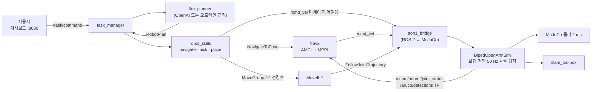
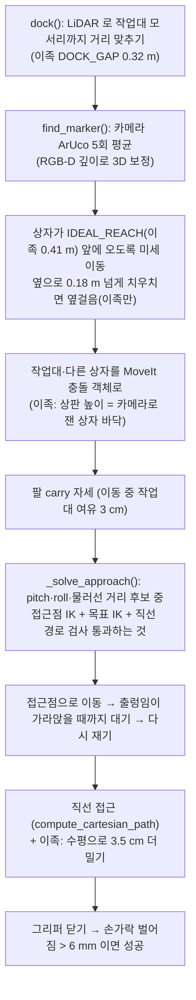
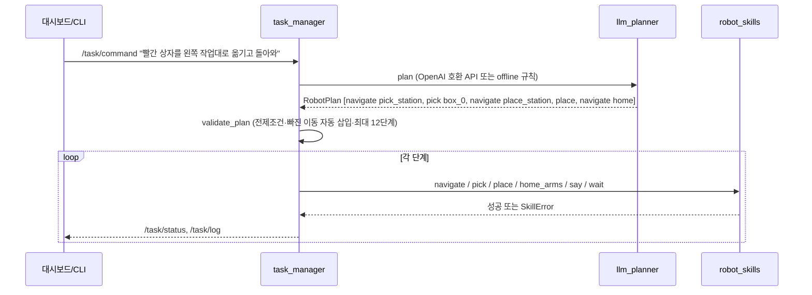

# TRON1 + OpenArm 시험·검증 기록

[TRON1 목차](README.md) · [설계](design.md) · [보행 학습](locomotion-rl.md) · [실로봇으로 넘어가기](../real-robot.md)

하반신을 TRON1 으로 바꾼 뒤 SLAM·Nav2·집기·LLM 미션을 **실제로 시험한 순서대로** 모은 기록입니다. 수치는 모두 이 저장소의 시뮬레이터에서 직접 잰 값입니다. 날짜가 뒤로 갈수록 최신이며, **현재 상태는 마지막 절(Sole-foot 전체 미션 완주)** 기준입니다. 한 번의 성공은 반복 성공률 보장이 아닙니다.

| 절 | 내용 | 통합 전 문서 |
|---|---|---|
| [1](#1-2026-11-05-시점-상태와-전체-구조) | 2026-11-05 시점 상태표, 전체 구조, 용어 | 07장 0~1 |
| [2](#2-ros-2-브리지slamnav2-시험) | 브리지·SLAM·Nav2 시험 방법과 결과 | 07장 6~8 |
| [3](#3-카메라moveit-집기-시험-초기) | 카메라+MoveIt 집기 초기 시험(실패 원인 분석), LLM 연결 | 07장 9~10 |
| [4](#4-몸통-흔들림-원인-분석) | 몸통 흔들림 원인 분해 실험 | 06장 + 07장 11 |
| [5](#5-시각-피드백-집기-손목-마커-visual-servoing) | 손목 마커 시각 피드백 집기, 시험 7~20 | 08장 |
| [6](#6-sole-footsf-로-전체-미션-완주) | Sole-foot 로 전체 미션 완주와 고친 것 | 09장 |
| [7](#7-실행-명령-모음과-남은-과제) | 실행 명령 모음, 남은 과제 | 07장 12~13 |

## 1. 2026-11-05 시점 상태와 전체 구조

### 상태표 (2026-11-05 기준 — 이후 5·6절에서 집기·미션 성공)

| 기능 | 상태 | 근거 |
|---|---|---|
| 하반신 모델 (xacro → URDF → MJCF) | ✅ Point-foot·Sole-foot 둘 다 생성 | [설계](design.md) |
| 보행 정책 (PPO 미세조정) | ✅ PF v8: 넘어짐 0/3 (6개 시험). SF: 넘어짐 0/3 (한 팔 carry 만 3/3) | [보행 학습 8절](locomotion-rl.md) |
| 제자리 서기 | PF: 원리상 불가(항상 제자리 걸음). SF: 명령 0 이면 실제로 섬 (30 s 흔들림 0.10 m) | [보행 학습 8-3](locomotion-rl.md) |
| SLAM 지도 작성 | ✅ 점유 셀 97.6% 가 정답 지도 10 cm 안 | 2-2 |
| Nav2 주행 | ✅ 목표 3/3 도착 (PF). 전체 미션에서 pick_station 도착 | 2-3 |
| 도킹·ArUco 인식 | ✅ ArUco 위치 오차 최대 0.2 cm (정답 대비) | 3-1 |
| LLM 명령 → 계획 | ✅ "빨간 상자를 왼쪽 작업대로 옮기고 돌아와" → 5단계 계획 | 3-2 |
| **MoveIt 집기** | ❌ **아직 성공 못 함** — 손끝이 상자에서 3~6 cm 어긋남 → 5·6절에서 해결 | 3-1 |
| 상반신을 하반신에 바짝 붙인 설계 | 🔄 모델·자세 적용 완료, 정책 재학습 중 | [설계 변경 이력](design.md#몸체-설계-변경-이력-왜-바꿨나)·4 |


### 전체 구조



바퀴형과 비교해 바뀐 것은 오른쪽 아래 `tron1_bridge` 와 `BipedOpenArmSim` 뿐입니다.
토픽 이름이 같으므로 SLAM·Nav2·MoveIt·LLM 앱은 바퀴형 것을 그대로 씁니다.
앱 쪽에는 이족용 선택 기능만 더했습니다(3-1).

용어

- **MJCF** (MuJoCo XML Format) — MuJoCo 시뮬레이터의 로봇·월드 기술 파일
- **URDF** (Unified Robot Description Format) — ROS 의 로봇 기술 파일. **xacro** (XML Macros) 는 URDF 를 변수·매크로로 만드는 형식
- **SRDF** (Semantic Robot Description Format) — MoveIt 용 팔 그룹·이름 자세·충돌 무시 쌍
- **TF** (Transform) — ROS 의 좌표계 트리 (map → odom → base_footprint → base_link …)
- **PD 제어** (Proportional-Derivative) — 목표각과의 차이(P)와 속도(D)로 토크를 내는 관절 제어
- **PPO** (Proximal Policy Optimization) — 정책을 조금씩만 바꾸며 학습하는 강화학습 알고리즘
- **SLAM** (Simultaneous Localization and Mapping) — 움직이며 지도를 만들고 동시에 자기 위치를 추정
- **AMCL** (Adaptive Monte Carlo Localization) — 만들어 둔 지도 위에서 파티클로 위치를 추정
- **MPPI** (Model Predictive Path Integral) — Nav2 의 경로 추종 제어기. 무작위 속도 후보를 굴려 보고 고른다
- **IK** (Inverse Kinematics) — 손 위치·자세 → 관절각 계산
- **TCP** (Tool Center Point) — 그리퍼 손가락 사이의 기준점 (`openarm_*_hand_tcp`)
- **ONNX** (Open Neural Network Exchange) — 신경망 가중치 교환 형식
- **PF / SF** — TRON1 의 Point-foot(점 발, 발목 없음) / Sole-foot(평발, 발목 관절 있음)

## 2. ROS 2 브리지·SLAM·Nav2 시험

### 2-1. ROS 2 브리지와 실행

- `tron1_openarm_sim/bridge_biped.py` 는 바퀴형 `bridge_node.py` 를 import 하고 시뮬 코어만 `BipedOpenArmSim` 으로 바꿉니다.
  - `/cmd_vel` 은 linear.y(옆걸음)도 받습니다.
  - `BASE_LINK_Z` 는 발 형태에 따라 0.68/0.73 입니다 (ArUco 위치를 base_footprint 기준으로 바꿀 때 씀).
- 디버그 토픽 `/biped/status` (JSON): 발 형태, 서기 여부, 몸통 높이·기울기, 넘어짐, 정책 명령, 인코더 추정 속도, **손끝 정답 위치**, **팔과 외부 물체의 접촉 목록**.
- 모든 launch 에 `foot:=pf|sf` 인자가 있습니다. `policy:=` 를 비우면 발 형태별 기본 정책을 씁니다.

```bash
(cd mobile_openarm && .venv-mobile/bin/python -m colcon build --symlink-install --base-paths src)        # 휠형 (underlay)
(cd tron1_openarm && source ../mobile_openarm/install/setup.bash && \
  ../mobile_openarm/.venv-mobile/bin/python -m colcon build --symlink-install --base-paths src)         # TRON1 (overlay)
source tron1_openarm/install/setup.bash
ros2 launch tron1_openarm_sim sim.launch.py foot:=sf viewer:=true              # 화면에서 서 있는 로봇 보기
ros2 topic echo /biped/status                                                  # standing: true 확인
ros2 topic pub -r 10 /cmd_vel geometry_msgs/msg/Twist "{linear: {x: 0.2}}"   # 걷기
```

- 실행 환경 주의: GPU 없는 Docker 에서는 `MUJOCO_GL=osmesa` 입니다.
  - 머리 카메라 렌더에서 그림자를 켜면 프레임당 0.68 s 가 걸렸고, 끄자 0.16 s 가 됐습니다 (`_camera_scene_hook`).
  - launch 를 끌 때 자식 프로세스가 남아 시뮬 두 개가 동시에 돌면 실시간 배율이 0.1 까지 떨어졌습니다. 끌 때 `ps … | xargs kill -9` 로 남은 것까지 정리합니다.


### 2-2. SLAM 시험 — 어떻게 했나

방법

1. `slam.launch.py` 를 실행합니다 (시뮬 + slam_toolbox online async). LiDAR 는 몸통 앞 0.57 m 높이입니다. 상자 더미(0.6 m)를 보도록 정한 높이입니다.
2. 사람 손 조종 대신 `tools/validation/slam_auto_drive.py` 로 같은 경로를 반복 주행합니다.
   - 시뮬 정답 자세(`/ground_truth/pose`)를 보며 경유지 12개를 0.25 m/s 로 따라갑니다.
   - 지도 품질을 공정하게 비교하려고 매번 같은 경로를 썼습니다. 정답 자세는 경로 따라가기에만 쓰고, SLAM 자체는 정답을 쓰지 않습니다.
3. `map_saver_cli` 로 저장한 지도를 정답 지도(월드에서 만든 `world_map`)와 겹쳐 비교합니다.

```bash
ros2 launch tron1_openarm_sim slam.launch.py viewer:=false
python3 tron1_openarm/tools/validation/slam_auto_drive.py
ros2 run nav2_map_server map_saver_cli -f ~/maps/tron1_map --ros-args -p use_sim_time:=true
```

결과: SLAM 지도의 점유 셀 중 **97.6%** 가 정답 지도 장애물에서 10 cm 안이었습니다 (`doc/images/tron1_slam_map_vs_truth.png`).
이족이라 제자리 걸음으로 스캔이 흔들리므로 바퀴형보다 천천히, 회전은 더 천천히 몰았습니다.


### 2-3. Nav2 시험 — 어떻게 했나

설정 `config/nav2_params_tron1.yaml` (`tools/make_nav2_params_tron1.py` 가 바퀴형 파라미터에서 생성)

| 파라미터 | 바퀴형 | TRON1 | 이유 |
|---|---|---|---|
| 최대 vx / wz | 0.40 / 1.2 | 0.35 / 0.8 | 보행 정책의 학습 범위 |
| 가속 ax / az | 2.0 / 2.5 | 0.8 / 1.5 | 이족은 급가속에 약함 |
| 도착 허용 xy / yaw | 0.12 m / 0.15 rad | 0.15 m / 0.20 rad | 제자리 걸음 흔들림 |
| footprint | 0.55×0.52 | 0.46×0.64 | 내린 팔·손 포함 |
| AMCL alpha | 0.2 | 0.4 | 다리 오도메트리 잡음 |

방법

1. `nav.launch.py` 를 실행하고 `ros2 action send_goal /navigate_to_pose …` 로 목표를 보냅니다.
2. `tools/validation/nav_monitor.py` 로 정답·AMCL·오도메트리·`/cmd_vel` 을 3 s 마다 기록합니다.
3. 도착 여부와, 도착했을 때 정답 대비 위치 오차를 봅니다.

겪은 문제: **MPPI 교착**

- 로봇이 출발하지 않았습니다.
- 기록을 보니 MPPI 는 "측정 속도 + 가속 한계×0.05 s" 만큼씩만 명령을 키우는데, 정책이 0.04 m/s 같은 작은 명령에는 다리를 움직이지 않았습니다.
- 측정 속도가 계속 0 이니 명령도 0.04 에 머물렀습니다.
- 해결: [보행 학습 8-3](locomotion-rl.md) 의 속도 PI 루프가 작은 명령도 실제 움직임으로 만듭니다.

결과: 목표 3/3 도착. 전체 미션에서도 pick_station 도착(약 384 s). 도착 오차는 AMCL 옆 오차 때문에 최대 0.15 m 정도였고, 이것은 3-1 의 옆걸음으로 보정합니다.

## 3. 카메라+MoveIt 집기 시험 (초기)

### 3-1. 카메라 정보를 받으며 MoveIt 으로 집기 — 어떻게 시험했고 왜 만족하지 못했나

#### 3-1-1. 집기 동작 순서 (`mobile_openarm/src/mobile_openarm_apps/mobile_openarm_apps/robot_skills.py` `pick()`)



#### 3-1-2. 평가 방법

- **성공 판정 (앱 자체)**: 그리퍼를 닫은 뒤 손가락 벌어짐이 6 mm 보다 크면 "상자를 쥐었다"고 봅니다. 실로봇에서도 같은 방법을 씁니다.
- **원인 분석용 정답 기록 (시뮬 전용)** `tools/validation/grasp_recorder.py`: 0.2 s 마다 다음을 기록합니다.
  - 손끝 정답 위치 (손 몸체 + 손 z축 0.09 m, URDF `hand_tcp` 정의와 같음)
  - 상자 정답 위치 (`/sim/objects`)
  - MoveIt 이 생각하는 손끝 (TF)
  - 카메라가 잰 상자
  - 몸통 높이·기울기, 팔과 외부 물체 접촉
- 판정 지표: 손끝–상자 최근접 거리와 방향, 상자가 들렸는지(z 상승), 팔이 작업대에 닿았는지, 최대 기울기.

```bash
bash tron1_openarm/tools/validation/pick_test.sh pf 1     # 또는 sf
```

#### 3-1-3. 시험 기록 — 발견한 문제와 고친 것

| # | 증상 (로그·정답 기록) | 원인 | 고친 것 |
|---|---|---|---|
| 1 | 직선 경로 64% 만 가능 | 도킹 후 상자가 옆으로 0.27~0.31 m (AMCL 옆 오차) | 옆걸음 `strafe_base` (이족만, `/cmd_vel.linear.y`) |
| 2 | 재측정 값이 엉뚱함 (z 0.76) | carry 자세의 팔이 마커를 가려, 깊이 영상이 팔까지의 거리를 줌 | 6 cm 넘게 다른 재측정은 버림 |
| 3 | 몸통이 1.3~1.9 m 달아남 | 한 팔 carry 가 학습 범위 밖 | v8 재학습, 옆 보정 한도 0.45 |
| 4~8 | 모든 접근 후보가 42~67% | (a) 지도 상판 높이와 기울어진 몸통 기준 상자 높이가 3~6 cm 어긋나 상자 중심이 상판 '안' (b) 목표 상자를 장애물로 둔 채 직선 검사 (c) 접근점 IK 가 관절 한계에 붙은 다른 팔 모양 | (a) 상판 높이를 카메라로 잰 상자 바닥으로 (b) 검사 때 목표 상자 제외 (c) 접근점 IK 를 목표점 IK 에서 시작 |
| 9 | 접근 성공, 그러나 손가락이 끝까지 닫힘 | - | 정답 기록기를 만들어 분석 시작 |
| 11 | MoveIt 거부 (`START_STATE_IN_COLLISION`, box_37) | 팔 무늬를 마커 37 로 오검출 → 팔 위에 가짜 상자 | 알려진 마커 id 만 장애물로 |
| 12 | 손끝이 상자 중심 3.5 cm 앞에서 멈춤 | 팔 처짐 + 몸통 반동 | 수평 밀기 3.5 cm |
| 17 | 마지막 접근 중 몸통이 10 cm 앞뒤로 출렁 | 큰 팔 동작 뒤 균형 회복 중 | 출렁임이 가라앉을 때까지 대기(`wait_still`) |
| SF 1·2 | 기울기 18~20°, 몸통 높이 0.55 m | **손가락이 이동 중 작업대 상판을 스침** (접촉 기록으로 확인) | 이동 중 작업대 충돌 객체 3 cm 여유 |
| SF 3 | 직선 27% | 팔에 가려 안 보이는 목표 상자가 장애물로 남음 | 안 보여도 목표 상자 장애물 제거 |

#### 3-1-4. 왜 아직 만족하지 못하나 (측정)

마지막 시험들에서 손끝은 상자에서 PF 2~4 cm, SF 4~6 cm 어긋났습니다.
상자는 5 cm 이고 손가락 사이 여유는 약 ±2 cm 라서 쥐지 못합니다.
4절 흔들림 분석의 분해 결과는 다음과 같습니다.

| 손끝 오차의 원인 | 크기 |
|---|---|
| 팔을 크게 움직일 때 몸통 반동·무게중심 이동 (팔 질량을 없애면 62% 줄어듦) | 몸통 몫 4~6 cm |
| 보행 정책이 팔 자세를 모름 (관측에 팔 관절 없음) | 위에 포함 |
| 팔 관절이 중력에 처짐 (몸통을 고정해도 남음) | 2~3 cm |
| 기둥 높이 (13 cm 줄이면 16~25% 감소) | 작음 |

정해진 위치로 손을 보내는 방식(열린 루프)으로는 이족에서 ±2 cm 를 안정적으로 맞추기 어렵다는 것이 지금까지의 결론입니다.
그래서 상반신을 하반신에 바짝 붙인 설계([설계 변경 이력](design.md#몸체-설계-변경-이력-왜-바꿨나) ⑦)로 바꾸고 정책을 다시 학습하는 중입니다.


### 3-2. LLM 명령 수신 → 로봇 행동 실행



- **안전 설계** (`llm_planner.py`):
  - 행동은 화이트리스트(navigate, pick, place, home_arms, say, wait)만 허용합니다.
  - 장소·물체는 Enum 으로 제한합니다. LLM 이 임의 좌표나 명령을 만들 수 없습니다.
  - 계획은 `validate_plan()` 이 상태를 시뮬레이션해 검사합니다.
- 오프라인 모드(`planner:=offline`)는 API 없이 규칙으로 같은 형식의 계획을 만듭니다. 로컬 LLM 은 `OPENAI_BASE_URL` 로 붙입니다.
- 이족에서 앱이 달라지는 부분은 환경변수로만 켭니다. 바퀴형은 변수가 없으므로 예전 동작 그대로입니다.
  - `OPENARM_SRDF` (이족용 이름 자세)
  - `OPENARM_BIPED=1`: 옆걸음, 작업대 더 가까이, 상판 높이 측정, 이동 중 여유, 출렁임 대기, 재측정, 수평 밀기

```bash
ros2 launch tron1_openarm_sim full_system.launch.py foot:=pf planner:=offline viewer:=false
python3 tron1_openarm/tools/validation/mission_cli.py "빨간 상자를 왼쪽 작업대로 옮기고 돌아와" 1500
```

전체 미션 결과 (PF): 계획 5단계 생성 → pick_station 도착 → 도킹·마커 인식 → **pick 단계에서 실패** (3-1. 이후 5·6절에서 해결).

## 4. 몸통 흔들림 원인 분석

> 4절. 아래 요약(구현 기록 11절) 뒤에 원래 분석 문서 전체를 이어 둡니다.


- 질문: 상반신이 너무 길고 가늘어서 흔들리는가?
- 측정:
  - 시뮬에서 상반신은 관절 없이 강체로 고정되어 있어 휘지 않습니다.
  - 상반신 무게의 83% 가 팔(12.2 kg)입니다.
  - 상반신을 얹어 무게중심이 0.21 m 올라갔습니다.
- 실험 (PF, carry 동작 흔들림): 그대로 11.6 cm, 팔 질량 1% 4.4 cm, 팔 3배 느리게 7.2 cm, 기둥 13 cm 짧게 9.7 cm.
- 사용자 제안: 팔이 하반신 바로 위에 붙도록 → 어깨 = 서 있는 base + 0.10 m 로 변경 ([설계 변경 이력](design.md#몸체-설계-변경-이력-왜-바꿨나) ⑦).
- 기존 정책 그대로 잰 예비 결과 (재학습 전):
  - SF 는 carry 흔들림 13.0 → 9.1 cm (−30%), ready 0.2 cm.
  - PF 는 어깨 높이로는 거의 같고(7.7 → 7.6 cm), 팔 자세를 바꾼 효과가 컸습니다 (11.6 → 7.7 cm).

### 이 장에 나오는 용어

- **흔들림(sway)** — 팔을 움직이는 동안 몸통(base_link) 위치가 움직인 범위 [cm]
- **손끝 오차** — 손끝(TCP)이 실제로 간 곳과, 몸통이 처음 자리에 가만히 있고 팔이 명령대로 정확히 움직였을 때 갔을 곳의 차이
  - **몸통 몫** — 몸통이 움직이고 기울어서 생긴 오차
  - **팔 몫(처짐)** — 팔 관절이 중력 때문에 명령 각도를 정확히 따라가지 못해 생긴 오차
- **무게중심(COM, center of mass)** — 로봇 전체 질량의 평균 위치. 높을수록 작은 흔들림에도 넘어지기 쉽다

### 4-1. 질문

> 상반신 몸통(기둥)이 너무 길고 가늘어서 조금만 움직여도 흔들리는 것 아닌가?

이 질문을 두 부분으로 나눠 확인했습니다.

1. 시뮬레이터 모델에서 상반신이 하반신에 어떻게 붙어 있나 (휠 수 있나)
2. 흔들림을 원인별로 나누면 무엇이 가장 큰가

### 4-2. 상반신 결합 구조와 질량 분포 (측정)

| | Point-foot (PF) | Sole-foot (SF) |
|---|---|---|
| 상반신 연결 | `base_link → openarm_mount_link → openarm_body_link0`, **관절 0개 (강체 고정)** | 같음 |
| 전체 질량 | 33.9 kg | 36.0 kg |
| 상반신 질량 (비율) | 14.7 kg (43%) | 14.5 kg (40%) |
| 그중 양팔+그리퍼 | **12.2 kg** | 12.2 kg |
| 그중 기둥+브래킷 | 2.5 kg | 2.3 kg |
| 무게중심 높이: TRON1 단독 → 상반신 얹은 뒤 | 0.43 → 0.64 m (**+0.21 m**) | 0.42 → 0.62 m (+0.21 m) |

- 시뮬레이터에서 기둥은 **휘지 않는 강체**입니다. 그래서 '기둥이 가늘어서 휜다' 는 효과는 시뮬레이션 결과에 들어 있지 않습니다.
- 기둥 자체는 2.3~2.5 kg 로 가볍습니다. 상반신 무게의 83% 는 **팔**입니다.
- 원본 OpenArm 기둥(0.75 m)은 이미 0.38~0.43 m 로 짧게 바꿔 두었습니다 ([설계 — 기둥 교체](design.md#4-2-기둥-교체)).

실로봇 참고 (계산값): 40×40 mm 알루미늄 프로파일(단면 2차 모멘트 약 1×10⁻⁷ m⁴) 0.4 m 기둥 끝에 팔 12 kg 이 2 m/s² 로 흔들릴 때
휨은 약 0.07 mm, 원본 길이 0.75 m 이면 약 0.6 mm 입니다. 기둥 휨 자체는 작지만, **볼트 결합부의 유격·장착판의 휨**은 이보다 클 수 있어 실기에서 확인해야 합니다.

### 4-3. 원인 분해 실험

`tools/sway_analysis.py` — 실제 시뮬레이터 제어기(`BipedOpenArmSim`: 보행 정책 + 자세 유지 루프)로, 집기와 같은 순서로 오른팔을 움직입니다.
서기 4 s → carry → 접근점(pre) → 상자 앞(grasp). 각 이동 2 s + 유지 3 s.

조건을 하나씩 바꿔 무엇이 흔들림을 만드는지 봅니다.

| 조건 | 무엇을 확인하나 |
|---|---|
| normal | 실제 상태 |
| massless_arms | 팔 질량을 1% 로 (같은 동작). 흔들림이 줄면 → **팔의 무게·반동**이 원인 |
| slow | 팔을 3배 느리게 (6 s). 줄면 → **반동(가속)** 이 원인 |
| short_column | 어깨를 0.98 m 로 (기둥 13 cm 짧게). 줄면 → **높이·기둥 길이**가 원인 |
| fixed_base | 몸통을 공중에 고정. 남는 오차 = **팔 처짐**만 |

#### 결과 (Point-foot, cm)

| 조건 | carry 흔들림 | pre 흔들림 | grasp 흔들림 | grasp 손끝 오차 (몸통 몫 / 팔 몫) |
|---|---|---|---|---|
| normal | **11.6** | 8.3 | 3.6 | 5.9 (4.4 / 2.8) |
| massless_arms | **4.4** (−62%) | 2.3 (−72%) | 2.6 | 4.4 (4.4 / 0) |
| slow (3배 느리게) | 7.2 (−38%) | 5.2 (−37%) | 3.0 | 6.7 (6.2 / 2.8) |
| short_column (−13 cm) | 9.7 (−16%) | 6.2 (−25%) | 4.2 | 5.8 (4.4 / 2.5) |
| fixed_base | 0 | 0 | 0 | 2.4 (0 / 2.4) |

#### 결과 (Sole-foot, cm)

| 조건 | carry | pre | grasp | grasp 손끝 오차 (몸통 몫 / 팔 몫) |
|---|---|---|---|---|
| normal | 12.7 | 6.9 | 2.9 | 17.5 (18.1 / 2.6) |
| slow | 8.8 | 5.1 | **1.1** | 9.2 (9.6 / 2.6) |
| fixed_base | 0 | 0 | 0 | 4.5 (0 / 4.6) |

(SF 의 massless_arms 는 정책이 학습한 적 없는 조건이라 오히려 크게 흔들려 비교에서 뺐습니다. SF 의 '몸통 몫' 이 큰 것은 흔들림보다
서기 모드를 잠깐 풀고 발을 디디며 **자리가 옮겨진 누적 거리**입니다.)

### 4-4. 결론 — 원인의 크기 순서

1. **팔 동작의 반동 (가장 큼).** 팔 질량만 없애도 carry 흔들림이 11.6 → 4.4 cm (−62%). 팔을 3배 느리게만 해도 −38%.
   6 kg 짜리 팔이 2 초 만에 크게 움직이면 그 반작용과 무게중심 이동을, 발목 없는(PF) 또는 발목이 약한(SF, 20 Nm) 하반신이 발을 디뎌 받아낸다.
2. **보행 정책이 팔 자세를 모른다.** 정책 관측에 팔 관절이 없어, 팔이 움직인 '뒤' 몸통이 흔들리는 것을 보고서야 반응한다 ([보행 학습 7절](locomotion-rl.md#7-더-좋은-정책을-원할-때-gpu-pc)).
   팔 질량이 없어도 2~4 cm 는 남는데, 이것이 제자리 걸음 자체의 흔들림(PF)이다.
3. **팔 처짐 2~3 cm.** 몸통과 상관없이, 팔 관절 위치 제어가 중력에 밀려 생긴다 (fixed_base 에서도 2.4 cm).
4. **기둥 높이·길이 (작음).** 기둥을 13 cm 줄여도 흔들림은 16~25% 만 준다. 시뮬레이터 안에서 기둥은 휘지 않으므로 '가늘어서' 의 효과는 없다.

손끝 오차는 위 1·2(몸통 몫 4~6 cm)와 3(팔 몫 2~3 cm)을 합친 것이고, 상자(5 cm)를 잡을 여유(손가락 사이 약 ±2 cm)보다 크다.
이것이 이족에서 집기가 계속 실패한 근본 원인이다.

### 4-5. 원인별 대책

| 원인 | 대책 | 기대 효과 | 비용 |
|---|---|---|---|
| 팔 반동 | 이족일 때 팔 속도 배율을 낮춤 (0.3 → 0.1) | 흔들림 −38% (실험) | 작음 (조작 시간 늘어남) |
| 정책이 팔을 모름 | 보행 정책 관측에 **팔 관절각 14개**를 넣어 다시 학습 → 팔이 움직이기 '전'에 무게중심 이동을 대비 | 가장 근본적 | 큼 (처음부터 학습, 수 시간) |
| 팔 처짐 | 팔 위치 제어 이득을 높이거나 중력 보상(gravity compensation) 토크 추가 | 2~3 cm 제거 | 중간 |
| 남는 오차 | 손목에 마커를 붙여 카메라로 손-상자 상대 오차를 보며 마지막 몇 cm 보정 (visual servoing) | 남은 오차 흡수 | 중간 |
| 기둥·결합부 (실로봇) | 기둥을 짧게(이미 적용), 장착판·볼트 결합 강성 확보, 팔 무게중심을 몸 쪽으로 | 실기에서 확인 | 기구 설계 |

## 5. 시각 피드백 집기 (손목 마커 visual servoing)

### 이 장에 나오는 용어

- **시각 피드백(visual servoing)** — 카메라로 잰 오차를 보고 로봇을 다시 움직이는 닫힌 루프 제어. 여기서는 "손끝 − 목표" 오차
- **손목 마커** — `openarm_*_link7`(손목, 손과 관절 없이 붙어 있음) 네 면에 붙인 4 cm ArUco 마커
- **정기구학(FK, forward kinematics)** — 관절각으로 손 위치를 계산하는 것. MoveIt·TF 가 이 값을 쓴다
- **명령 목표 누적(적분)** — 팔이 중력에 처지는 만큼 실제 손은 명령보다 덜 간다. 오차만큼 '명령'을 계속 옮겨 처짐을 상쇄
- **시각 오도메트리** — 작업대 위에 가만히 있는 다른 마커들이 카메라에서 얼마나 움직였는지로 몸통이 움직인 양을 아는 것
- **시각 제자리 유지(station keeping)** — 그 마커들이 처음 자리로 돌아오도록 몸통을 천천히 걷게 하는 것

### 5-1. 무엇을 만들었나 (파일)

| 파일 | 내용 |
|---|---|
| `tron1_openarm_sim/wrist_markers.py` (새 파일) | 마커 ID(오른손 40~43, 왼손 44~47), link7 기준 위치·면 방향, TCP 오프셋(link7 + 0.19 m), `tcp_from_marker()` |
| `tools/build_tron1_openarm.py` `add_wrist_markers()` | link7 의 ±x·±y 면에 얇은 마커 판(시각 전용: 질량·충돌 없음) + 텍스처 생성. PF/SF MJCF 모두 재생성 |
| `robot_skills.py` `measure_hand_and_box()` | 같은 카메라 프레임에서 손목 마커(→ 손끝)와 상자 마커를 함께 잼. 손목 마커가 가려지면 측정 관절각의 정기구학 손끝을 씀 |
| `robot_skills.py` `visual_servo()` | 손끝을 '상자 중심 + offset' 에 맞출 때까지 최대 4번: 재기 → 오차만큼 명령 목표 누적 이동. 옆 오차가 2 cm 넘으면 뒤로 4 cm 물러나며 옮김(상자를 밀지 않게) |
| `robot_skills.py` `_snapshot()`·`predict_hidden()` | 목표 상자가 손에 가려지면, 함께 보이던 다른 상자 마커들의 이동(중앙값)으로 목표의 현재 위치를 추정 |
| `robot_skills.py` `station_keep()` | 다른 마커들이 처음 자리로 돌아오도록 `/cmd_vel` 로 천천히(≤5 cm/s) 걷기 |
| `robot_skills.py` `pick()` | ① 접근점 가기 전 상자 재측정 → 접근점 IK 이동(안 되면 재계산) ② station_keep → 접근점 시각 보정 ③ station_keep → 직선 접근 ④ 파지 위치 시각 보정 ⑤ 쥔 뒤 팔은 천천히(0.1) |
| `biped_core.py` | 제자리일 때 미끄러짐 보정 비율 0.18(걸을 때 1.0) + PF 옆 미끄러짐 보정 (아래 3-3) |
| `bridge_biped.py` | 접촉 목록 읽기를 시뮬 잠금 안으로(브리지가 IndexError 로 죽던 경쟁 상태), 상태에 정답 자세·오도메트리 추가 |
| `tools/validation/grasp_recorder.py` | 정답 기록에 몸통 정답 자세·오도메트리·명령 추가 |

손목 마커를 손(hand)이 아니라 **link7** 에 붙인 이유: 손바닥 옆면은 손가락이 덮고, 손 뒤쪽 절반은 link7 안에 들어가 있어 붙일 자리가 없다.
link7 과 손은 관절 없이 고정이므로 link7 위 마커 위치를 알면 손끝(TCP)을 정확히 안다. 접근 자세(roll ±70~90°)에서는 ±x 면,
roll 0° 에서는 ±y 면이 위(카메라 쪽)를 향하므로 네 면에 모두 붙였다 (오프라인 렌더로 모든 접근 자세에서 검출 확인).

### 5-2. 실행 방법

```bash
# 모델 재생성 (손목 마커 포함)
source mobile_openarm/.venv-mobile/bin/activate
cd tron1_openarm/src/tron1_openarm_sim
python3 tools/build_tron1_openarm.py --tron1 <PF_TRON1A> --openarm <openarm_bimanual.xml> --out mjcf
python3 tools/build_tron1_openarm.py --foot sf --base-height 0.73 --tron1 <SF_TRON1A> --openarm <...> --out mjcf/sf
cd ~/openarms_llm_ex/mobile_openarm && .venv-mobile/bin/python -m colcon build --symlink-install --base-paths src --packages-select mobile_openarm_apps
cd ~/openarms_llm_ex/tron1_openarm && source ../mobile_openarm/install/setup.bash && \
  ../mobile_openarm/.venv-mobile/bin/python -m colcon build --symlink-install --base-paths src --packages-select tron1_openarm_sim
cd ~/openarms_llm_ex && source tron1_openarm/install/setup.bash

# 집기 시험 (시뮬 + MoveIt + 정답 기록기 + pick_place)
LOG_DIR=/tmp/tron1_logs bash tron1_openarm/tools/validation/pick_test.sh pf 20
grep -E "servo|station" /tmp/tron1_logs/pfpk20.log       # 시각 보정 기록
```

로그 한 줄 읽는 법:
```
[servo 접근점] 1: 손끝(손목 마커) [0.425 -0.171 0.745] → 목표 [0.447 -0.156 0.755], 오차 [2.3 1.5 1.0] cm (|2.9|), 정기구학과 차이 [0.1 0.2 0.4] cm
```
손끝(카메라로 잰 값) → 목표(상자 중심 + 접근 offset), 오차, 그리고 카메라 손끝과 정기구학 손끝의 차이(카메라·모델이 맞는지 확인용).

### 5-3. 시험 기록 (PF, 시험 7~20)

각 시험은 `pick_test.sh` 한 번(시뮬 약 10~20 분). 시뮬 정답(상자·손끝·몸통 실제 위치)을 `grasp_recorder.py` 로 같이 기록해 비교했다.

#### 5-3-1. 시각 피드백 자체는 잘 동작한다

| 확인 항목 | 결과 |
|---|---|
| 손목 마커로 잰 손끝 vs 정기구학 손끝 | 0.1~0.6 cm 차이 (시험 7·9·12·16·20) → 카메라 보정·마커 위치 정확 |
| 카메라로 잰 상자 vs 정답 | 대부분 1 cm 안 (시험 11 정답 기록). 손에 밀려 9 cm 움직인 것도 정확히 잡음 |
| 상자가 보일 때 보정 수렴 | 13 → 8.7 → 6.0 → 3.8 cm (시험 16), 1.4 → 1.0 → 0.5 cm (시험 13), 3.4 → 1.2 → 0.1 cm (시험 9) |
| **파지 성공 (시험 11, 20)** | 시험 20: 상자 23 cm 들어 올려 carry 로 든 채 안정 (쥔 팔 천천히 적용 뒤). 시험 11: 손끝-상자 약 2 cm, 상자를 5 cm 들어 올림. 그 뒤 팔을 carry 로 빠르게 접다 넘어짐 → 쥔 팔은 0.1 속도로 |

#### 5-3-2. 시험하며 찾은 문제와 고친 것

| 시험 | 정답 기록으로 본 문제 | 고친 것 |
|---|---|---|
| 7 | 보정 뒤 MoveIt 안의 손 위치가 상판에 '닿은' 것으로 계산돼 직선 접근이 75% 에서 끊김 | 손 높이는 카메라로 지키므로 충돌 검사 없이 재시도 |
| 8 | 브리지가 `IndexError` 로 죽음 (상태 발행 스레드가 시뮬 스텝과 동시에 접촉 배열을 읽음) | 시뮬 잠금 안에서 복사 |
| 9 | 손을 상자 옆 10 cm 에 '정확히' 맞춤 — 1분 전 측정값을 썼는데 그사이 몸통이 12 cm 흐름 | 같은 프레임에서 본 상자 우선, 가려지면 추정 (→ 13) |
| 10 | home→carry 중 손가락이 상판 모서리를 침 — 작업대가 오도메트리로는 0.42 m, 실제는 0.33 m | 카메라로 잰 상자 거리로 작업대 앞 모서리 위치를 제한 (`BOX_EDGE_MIN`) |
| 11 | 손가락이 마커를 일부 가려 깊이를 손가락에서 읽음 (19 cm 튐) | 상판 높이와 2 cm 넘게 안 맞는 측정은 버림. **파지 성공**, 그 뒤 넘어짐 → 쥔 팔 천천히 |
| 12 | odom 으로 옮긴 옛 위치가 오히려 7~9 cm 더 틀림 (다리 오도메트리가 제자리 흐름을 못 봄) | odom 이동 대신 다른 마커 기준 (→ 13) |
| 13 | 목표 마커가 손에 가려진 1분 동안 몸통이 흘러, '오차 0.5 cm' 라고 판단했지만 실제로는 상자를 10 cm 밀고 있었음 | **시각 오도메트리** (`predict_hidden`) |
| 14 | 접근점이 14 cm 어긋나 손이 상자 옆에 붙은 채 옆으로 보정 → 상자를 8 cm 밀고 감 | 옆으로 2 cm 넘게 어긋나면 뒤로 물러나며 보정, 어긋난 접근점은 IK 재계산 |
| 15·16 | 팔을 뻗고 서 있으면 몸통이 앞으로 걸어 나감 (1분에 10~35 cm) | 원인 추적 → 3-3 |
| 17·18 | 팔을 옮길 때 몸통이 옆으로 7~12 cm 밀렸다 돌아옴, 앞뒤로도 계속 흐름 | 팔 기본 속도 0.15, **시각 제자리 유지** |
| 19 | 작업대 여유(3 cm) 때문에 carry 계획 실패 | 여유 없이 재계획 |
| 20 | 제자리 유지로 접근점 오차 10~14 → 2.9 cm. 직선 접근 중 손가락이 상자를 밀자 몸통이 6° 돌아 보정이 출렁였지만(12 → 4 → 10 → 7 cm), **첫 시도에 파지 성공** | 정답 기록: 상자 23 cm 들어 올림, carry 자세로 든 채 기울기 1.6° 로 서 있음 (넘어지지 않음) |

그 밖에: 시험 스크립트가 정답 기록기를 끄지 못해(종료 패턴 오타) 이전 시험의 기록기 9개가 남아 CPU 를 먹던 것, 이전 시험의 pick_place 가 다음 시험까지 살아 있던 것을 고쳤다.

#### 5-3-3. 근본 원인: PF 가 제자리에서 걸어 나간다 (오도메트리가 못 봄)

오프라인 실험(`BipedOpenArmSim`, 정답 vs 다리 오도메트리):

| 조건 (30 s, 명령 0) | 정답 이동 | 오도메트리 |
|---|---|---|
| 정책만 (제자리 유지 끔), 미끄러짐 보정 없음 | **뒤로 29 cm / 20 s** | 1 cm |
| 같은 조건 + 발 마찰 1.2 / condim 6 / 접촉 강성 0.005 / noslip | 뒤로 16~30 cm | 1 cm |
| 제자리 유지 + 미끄러짐 보정 비율 1.0 (원래 값), 팔 pre 자세 | **앞으로 +17 cm** | 0 |
| 비율 0 | 뒤로 −40~−50 cm | 0 |
| 비율 0.18 (바꾼 값), 한 자세 | +0~2 cm | 0 |
| 비율 0.18, carry → pre 로 팔을 옮긴 뒤 60 s | +17 cm | 0 |

- 디딘 발의 접점이 평균 −2.6 cm/s 로 미끄러진다(접점 속도 직접 측정). 다리 기구학 오도메트리는 "디딘 발은 고정" 이라고 가정하므로 이 움직임을 못 본다.
- 원래 있던 보정(보행 정책 속도 추정기와 비교)은 팔을 뻗으면 추정기가 틀려(뒤로 −1.7 cm/s 라고 냄) 오히려 앞으로 걸어 나가게 만들었다.
- 비율만 바꿔서는 팔 자세·이력에 따라 달라 완전히 없앨 수 없었다 → **카메라로 고정 마커를 보는 시각 제자리 유지**로 해결 방향을 바꿨다 (실로봇에서도 같은 원리).
- 걷기(명령 ≠ 0)는 비율 1.0 그대로라 2 m 직진 오도메트리 오차 0.7% 로 유지된다 (Nav2 영향 없음).

#### 5-3-4. Sole-foot (SF) 시험 7

발을 디딘 채 서는 SF 로도 시험했지만, 도킹 미세 이동 중 몸통이 **44° 돌아가** 작업대를 비스듬히 보게 되었다 (정답 기록 yaw 97.9° → 53.4°).
SF 정책의 제자리 회전 성능이 약한 문제([보행 학습](locomotion-rl.md), 0.02 rad/s)가 그대로 드러난 것으로, 지금 정책으로는 SF 집기는 어렵다.

### 5-4. 남은 문제와 다음 단계

남은 문제 (시험 20 정답 기록):
1. 시각 제자리 유지가 ±3 cm 로 출렁이며 완전히 서지 않는다 (PF 는 항상 발을 구르므로).
2. 손가락이 상자에 닿으면 그 반력으로 몸통이 몇 도 돌아(yaw 6°) 0.5 m 앞 손이 5 cm 옆으로 간다.
3. 목표 마커가 손에 가려지는 마지막 몇 cm 는 다른 마커로 '추정' 할 수밖에 없다.

다음 단계 후보 (효과 큰 순):
| 방법 | 기대 | 비용 |
|---|---|---|
| 보행 정책 재학습: 관측에 팔 관절각 + 학습 중 '팔 뻗은 채 제자리 유지' 보상 | 흐름·반동 자체를 줄임 (가장 근본적) | 수 시간 학습 |
| 손목(손바닥 쪽) 카메라 추가 | 마지막 몇 cm 를 가림 없이 직접 봄 | 모델·브리지 수정 |
| 다리 오도메트리에 발 미끄러짐 추정 (발 속도·IMU 가속 융합) | 제자리 유지 정확도 | 중간 |
| 집기를 더 빠르게 끝내기 (IK 계산 시간·대기 단축) | 흐를 시간을 줄임 | 작음 |

## 6. Sole-foot(SF) 로 전체 미션 완주

### 이 장에 나오는 용어

- **정답 기록(ground truth)** — 시뮬레이터만 아는 실제 위치(몸통·손끝·상자). `tools/validation/grasp_recorder.py` 가 0.2 s 마다 기록
- **AMCL** — 라이다 스캔을 지도에 맞춰 로봇 위치를 고치는 Nav2 의 위치 추정기
- **속도 추정기(encoder)** — 보행 정책 안의 작은 신경망. 학습 때 실제 몸통 속도로 지도학습되어, 관절·IMU 이력으로 몸통 속도를 추정
- **서기 모드(stand_still)** — SF 정책의 '두 발 디딘 채 보행 시계 정지' 모드 (명령 0 일 때)

### 6-1. 실행 방법

```bash
# 모델·패키지 준비 (5절 + 이 절 변경 반영) 후
(cd mobile_openarm && .venv-mobile/bin/python -m colcon build --symlink-install --base-paths src --packages-select mobile_openarm_apps)
(cd tron1_openarm && source ../mobile_openarm/install/setup.bash && \
  ../mobile_openarm/.venv-mobile/bin/python -m colcon build --symlink-install --base-paths src --packages-select tron1_openarm_sim)
LOG_DIR=/tmp/tron1_logs bash tron1_openarm/tools/validation/mission_test.sh sf 16
# → 전체 시스템(시뮬+Nav2+MoveIt+작업 관리자+오프라인 LLM 플래너)을 띄우고 자연어 명령을 실행,
#   끝나면 '상자가 왼쪽 작업대 위에 있는가' 를 정답으로 판정해 출력
```

### 6-2. 고친 것 (원인 → 수정 → 효과)

#### 6-2-1. 보행 정책 (SF 3·4차 미세조정)

| 원인 (오프라인 측정) | 수정 | 효과 |
|---|---|---|
| 느린 명령(0.04~0.08 m/s)을 거의 무시 — 학습 때 |명령|<0.05 를 0 으로 바꿔 느린 걸음을 배운 적이 없음 | 학습 명령의 15% 를 느린 미세 이동(±0.12 m/s, ±0.3 rad/s)으로 | 미세 이동 가능 |
| 직진 중 방향이 13~17° 돌아감, 제자리 회전 0.01 rad/s | 3차: 회전 추종 가중치 3→5 / 4차: 허용 폭 0.05→0.25(좁으면 '조금 더 도는' 기울기가 없음), 가중치 6, 제자리 회전 명령 30% | 회전 0.5 rad/s × 6 s → 172°/172°, 직진 방향 흐름 −0.5° |

`rl/tron1_env.py` (`TRON1_SF_STAGE`), 학습: `train_ppo.py --foot sf --init <이전 best> --minutes 110 --init-std 0.2 --lr 1e-4` (2 코어 CPU 110 분).
배포 정책: `policies/tron1sf_openarm_policy.npz` = `runs/sf_v4/best.npz`.

#### 6-2-2. SF 오도메트리 (`biped_core.py`)

| 원인 | 수정 | 효과 |
|---|---|---|
| 서 있는데도(정답 0 cm) 오도메트리가 30 s 에 57 cm 흐름 — 미끄러짐 보정이 속도 추정기의 치우침을 계속 쌓음 | 서기 모드(발 디딤) 중에는 보정 정지 | 서 있는 동안 0 cm |
| 걸을 때 기구학 오도메트리가 실제의 67~90% 만 읽음 (평발이 디딘 채 구르며 발 기준점이 움직임; 마찰을 바꿔도 같음) | SF 는 걸을 때 **속도 추정기를 적분** (`SF_ENCODER_ODOM`) | 1.5 m 직진 오차 0.7% |
| 서기 모드에서 잠깐 빠져나온 사이 속도 보정 적분항이 한계까지 쌓여 상자를 든 채 −0.34 m/s·−0.7 rad/s 로 걷다 넘어짐 | 제자리일 때 적분·보정 상한 축소, 서기 모드 해제 조건 완화 | 넘어짐 없음 |

#### 6-2-3. 센서 배치

| 원인 | 수정 |
|---|---|
| SF 는 PF 보다 8 cm 높게 서서 LiDAR 가 0.63 m — 지도(PF 로 작성)의 0.6 m 상자 더미 위를 지나 스캔과 지도가 안 맞음 (AMCL 0.8 m 오차) | SF 모델의 LiDAR 를 5 cm 내려 서 있을 때 0.58 m (`FOOT["sf"]["lidar_z"]`) |

#### 6-2-4. Nav2 (`tools/make_nav2_params_tron1.py`)

| 원인 (정답 기록) | 수정 |
|---|---|
| AMCL alpha 를 모두 0.8 로 올리자 회전 잡음까지 커져 라이다 매칭이 방향을 11~40° 잘못 바꾸다 위치를 잃음 | 회전→회전 0.1 (IMU yaw 정확), 이동→이동 0.8, 갱신 0.1 m/0.1 rad 마다 → 이동 중 위치 오차 0.01~0.18 m |
| 목표 근처의 작은 명령에서 방향이 ±25° 출렁여 허용 범위에 못 들어감 | 목표 허용 0.25 m / 0.35 rad (도착 뒤 카메라 도킹이 다시 맞춤) |
| SF 회전 응답이 늦어 큰 회전 명령에서 ±60° 출렁 | MPPI 회전 상한 0.8 → 0.5 rad/s |
| 시뮬이 실시간의 0.3~0.5 배라 6 m 이동이 600 s 초과 | 이족 이동 제한 시간 1500 s |
| 충돌 감시기 '접근 감속' 에 계속 걸려 25 분 동안 명령 0 | 이족은 끔(비용 지도 + MPPI 가 회피), 진행 판정 60 s |

#### 6-2-5. 집기 (`robot_skills.py`, 5절의 시각 피드백 위에)

| 원인 (정답 기록) | 수정 |
|---|---|
| Nav2 도착 오차(옆 0.36 m, 방향 20°)로 다가가자 상자가 시야 밖으로 | **카메라 도킹**: 상자 마커 방향으로 몸통 방향 보정 → 옆걸음으로 옆 오차 보정 → 그다음 앞뒤 (`_visual_dock`) |
| 미세 이동이 명령보다 덜 감 (+0.40 m 명령에 +0.22 m) | 상자 거리를 카메라로 재며 최대 4 번 반복 |
| 팔을 뻗으면 몸통이 숙여져(최대 7°) 접근점에서 손가락이 상판에 닿음 | 접근점 7 cm 위에서 비스듬히, 걸리면 손을 2 cm 들고 다시 |
| 팔을 옮길 때 몸통이 돌아 상자가 옆으로 8 cm 옮겨 보임 | 시각 제자리 유지에 **방향(yaw)** 추가 (마커 2 개를 잇는 선의 회전) |
| carry 로 드는 동안 9 cm 밀렸는데 '밀린 뒤' 자세를 기준으로 잡음 | **도킹 직후 자세**를 기준으로 carry 뒤 되돌림 |
| home → carry 에서 아래팔이 앞으로 휘둘려 상판 모서리를 침 (기울기 22°) | 경유 자세 (위팔 −0.5 rad 젖히고 팔꿈치 먼저 굽힘): 작업대 높이에서 앞으로 0.475 → 0.37 m. 단, 팔이 home 근처일 때만 |
| 위 경유를 잡기 자세에도 써서 쥔 상자가 LiDAR 높이로 내려와 Nav2 가 '바로 앞 장애물' 로 보고 뒷걸음 | 경유 조건을 'home 근처' 로 한정 |
| 옆 오차가 크면 2 cm 물러나는 규칙이 누적돼 상자 6 cm 뒤에서 손가락을 닫음 | 앞으로는 안 가고, 너무 깊을 때만 뒤로 (누적 없음) |
| 손이 상자를 4.4 cm 밀었는데, 가려진 상자를 다른 마커로만 추정해 '0.6 cm 로 맞췄다' 고 판단 | 파지 위치에서 상자가 가려지면 **손을 빼서 직접 다시 잼** |
| 전체 시스템에서 카메라 프레임 간격이 0.5 s 를 넘어 '마커를 찾지 못함' | 이족은 검출 신선도 2 s |
| 시작 자세가 부풀린 작업대와 겹쳐 MoveIt 이 계획 거부(−10) | 상자 장애물·작업대 여유 없이 재계획 |

### 6-3. 시험 기록 (SF)

| 시험 | 결과 | 막힌 곳 → 다음 수정 |
|---|---|---|
| 집기 7 | 실패 | 도킹 중 몸통 44° 회전 → 정책 재학습(3·4차) |
| 집기 8~12 | 실패 | 손가락-상판 닿음, 방향 흐름, 적분 폭주로 넘어짐 → 2-2·2-5 |
| **집기 13** | **성공** (상자 28 cm 들어 올림) | — |
| 미션 1~2 | 이동 실패 | 오도메트리 → 2-2 |
| 미션 3~5 | 도착 오차·상자 시야 밖 | 카메라 도킹, LiDAR 높이 |
| 미션 6~7 | 위치 상실 | AMCL 잡음 설정 |
| 미션 8~11 | 이동 성공, 집기 실패 | 2-5 의 물러나기·경유 자세·기준 자세 |
| 미션 12~13 | **집기 성공**, 놓으러 가는 이동 실패 | 쥔 상자 높이, 충돌 감시기 |
| 미션 14~15 | 집기 실패 | 시작 자세 충돌, 밀린 상자 |
| **미션 16** | **완주** (2659 s) | — |

### 6-4. 남은 한계

- 성공은 1 회입니다. 반복 성공률은 아직 재지 않았습니다 (한 번에 시뮬 약 45 분).
- 시뮬이 실시간의 0.3~0.5 배라 미션 하나가 45 분 걸립니다 (실로봇 시간으로는 약 15~20 분).
- 집기 마지막 몇 cm 는 상자 마커가 손에 가려 '손을 빼서 다시 재기' 로 버팁니다. 손바닥 쪽 카메라가 있으면 더 빠르고 확실합니다.
- PF(Point-foot) 는 이 절의 수정 중 PF 에도 해당하는 것(로봇 기술 쪽)은 같이 적용되지만, 정책·오도메트리 수정은 SF 기준입니다.

## 7. 실행 명령 모음과 남은 과제

### 실행 명령 모음

```bash
# 0) 빌드 (저장소 루트에서. tron1_openarm 은 mobile_openarm/install 위 overlay)
(cd mobile_openarm && .venv-mobile/bin/python -m colcon build --symlink-install --base-paths src)        # 휠형 (underlay)
(cd tron1_openarm && source ../mobile_openarm/install/setup.bash && \
  ../mobile_openarm/.venv-mobile/bin/python -m colcon build --symlink-install --base-paths src)         # TRON1 (overlay)
source tron1_openarm/install/setup.bash
# 1) 모델·월드·URDF·SRDF 다시 만들기
bash tron1_openarm/scripts/10_setup_tron1.sh
# 2) 시뮬 단독 자체 시험 (ROS 불필요, 10개 항목)
source mobile_openarm/.venv-mobile/bin/activate
cd tron1_openarm/src/tron1_openarm_sim
python3 tools/selftest_tron1.py                                                  # PF
python3 tools/selftest_tron1.py sf/world_light.xml policies/tron1sf_openarm_policy.npz   # SF
python3 tools/sway_analysis.py mjcf/world_light.xml policies/tron1_openarm_policy.npz normal   # 흔들림 분해
# 3) 학습·평가 (locomotion-rl.md 8-8)
# 4) SLAM / Nav2
ros2 launch tron1_openarm_sim slam.launch.py foot:=pf
ros2 launch tron1_openarm_sim nav.launch.py foot:=pf map:=$HOME/maps/tron1_map.yaml
# 5) 집기 시험 (정답 기록 포함)
bash tron1_openarm/tools/validation/pick_test.sh sf 1
# 6) 전체 시스템 + LLM 미션
ros2 launch tron1_openarm_sim full_system.launch.py foot:=sf planner:=offline     # http://localhost:8080
```

### 남은 과제

1. 어깨를 낮춘 설계로 재학습 완료(PF·SF) → 흔들림 재측정 → 집기 → 전체 미션.
2. 그래도 부족하면 (4절 대책):
   - 팔 속도 낮추기
   - 팔 중력 보상
   - 보행 정책 관측에 팔 관절각 추가 재학습
   - 손목 마커로 손–상자 상대 오차를 보며 보정 (visual servoing)
3. SF 직진·회전 추종 개선 (Nav2 주행에 필요).
