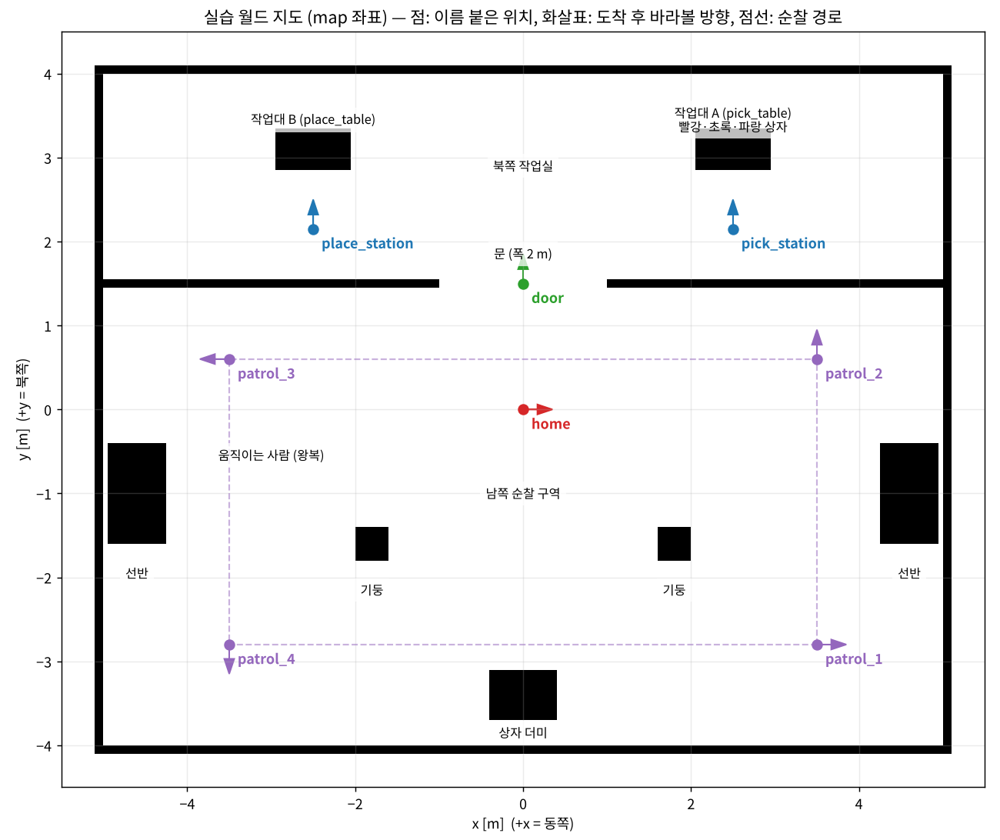

# 휠 + OpenArm 교육 (1일차 · 2일차, 12장)

[README](../../README.md) · [TRON1 교육](../tron1/README.md) · [용어집](../glossary.md)

차동구동 바퀴 하반신 + OpenArm v1 양팔 로봇으로 **1일차: 화면 확인 → 직접 운전 → 좌표계 → 지도 만들기 → 자율주행 → 순찰**, **2일차: 팔 계획 → 집기 → 운반 → 자연어 계획 → 작업 실행 → 웹 통합 미션**을 실습합니다. 각 장은 개념 → 실제로 쓰는 파일 → 따라하기(명령 풀이 포함) → 체크리스트 → 확인 질문 → 문제 해결 순서입니다.

**시작 전에** Ubuntu 24.04, ROS 2 Jazzy, 저장소 clone, 에셋 생성과 빌드가 끝나 있어야 합니다. 환경에 맞는 설치 문서 하나를 먼저 진행하세요: [노트북](../setup/ubuntu24-native.md) · [DGX Spark](../setup/dgx-spark.md) · [iMac Docker](../setup/imac-docker.md).

문서의 `~/openarm_mobile_ws` 는 저장소를 clone 한 폴더(저장소 루트)로 바꿔 읽으세요. Docker 내부 경로는 `/root/openarm_mobile_ws` 입니다. 모르는 약어(SLAM, TF, MJCF, AMCL …)는 [용어집](../glossary.md)에서 찾으세요. 각 장 맨 앞에도 그 장의 용어 풀이가 있습니다.

| DAY | 챕터 | 이 장에서 하는 일 | 문서 |
|---|---|---|---|
| 1 | 01 | Gazebo와 MuJoCo의 차이를 알고, MuJoCo 뷰어로 로봇과 월드를 직접 만져 본다 | [day1-01-mujoco-basics.md](day1-01-mujoco-basics.md) |
| 1 | 02 | 브리지로 MuJoCo 시뮬레이션을 ROS 2 토픽·액션으로 연결하고 키보드로 운전한다 | [day1-02-bridge.md](day1-02-bridge.md) |
| 1 | 03 | 로봇 설명(URDF)과 좌표계(TF) 트리를 확인한다 | [day1-03-description-tf.md](day1-03-description-tf.md) |
| 1 | 04 | SLAM으로 지도를 만들고 저장한 뒤, 그 지도에서 AMCL로 위치를 추정한다 | [day1-04-slam-rviz.md](day1-04-slam-rviz.md) |
| 1 | 05 | Nav2로 목표 지점까지 자율주행하고 장애물을 피한다 | [day1-05-nav2.md](day1-05-nav2.md) |
| 1 | 06 | 여러 지점을 순서대로 도는 순찰 프로그램을 실행한다 | [day1-06-patrol.md](day1-06-patrol.md) |
| 2 | 01 | MoveIt 2로 양팔을 계획·실행한다 (RViz 조작 + Python) | [day2-01-moveit.md](day2-01-moveit.md) |
| 2 | 02 | ArUco 마커로 상자 위치를 알아내고 집어서 옮긴다 | [day2-02-aruco-pick-place.md](day2-02-aruco-pick-place.md) |
| 2 | 03 | 주행과 조작을 이어서, 작업대 A의 상자를 작업대 B로 운반한다 | [day2-03-nav-pick-place.md](day2-03-nav-pick-place.md) |
| 2 | 04 | LLM이 자연어 명령을 로봇 작업 계획(JSON)으로 바꾸게 한다 | [day2-04-llm-planner.md](day2-04-llm-planner.md) |
| 2 | 05 | LLM 계획을 실제 ROS 2 동작으로 실행하는 Task Manager를 돌린다 | [day2-05-task-manager.md](day2-05-task-manager.md) |
| 2 | 06 | 웹 대시보드에서 명령을 보내고 진행 상황을 본다 (최종 통합) | [day2-06-dashboard.md](day2-06-dashboard.md) |

## 모든 챕터에 공통으로 쓰는 규칙

### 1. 터미널 여러 개 쓰기

ROS 2는 **프로그램(노드)마다 터미널 하나**를 차지하는 경우가 많습니다. 문서에는 터미널을 **T1, T2, T3** 처럼 번호로 적었습니다.

- T1에서 `ros2 launch ...` 를 실행하면 그 터미널은 로그를 계속 출력하면서 **붙잡혀 있습니다**. 끝난 것이 아니라 *돌아가는 중*입니다. 다음 명령은 새 터미널(T2)을 열어서 입력하세요.
- 새 터미널 여는 법
  - Ubuntu 노트북: `Ctrl + Alt + T`, 또는 터미널 창에서 `Ctrl + Shift + T`(새 탭)
  - iMac Docker: Mac 터미널에서 `cd ~/openarm_mobile_ws/docker && docker compose exec openarm bash`, 또는 VNC 화면의 xterm에서 `xterm &`

### 2. 새 터미널마다 환경 불러오기

```bash
cd ~/openarm_mobile_ws                                          # 저장소 루트로 이동
source /opt/ros/jazzy/setup.bash                                # ROS 2 명령(ros2 ...) 사용 가능하게
source mobile_openarm/install/setup.bash                        # 우리 패키지(mobile_openarm_*) 찾을 수 있게
source mobile_openarm/.venv-mobile/bin/activate                 # python3 로 직접 실행할 때 (mujoco 등)
```

- `cd`: 현재 작업 폴더를 바꿉니다. 이후 `mobile_openarm/install/...`, `mobile_openarm/src/...` 같은 상대 경로가 저장소 안의 파일을 가리키게 합니다. Docker 안에서는 `cd /root/openarm_mobile_ws` 입니다.
- `source`: 설정 파일을 **현재 터미널에 적용**합니다. 설치나 빌드를 하는 명령이 아닙니다. `/opt/ros/jazzy/setup.bash` 는 `ros2` 명령과 기본 ROS 패키지를, `mobile_openarm/install/setup.bash` 는 휠형 워크스페이스를 빌드하며 생긴 우리 패키지 경로를 등록합니다.
- `.venv-mobile/bin/activate`: MuJoCo·OpenAI·Pydantic v2·Flask 가 든 Python 가상환경을 켭니다. 프롬프트 앞에 `(.venv-mobile)` 이 붙고 `python3` 가 이 환경을 가리킵니다. ROS 가 쓰는 NumPy 버전은 그대로입니다 ([Python 가상환경](../setup/python-venv.md)).

`04_setup_workspace.sh` 를 실행한 PC 와 Docker 이미지는 `~/.bashrc` 에 ROS·패키지 줄이 들어 있어 자동으로 적용됩니다. `Package 'mobile_openarm_sim' not found` 가 나오면 세 번째 줄을 다시 실행하세요. 가상환경 줄은 `python3 ...` 명령을 쓰는 터미널에서만 필요합니다. `ros2 run`/`ros2 launch` 는 빌드 때 가상환경의 Python 이 기록되어 있어 켜지 않아도 됩니다.

이전에 TRON1 을 실행했던 터미널이라면 이족 설정을 지웁니다(파일을 지우는 명령이 아님).

```bash
unset OPENARM_BIPED OPENARM_SRDF
```

**명령을 읽는 규칙 두 가지**

```text
ros2 run    패키지이름  실행프로그램이름  그 프로그램에 줄 입력값/옵션
ros2 launch 패키지이름  launch파일이름    launch에 줄 설정값 (이름:=값)
```

- **실행 프로그램**은 패키지에 등록된 이름입니다. Python 파일명과 같다고 단정하면 안 됩니다. 우리 앱은 `setup.py` 에서 실행 이름을 Python 의 `main()` 함수에 연결해 둡니다.
- **run 뒤의 입력값 문법은 프로그램마다 다릅니다.** ROS 파라미터는 `--ros-args -p 이름:=값`, 프로그램 자체 옵션은 `--offline` 처럼 그대로 씁니다. 각 장의 "명령 풀이" 에서 하나씩 설명합니다.

**다시 빌드할 때 주의:** 소스를 고친 뒤에는 휠형 워크스페이스 폴더에서 가상환경의 Python 으로 colcon 을 실행합니다. 그냥 `colcon build` 를 쓰면 실행 파일이 시스템 Python(`/usr/bin/python3`)으로 다시 기록되어 `No module named 'mujoco'` 가 납니다.

```bash
cd ~/openarm_mobile_ws/mobile_openarm
.venv-mobile/bin/python -m colcon build --symlink-install --base-paths src
source install/setup.bash
```

### 3. 멈추기·다시 시작하기

- 실행 중인 프로그램 멈추기: 그 터미널에서 `Ctrl + C`
- 한 챕터가 끝나면 **모든 터미널에서 Ctrl + C** 로 다 끄고 다음 챕터를 시작하세요. 이전 챕터의 노드가 남아 있으면 같은 이름의 노드가 둘이 되어 TF가 뒤엉킵니다.
- 남은 프로세스 확인: `ros2 node list` (아무것도 없어야 정상)

### 4. 저사양 옵션

화면이 끊기거나 메모리가 8GB 이하이면 `world` 인자를 지원하는 sim/slam/nav/full_system launch에 다음을 붙입니다. MoveIt launch에는 적용하지 않습니다.

```
world:=world_light.xml        # 로봇의 시각용 메시를 빼서 메모리 1.9GB → 0.2GB
```

iMac Docker(GPU 없음)는 sim launch에서 `camera_hz:=5.0`을 사용할 수 있습니다. 현재 nav/full_system은 이 인자를 전달하지 않으므로 모든 launch에 붙이지 마세요.

### 5. 월드 지도 (모든 챕터 공통 무대)



검은색은 벽·작업대·기둥·선반, 흰색은 다닐 수 있는 곳입니다. 이 그림은 패키지에 들어 있는 정답 지도(`mobile_openarm/src/mobile_openarm_sim/maps/world_map.pgm`)에 이름 붙은 위치를 표시한 것입니다.

- 방 전체는 가로 10 m × 세로 8 m입니다. 좌표는 m 단위이고 +x = 동쪽(오른쪽), +y = 북쪽(위쪽)입니다.
- 이름 붙은 위치(`home`, `pick_station`, `place_station`, `door`, `patrol_1~4`)는 `mobile_openarm/src/mobile_openarm_sim/config/locations.yaml` 에 적혀 있습니다.
