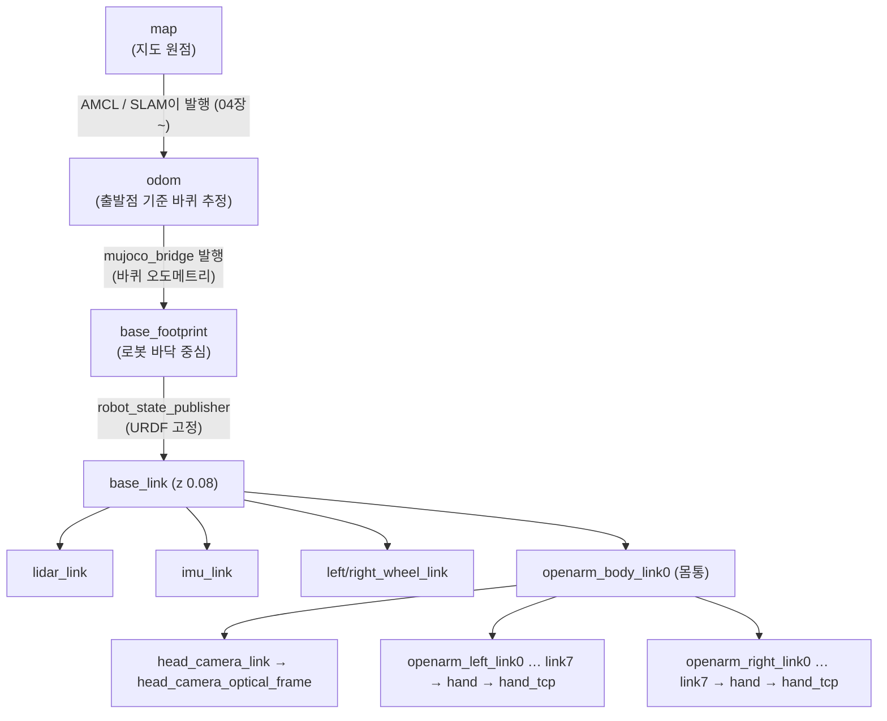

# DAY 1-03 Launch · Description · 센서 · TF — 로봇 설명과 좌표계

← [이전](day1-02-bridge.md) · [목차·공통 규칙](README.md) · [다음](day1-04-slam-rviz.md) →

## 이 장의 미션

> 로봇 설명 파일(URDF)이 어떻게 만들어지는지 확인하고, **TF 트리(좌표계 연결도)를 PDF로 뽑아 읽은 뒤,**
> **"머리 카메라는 바닥에서 몇 m 높이에, 몇 도 숙여 달려 있나?"** 와 **"LiDAR는 몇 m 높이인가?"** 를 TF 명령으로 직접 알아낸다.

## 이 장에 나오는 용어

- **launch 파일** — 여러 노드를 옵션과 함께 한 번에 실행하는 스크립트 (`*.launch.py`)
- **URDF** (Unified Robot Description Format, 통합 로봇 설명 형식) — ROS가 쓰는 로봇 구조 XML. 링크(부품)와 조인트(관절)의 나무 구조
- **MJCF** (MuJoCo Format, MuJoCo XML 모델 형식) — MuJoCo가 읽는 로봇·환경 설명 파일
- **TF** (Transform, 좌표 변환 / ROS 패키지 tf2) — 좌표계 사이 위치·방향 관계를 시간과 함께 알려 주는 ROS 시스템
- **frame** (coordinate frame, 좌표계) — `map`, `odom`, `base_footprint` 처럼 이름 붙은 기준 좌표
- **rpy** (roll·pitch·yaw) — x축 회전·y축 회전(숙이기)·z축 회전(좌우 돌기)
- **LiDAR** (Light Detection And Ranging, 레이저 거리 측정기) — 레이저를 360° 쏴서 주변까지 거리를 재는 센서. 토픽 `/scan`
- **IMU** (Inertial Measurement Unit, 관성 측정 장치) — 가속도·회전 속도 센서

전체 목록은 [용어집](../glossary.md)에 있습니다.

## 1. 개념

### Launch 파일

`ros2 launch <패키지> <파일>.launch.py` 는 **여러 노드를 한 번에, 정해진 옵션으로** 실행하는 Python 스크립트입니다. `DeclareLaunchArgument` 로 선언한 옵션은 명령 끝에 `이름:=값` 으로 바꿀 수 있습니다.

```bash
ros2 launch mobile_openarm_sim sim.launch.py --show-args    # 이 launch가 받는 옵션 목록과 기본값
```

### 로봇 설명(Robot Description)과 URDF

**URDF** 는 ROS의 로봇 설명 XML입니다. 로봇을 **링크(link, 부품)** 와 **조인트(joint, 부품 사이 연결)** 의 나무 구조로 적습니다. 조인트마다 "부모 링크 기준으로 자식 링크가 어디(xyz)에 어떤 방향(rpy)으로 붙는지"가 들어 있습니다.

이 실습에서는 MuJoCo 모델(MJCF)이 원본이고, **URDF는 MJCF에서 자동으로 만듭니다.** 그래서 시뮬레이터와 RViz·MoveIt의 로봇 모양이 항상 같습니다.

### TF (좌표 변환)

**TF** 는 "좌표계 A에서 본 좌표계 B의 위치·방향"을 시간과 함께 계속 알려 주는 ROS의 시스템입니다. 예를 들어 카메라가 "상자가 내 앞 0.5 m에 있다"고 하면, TF로 그것을 "로봇 바닥 기준 어디", "지도 기준 어디"로 바꿀 수 있습니다.

이 로봇의 TF 트리:



- **고정 TF**(로봇 부품 사이, 움직이지 않음)와 **움직이는 TF**(관절 각도에 따라 바뀜)는 `robot_state_publisher` 가 URDF와 `/joint_states` 로 계산합니다.
- `odom → base_footprint` 는 브리지가 바퀴 회전으로 계산해 발행합니다.
- `map → odom` 은 위치 추정기(SLAM/AMCL)가 발행합니다. 이 장에서는 아직 없습니다.
- `head_camera_optical_frame` 은 카메라 표준 좌표(z=앞, x=오른쪽, y=아래)입니다. OpenCV·ArUco 결과가 이 좌표로 나옵니다.

## 2. 실제로 쓰는 파일

| 파일 | 하는 일 |
|---|---|
| `mobile_openarm/src/mobile_openarm_sim/launch/sim.launch.py` | `urdf/mobile_openarm.urdf` 를 읽어 `robot_state_publisher` 의 `robot_description` 파라미터로 넘긴다 |
| `mobile_openarm/src/mobile_openarm_sim/tools/mjcf_to_urdf.py` | MJCF → URDF 변환기. MuJoCo 몸체마다 링크, 관절마다 조인트를 만들고 센서 위치(LiDAR, IMU, 카메라)에 빈 링크를 붙인다 |
| `mobile_openarm/src/mobile_openarm_sim/urdf/mobile_openarm.urdf` | 변환 결과 (링크 33개, 조인트 32개) |
| `robot_state_publisher` (ROS 2 표준) | URDF + `/joint_states` → `/tf`, `/tf_static`, `/robot_description` |
| `tf2_tools view_frames`, `tf2_ros tf2_echo` (ROS 2 표준) | TF 트리 그림 그리기, 두 좌표계 사이 변환 출력 |

## 3. 따라하기

### 단계 1 — T1: 시뮬레이터 켜기

```bash
ros2 launch mobile_openarm_sim sim.launch.py
```

02장과 같습니다. RViz 왼쪽 Displays의 **TF** 항목을 펼쳐 `Show Names` 를 켜면 좌표계 이름이 화면에 나옵니다. 너무 많으면 Frames 목록에서 필요한 것만 체크합니다.

### 단계 2 — T2: URDF 만들기와 검사

원본 URDF를 덮어쓰지 않도록 **임시 파일로** 다시 만들어 봅니다.

```bash
cd ~/openarm_mobile_ws/mobile_openarm/src/mobile_openarm_sim
python3 tools/mjcf_to_urdf.py --mjcf mjcf/mobile_openarm.xml --out /tmp/check.urdf
```

| 옵션 | 의미 |
|---|---|
| `--mjcf` | 입력 MuJoCo 모델 (로봇만 있는 파일) |
| `--out` | 출력 URDF 경로 |

`wrote /tmp/check.urdf` 가 나오면 성공입니다. (이 변환기는 개발할 때 MuJoCo와 URDF의 손끝 위치를 관절 자세 20개에서 비교해 최대 오차 0.000007 m를 확인했습니다.)

```bash
sudo apt install -y liburdfdom-tools     # 처음 한 번 (Docker 이미지에는 들어 있을 수 있음)
check_urdf /tmp/check.urdf | head -20    # 링크 나무 구조 출력: root Link: base_footprint …
diff /tmp/check.urdf urdf/mobile_openarm.urdf && echo 같음
```

### 단계 3 — T2: TF 트리 그림 뽑기

```bash
cd ~
ros2 run tf2_tools view_frames
```

- 5초 동안 TF를 듣고 현재 폴더에 `frames_날짜시간.pdf` 와 `.gv` 를 만듭니다.
- 열기: 노트북 `xdg-open ~/frames_*.pdf`. Docker는 Mac에서 보려면 `docker compose cp openarm:/root/frames_<이름>.pdf ~/Desktop/` (Mac 터미널, `docker/` 폴더에서).
- **읽는 법**: 상자 = 좌표계, 화살표 = 부모→자식, 화살표 옆 `Broadcaster` = 누가 발행하는지, `Average rate` = 몇 Hz인지. `odom → base_footprint` 의 broadcaster가 `/mujoco_bridge` 인 것을 확인하세요. 이 장에서는 `map` 이 없어야 정상입니다.

### 단계 4 — T2: 좌표 변환 값 읽기 (미션)

```bash
ros2 run tf2_ros tf2_echo base_footprint head_camera_link
```

**명령 풀이**

- `tf2_ros`: 좌표계 사이의 관계를 다루는 도구가 들어 있는 패키지입니다.
- `tf2_echo`: 두 좌표계 사이의 위치·방향을 계속 출력하는 실행 프로그램입니다.
- `base_footprint`: **첫 번째 입력값**, 기준 좌표계(로봇 바닥의 이동 기준점과 축)입니다.
- `head_camera_link`: **두 번째 입력값**, 확인할 대상 좌표계(머리 카메라 장착 프레임)입니다.
- 두 이름은 파일이 아니라 실행 중인 로봇의 TF 트리에 등록된 이름입니다.

**출력 읽기:** `Translation [x, y, z]` 는 기준 좌표계 축 방향의 거리(m), `Rotation` 은 상대 회전입니다. z 가 1.16 이면 기준 원점보다 +Z 방향으로 1.16 m 위라는 뜻입니다. 카메라가 고정 장착되어 있으면 출력이 반복돼도 값은 같습니다. `head_camera_link` 가 영상 처리용 optical frame 과 같다고 가정하지 마세요. 확인 후 `Ctrl+C` 로 조회만 종료합니다.

- "base_footprint 기준으로 head_camera_link가 어디 있나"를 1초마다 출력합니다. Ctrl+C로 멈춥니다.
- 출력의 `Translation: [x, y, z]` 가 위치(m), `Rotation: in RPY (degree)` 가 방향입니다.
- **미션 답 적기**: 카메라 높이 z = ____ m, 앞뒤 x = ____ m, 아래로 숙인 각도(pitch) = ____ °

같은 방법으로:

```bash
ros2 run tf2_ros tf2_echo base_footprint lidar_link                # LiDAR 높이
ros2 run tf2_ros tf2_echo base_footprint openarm_right_hand_tcp    # 오른손 끝 위치
```

오른손 끝을 보면서 02장의 팔 액션을 다시 보내 보세요(T3). 값이 바뀌면 `robot_state_publisher` 가 관절 각도에 따라 TF를 다시 계산하는 것입니다.

정답(확인용): 카메라 약 x 0.22 m, z 1.16 m, 50° 숙임 / LiDAR 약 x 0.22 m, z 0.34 m.

### 단계 5 — 센서 데이터를 RViz에서 확인

RViz 왼쪽 아래 **Add** → **By topic** 에서 다음을 추가해 봅니다.

| 토픽 | 디스플레이 | 보이는 것 |
|---|---|---|
| `/scan` | LaserScan | 벽에 찍힌 점 (이미 켜져 있음) |
| `/odom` | Odometry | 로봇이 지나간 자리의 화살표 |
| `/aruco/markers` | MarkerArray | 카메라가 본 마커 위치 (작업대 앞으로 가야 보임) |

## 4. 미션 체크리스트

- [ ] `--show-args` 로 sim.launch.py의 옵션을 확인했다
- [ ] `mjcf_to_urdf.py` 로 URDF를 만들고 `check_urdf` 로 나무 구조를 봤다
- [ ] `view_frames` PDF에서 `odom → base_footprint` 를 누가 발행하는지 찾았다
- [ ] `tf2_echo` 로 카메라·LiDAR 높이를 구했다

## 5. 확인 질문

1. 이 실습에서 URDF와 MJCF 중 원본은? → MJCF. URDF는 변환해서 만든다
2. `map → odom` 은 이 장에서 왜 없나? → 위치 추정기(SLAM/AMCL)를 아직 안 켰기 때문 (04장)
3. ArUco 위치 결과가 나오는 좌표계는? → `head_camera_optical_frame` (나중에 `base_footprint` 로 변환해서 씀)

## 6. 잘 안 될 때

| 증상 | 해결 |
|---|---|
| `tf2_echo` 가 `Could not transform … does not exist` | 프레임 이름 오타, 또는 T1이 꺼져 있음. `ros2 run tf2_tools view_frames` 로 이름 확인 |
| RViz 로봇이 흰색/빨간 오류 | `/robot_description` 이 없음. T1 로그에서 robot_state_publisher 오류 확인 |
| `check_urdf: command not found` | `sudo apt install liburdfdom-tools` |

## 7. 더 해보기

- `urdf/mobile_openarm.urdf` 에서 `head_camera_link` 조인트의 `rpy` 를 찾아 0.872664 rad = 50° 인지 계산
- `ros2 param get /robot_state_publisher robot_description | head` 로 파라미터로 들어간 URDF 확인
