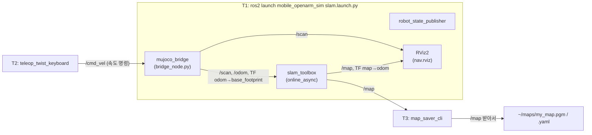

# DAY 1-04 SLAM과 RViz2 — 지도 만들기와 위치 추정

← [이전](day1-03-description-tf.md) · [목차·공통 규칙](README.md) · [다음](day1-05-nav2.md) →

## 이 장의 미션

> 로봇을 키보드로 운전해 방 두 개를 한 바퀴 돌며 **지도를 직접 만들고 파일로 저장**한다.
> 그다음 그 지도만 가지고 **로봇이 자기 위치를 찾게(AMCL)** 한다.

다 끝나면 `~/maps/my_map.pgm`(지도 그림)과 `~/maps/my_map.yaml`(지도 설명 파일)이 생기고, RViz2에서 지도 위에 로봇이 정확히 올라가 있는 것을 볼 수 있어야 합니다.

## 이 장에 나오는 용어

- **SLAM** (Simultaneous Localization And Mapping, 동시적 위치추정 및 지도작성) — 지도를 만들면서 그 지도 안의 내 위치도 동시에 알아내는 기술
- **online_async** (online asynchronous) — slam_toolbox 실행 방식: 실시간 센서(online)를, 처리가 밀리면 최신 스캔만(async) 처리
- **점유 격자 지도(occupancy grid)** — 5 cm 칸마다 빈 곳/벽/모름을 칠한 2D 지도 (`.pgm` 그림 + `.yaml` 설명)
- **RViz2** (ROS Visualization 2, ROS 시각화 도구) — 로봇이 보고 생각하는 것을 3D로 보여 주는 화면. 시뮬레이터가 아님
- **AMCL** (Adaptive Monte Carlo Localization, 적응형 몬테카를로 위치추정) — 이미 있는 지도 위에서 위치 후보(파티클) 수백 개로 위치를 추정
- **LiDAR** (Light Detection And Ranging, 레이저 거리 측정기) — 레이저를 360° 쏴서 주변까지 거리를 재는 센서. 토픽 `/scan`
- **odom** (odometry, 주행 거리계) — 바퀴 회전량으로 계산한 이동 추정. 오래 가면 오차가 쌓임
- **teleop** (teleoperation, 원격 조종) — 사람이 키보드로 직접 운전
- **cmd_vel** (command velocity, 속도 명령) — 로봇에 주는 직진 속도(m/s)·회전 속도(rad/s) 토픽
- **TF** (Transform, 좌표 변환 / ROS 패키지 tf2) — 좌표계 사이 위치·방향 관계를 시간과 함께 알려 주는 ROS 시스템

전체 목록은 [용어집](../glossary.md)에 있습니다.

## 1. 개념

### SLAM이란?

**SLAM(Simultaneous Localization And Mapping, 동시적 위치추정 및 지도작성)** 은 처음 보는 공간에서 로봇이 **"지도 만들기"와 "지도 안에서 내 위치 알기"를 동시에** 하는 기술입니다.

- 지도를 만들려면 내 위치를 알아야 하고(어디서 본 벽인지), 내 위치를 알려면 지도가 있어야 합니다(벽에서 얼마나 떨어졌는지). 닭과 달걀 문제를 동시에 푸는 것이 SLAM입니다.
- 이 로봇은 **2D LiDAR**(`/scan`, 360개 빔, 최대 12 m)와 **바퀴 오도메트리**(`/odom`, 바퀴가 몇 바퀴 돌았는지로 계산한 이동량)를 씁니다.
- 오도메트리만 믿으면 미끄러짐 때문에 오차가 쌓입니다. SLAM은 새 스캔을 지금까지의 지도와 **맞춰 보며(scan matching)** 위치를 바로잡습니다.
- 한 바퀴 돌아 출발점 근처로 돌아오면 "아까 본 곳이다"를 알아채고 그동안 쌓인 오차를 한꺼번에 고칩니다. 이것이 **루프 클로저(loop closure)** 입니다. 그래서 지도를 만들 때는 **출발점으로 돌아와 끝내는 것**이 중요합니다.
- 결과는 **점유 격자 지도(Occupancy Grid)** 입니다. 5 cm 칸마다 흰색=빈 곳, 검은색=벽, 회색=아직 모르는 곳으로 표시합니다.

### slam_toolbox와 `online_async`

이 실습은 ROS 2 표준 SLAM 패키지인 **slam_toolbox** 를 씁니다. slam_toolbox에는 실행 방식이 여러 개 있습니다.

| 방식 | 뜻 | 언제 쓰나 |
|---|---|---|
| **online**_async | 로봇이 **지금 실시간으로** 보내는 센서 데이터로 지도를 만든다 | 로봇을 운전하며 지도를 만들 때 (**이번 실습**) |
| offline | 미리 녹화한 데이터(rosbag)를 나중에 처리 | 녹화본으로 지도를 다시 만들 때 |
| online_**async** | 스캔 처리가 밀리면 **오래된 스캔을 버리고 최신 것만** 처리 → 실시간성 우선 | CPU가 느린 노트북, Docker(이번 실습) |
| online_**sync** | 들어온 스캔을 **하나도 빼지 않고** 모두 처리 → 정확하지만 밀릴 수 있음 | 빠른 PC |

`online_async` 는 **여러분이 직접 입력하는 명령이 아닙니다.** `slam.launch.py` 안에서 slam_toolbox의 `online_async_launch.py` 를 불러오도록 이미 정해 두었습니다. 명령 옆의 `# slam_toolbox online_async` 는 "이 명령을 실행하면 내부에서 online_async 방식이 돈다"는 설명 주석입니다.

### RViz2란?

**RViz2** 는 ROS 2의 **3D 시각화 도구**입니다. 로봇이 무엇을 보고, 어디에 있다고 생각하는지를 눈으로 보여 줍니다. RViz2는 **시뮬레이터가 아닙니다.** MuJoCo 창이 "실제 세계(정답)"라면 RViz2는 "로봇 머릿속"입니다. 두 창이 다르게 보이면 로봇이 착각하고 있는 것입니다.

이 장에서 RViz2에 보이는 것(`rviz/nav.rviz` 설정):

| RViz 항목 | 토픽 | 보이는 모양 | 의미 |
|---|---|---|---|
| Map | `/map` | 흰·검·회색 바닥 그림 | SLAM이 지금까지 만든 지도 |
| LaserScan | `/scan` | 빨간/색 점들 | LiDAR가 지금 이 순간 맞힌 벽 |
| RobotModel | `/robot_description` | 로봇 3D 모델 | 로봇이 생각하는 자기 위치·자세 |
| TF | `/tf` | 좌표축 화살표들 | 좌표계(map, odom, base_footprint …) 관계 |
| PoseArray (AMCL 단계) | `/particle_cloud` | 작은 화살표 구름 | AMCL이 "여기쯤일 것"이라고 추측하는 후보들 |

RViz 기본 조작: **왼쪽 드래그** 회전, **가운데(휠) 드래그 / Shift+왼쪽 드래그** 이동, **휠** 확대·축소. 왼쪽 Displays 패널에서 항목 체크박스를 켜고 끌 수 있습니다. 위쪽 툴바의 **2D Pose Estimate**, **2D Goal Pose** 버튼은 다음 단계와 05장에서 씁니다.

### AMCL이란?

**AMCL(Adaptive Monte Carlo Localization)** 은 **이미 있는 지도** 위에서 위치만 추정합니다. SLAM은 지도를 *만드는* 단계, AMCL은 만든 지도를 *쓰는* 단계입니다. AMCL은 로봇이 있을 법한 위치 후보(파티클) 수백 개를 뿌리고, 각 후보에서 LiDAR가 보일 모습과 실제 스캔을 비교해 맞는 후보만 살립니다. 로봇이 움직일수록 파티클 구름이 한 점으로 모입니다.

## 2. 이 장의 전체 구조



## 3. 실제로 실행되는 소스

`ros2 launch mobile_openarm_sim slam.launch.py` 를 입력하면 다음 순서로 파일이 실행됩니다.

| 순서 | 파일 | 하는 일 |
|---|---|---|
| 1 | `mobile_openarm/src/mobile_openarm_sim/launch/slam.launch.py` | 아래 두 launch를 묶어 실행한다. 카메라와 움직이는 사람은 끈다(`camera:=false`, `move_person:=false`). SLAM 중에는 필요 없고, 사람이 지도에 벽처럼 찍히기 때문이다 |
| 2 | `mobile_openarm/src/mobile_openarm_sim/launch/sim.launch.py` | 시뮬레이터 쪽 노드 3개를 띄운다 |
| 2-1 | `mobile_openarm_sim/bridge_node.py` (실행 이름 `mujoco_bridge`) | MuJoCo 물리 엔진을 돌리고 `/scan`, `/odom`, `/clock`, TF를 발행한다. `/cmd_vel` 을 받아 바퀴를 굴린다. 실제 물리 계산은 `sim_core.py` 가 한다 |
| 2-2 | `robot_state_publisher` (ROS 2 표준) | `urdf/mobile_openarm.urdf` 를 읽고 관절 각도(`/joint_states`)로 로봇 각 부품의 TF를 계산한다 |
| 2-3 | `rviz2` + `rviz/nav.rviz` | 위 표의 항목이 미리 켜진 RViz2 |
| 3 | `/opt/ros/jazzy/share/slam_toolbox/launch/online_async_launch.py` (ROS 2 표준) | slam_toolbox 노드를 **online_async** 방식으로 띄운다 |
| 3-1 | `mobile_openarm/src/mobile_openarm_sim/config/slam_toolbox.yaml` | slam_toolbox 설정. 주요 값: `scan_topic: /scan`, `base_frame: base_footprint`, `resolution: 0.05`(5 cm 격자), `max_laser_range: 12.0`, `do_loop_closing: true`, `map_update_interval: 2.0`(지도 2초마다 갱신), `minimum_travel_distance: 0.5`(0.5 m 움직일 때마다 새 스캔 반영) |

## 4. 따라하기

### 단계 1 — T1: 시뮬레이터 + SLAM 켜기

```bash
ros2 launch mobile_openarm_sim slam.launch.py
# 저사양이면: ros2 launch mobile_openarm_sim slam.launch.py world:=world_light.xml
```

**명령 풀이:** `sim.launch.py` 대신 **`slam.launch.py`** 를 선택합니다. 시뮬과 SLAM(slam_toolbox)을 함께 실행하며 RViz 는 기본으로 열립니다. 라이다 거리 측정과 로봇 이동 정보로 새 지도를 만들 준비를 할 뿐, 로봇을 자동으로 탐색시키지는 않습니다.

- **언제**: 이 장을 시작할 때 가장 먼저. 다른 챕터의 launch가 켜져 있으면 먼저 Ctrl+C로 끄세요.
- **화면에서 확인할 것** (10~30초 기다리기)
  1. **MuJoCo 창**: 방 한가운데(home)에 로봇이 동쪽을 보고 서 있다.
  2. **RViz2 창**: 처음 몇 초는 `Frame [map] does not exist` 경고가 보일 수 있다. slam_toolbox가 첫 스캔을 처리하면 사라진다.
  3. 로봇 주변으로 **흰 바닥 + 검은 벽 테두리**가 조금 그려진다. 아직 안 가 본 곳은 회색이다.
  4. T1 로그에 `Registering sensor: [Custom Described Lidar]` 같은 slam_toolbox 메시지가 보인다.

### 단계 2 — T2: 키보드 운전 프로그램 켜기

새 터미널(T2)을 열고:

```bash
ros2 run teleop_twist_keyboard teleop_twist_keyboard
```

- **무엇이 실행되나**: ROS 2 표준 패키지 `teleop_twist_keyboard` 의 Python 스크립트(`/opt/ros/jazzy/lib/teleop_twist_keyboard/teleop_twist_keyboard`)입니다. 우리 코드가 아닙니다. 누른 키를 **속도 명령(`geometry_msgs/Twist`)으로 바꿔 `/cmd_vel` 토픽에 보냅니다.** `bridge_node.py` 의 `on_cmd_vel()` 이 이것을 받아 `sim_core.set_cmd_vel()` → 좌·우 바퀴 속도로 바꿉니다.
- **중요: 키는 T2 터미널에 입력해야 합니다.** 키를 누르기 전에 T2 창을 한 번 클릭해서 선택하세요. MuJoCo나 RViz 창이 선택된 상태에서 누르면 아무 일도 안 일어납니다.
- 실행하면 다음 같은 안내가 나옵니다.

```
Moving around:
   u    i    o
   j    k    l
   m    ,    .
q/z : increase/decrease max speeds by 10%
w/x : increase/decrease only linear speed by 10%
e/c : increase/decrease only angular speed by 10%
currently:	speed 0.5	turn 1.0
```

| 키 | 동작 |
|---|---|
| `i` | 앞으로 |
| `,` | 뒤로 |
| `j` / `l` | 제자리 왼쪽 / 오른쪽 회전 |
| `u` / `o` | 앞으로 가며 왼쪽 / 오른쪽으로 꺾기 |
| `k` (또는 아무 다른 키) | 정지 |
| `z` / `q` | 최대 속도 10% 낮추기 / 높이기 |
| `x` / `w` | 직진 속도만 낮추기 / 높이기 |

- **키는 누르고 있어야 움직입니다.** 브리지는 0.5초 동안 새 명령이 없으면 로봇을 세웁니다(`sim_core.py` 의 `cmd_timeout = 0.5`). 키를 떼면 곧 멈추니 안전합니다.
- **먼저 `z` 를 4~5번 눌러 속도를 0.3 m/s 정도로 낮추세요.** 너무 빨리 돌면 스캔이 번져 지도가 겹쳐 그려집니다. 회전은 `e`/`c` 로 따로 조절할 수 있습니다(0.5 rad/s 정도 권장).

### 단계 3 — 운전하며 지도 만들기 (미션 본체)

화면 세 개(MuJoCo, RViz2, T2 터미널)를 나란히 놓고, **T2에 키를 누르며 RViz2를 봅니다.**

권장 경로(약 5~10분). 위치는 [월드 지도 그림](../images/world_map.png)을 보세요.

1. **남쪽 구역 한 바퀴**: home에서 `i` 로 동쪽으로 가다가 기둥(1.8, -1.6)과 선반(4.6, -1) 사이를 지나 남쪽으로 → 상자 더미(0, -3.4) 북쪽을 지나 서쪽 → 서쪽 기둥·선반 주변 → 다시 home 근처.
2. **문으로 북쪽 작업실 들어가기**: home에서 북쪽(`j` 로 왼쪽 90° 돌기)으로 가서 가운데 문(x=-1~1, y=1.5)을 통과.
3. **작업실 한 바퀴**: 작업대 A(동쪽)와 B(서쪽) 앞을 천천히 지나기. 작업대 다리가 점으로 찍힌다.
4. **문으로 나와 home으로 돌아오기**: 출발점 근처로 돌아오면 루프 클로저가 일어나 지도가 살짝 "딱" 맞춰지는 것을 볼 수 있다.

운전 요령:
- 회색(모르는 곳)이 남은 쪽으로 가세요. 벽이 끊겨 보이면 그쪽을 한 번 더 지나세요.
- **회전할 때는 멈춘 상태에서 천천히** (`j`/`l`). 빠르게 돌면서 직진하면 지도가 비틀어집니다.
- 벽에 부딪히면 `,` 로 뒤로 빼면 됩니다. MuJoCo 창에서 로봇이 넘어지면 T3에서 `ros2 service call /sim/reset std_srvs/srv/Trigger` 로 처음 위치로 되돌릴 수 있지만, 그러면 SLAM이 혼란스러워지니 **T1부터 다시 시작**하는 편이 깔끔합니다.

### 단계 4 — T3: 지도 저장하기

**SLAM을 끄기 전에** 저장해야 합니다. T1·T2는 그대로 두고 새 터미널(T3)에서:

```bash
mkdir -p ~/maps
ros2 run nav2_map_server map_saver_cli -f ~/maps/my_map --ros-args -p use_sim_time:=true
```

**명령 풀이**

- `mkdir -p ~/maps`: 폴더를 만듭니다. `-p` 는 상위 폴더도 만들고 이미 있으면 그대로 쓰라는 옵션입니다.
- `nav2_map_server`: 지도 관련 프로그램을 제공하는 패키지, `map_saver_cli`: 현재 지도를 파일로 저장하는 실행 프로그램입니다.
- `-f ~/maps/my_map`: 저장할 경로와 이름 접두사입니다. `my_map.yaml` 과 지도 이미지(`my_map.pgm`)가 생깁니다.
- `--ros-args`: 여기부터 ROS 용 설정이라는 구분자입니다.
- `-p use_sim_time:=true`: 노드 파라미터 `use_sim_time` 을 켭니다. PC 시계 대신 시뮬레이터의 `/clock` 을 씁니다. 여기의 `-p` 는 `mkdir -p` 와 다른 의미입니다.

저장 명령이 끝나도 SLAM 은 계속 실행됩니다. Docker 의 `~/maps` 는 컨테이너 안의 `/root/maps` 이므로, 컨테이너를 지운 뒤에도 보관하려면 공유 폴더(저장소 안)로 복사하세요.

| 부분 | 의미 |
|---|---|
| `mkdir -p ~/maps` | 지도를 넣을 폴더 만들기 (`-p`: 이미 있어도 오류 없음) |
| `nav2_map_server map_saver_cli` | Nav2의 지도 저장 도구. `/map` 토픽을 한 번 받아서 파일로 쓰고 끝난다 |
| `-f ~/maps/my_map` | 저장할 파일 이름(확장자 빼고). `my_map.pgm`, `my_map.yaml` 두 개가 생긴다 |
| `--ros-args -p use_sim_time:=true` | 시뮬레이션 시간(`/clock`)을 쓴다. 안 붙이면 시간 불일치로 저장이 실패할 수 있다 |

- 성공하면 `Map saved successfully` 가 나오고 프로그램이 스스로 끝납니다.
- 확인: `ls ~/maps` → `my_map.pgm my_map.yaml`. 그림 확인은 `eog ~/maps/my_map.pgm`(노트북) 또는 RViz 화면으로.
- `my_map.yaml` 을 열어 보면(`cat ~/maps/my_map.yaml`) `resolution: 0.05`, `origin: [...]`(지도 왼쪽 아래 모서리의 실제 좌표) 등이 적혀 있습니다.

저장이 끝나면 **T1, T2를 Ctrl+C로 끕니다.**

### 단계 5 — T1: 저장한 지도로 AMCL 위치 추정

```bash
ros2 launch mobile_openarm_sim nav.launch.py map:=$HOME/maps/my_map.yaml
```

- **무엇이 실행되나**: `nav.launch.py` 가 `sim.launch.py`(시뮬레이터 + RViz)를 띄우고, 3초 뒤 Nav2 표준 `nav2_bringup/launch/bringup_launch.py` 를 띄웁니다. 그 안에 **map_server**(지도 파일을 `/map` 으로 발행), **AMCL**(위치 추정), 그리고 05장에서 쓸 주행 노드들이 들어 있습니다. 설정은 `config/nav2_params.yaml`.
- 이번에는 SLAM이 돌지 않습니다. 지도는 **파일에서 읽기만** 합니다.
- 로봇은 다시 home에서 시작하고, AMCL 설정(`set_initial_pose: true`, 초기 위치 0, 0, 0°)이 "home에서 출발한다"고 알려 주므로 대부분 바로 맞습니다. SLAM 지도의 원점도 SLAM을 시작한 위치 = home이기 때문입니다.

**RViz에서 확인**: 검은 벽 선과 LaserScan 점들이 **겹쳐야** 합니다. 로봇 주변에 작은 화살표 구름(`/particle_cloud`)이 보입니다.

### 단계 6 — 2D Pose Estimate로 위치 고쳐 보기 (실습)

AMCL이 위치를 틀리게 잡은 상황을 일부러 만들어 고쳐 봅니다.

1. RViz 위쪽 툴바의 **2D Pose Estimate** 를 누릅니다.
2. 지도에서 로봇과 **다른 곳**을 클릭한 채로 드래그해 방향을 정하고 놓습니다. 로봇 모델이 그곳으로 순간이동하고, 스캔 점이 벽과 어긋나 보입니다. "로봇이 착각한 상태"입니다.
3. 이제 다시 **2D Pose Estimate** 로 MuJoCo 창에서 본 **진짜 위치·방향**을 찍어 줍니다. 스캔 점이 벽에 다시 겹치면 성공입니다.
4. T2에서 teleop을 켜고 조금 움직여 보세요. 파티클 구름이 점점 작게 모입니다(위치 확신이 커짐).

## 5. 미션 체크리스트

- [ ] RViz에서 남쪽 구역·문·북쪽 작업실의 벽이 모두 검은 선으로 닫혀 그려졌다
- [ ] `~/maps/my_map.pgm`, `~/maps/my_map.yaml` 이 생겼다
- [ ] `nav.launch.py map:=...` 로 내 지도를 불러왔을 때 스캔 점이 벽과 겹친다
- [ ] 2D Pose Estimate로 일부러 틀린 위치를 준 뒤, 다시 바로잡았다

## 6. 확인 질문

1. SLAM 중에 움직이는 사람을 끈(`move_person:=false`) 이유는? → 사람이 지나간 자리가 벽처럼 지도에 찍히기 때문
2. MuJoCo 창과 RViz 창의 차이는? → MuJoCo = 실제(정답), RViz = 로봇이 추정한 세계
3. 지도를 만들 때 출발점으로 돌아와야 하는 이유는? → 루프 클로저로 누적 오차를 고치기 위해

## 7. 잘 안 될 때

| 증상 | 원인 | 해결 |
|---|---|---|
| 키를 눌러도 로봇이 안 움직임 | T2 터미널이 선택되지 않음 | T2 창을 클릭한 뒤 키 누르기 |
| RViz에 지도가 안 나오고 `Frame [map] does not exist` 가 계속 | slam_toolbox가 스캔을 못 받음 | T3에서 `ros2 topic hz /scan`(약 10 Hz여야 함), `ros2 node list` 에 `/slam_toolbox` 있는지 확인 |
| 지도가 겹치고 비틀림 | 너무 빨리 돌았음 | 속도를 낮추고 T1부터 다시 |
| map_saver가 `Failed to spin map subscription` | SLAM을 먼저 꺼 버림 / 시간 옵션 빠짐 | T1을 켠 상태에서 `use_sim_time:=true` 붙여 다시 |
| AMCL 단계에서 스캔이 벽과 어긋남 | 초기 위치 불일치 | 단계 6처럼 2D Pose Estimate로 맞추기 |

## 8. 더 해보기 (선택)

- `ros2 launch mobile_openarm_sim nav.launch.py slam:=True` : 지도 파일 없이 SLAM과 Nav2를 동시에 돌려, 지도를 만들면서 목표 지점으로 보내 보기
- `config/slam_toolbox.yaml` 의 `resolution` 을 0.10으로 바꿔(빌드 필요: `mobile_openarm/` 에서 `.venv-mobile/bin/python -m colcon build --symlink-install --base-paths src`) 지도가 어떻게 달라지는지 비교
- 패키지에 들어 있는 정답 지도 `mobile_openarm/src/mobile_openarm_sim/maps/world_map.pgm` 과 내 지도를 나란히 놓고 비교
