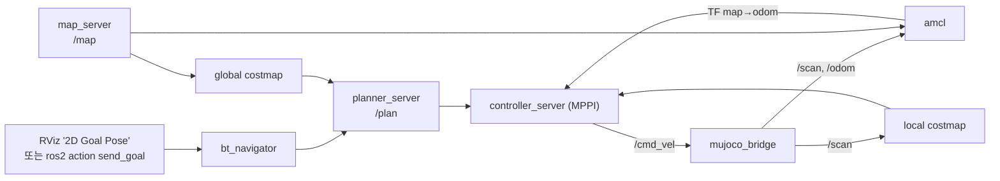

# DAY 1-05 Nav2 자율주행 — 목표 지점으로 스스로 가기

← [이전](day1-04-slam-rviz.md) · [목차·공통 규칙](README.md) · [다음](day1-06-patrol.md) →

## 이 장의 미션

> RViz2에서 목표를 찍어 로봇을 **home → 문 → 작업대 A 앞**까지 스스로 가게 하고,
> 움직이는 사람(장애물)을 피하는지 본다. 같은 일을 명령어(액션)로도 해 본다.

## 이 장에 나오는 용어

- **Nav2** (Navigation 2) — ROS 2 자율주행 패키지 모음: 경로 계획, 장애물 회피, 위치 추정, 복구
- **costmap** (비용 지도) — 벽 가까울수록 비싸게 칠한 지도. Nav2가 이것으로 경로를 짬. **inflation(팽창)** 은 벽 주변 위험 영역 넓히기
- **MPPI** (Model Predictive Path Integral, 모델 예측 경로 적분) — Nav2 주행 제어기. 가능한 움직임 1000개를 미리 시뮬레이션해 가장 좋은 속도를 고름
- **BT** (Behavior Tree, 행동 트리) — "계획 → 따라가기 → 막히면 복구"를 조합하는 Nav2의 방식
- **AMCL** (Adaptive Monte Carlo Localization, 적응형 몬테카를로 위치추정) — 이미 있는 지도 위에서 위치 후보(파티클) 수백 개로 위치를 추정
- **RViz2** (ROS Visualization 2, ROS 시각화 도구) — 로봇이 보고 생각하는 것을 3D로 보여 주는 화면. 시뮬레이터가 아님
- **쿼터니언(quaternion)** — 방향을 숫자 4개(x, y, z, w)로 나타내는 방법. yaw만 돌릴 땐 z = sin(yaw/2), w = cos(yaw/2)

전체 목록은 [용어집](../glossary.md)에 있습니다.

## 1. 개념

### Nav2가 하는 일

**Nav2(Navigation 2)** 는 "목표 지점을 주면 알아서 가는" ROS 2 패키지 모음입니다. 안에서 여러 노드가 나눠 일합니다.

| Nav2 안의 노드 | 하는 일 | 이 실습 설정 |
|---|---|---|
| map_server | 지도 파일(`.yaml` + `.pgm`)을 읽어 `/map` 으로 발행 | `maps/world_map.yaml` (정답 지도) 또는 04장에서 만든 지도 |
| amcl | 지도 위에서 로봇 위치 추정 → TF `map → odom` 발행 | 시작 위치 (0, 0, 0°) |
| planner_server | **전역 경로 계획**: 지도 전체를 보고 목표까지 길을 찾음 → `/plan` (초록 선) | 5 Hz로 다시 계획 |
| controller_server | **지역 제어**: 경로를 따라가며 장애물을 피하는 속도 계산 → `/cmd_vel` | MPPI(Model Predictive Path Integral, 모델 예측 경로 적분) 제어기, 최대 0.4 m/s, 회전 1.2 rad/s |
| bt_navigator | **행동 트리(BT, Behavior Tree)**: "계획 → 따라가기 → 막히면 복구(후진·회전)"를 조합 | 액션 이름 `/navigate_to_pose` |
| behavior_server | 복구 동작(spin, backup, wait) | — |

### 비용 지도(costmap)

Nav2는 지도를 그대로 쓰지 않고 **비용 지도(costmap)** 를 만듭니다. 벽은 "갈 수 없음", 벽 가까이는 "비쌈", 멀면 "쌈"으로 칠하고, 비용이 낮은 길로 다닙니다.

- **전역 비용 지도(global costmap)**: 지도 전체. 경로 계획용.
- **지역 비용 지도(local costmap)**: 로봇 주변 몇 m. **LiDAR가 지금 보는 장애물(사람)** 도 실시간으로 칠함. 회피용.
- **팽창(inflation)**: 벽 주변으로 0.45 m까지 비용을 퍼뜨림. 로봇이 벽에 붙어 다니지 않게 함.
- **footprint**: 로봇 바닥 사각형 0.55 × 0.52 m. 충돌 검사에 사용.

## 2. 이 장의 전체 구조



## 3. 실제로 실행되는 소스

| 순서 | 파일 | 하는 일 |
|---|---|---|
| 1 | `mobile_openarm/src/mobile_openarm_sim/launch/nav.launch.py` | ① `sim.launch.py` 실행(RViz는 `rviz/nav.rviz`) ② **3초 기다린 뒤**(`TimerAction`) Nav2 실행. 시뮬 시간(`/clock`)과 TF가 먼저 나와야 Nav2가 오류 없이 켜지기 때문 |
| 2 | `/opt/ros/jazzy/share/nav2_bringup/launch/bringup_launch.py` (Nav2 표준) | 위 표의 노드들을 한 프로세스로 묶어(`use_composition`) 실행하고 자동 활성화(`autostart`) |
| 3 | `mobile_openarm/src/mobile_openarm_sim/config/nav2_params.yaml` | 모든 Nav2 노드 설정. `tools/make_nav2_params.py` 가 Nav2 Jazzy 기본값(`nav2_params_upstream_jazzy.yaml`)에서 이 로봇에 맞는 값만 바꿔 만든다 |
| 4 | `mobile_openarm/src/mobile_openarm_sim/maps/world_map.yaml` + `.pgm` | 기본 지도. `tools/make_map.py` 가 월드 모델에서 바로 만든 "정답 지도" |
| 5 | `config/locations.yaml` | 이름 붙은 위치 좌표 (06장, DAY 2에서 사용) |

`nav.launch.py` 옵션:

| 옵션 | 기본값 | 의미 |
|---|---|---|
| `map:=<경로>` | 정답 지도 | 사용할 지도 파일 |
| `slam:=True` | False | 지도 없이 SLAM하면서 주행 |
| `move_person:=false` | true | 움직이는 사람 끄기 |
| `params_file:=<경로>` | `nav2_params.yaml` | 다른 Nav2 설정 |
| `world`, `viewer`, `rviz`, `camera` | — | `sim.launch.py` 로 그대로 전달 |

## 4. 따라하기

### 단계 1 — T1: 시뮬레이터 + Nav2 켜기

```bash
ros2 launch mobile_openarm_sim nav.launch.py
# 04장에서 만든 지도로: ros2 launch mobile_openarm_sim nav.launch.py map:=$HOME/maps/my_map.yaml
```

**명령 풀이**

- `nav.launch.py`: 시뮬, 지도 읽기(map_server), AMCL 위치 추정, Nav2 자율주행을 함께 시작합니다. AMCL 은 관측한 벽과 저장 지도를 비교해 현재 위치를 추정합니다.
- `world:=...`: 시뮬레이터가 읽을 **물리 환경**입니다.
- `map:=$HOME/maps/my_map.yaml`: Nav2 가 읽을 **지도 파일**입니다. 빼면 패키지에 들어 있는 기본(정답) 지도를 씁니다.
- `world` 와 `map` 은 다릅니다. 앞은 로봇이 실제로 움직이는 가상 공간, 뒤는 길 찾기와 위치 추정에 쓰는 지도입니다. 직접 만든 지도가 이상하면 `map:=` 만 빼고 다시 실행해 비교하세요.

명령 실행만으로 로봇이 출발하지는 않습니다. RViz 의 **Nav2 Goal** 로 목표를 찍어야 움직입니다.

- **기다리기**: 10~30초. T1 로그에 `Managed nodes are active` 가 나오면 준비 완료입니다.
- **RViz에서 확인**: 회색 지도와 벽, 벽 주변의 색 띠(비용 지도), 로봇 주변 화살표 구름(AMCL 파티클), 로봇 발밑의 사각형(footprint).
- 남쪽 서쪽(-3, -1) 근처에서 주황색 사람이 왔다 갔다 합니다(MuJoCo 창). RViz에서는 LiDAR 점과 지역 비용 지도 색으로 보입니다.

### 단계 2 — RViz에서 목표 찍기

1. RViz 위 툴바의 **2D Goal Pose** 를 누릅니다.
2. 지도 위 목표 지점을 **클릭한 채 드래그**해서 도착 후 바라볼 방향(초록 화살표)을 정하고 놓습니다.
3. 로봇이 출발합니다.

**보이는 것**
- 초록/파란 선 `/plan`: 전역 경로 (목표까지 전체 길)
- 짧은 선 `/local_plan`: 제어기가 지금 따라가는 앞부분
- T1 로그: `Received goal`, 도착 시 `Goal succeeded`

목표 도착 기준은 위치 0.12 m, 방향 0.15 rad(약 9°) 이내입니다.

### 단계 3 — 미션: 세 지점 차례로 보내기

| 순서 | 목표 | 좌표(x, y) | 바라볼 방향 |
|---|---|---|---|
| 1 | 문 앞 (`door`) | (0.0, 1.5) | 북쪽(위) |
| 2 | 작업대 A 앞 (`pick_station`) | (2.5, 2.15) | 북쪽 |
| 3 | home | (0.0, 0.0) | 동쪽(오른쪽) |

RViz 위쪽의 좌표 표시(마우스를 올리면 왼쪽 아래 상태줄에 나옴)를 보며 근처를 찍으면 됩니다.

### 단계 4 — T2: 명령어(액션)로 목표 보내기

```bash
ros2 action send_goal /navigate_to_pose nav2_msgs/action/NavigateToPose \
  "{pose: {header: {frame_id: map}, pose: {position: {x: 2.5, y: 2.15}, orientation: {z: 0.7071, w: 0.7071}}}}" \
  --feedback
```

| 부분 | 의미 |
|---|---|
| `/navigate_to_pose` | bt_navigator의 액션 이름 |
| `frame_id: map` | 좌표 기준이 지도라는 뜻 |
| `position: {x, y}` | 목표 위치 (m) |
| `orientation: {z: 0.7071, w: 0.7071}` | 방향 쿼터니언. yaw 90°(북쪽). 공식: z = sin(yaw/2), w = cos(yaw/2). 0° → (z 0, w 1), 180° → (z 1, w 0), -90° → (z -0.7071, w 0.7071) |
| `--feedback` | 남은 거리(`distance_remaining`), 경과 시간 등 진행 상황 출력 |

### 단계 5 — 장애물 회피 관찰

1. 목표를 서쪽 선반 근처, 예를 들어 (-3.5, -2.8)로 보내 사람이 다니는 길을 지나게 합니다.
2. RViz에서 사람이 지역 비용 지도에 빨갛게 나타나고, 경로가 휘어지는지 봅니다.
3. 사람 멈추기/다시 움직이기 (T2):

```bash
ros2 service call /sim/set_person_motion std_srvs/srv/SetBool "{data: false}"   # 멈춤
ros2 service call /sim/set_person_motion std_srvs/srv/SetBool "{data: true}"    # 다시 움직임
```

### 단계 6 — 상태 확인 명령

```bash
ros2 lifecycle get /amcl                         # active 이면 정상
ros2 topic echo /amcl_pose --once                # AMCL이 추정한 위치
ros2 topic echo /ground_truth/pose --once        # 정답 위치 (비교용)
ros2 param get /controller_server FollowPath.vx_max   # 최대 직진 속도 (0.4)
```

## 5. 미션 체크리스트

- [ ] RViz의 2D Goal Pose로 문 → 작업대 A → home을 차례로 보냈다
- [ ] 같은 목표를 `ros2 action send_goal` 로 보냈다
- [ ] 움직이는 사람 때문에 경로가 바뀌는 것을 봤다
- [ ] `/amcl_pose` 와 `/ground_truth/pose` 를 비교했다

## 6. 확인 질문

1. 전역 경로 계획과 지역 제어의 차이는? → 전역 = 지도 전체로 길 찾기, 지역 = 지금 보이는 장애물을 피하며 속도 내기
2. 벽에 바짝 붙지 않게 하는 설정은? → 비용 지도의 팽창(inflation_radius 0.45 m)
3. `nav.launch.py` 가 Nav2를 3초 늦게 켜는 이유는? → `/clock` 과 TF가 먼저 나와야 해서

## 7. 잘 안 될 때

| 증상 | 해결 |
|---|---|
| 목표를 찍어도 안 움직임, 로그에 `Waiting for transform` | AMCL 위치가 안 잡힘. **2D Pose Estimate** 로 로봇 위치를 찍어 주기 |
| `Failed to make progress` 로 멈춤 | 목표가 벽·작업대에 너무 가까움. 0.7 m 이상 떨어진 곳을 찍기 |
| 계속 제자리에서 돔 | 도착 방향 맞추는 중이거나 경로가 막힘. 목표 방향을 길 방향으로 다시 찍기 |
| 매우 느림 / `Control loop missed its desired rate` | CPU 부족. `world:=world_light.xml`, `camera:=false` |

## 8. 더 해보기

- `nav.launch.py slam:=True` 로 지도 없이 출발해, 모르는 곳으로 목표를 보내 보기
- RViz Displays에서 global/local costmap을 하나씩 꺼 보며 차이 보기
