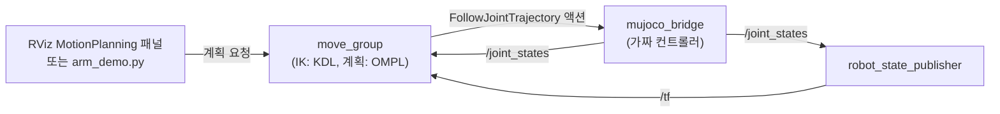

# DAY 2-01 MoveIt 2 양팔 제어 — 팔 동작 계획하고 실행하기

← [이전](day1-06-patrol.md) · [목차·공통 규칙](README.md) · [다음](day2-02-aruco-pick-place.md) →

## 이 장의 미션

> RViz2의 MotionPlanning 패널에서 **오른팔 손끝을 마우스로 끌어 목표를 정하고, 계획(Plan) → 실행(Execute)** 한다.
> 그다음 Python 데모(`arm_demo`)로 이름 자세 · 관절 목표 · 손끝 자세 목표 · 직선 경로 네 가지 방법을 모두 실행해 본다.

## 이 장에 나오는 용어

- **MoveIt 2** — ROS 2 로봇 팔 동작 계획 프레임워크 (IK, 충돌 없는 경로, 실행)
- **IK** (Inverse Kinematics, 역기구학) — 원하는 손끝 위치 → 관절 각도 계산. 반대는 **FK** (Forward Kinematics, 정기구학)
- **SRDF** (Semantic Robot Description Format, 의미 로봇 설명 형식) — MoveIt용 추가 정보: 팔 그룹, 이름 자세, 충돌 검사 제외 쌍
- **OMPL** (Open Motion Planning Library, 공개 동작 계획 라이브러리) — 충돌 없는 관절 경로를 찾는 알고리즘 모음 (RRTConnect)
- **KDL** (Kinematics and Dynamics Library, 기구학·동역학 라이브러리) — IK 계산에 쓰는 라이브러리
- **TCP** (Tool Center Point, 도구 중심점) — 그리퍼 끝 기준점 (`openarm_*_hand_tcp`)
- **Cartesian path** (직교 좌표 경로) — 손끝을 공간에서 직선으로 움직이는 경로
- **planning scene** (계획 장면) — MoveIt이 아는 주변 물체(작업대·상자). 충돌 검사에 사용

전체 목록은 [용어집](../glossary.md)에 있습니다.

## 1. 개념

### 왜 MoveIt이 필요한가?

01-02장에서는 관절 7개의 각도를 직접 적어 팔을 움직였습니다. 하지만 실제로 원하는 것은 "**손을 저기 상자 위로**"입니다. 이를 위해 세 가지 계산이 필요합니다.

1. **역기구학(IK, Inverse Kinematics)**: 원하는 손끝 위치·방향 → 관절 각도 7개
2. **충돌 없는 경로 계획(motion planning)**: 지금 자세에서 목표 자세까지, 몸·다른 팔·작업대에 부딪히지 않는 관절 경로 찾기
3. **궤적 만들기**: 속도·가속도 한계를 지키는 시간표 붙이기

**MoveIt 2** 는 이것을 해 주는 ROS 2 팔 동작 계획 프레임워크입니다.

### MoveIt 구성 요소 (이 로봇 설정)

| 요소 | 이 실습의 값 | 파일 |
|---|---|---|
| **계획 그룹(planning group)**: 같이 움직일 관절 묶음 | `left_arm`, `right_arm`(각 7관절, `link0` → `hand_tcp`), `both_arms`, `left_gripper`, `right_gripper` | `config/mobile_openarm.srdf` |
| **이름 자세(named state)** | `home`(팔 내림), `ready`(작업 준비), `carry`(물건 들고 이동: 손이 몸 쪽 footprint 안), `hands_up` | 같은 SRDF |
| **자기충돌 제외 쌍** | 원래 붙어 있어 늘 닿는 부품 쌍은 검사 안 함 (233쌍) | 같은 SRDF (`tools/make_srdf.py` 가 MuJoCo로 3,000개 자세를 샘플링해 만듦) |
| **IK 풀이기** | KDL(Kinematics and Dynamics Library) | `config/kinematics.yaml` |
| **경로 계획기** | OMPL(Open Motion Planning Library)의 RRTConnect | `config/ompl_planning.yaml` |
| **관절 속도·가속도 한계** | | `config/joint_limits.yaml` |
| **실행 컨트롤러** | `left/right_joint_trajectory_controller`, `left/right_gripper_controller` (02장의 브리지 액션) | `config/moveit_controllers.yaml` |

**SRDF(Semantic Robot Description Format)** 는 URDF에 MoveIt용 정보(그룹, 이름 자세, 충돌 제외)를 덧붙인 파일입니다.

### 계획 장면(planning scene)

MoveIt은 로봇 주변 물체를 **계획 장면**으로 알고 있어야 피해 갑니다. DAY 2-02부터 작업대·상자를 장면에 넣습니다. 이 장에서는 로봇 자신만 있습니다.

## 2. 이 장의 전체 구조



## 3. 실제로 실행되는 소스

| 순서 | 파일 | 하는 일 |
|---|---|---|
| 1 | `mobile_openarm/src/mobile_openarm_sim/launch/sim.launch.py` | 시뮬레이터 + 브리지 (02장과 같음) |
| 2 | `mobile_openarm/src/mobile_openarm_moveit_config/launch/move_group.launch.py` | `MoveItConfigsBuilder` 로 URDF·SRDF·kinematics·joint_limits·controllers·OMPL 설정을 모아 **move_group** 노드 실행. `rviz:=true`(기본)면 `config/moveit.rviz` 로 RViz 실행 |
| 3 | `mobile_openarm/src/mobile_openarm_apps/mobile_openarm_apps/arm_demo.py` | 아래 단계 4의 순서대로 팔을 움직이는 데모 |
| 3-1 | `mobile_openarm/src/mobile_openarm_apps/mobile_openarm_apps/robot_skills.py` | arm_demo가 쓰는 공용 기능 클래스 `RobotSkills`. 팔 관련 함수: `move_named()`(이름 자세), `move_joints()`(관절 목표), `compute_ik()`, `move_pose()`(손끝 목표), `cartesian()`(직선 경로), `open_gripper()`/`close_gripper()`. 내부에서 move_group의 `move_action` 액션(계획+실행), `compute_ik`·`compute_cartesian_path`·`apply_planning_scene` 서비스, `execute_trajectory` 액션을 호출 |

## 4. 따라하기

### 단계 1 — T1: 시뮬레이터 켜기

```bash
ros2 launch mobile_openarm_sim sim.launch.py rviz:=false
```

`rviz:=false`: MoveIt용 RViz를 따로 띄우므로 시뮬 쪽 RViz는 끕니다(메모리 절약).

### 단계 2 — T2: MoveIt(move_group) + RViz 켜기

```bash
ros2 launch mobile_openarm_moveit_config move_group.launch.py
```

**명령 풀이:** `mobile_openarm_moveit_config` 는 휠형 로봇의 MoveIt 설정 패키지, `move_group.launch.py` 는 팔 계획·실행 요청을 처리하는 서버(move_group)와 RViz 를 시작합니다. `rviz:=false` 를 붙이면 창만 끄고 서버는 그대로 동작합니다. 이 명령만으로 팔이 움직이지는 않으며, 앱이 목표를 보내야 계획·실행합니다.

- **언제**: T1의 MuJoCo 창이 뜬 뒤.
- **확인**: T2 로그에 `You can start planning now!`. RViz에 로봇과 왼쪽 아래 **MotionPlanning** 패널이 보입니다.

### 단계 3 — RViz에서 손으로 계획하기

1. MotionPlanning 패널 → **Planning** 탭 → **Planning Group** 을 `right_arm` 으로 고릅니다.
2. 오른손 끝에 **파란 공·화살표(인터랙티브 마커)** 가 나타납니다. 공을 드래그하면 손 위치, 색 고리를 드래그하면 손 방향이 바뀝니다. 주황색 반투명 팔이 **목표 자세**입니다. 팔이 빨갛게 변하면 IK 해가 없거나 충돌하는 자세입니다.
3. **Plan** 을 누르면 지금 자세 → 목표 자세 경로가 애니메이션으로 보입니다.
4. **Execute** 를 누르면 MuJoCo 창의 팔이 실제로 움직입니다. (**Plan & Execute** 는 둘을 한 번에.)
5. **Goal State** 드롭다운에서 `ready`, `hands_up`, `home` 같은 이름 자세를 골라 Plan & Execute 해 보세요.
6. Planning Group 을 `both_arms` 로 바꾸고 Goal State `hands_up` → 양팔이 동시에 움직입니다.

### 단계 4 — T3: Python 데모 실행

```bash
ros2 run mobile_openarm_apps arm_demo
```

**명령 풀이:** `arm_demo` 는 팔 시험 프로그램의 등록된 실행 이름이며 추가 입력값은 없습니다. 프로그램 안에 정의된 이름 자세·손끝 목표를 T2 의 MoveIt 에 차례로 요청합니다. RViz 의 계획 결과와 MuJoCo 의 실제 팔 움직임을 함께 보세요. **계획 성공 로그만으로 실행까지 성공했다고 판단하지 마세요.**

`arm_demo.py` 가 하는 일과 화면:

| 순서 | 코드 | 방법 | 보이는 동작 |
|---|---|---|---|
| 1 | `move_named("both_arms", "ready" → "hands_up" → "home")` | **이름 자세** | 양팔이 준비 → 만세 → 내림 |
| 2 | `move_joints("right_arm", {… joint4: 1.2})` | **관절 목표** | 오른팔 팔꿈치만 1.2 rad 굽힘 |
| 3 | `move_pose(side, [0.50, ∓0.15, 0.95], 30° 숙인 방향)` | **손끝 자세 목표** (IK → 계획) | 손끝이 몸 앞 50 cm, 높이 95 cm로 |
| 4 | `cartesian(side, [아래 10 cm])` → `cartesian(side, [원위치])` | **직선 경로** | 손끝이 똑바로 10 cm 내려갔다 올라옴 |
| 5 | 3~4를 왼팔도 반복 후 `home` | | |
| 6 | `open_gripper("right")` / `close_gripper("right")` | 그리퍼 | 오른손 손가락 열고 닫기 |

T3에 단계마다 로그(`관절 목표: …`, `pose goal: …`, `직선 이동: …`)가 찍히고 마지막에 `arm_demo 완료`.

좌표 `[0.50, -0.15, 0.95]` 는 **`base_footprint` 기준**(로봇 바닥 중심, 앞 = +x, 왼쪽 = +y, 위 = +z)입니다.

### 단계 5 — 미션: 손끝 목표 바꾸기

`arm_demo.py` 를 복사해 내 프로그램을 만들어 봅니다.

```bash
cd ~/openarm_mobile_ws/mobile_openarm/src/mobile_openarm_apps/mobile_openarm_apps
cp arm_demo.py my_arm.py
```

`my_arm.py` 에서 `p = np.array([0.50, y, 0.95])` 를 `[0.45, y, 1.10]`(조금 가깝고 높게)으로 바꾸고, 직선 이동을 아래 10 cm 대신 **앞으로 10 cm**(`p + [0.10, 0, 0]`)로 바꿉니다. 실행:

```bash
cd ~/openarm_mobile_ws
python3 -m mobile_openarm_apps.my_arm          # 패키지 폴더 기준으로 import 되도록 -m 사용
```

`--symlink-install` 로 빌드했으므로 `src` 의 파일이 그대로 쓰입니다. (`ros2 run` 으로 부르고 싶으면 `setup.py` 의 `console_scripts` 에 등록하고 다시 빌드해야 합니다.)

## 5. 미션 체크리스트

- [ ] RViz에서 인터랙티브 마커를 끌어 Plan → Execute 했다
- [ ] Goal State로 `hands_up` 을 양팔(`both_arms`)로 실행했다
- [ ] `arm_demo` 가 `arm_demo 완료` 까지 실행됐다
- [ ] 손끝 목표·직선 방향을 바꾼 내 프로그램을 실행했다

## 6. 확인 질문

1. 원하는 손끝 위치에서 관절 각도를 구하는 계산은? → 역기구학(IK)
2. `carry` 자세를 따로 둔 이유는? → 물건을 들고 주행할 때 손이 로봇 바닥 윤곽(footprint) 안에 있어야 벽·사람에 안 부딪힘
3. Plan 결과가 MuJoCo에서 실행되는 경로는? → move_group → FollowJointTrajectory 액션 → mujoco_bridge

## 7. 잘 안 될 때

| 증상 | 해결 |
|---|---|
| `Unable to identify any set of controllers` | T1(브리지)이 꺼져 있음. `ros2 action list` 에 `*_joint_trajectory_controller/...` 가 있어야 함 |
| Plan이 `No IK solution` / 빨간 팔 | 손이 닿지 않는 곳. 몸 앞 0.3~0.6 m, 높이 0.8~1.2 m 정도로 |
| `START_STATE_INVALID` | 팔이 관절 한계에 걸림. RViz Goal State `home` 으로 먼저 이동 |
| RViz 패널이 안 보임 | RViz 메뉴 Panels → MotionPlanning 체크 |

## 8. 더 해보기

- MotionPlanning 패널 **Scene Objects** 탭에서 상자(Box)를 추가해 팔 경로 사이에 두고 Plan → 상자를 돌아가는 경로가 나오는지
- **Planning** 탭의 Velocity/Acceleration Scaling 을 0.1과 1.0으로 바꿔 속도 비교
