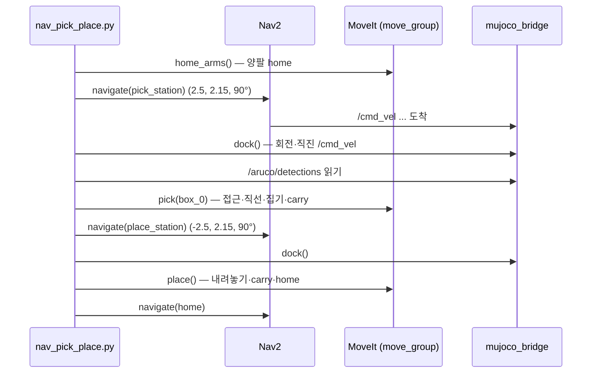

# DAY 2-03 Nav + Pick & Place — 주행과 조작 연결하기 (이동 조작)

← [이전](day2-02-aruco-pick-place.md) · [목차·공통 규칙](README.md) · [다음](day2-04-llm-planner.md) →

## 이 장의 미션

> home에서 출발해 **작업대 A로 자율주행 → 빨간 상자 집기 → 작업대 B로 운반 → 내려놓기 → home 복귀** 를 한 번에 해낸다.

이처럼 바퀴로 이동하면서 팔로 일하는 것을 **이동 조작(mobile manipulation)** 이라고 합니다.

## 이 장에 나오는 용어

- **pick & place** (집어서 놓기), **grasp** (파지, 손으로 잡기), **docking** (도킹, 작업대 앞에 정확히 붙기)
- **Nav2** (Navigation 2) — ROS 2 자율주행 패키지 모음: 경로 계획, 장애물 회피, 위치 추정, 복구
- **AMCL** (Adaptive Monte Carlo Localization, 적응형 몬테카를로 위치추정) — 이미 있는 지도 위에서 위치 후보(파티클) 수백 개로 위치를 추정
- **costmap** (비용 지도) — 벽 가까울수록 비싸게 칠한 지도. Nav2가 이것으로 경로를 짬. **inflation(팽창)** 은 벽 주변 위험 영역 넓히기
- **TF** (Transform, 좌표 변환 / ROS 패키지 tf2) — 좌표계 사이 위치·방향 관계를 시간과 함께 알려 주는 ROS 시스템
- **MoveIt 2** — ROS 2 로봇 팔 동작 계획 프레임워크 (IK, 충돌 없는 경로, 실행)

전체 목록은 [용어집](../glossary.md)에 있습니다.

## 1. 개념

### 주행 ↔ 조작 전환에서 생기는 문제와 해결

DAY 1(주행)과 DAY 2-02(조작)를 이어 붙이기만 하면 잘 안 됩니다. 이 장의 핵심은 **둘 사이의 이음새**입니다.

| 문제 | 해결 (`robot_skills.py`) |
|---|---|
| 팔을 벌린 채 달리면 벽·사람에 부딪힘. Nav2의 footprint는 바닥 사각형만 앎 | 주행 전에 `home_arms()`: 빈손은 `home`, 물건을 들었으면 `carry` (손이 footprint 안) |
| Nav2(AMCL) 위치 오차가 ±5 cm. 작업대에 너무 가까이 목표를 주면 Nav2가 비용 지도 팽창 영역 안이라 도착을 못 함 | 스테이션을 작업대 **0.70 m 앞**에 두고 Nav2는 거기까지만. 이후 **도킹** `dock()`: ① 작업대와 정면이 되게 제자리 회전 `rotate_base()` ② 앞 모서리까지 0.40 m가 되게 직진 `nudge_base()` (오도메트리 TF로 거리 확인하며) |
| 도킹 후에도 남는 오차 | 집기 직전 **카메라로 잰 상자 거리**로 한 번 더 미세 이동 (`IDEAL_REACH = 0.52 m`) — 지도 대신 눈을 믿음 |
| 출발할 때 작업대에 붙어 있으면 회전하다 부딪힘 | `navigate()` 시작 시 작업대에서 0.7 m까지 뒤로 빠진 뒤 출발 |
| MoveIt 계획 장면의 작업대는 로봇 기준 좌표라 주행 후엔 위치가 바뀜 | 조작 직전마다 현재 TF(`map → base_footprint`)로 작업대·상자를 다시 넣음 `set_table()`, 주행 전 `clear_table()` |
| 주행이 실패할 수 있음 | `navigate(retries=1)`: 한 번 실패하면 다시 시도 |

### 좌표계 정리

- **Nav2 목표**: `map` 기준 (`locations.yaml` 의 좌표)
- **상자 위치·팔 목표**: `base_footprint` 기준 (로봇이 어디 있든 "내 앞 0.52 m")
- 둘을 잇는 것이 TF `map → odom → base_footprint`

## 2. 이 장의 전체 구조



## 3. 실제로 실행되는 소스

| 순서 | 파일 | 하는 일 |
|---|---|---|
| 1 | `mobile_openarm/src/mobile_openarm_sim/launch/nav.launch.py` | 시뮬 + Nav2 (05장) |
| 2 | `mobile_openarm/src/mobile_openarm_moveit_config/launch/move_group.launch.py` | MoveIt (DAY 2-01) |
| 3 | `mobile_openarm/src/mobile_openarm_apps/mobile_openarm_apps/nav_pick_place.py` | `home_arms()` → `navigate(from)` → `pick(object)` → `navigate(to)` → `place(station=to)` → `navigate("home")` |
| 3-1 | `robot_skills.py` `navigate()` | Nav2 `navigate_to_pose` 액션 호출. 최대 600초, 실패 시 1회 재시도. 출발 전 작업대에서 물러나기 |
| 3-2 | `robot_skills.py` `dock()`, `rotate_base()`, `nudge_base()`, `table_edge_distance()` | 작업대 앞 도킹 |
| 3-3 | `robot_skills.py` `pick()`, `place()` | DAY 2-02와 같음 |

`nav_pick_place` 파라미터:

| 파라미터 | 기본값 | 의미 |
|---|---|---|
| `object` | `box_0` | 운반할 상자 |
| `from_station` | `pick_station` | 집는 작업대 (A, 동쪽) |
| `to_station` | `place_station` | 놓는 작업대 (B, 서쪽) |

## 4. 따라하기

### 단계 1 — T1: 시뮬 + Nav2

```bash
ros2 launch mobile_openarm_sim nav.launch.py
# 저사양: ... world:=world_light.xml rviz:=false
```

`Managed nodes are active` 를 기다립니다. 로봇은 home에 있습니다.

### 단계 2 — T2: MoveIt

```bash
ros2 launch mobile_openarm_moveit_config move_group.launch.py rviz:=false
```

`You can start planning now!` 를 기다립니다.

### 단계 3 — T3: 운반 실행 (미션)

```bash
ros2 run mobile_openarm_apps nav_pick_place --ros-args -p object:=box_0
```

**명령 풀이:** 실행 이름이 `pick_place` 가 아닌 **`nav_pick_place`**(주행 포함)입니다. `-p object:=box_0` 으로 운반할 상자를 고르고, 출발·도착 작업대는 앱 기본값(`from_station`/`to_station`)을 씁니다. T1 의 nav launch 에는 02장의 작업대 시작 좌표를 붙이지 않습니다(home 에서 출발). 같은 시험을 반복하려면 전체를 재시작해 상자 배치를 초기화하세요.

5~10분 걸립니다(PC 속도에 따라). T3 로그에서 단계를 따라가 보세요.

| 로그 | 지금 하는 일 | 보이는 것 |
|---|---|---|
| `[arm] left_arm → 'home'` / `[arm] right_arm → 'home'` | 주행 전 양팔 내리기 | |
| `[nav] → pick_station (2.50, 2.15, 90°)` | Nav2로 작업대 A 앞 0.70 m까지 | RViz 경로, 로봇이 문을 지나 북쪽 방으로 |
| `[nav] 도착: pick_station` | Nav2 목표 도착 | |
| `[base] 제자리 회전 +n°` / `[base] 미세 이동 +0.30 m` | 도킹: 정면 맞추고 0.40 m까지 접근 | 로봇이 천천히 작업대 쪽으로 |
| `[pick] box_0(id 0) @ base […] → right 팔` | 상자 위치 인식, 팔 선택 | |
| `[pick] 보정 후 상자 위치 base […]` | 카메라 기준 미세 이동 (필요할 때만) | 로봇이 몇 cm 앞뒤로 |
| `[arm] right_arm → 'carry'`, `[ik] right 접근 자세 roll=70°` | carry 자세, 접근 자세 IK 풀기 | 오른손이 몸 쪽으로 올라왔다가 상자 뒤 위로 |
| `[pick] 완료: box_0` | 집고 carry 자세 | 오른손이 상자를 들고 몸 쪽으로 |
| `[base] 미세 이동 -0.xx m`, `[nav] → place_station …` | 작업대에서 물러난 뒤 B로 | 상자를 든 채 서쪽으로 |
| `[place] box_0 → base […] (right)` / `[place] 완료: box_0` | 내려놓고 팔 내림 | 작업대 B 위에 빨간 상자 |
| `[nav] → home …`, `nav_pick_place 완료` | 복귀 | |

### 단계 4 — 결과 확인

```bash
ros2 topic echo /sim/objects --once
```

`box_0` 의 world 좌표 x가 −2.5 근처(작업대 B), y가 2.9~3.1이면 성공입니다.

### 단계 5 — 반대로 옮기기 (도전)

상자를 B → A로 되돌려 봅니다. 이번엔 B에 있는 빨간 상자를 집어 A에 놓습니다.

```bash
ros2 run mobile_openarm_apps nav_pick_place --ros-args \
  -p object:=box_0 -p from_station:=place_station -p to_station:=pick_station
```

## 5. 미션 체크리스트

- [ ] 빨간 상자를 A에서 B로 옮기고 home으로 돌아왔다 (`nav_pick_place 완료`)
- [ ] `/sim/objects` 로 상자가 작업대 B 위에 있음을 확인했다
- [ ] 로그에서 "도킹"과 "보정 후 상자 위치" 단계를 찾아 무슨 일을 하는지 설명할 수 있다

## 6. 확인 질문

1. Nav2 목표를 작업대 바로 앞이 아니라 0.70 m 앞에 둔 이유는? → 비용 지도 팽창 영역 밖이라 Nav2가 확실히 도착할 수 있도록. 마지막 접근은 도킹으로
2. 운반 중 팔을 `carry` 자세로 하는 이유는? → 손이 로봇 바닥 윤곽 안에 있어야 Nav2의 충돌 검사가 맞음
3. AMCL 오차를 마지막에 없애는 방법은? → 카메라로 잰 상자 거리로 미세 이동

## 7. 잘 안 될 때

| 증상 | 해결 |
|---|---|
| `[nav] … 실패` 두 번 | 사람이 길을 막음 → `ros2 service call /sim/set_person_motion std_srvs/srv/SetBool "{data: false}"` |
| 도킹 후 `No IK solution` | AMCL 위치가 많이 틀림. RViz `2D Pose Estimate` 로 맞추고 다시 |
| 중간에 멈추고 싶음 | T3 Ctrl+C. 상자를 들고 있으면 `ros2 service call /sim/reset std_srvs/srv/Trigger` 후 T1부터 재시작 |

## 8. 더 해보기

- `robot_skills.py` 의 `DOCK_GAP = 0.40` 을 0.45로 바꾸고(빌드 불필요, `--symlink-install`) 집기 성공률이 어떻게 바뀌는지
- 파란 상자(`box_2`)로 운반 — 가장 바깥쪽이라 보정 이동이 더 큼
