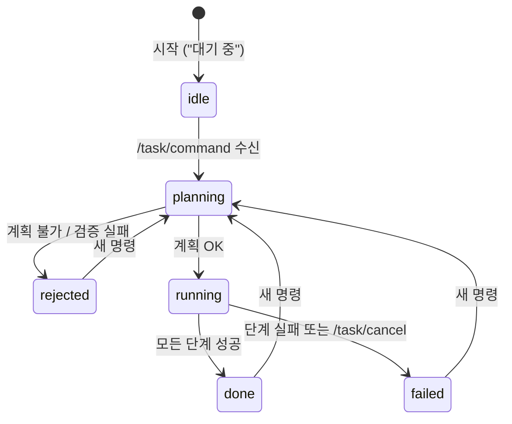

# DAY 2-05 LLM → ROS 2 작업 실행 — Task Manager

← [이전](day2-04-llm-planner.md) · [목차·공통 규칙](README.md) · [다음](day2-06-dashboard.md) →

## 이 장의 미션

> 터미널에서 **자연어 명령을 ROS 2 토픽으로 보내면**, Task Manager 노드가 계획(04장) → 검증 → **실제 주행·집기·놓기(DAY 1-05, DAY 2-03)** 를 차례로 실행하고,
> 진행 상황을 상태 토픽으로 알려 주게 한다. 실행 중 **취소**도 해 본다.

## 이 장에 나오는 용어

- **상태 기계(state machine)** — idle → planning → running → done/failed 처럼 정해진 상태 사이를 옮겨 가는 구조
- **토픽(topic) / 서비스(service) / 액션(action)** — ROS 2 통신 3종류: 계속 흘려보내기 / 한 번 묻고 답 받기 / 오래 걸리는 일 맡기고 진행 상황·결과 받기
- **LLM** (Large Language Model, 대규모 언어 모델) — GPT 같은 언어 AI
- **JSON** (JavaScript Object Notation) — `{"이름": 값}` 형태의 데이터 텍스트

전체 목록은 [용어집](../glossary.md)에 있습니다.

## 1. 개념

### Task Manager가 하는 일

04장의 계획기는 **글자로 된 계획**만 만듭니다. Task Manager는 그 계획을 **로봇 기능 호출로 바꿔 실행**하는 관리자입니다.



| 계획의 행동 | 실제 호출 (`robot_skills.py`) | 쓰이는 ROS 2 기능 |
|---|---|---|
| `navigate(location)` | `sk.navigate(loc)` | Nav2 `navigate_to_pose` 액션 |
| `pick(object)` | `sk.pick(obj)` | 도킹(`/cmd_vel`), `/aruco/detections`, MoveIt |
| `place(location)` | `sk.place(station)` | 도킹, MoveIt |
| `home_arms` | `sk.home_arms()` | MoveIt |
| `say(text)` | `sk.log("[say] …")` | `/task/log` 토픽 |
| `wait(seconds)` | `time.sleep()` | — |

### ROS 2 인터페이스

| 이름 | 종류 | 형식 | 방향 | 의미 |
|---|---|---|---|---|
| `/task/command` | 토픽 | std_msgs/String | → Task Manager | 자연어 명령 |
| `/task/status` | 토픽 | std_msgs/String (JSON) | Task Manager → | 상태: `state`, `command`, `steps`(단계별 `pending`/`running`/`done`/`failed`), `current`, `message`, `warnings`, `planner`, `history` (1초마다 + 바뀔 때) |
| `/task/log` | 토픽 | std_msgs/String | → | 스킬 로그 한 줄씩 (`[nav] …`, `[pick] …`) |
| `/task/cancel` | 서비스 | std_srvs/Trigger | → Task Manager | 실행 중인 작업 취소 |

### 안전 장치

- 실행 중에 새 명령이 오면 **무시**합니다(먼저 취소해야 함). 두 작업이 팔을 동시에 쓰는 일을 막습니다.
- 계획은 실행 **전에** `validate_plan()` 으로 검사합니다. 현재 위치(`self.location`)를 출발점으로 넣어 검사합니다.
- LLM 호출이 실패하면(`fallback_offline: true`) 오프라인 계획기로 넘어갑니다.

## 2. 실제로 실행되는 소스

| 순서 | 파일 | 하는 일 |
|---|---|---|
| 1 | `nav.launch.py` | 시뮬 + Nav2 |
| 2 | `move_group.launch.py` | MoveIt |
| 3 | `mobile_openarm/src/mobile_openarm_apps/mobile_openarm_apps/task_manager.py` | `TaskManager` 클래스: `/task/command` 를 받으면 `on_command()` → 별도 스레드에서 `run()`: `make_plan()`(llm 또는 offline) → `validate_plan()` → 단계마다 `execute()` → 상태 `set()` 발행 |
| 3-1 | `llm_planner.py` | 04장의 `plan_with_llm()`, `plan_offline()`, `validate_plan()` |
| 3-2 | `robot_skills.py` | 03장까지 쓴 기능 전부 |

파라미터:

| 파라미터 | 기본값 | 의미 |
|---|---|---|
| `planner` | `llm` | `llm` 또는 `offline` |
| `model` | `""` | 비우면 환경 변수 `OPENAI_MODEL` |
| `fallback_offline` | `true` | LLM 실패 시 오프라인 계획 사용 |

## 3. 따라하기

### 단계 1 — T1, T2: 시뮬 + Nav2, MoveIt

```bash
# T1
ros2 launch mobile_openarm_sim nav.launch.py
# T2 (T1 준비 후)
ros2 launch mobile_openarm_moveit_config move_group.launch.py rviz:=false
```

### 단계 2 — T3: Task Manager 켜기

```bash
ros2 run mobile_openarm_apps task_manager --ros-args -p planner:=offline
# API 키가 있으면: export OPENAI_API_KEY=... 후 -p planner:=llm
```

**명령 풀이:** `task_manager` 는 자연어 명령을 기다렸다가 계획·검증·단계별 실행을 관리합니다. `--ros-args -p planner:=offline` 은 관리자 노드의 `planner` 파라미터를 규칙 기반으로 설정합니다. 04장 계획기의 `--offline` 과 목적은 같지만 서로 다른 프로그램이라 문법이 다릅니다. 준비 로그가 나올 때까지 기다리세요. 앞 장 운반으로 상자가 옮겨진 상태라면 T1·T2 를 재시작해 배치를 초기화합니다.

`task_manager 준비 완료 — /task/command 로 자연어 명령을 보내세요` 가 나오면 준비 완료. 이 터미널은 계속 로그를 보여 줍니다.

### 단계 3 — T4: 상태 지켜보기

```bash
ros2 topic echo /task/status --field data
```

**명령 풀이:** `--field data` 는 메시지 전체 대신 `data` 필드(JSON 상태 문자열)만 출력합니다. `--once` 가 없으므로 계속 출력하며 `idle` → `planning` → `running` → `done`/`failed` 변화를 관찰합니다. 이 터미널은 유지하세요.

1초마다 JSON이 나옵니다. 처음엔 `"state": "idle"`.

### 단계 4 — T5: 명령 보내기 (미션)

```bash
ros2 topic pub --once /task/command std_msgs/msg/String "{data: '빨간 상자를 왼쪽 작업대로 옮기고 돌아와'}"
```

**명령 풀이**

- `ros2 topic pub`: 토픽으로 메시지를 보냅니다. `--once` 는 한 번만 발행합니다.
- `/task/command`: 명령을 받는 토픽, `std_msgs/msg/String`: 문자열 필드 `data` 하나를 가진 메시지 타입입니다.
- `"{data: '...'}"`: 메시지 내용(YAML). `data` 가 필드 이름, 작은따옴표 안 문장이 값이며 바깥 큰따옴표는 전체를 셸 입력 하나로 묶습니다.

발행 명령이 끝나도 작업은 관리자가 계속 실행합니다. T4 의 최종 `done` 과 실제 상자 위치·로봇 복귀를 확인하고, 실패했다면 어느 단계에서 무슨 이유로 실패했는지 기록합니다.

| 부분 | 의미 |
|---|---|
| `ros2 topic pub --once` | 메시지 한 번만 보내기 |
| `std_msgs/msg/String` | 문자열 메시지 형식 |
| `"{data: '...'}"` | 메시지 내용 (YAML 형식). 바깥 큰따옴표, 안쪽 작은따옴표 |

**관찰**: T4의 `state` 가 `planning` → `running` 으로, `steps` 의 `status` 가 하나씩 `running` → `done` 으로 바뀝니다. T3에는 `[task] 계획(offline): …`, `[nav] …`, `[pick] …` 로그. 5단계 모두 끝나면 `"state": "done", "message": "완료 (590s)"` 처럼 걸린 시간이 나옵니다(PC에 따라 다름).

### 단계 5 — 거부되는 명령

```bash
ros2 topic pub --once /task/command std_msgs/msg/String "{data: '커피 한 잔 타줘'}"
```

T4에 `"state": "rejected"` 와 이유. 로봇은 움직이지 않습니다.

### 단계 6 — 취소해 보기

```bash
ros2 topic pub --once /task/command std_msgs/msg/String "{data: '순찰 한 바퀴 돌고 와'}"
# 로봇이 움직이기 시작하면
ros2 service call /task/cancel std_srvs/srv/Trigger
```

**`/task/cancel` 풀이:** `ros2 service call` 은 한 번 요청하고 응답을 받습니다. `std_srvs/srv/Trigger` 는 요청 필드가 없는 타입이라 뒤에 입력값이 없습니다. 취소는 **현재 단계가 끝난 뒤 적용되며 비상정지가 아닙니다.** 응답이 왔다고 주행이나 팔이 즉시 멈췄다고 판단하지 마세요.

취소는 **지금 단계가 끝난 뒤 다음 단계로 넘어갈 때** 적용됩니다(`사용자 취소` → `state: failed`). 주행 중이면 그 목표까지는 갈 수 있습니다.

### 주의: 상자 위치

계획기는 "상자는 처음에 모두 작업대 A에 있다"고 가정합니다. 빨간 상자를 B로 옮긴 뒤 다시 "빨간 상자 옮겨"를 보내면 A에서 마커를 못 찾아 실패합니다. 다시 하려면 T1부터 재시작하거나 `ros2 service call /sim/reset std_srvs/srv/Trigger`(로봇도 home으로 돌아감, Nav2 위치가 어긋나면 RViz `2D Pose Estimate`)를 쓰세요.

## 4. 미션 체크리스트

- [ ] `/task/command` 로 운반 명령을 보내 `state: done` 까지 확인했다
- [ ] 불가능한 명령이 `rejected` 됐다
- [ ] `/task/cancel` 로 작업을 취소했다
- [ ] (키가 있으면) `planner:=llm` 으로 "파란 상자를 서쪽 작업대에 갖다 놔" 를 실행했다

## 5. 확인 질문

1. Task Manager가 실행 중 새 명령을 무시하는 이유는? → 두 작업이 같은 팔·바퀴를 동시에 쓰지 않도록
2. 계획의 `navigate` 는 실제로 어떤 ROS 2 기능을 부르나? → Nav2의 `navigate_to_pose` 액션
3. LLM이 응답하지 않으면? → `fallback_offline` 이 켜져 있으면 오프라인 계획으로 계속

## 6. 잘 안 될 때

| 증상 | 해결 |
|---|---|
| 명령을 보내도 반응 없음 | T3 Task Manager가 켜져 있는지, `ros2 topic info /task/command` 에 구독자 1 |
| `이미 작업 실행 중 — 무시` | 이전 작업 진행 중. 끝나길 기다리거나 `/task/cancel` |
| `state: failed`, `[pick] … 파지 실패` | 03장 문제 해결 참고, 리셋 후 재시도 |
| 한글이 `\\uXXXX` 로 보임 | `--field data` 대신 그대로 보거나 대시보드(06장) 사용 |

## 7. 더 해보기

- `task_manager.py` 의 `execute()` 에 새 행동 `look`(보이는 마커를 `say`)을 추가하고, `llm_planner.py` 의 `Step.action` Literal과 `SYSTEM_PROMPT` 에도 넣어 보기 (스키마·검증·실행 세 곳을 함께 고쳐야 함을 경험)
